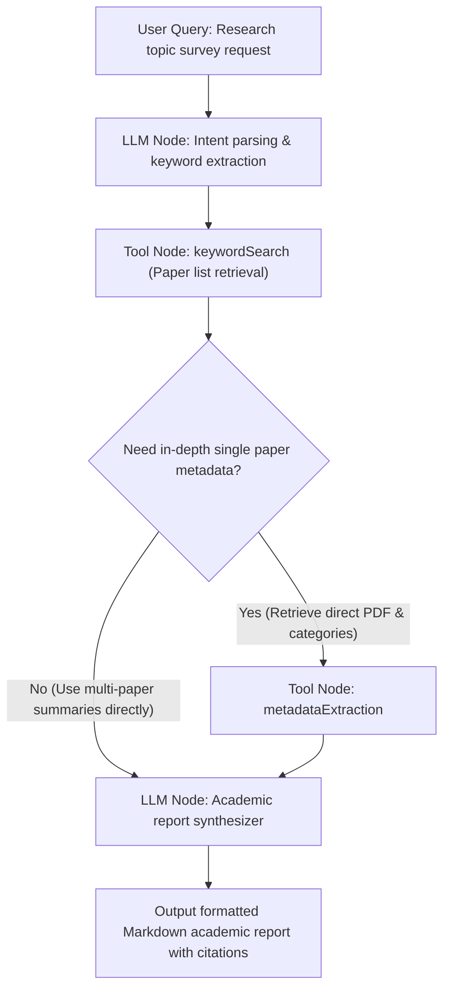

# ArXiv Tools Suite

The ArXiv Tools Suite is a dedicated academic literature retrieval and metadata extraction suite for FastGPT. Seamlessly integrating the open archive API maintained by Cornell University, this tool suite offers keyword search, author paper retrieval, precise ArXiv ID lookup, clean abstract extraction, and comprehensive metadata parsing with direct PDF links. It empowers Large Language Models (LLMs) and AI agents with authoritative, real-time academic frontier tracking and literature review capabilities.

---

## Core Advantages & Use Cases

### Core Advantages

- **No API Key & Zero Configuration**: Built directly on top of the official ArXiv open API. No account registration, API key generation, or credit card binding is required—ready to use out of the box.
- **End-to-End Academic Coverage**: Spans macro-level exploration (keyword search, author publications), micro-level deep reading (ID-based lookup, cleaned abstract extraction), and downstream archival & retrieval (direct PDF download links, categories, and DOI metadata).
- **Optimized for LLMs**: Features built-in text normalization and whitespace cleaning to strip chaotic XML linebreaks and redundant tags, delivering dense, well-structured text that saves prompt tokens.
- **Format-Tolerant ArXiv ID Parsing**: Intelligently handles diverse ArXiv ID input representations, including raw identifiers (e.g. `2301.00001`), prefixed identifiers (e.g. `arXiv:2301.00001`), and full canonical URLs (e.g. `https://arxiv.org/abs/2301.00001`), mitigating formatting errors.
- **Flexible Sorting & Result Sizing**: Supports multi-dimensional sorting by relevance (`relevance`), submission date (`submittedDate`), or last update date (`lastUpdatedDate`), alongside configurable result limits (1–50) to balance coverage and latency.

### Use Cases

- **Academic Research Assistant & AI Agents**: Build AI research companions for students, scholars, and engineers to automatically discover conference and journal preprints, synthesize methodologies, and summarize contributions.
- **Literature Review & Topic Surveys**: Aggregate seminal and state-of-the-art papers across specific technical subjects, chronologically tracking methodological evolution to assemble draft literature surveys.
- **Frontier Technology Tracking & Daily Digests**: Monitor breakthroughs across AI, quantitative finance, quantum computing, and computational biology, automatically curating and highlighting notable papers.
- **RAG Knowledge Base & Factual Grounding**: Dynamically ground conversational workflows with peer-accessible preprints, persistent DOI identifiers, and official PDF links to suppress hallucinations.

---

## Key-Free Feature

This plugin is powered by the public **ArXiv API** (`http://export.arxiv.org/api/query`).

- **No Secret Configuration Required**: When importing or invoking this plugin in FastGPT, you do not need to fill in any API keys under the plugin "Secrets" configuration.
- **Open & Transparent**: Data is sourced directly from the ArXiv official open repository under non-commercial open access guidelines.

---

## Child Tools Overview

This tool suite consists of 5 dedicated child tools:

| Tool ID | Tool Name | Description |
| :--- | :--- | :--- |
| `keywordSearch` | ArXiv Paper Search | Search papers across all disciplines by keywords with customizable result limits and sorting |
| `arxivIDSearch` | ArXiv ID Paper Search | Perform exact lookup for a single paper by its ArXiv ID to retrieve basic details and summary |
| `authorSearch` | ArXiv Author Paper Search | Search papers authored by a specific researcher, with support for date sorting and result limits |
| `abstractExtraction` | ArXiv Abstract Extraction | Extract cleaned, standardized paper abstracts by ArXiv ID, tailored for LLM prompt contexts |
| `metadataExtraction` | ArXiv Metadata Extraction | Extract complete paper metadata including categories, version, DOI, journal ref, and direct PDF download links |

---

## Parameter & Output Specifications

### 1. Keyword Paper Search (`keywordSearch`)

Searches the entire ArXiv preprint repository for matching keywords, supporting sorting by relevance, submission date, or update date.

#### Input Parameters

| Parameter | Type | Required | Default | Description |
| :--- | :--- | :--- | :--- | :--- |
| `keyword` | `string` | Yes | None | **Search keyword**. Academic term or keyword combination, e.g., `large language model`, `diffusion models`, `quantum computing`. |
| `maxResults` | `number` | No | `5` | **Maximum result count**. Permitted range is `1` to `50`. |
| `sortBy` | `string` | No | `relevance` | **Sort order**. Options:<br>• `relevance`: Sort by query relevance (default)<br>• `lastUpdatedDate`: Sort by last updated date<br>• `submittedDate`: Sort by initial submission date |

#### Output Results

| Field | Type | Description |
| :--- | :--- | :--- |
| `papers` | `Array<Object>` | Array of retrieved paper records. Returns `[]` if no papers match. |

**`papers` Array Item Structure:**

| Field | Type | Description |
| :--- | :--- | :--- |
| `title` | `string` | Paper title. |
| `authors` | `Array<string>` | List of author names. |
| `summary` | `string` | Paper abstract text. |
| `link` | `string` | Web link to the paper on ArXiv. |
| `published` | `string` | Initial publication timestamp (ISO 8601 format, e.g. `2023-03-15T17:58:00Z`). |

#### Example Response

```json
{
  "papers": [
    {
      "title": "Attention Is All You Need",
      "authors": [
        "Ashish Vaswani",
        "Noam Shazeer",
        "Niki Parmar",
        "Jakob Uszkoreit",
        "Llion Jones",
        "Aidan N. Gomez",
        "Lukasz Kaiser",
        "Illia Polosukhin"
      ],
      "summary": "The dominant sequence transduction models are based on complex recurrent or convolutional neural networks...",
      "link": "http://arxiv.org/abs/1706.03762v7",
      "published": "2017-06-12T17:57:34Z"
    }
  ]
}
```

---

### 2. ArXiv ID Paper Search (`arxivIDSearch`)

Performs a targeted lookup for a single paper using its ArXiv identifier, retrieving basic metadata including title, author list, summary, and links.

#### Input Parameters

| Parameter | Type | Required | Default | Description |
| :--- | :--- | :--- | :--- | :--- |
| `arxivId` | `string` | Yes | None | **Paper ArXiv ID**. Accepts multiple formats:<br>• Raw ID: `2303.08774`<br>• Prefixed: `arXiv:2303.08774`<br>• URL: `https://arxiv.org/abs/2303.08774` |

#### Output Results

| Field | Type | Description |
| :--- | :--- | :--- |
| `paper` | `Object \| null` | Paper details object; returns `null` if the identifier is not found. |

**`paper` Object Structure:**

| Field | Type | Description |
| :--- | :--- | :--- |
| `arxivId` | `string` | Parsed and normalized ArXiv ID (e.g. `2303.08774`). |
| `title` | `string` | Full paper title. |
| `authors` | `Array<string>` | List of author names. |
| `summary` | `string` | Paper abstract text. |
| `link` | `string` | Canonical ArXiv access link. |
| `published` | `string` | Publication date (ISO 8601 string). |

#### Example Response

```json
{
  "paper": {
    "arxivId": "2303.08774",
    "title": "GPT-4 Technical Report",
    "authors": ["OpenAI"],
    "summary": "We report the development of GPT-4, a large-scale, multimodal model which can accept image and text inputs and produce text outputs...",
    "link": "http://arxiv.org/abs/2303.08774v6",
    "published": "2023-03-15T17:58:00Z"
  }
}
```

---

### 3. Author Paper Search (`authorSearch`)

Retrieves papers published by a specific author on ArXiv, useful for researcher tracking and portfolio inspection.

#### Input Parameters

| Parameter | Type | Required | Default | Description |
| :--- | :--- | :--- | :--- | :--- |
| `author` | `string` | Yes | None | **Author name**. Standard English spelling recommended, e.g., `Yann LeCun`, `Geoffrey Hinton`, `Smith, J`. |
| `maxResults` | `number` | No | `5` | **Maximum result count**. Permitted range is `1` to `50`. |
| `sortBy` | `string` | No | `relevance` | **Sort order**. Options:<br>• `relevance`: Sort by query match relevance<br>• `lastUpdatedDate`: Sort by last updated date<br>• `submittedDate`: Sort by initial submission date |

#### Output Results

| Field | Type | Description |
| :--- | :--- | :--- |
| `papers` | `Array<Object>` | Array of paper records authored by the specified researcher. Returns `[]` if none found. |

**`papers` Array Item Structure:**

| Field | Type | Description |
| :--- | :--- | :--- |
| `title` | `string` | Paper title. |
| `authors` | `Array<string>` | Full list of authors including the target author. |
| `summary` | `string` | Paper abstract. |
| `link` | `string` | Canonical ArXiv web link. |
| `published` | `string` | Initial submission date. |

#### Example Response

```json
{
  "papers": [
    {
      "title": "Deep Learning",
      "authors": ["Yann LeCun", "Yoshua Bengio", "Geoffrey Hinton"],
      "summary": "Deep learning allows computational models that are composed of multiple processing layers to learn representations of data with multiple levels of abstraction...",
      "link": "http://arxiv.org/abs/2106.01234",
      "published": "2021-06-02T10:00:00Z"
    }
  ]
}
```

---

### 4. Abstract Extraction (`abstractExtraction`)

Extracts the abstract for a given ArXiv ID and **cleans redundant line breaks and irregular whitespace**, producing compact natural language text ideal for LLM prompt context injection.

#### Input Parameters

| Parameter | Type | Required | Default | Description |
| :--- | :--- | :--- | :--- | :--- |
| `arxivId` | `string` | Yes | None | **Paper ArXiv ID**. E.g. `2301.00001`, `arXiv:2301.00001`, or canonical URL. |

#### Output Results

| Field | Type | Description |
| :--- | :--- | :--- |
| `abstract` | `Object \| null` | Extracted and normalized abstract object; returns `null` if not found. |

**`abstract` Object Structure:**

| Field | Type | Description |
| :--- | :--- | :--- |
| `arxivId` | `string` | Normalized ArXiv identifier. |
| `title` | `string` | Paper title. |
| `abstract` | `string` | **Normalized abstract text**, free of irregular line breaks and duplicate whitespace. |
| `authors` | `Array<string>` | List of authors. |
| `published` | `string` | Publication date (ISO 8601 string). |
| `link` | `string` | ArXiv article landing page URL. |

#### Example Response

```json
{
  "abstract": {
    "arxivId": "1706.03762",
    "title": "Attention Is All You Need",
    "abstract": "The dominant sequence transduction models are based on complex recurrent or convolutional neural networks that include an encoder and a decoder. The best performing models also connect the encoder and decoder through an attention mechanism. We propose a new simple network architecture, the Transformer, based solely on attention mechanisms, dispensing with recurrence and convolutions entirely...",
    "authors": ["Ashish Vaswani", "Noam Shazeer", "Niki Parmar", "Jakob Uszkoreit"],
    "published": "2017-06-12T17:57:34Z",
    "link": "http://arxiv.org/abs/1706.03762v7"
  }
}
```

---

### 5. Metadata & PDF Extraction (`metadataExtraction`)

Performs in-depth metadata extraction for a paper, including disciplinary categories, revisions, DOI, journal references, author comments, and **direct PDF and LaTeX source download URLs**.

#### Input Parameters

| Parameter | Type | Required | Default | Description |
| :--- | :--- | :--- | :--- | :--- |
| `arxivId` | `string` | Yes | None | **Paper ArXiv ID**. E.g. `2303.08774`, `arXiv:2303.08774`, or canonical URL. |

#### Output Results

| Field | Type | Description |
| :--- | :--- | :--- |
| `metadata` | `Object \| null` | Full paper metadata object; returns `null` if not found. |

**`metadata` Object Structure:**

| Field | Type | Description |
| :--- | :--- | :--- |
| `arxivId` | `string` | Normalized ArXiv ID. |
| `title` | `string` | Cleaned paper title. |
| `authors` | `Array<string>` | List of author names. |
| `abstract` | `string` | Cleaned paper abstract. |
| `categories` | `Array<string>` | Disciplinary subject categories (e.g. `["cs.CL", "cs.AI", "cs.LG"]`). |
| `primaryCategory` | `string` | Primary subject classification (e.g. `cs.CL`). |
| `published` | `string` | Initial submission timestamp. |
| `updated` | `string` | Latest revision timestamp. |
| `version` | `string` | Current revision version (e.g. `"1"`, `"2"`, `"6"`). |
| `doi` | `string` | Digital Object Identifier (empty string if not assigned). |
| `journalRef` | `string` | Publication or conference journal reference (if provided). |
| `comments` | `string` | Author remarks, page counts, or conference acceptance notes (if provided). |
| `links` | `Object` | Object containing canonical landing pages:<br>• `abstract`: Abstract landing page URL<br>• `pdf`: PDF web viewer link<br>• `source`: Source file package URL |
| `downloadUrls` | `Object` | Object containing direct file download links:<br>• `pdf`: **Direct PDF download URL** (e.g. `https://arxiv.org/pdf/2303.08774.pdf`)<br>• `source`: Direct LaTeX source archive download URL<br>• `other`: Array of other download URLs |

#### Example Response

```json
{
  "metadata": {
    "arxivId": "2303.08774",
    "title": "GPT-4 Technical Report",
    "authors": ["OpenAI"],
    "abstract": "We report the development of GPT-4, a large-scale, multimodal model which can accept image and text inputs and produce text outputs...",
    "categories": ["cs.CL", "cs.AI", "cs.LG"],
    "primaryCategory": "cs.CL",
    "published": "2023-03-15T17:58:00Z",
    "updated": "2023-03-27T16:00:00Z",
    "version": "6",
    "doi": "",
    "journalRef": "",
    "comments": "100 pages, 30 figures",
    "links": {
      "abstract": "https://arxiv.org/abs/2303.08774",
      "pdf": "https://arxiv.org/pdf/2303.08774.pdf",
      "source": "https://arxiv.org/src/2303.08774"
    },
    "downloadUrls": {
      "pdf": "https://arxiv.org/pdf/2303.08774.pdf",
      "source": "https://arxiv.org/src/2303.08774",
      "other": []
    }
  }
}
```

---

## Typical Workflow Orchestration Example

In FastGPT Advanced Orchestration, combine the ArXiv Tools Suite with LLM nodes to easily construct an automated **"Academic Paper Intelligence & In-Depth Report Generation"** workflow.

### Workflow Flowchart



### Orchestration Steps

1. **User Query**: The user asks for domain-specific paper research, e.g., *"Please research the 3 latest representative papers on video diffusion models and provide an analytical report."*
2. **Intent Parsing (LLM Node)**: The model extracts refined English academic search terms like `video diffusion models generation`, configuring `maxResults: 3` and `sortBy: "submittedDate"`.
3. **Paper Retrieval (`keywordSearch` Node)**: Queries ArXiv to obtain titles, authors, submission dates, and summaries of the 3 most recent matching papers.
4. **Metadata Augmentation (Optional, `metadataExtraction` Node)**: If direct PDF URLs or disciplinary classifications are required in the report, extract the ArXiv ID of the leading paper and fetch its complete metadata.
5. **Academic Report Synthesis (LLM Node)**: Passes the structured JSON array into an analytical prompt template to generate a professional academic intelligence report.

#### LLM Prompt Template Example

```text
You are a senior academic advisor in Computer Vision and Artificial Intelligence. Based on the following ArXiv research papers, write a comprehensive, professional state-of-the-art literature report for the user.

[Retrieved Paper Data]
{{keywordSearch.papers}}

[Report Guidelines]
1. **Background & Overview**: Summarize the current research trajectory and hot trends in 2-3 concise sentences.
2. **Deep Dive per Paper** (analyze each paper systematically):
   - **Title & Authors**: State the full title, primary authors/institutions, and submission date.
   - **Core Innovation**: Highlight the critical challenge addressed and the novel methodology proposed.
   - **Methodology & Architecture**: Outline key algorithms, architectures, or empirical foundations from the abstract.
   - **Access Links**: Provide the official paper URL and direct PDF link.
3. **Comparative Analysis & Outlook**: Contrast key trade-offs between the approaches and outline future research directions.
4. Maintain an objective, academic tone while preserving standard technical terminology.
```

---

## Important Notes

1. **ArXiv API Rate Limits**:
   - The official ArXiv API guidelines request clients to **rate limit queries to no more than 1 request every 3 seconds** and avoid concurrent multi-connection requests.
   - When configuring batch workflows or loops in FastGPT, avoid rapid consecutive bursts to prevent temporary upstream IP blocks (indicated by HTTP 503 or HTTP 429 status codes).
2. **Network Connectivity & Availability**:
   - This tool suite communicates directly with `http://export.arxiv.org/api/query`. Verify that the hosting environment or plugin Runner container has uninterrupted network access to overseas ArXiv services. If DNS timeouts occur, configure proper network routing or proxies.
3. **Data Freshness & Index Delays**:
   - ArXiv operates on a scheduled daily publication batch cycle (typically weekday evenings US Eastern Time; weekends and holidays excluded). Papers uploaded on the same day become searchable via the API only after ArXiv indexes them in the next publication cycle.
4. **Copyright & Fair Use Notice**:
   - Preprints hosted on ArXiv remain the intellectual property of their respective authors or designated copyright holders. Metadata and download URLs provided by this suite are intended for research, personal study, academic collaboration, and compliant AI-assisted analysis.
