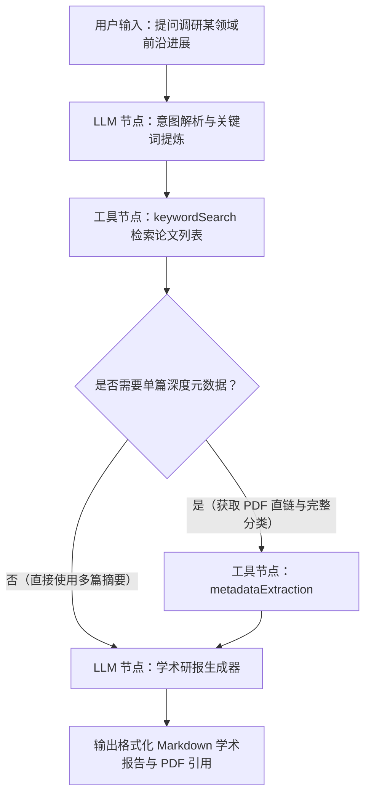

# ArXiv 学术论文工具集 (ArXiv Tools)

ArXiv 学术论文工具集是专为 FastGPT 设计的学术科研文献检索与元数据提取套件（Tool Suite）。该工具集无缝集成了康奈尔大学维护的 ArXiv 开放档案库数据接口，提供关键词检索、作者论文检索、ArXiv ID 精准查询、纯净摘要提取以及包含 PDF 直链的完整元数据解析能力，为大模型与 AI Agent 赋予权威、实时的学术前沿感知与文献综述能力。

---

## 核心优势与应用场景

### 核心优势

- **免 API Key 与零门槛配置**：直接基于 ArXiv 官方开放接口实现，无需注册第三方账号、无需申请 API 密钥或绑定信用卡，真正做到开箱即用。
- **覆盖学术研究全链路**：从前期的宏观领域探索（关键词检索、作者论文库），到中期的单篇精读（ID 检索、纯净摘要提取），再到后期的文献归档与下载（PDF 直链、分类与 DOI 元数据），全面覆盖科研分析流程。
- **专为大语言模型（LLM）优化**：内置文本规范化与空格换行清洗逻辑，自动剥离 XML 原始报文中的冗余标记与杂乱换行符，输出结构干净、语义密集的结构化数据，节约上下文 Token。
- **宽容的 ID 格式自适应**：智能兼容多种格式的 ArXiv 标识输入，包括纯数字版本号（如 `2301.00001`）、标准前缀格式（如 `arXiv:2301.00001`）以及官方 Web 详情链接（如 `https://arxiv.org/abs/2301.00001`），避免因用户输入格式差异导致调用失败。
- **灵活的排序与体量控制**：支持相关度（`relevance`）、提交日期（`submittedDate`）和最后更新日期（`lastUpdatedDate`）多维度排序，支持动态指定返回结果条数（1~50），兼顾检索精度与响应速度。

### 应用场景

- **学术科研助理与 Agent**：构建面向高校师生、科研人员和工程师的 AI 论文研究助手，自动检索目标领域顶会顶刊预印本，快速提炼核心思想与方法创新。
- **论文文献综述与脉络梳理**：针对特定技术课题或前沿方向，批量聚合多篇经典与最新论文，按提交时间演进梳理技术发展历程，生成系统化文献综述草稿。
- **前沿科技跟踪与每日学术速递**：定期监控 AI、量化金融、量子计算、生物医学等特定领域或顶尖学者的最新论文动态，自动筛选高价值论文并输出重点解读摘要。
- **RAG 知识库论文检索与事实依据增强**：在专业问答知识库中实时联动 ArXiv，为大模型生成内容提供权威论文出处、DOI 引用标识和官方 PDF 下载链接，有效遏制模型幻觉。

---

## 免 Key 特性说明

本插件基于公开的 **ArXiv API**（`http://export.arxiv.org/api/query`）构建。

- **无需配置密钥**：在 FastGPT 中导入或使用本插件时，不需要在“密钥（Secrets）”中填写任何 API Key，开箱即用。
- **完全开放透明**：数据直接来源于 ArXiv 官方开放档案库，遵循非商业学术开放获取标准。

---

## 子工具列表

本工具集包含以下 5 个专业子工具：

| 子工具 ID | 子工具名称 | 功能说明 |
| :--- | :--- | :--- |
| `keywordSearch` | ArXiv 论文检索 | 根据关键词搜索相关领域的论文，支持自定义返回数量及排序方式（相关度/时间） |
| `arxivIDSearch` | ArXiv ID 论文检索 | 通过 ArXiv 论文 ID 精确查询单篇论文的基础信息与摘要内容 |
| `authorSearch` | ArXiv 作者论文检索 | 根据学者姓名检索其发表的所有 ArXiv 论文，支持按发表或更新时间排序 |
| `abstractExtraction` | ArXiv 摘要提取 | 根据 ArXiv ID 提取经过深度文本清洗的高质量论文摘要，优化 LLM 提示词输入 |
| `metadataExtraction` | ArXiv 元数据提取 | 提取论文完整元数据，包含中英文分类、版本号、DOI、期刊引用及 PDF / 源码直接下载链接 |

---

## 各子工具输入参数与输出结果说明

### 1. 关键词检索 (`keywordSearch`)

根据给定的关键词在全量 ArXiv 论文库中检索，支持按相关度、提交时间或更新时间排序。

#### 输入参数

| 参数名 | 类型 | 必填 | 默认值 | 说明 |
| :--- | :--- | :--- | :--- | :--- |
| `keyword` | `string` | 是 | 无 | **搜索关键词**。支持英文学术术语或关键词组合，例如：`large language model`、`diffusion models`、`quantum computing`。 |
| `maxResults` | `number` | 否 | `5` | **最大返回论文数量**。有效数值范围为 `1` 到 `50`。 |
| `sortBy` | `string` | 否 | `relevance` | **结果排序方式**。可选值：<br>• `relevance`：按查询相关度排序（默认）<br>• `lastUpdatedDate`：按最后更新时间排序<br>• `submittedDate`：按首次提交时间排序 |

#### 输出结果

| 字段名 | 类型 | 说明 |
| :--- | :--- | :--- |
| `papers` | `Array<Object>` | 检索到的论文列表数组。未检索到结果时返回空数组 `[]`。 |

**`papers` 数组条目结构：**

| 字段名 | 类型 | 说明 |
| :--- | :--- | :--- |
| `title` | `string` | 论文标题。 |
| `authors` | `Array<string>` | 论文作者姓名列表。 |
| `summary` | `string` | 论文摘要正文。 |
| `link` | `string` | 论文官方页面访问链接。 |
| `published` | `string` | 首次发布时间（ISO 8601 标准格式字符串，如 `2023-03-15T17:58:00Z`）。 |

#### 输出示例

```json
{
  "papers": [
    {
      "title": "Attention Is All You Need",
      "authors": [
        "Ashish Vaswani",
        "Noam Shazeer",
        "Niki Parmar",
        "Jakob Uszkoreit",
        "Llion Jones",
        "Aidan N. Gomez",
        "Lukasz Kaiser",
        "Illia Polosukhin"
      ],
      "summary": "The dominant sequence transduction models are based on complex recurrent or convolutional neural networks...",
      "link": "http://arxiv.org/abs/1706.03762v7",
      "published": "2017-06-12T17:57:34Z"
    }
  ]
}
```

---

### 2. ArXiv ID 精准查询 (`arxivIDSearch`)

根据已知的 ArXiv 论文 ID 精准定位单篇论文，获取其详细题目、作者、摘要与发布时间。

#### 输入参数

| 参数名 | 类型 | 必填 | 默认值 | 说明 |
| :--- | :--- | :--- | :--- | :--- |
| `arxivId` | `string` | 是 | 无 | **论文 ArXiv ID**。支持以下多种书写格式：<br>• 纯编号：`2303.08774`<br>• 带前缀：`arXiv:2303.08774`<br>• 详情页 URL：`https://arxiv.org/abs/2303.08774` |

#### 输出结果

| 字段名 | 类型 | 说明 |
| :--- | :--- | :--- |
| `paper` | `Object \| null` | 查找到的论文详细信息对象；若对应 ID 不存在则为 `null`。 |

**`paper` 对象结构：**

| 字段名 | 类型 | 说明 |
| :--- | :--- | :--- |
| `arxivId` | `string` | 解析并规范化后的 ArXiv ID（如 `2303.08774`）。 |
| `title` | `string` | 论文完整标题。 |
| `authors` | `Array<string>` | 论文作者姓名列表。 |
| `summary` | `string` | 论文摘要正文。 |
| `link` | `string` | 论文官方访问链接。 |
| `published` | `string` | 首次发布时间（ISO 8601 格式）。 |

#### 输出示例

```json
{
  "paper": {
    "arxivId": "2303.08774",
    "title": "GPT-4 Technical Report",
    "authors": ["OpenAI"],
    "summary": "We report the development of GPT-4, a large-scale, multimodal model which can accept image and text inputs and produce text outputs...",
    "link": "http://arxiv.org/abs/2303.08774v6",
    "published": "2023-03-15T17:58:00Z"
  }
}
```

---

### 3. 作者论文检索 (`authorSearch`)

根据作者姓名检索其在 ArXiv 上发表的所有学术论文，适用于学者跟踪与学术成果梳理。

#### 输入参数

| 参数名 | 类型 | 必填 | 默认值 | 说明 |
| :--- | :--- | :--- | :--- | :--- |
| `author` | `string` | 是 | 无 | **论文作者姓名**。建议使用标准英文写法，例如：`Yann LeCun`、`Geoffrey Hinton`、`Smith, J`。 |
| `maxResults` | `number` | 否 | `5` | **最大返回论文数量**。有效数值范围为 `1` 到 `50`。 |
| `sortBy` | `string` | 否 | `relevance` | **结果排序方式**。可选值：<br>• `relevance`：按匹配相关度排序<br>• `lastUpdatedDate`：按最后更新时间排序<br>• `submittedDate`：按首次提交时间排序 |

#### 输出结果

| 字段名 | 类型 | 说明 |
| :--- | :--- | :--- |
| `papers` | `Array<Object>` | 该作者的论文列表数组。未检索到时返回空数组 `[]`。 |

**`papers` 数组条目结构：**

| 字段名 | 类型 | 说明 |
| :--- | :--- | :--- |
| `title` | `string` | 论文标题。 |
| `authors` | `Array<string>` | 包含该作者在内的全部作者列表。 |
| `summary` | `string` | 论文摘要。 |
| `link` | `string` | 论文网页访问链接。 |
| `published` | `string` | 首次提交发布时间。 |

#### 输出示例

```json
{
  "papers": [
    {
      "title": "Deep Learning",
      "authors": ["Yann LeCun", "Yoshua Bengio", "Geoffrey Hinton"],
      "summary": "Deep learning allows computational models that are composed of multiple processing layers to learn representations of data with multiple levels of abstraction...",
      "link": "http://arxiv.org/abs/2106.01234",
      "published": "2021-06-02T10:00:00Z"
    }
  ]
}
```

---

### 4. 论文摘要提取 (`abstractExtraction`)

针对指定 ArXiv ID 提取论文摘要，**自动去除段落内无规律的换行符与多余空格**，输出格式整洁的自然语言文本，极适合直接拼接作为下游 LLM 的提示词上下文。

#### 输入参数

| 参数名 | 类型 | 必填 | 默认值 | 说明 |
| :--- | :--- | :--- | :--- | :--- |
| `arxivId` | `string` | 是 | 无 | **论文 ArXiv ID**。例如 `2301.00001`、`arXiv:2301.00001` 或完整 URL。 |

#### 输出结果

| 字段名 | 类型 | 说明 |
| :--- | :--- | :--- |
| `abstract` | `Object \| null` | 提取并清洗后的摘要信息对象；若未找到则为 `null`。 |

**`abstract` 对象结构：**

| 字段名 | 类型 | 说明 |
| :--- | :--- | :--- |
| `arxivId` | `string` | 标准化的 ArXiv ID。 |
| `title` | `string` | 论文标题。 |
| `abstract` | `string` | **经过深度空白规范化清洗后的纯净摘要文本**，连续空格与硬换行已被规整。 |
| `authors` | `Array<string>` | 论文作者列表。 |
| `published` | `string` | 发布时间（ISO 8601 格式）。 |
| `link` | `string` | 论文主页链接。 |

#### 输出示例

```json
{
  "abstract": {
    "arxivId": "1706.03762",
    "title": "Attention Is All You Need",
    "abstract": "The dominant sequence transduction models are based on complex recurrent or convolutional neural networks that include an encoder and a decoder. The best performing models also connect the encoder and decoder through an attention mechanism. We propose a new simple network architecture, the Transformer, based solely on attention mechanisms, dispensing with recurrence and convolutions entirely...",
    "authors": ["Ashish Vaswani", "Noam Shazeer", "Niki Parmar", "Jakob Uszkoreit"],
    "published": "2017-06-12T17:57:34Z",
    "link": "http://arxiv.org/abs/1706.03762v7"
  }
}
```

---

### 5. 完整元数据与 PDF 链接提取 (`metadataExtraction`)

深度提取单篇论文的全部元数据，包含论文分类（主分类与所有从属分类）、版本号、DOI 标识符、期刊引用记录、作者备注以及可直接下载的 **PDF 直链** 和 **LaTeX 源码包链接**。

#### 输入参数

| 参数名 | 类型 | 必填 | 默认值 | 说明 |
| :--- | :--- | :--- | :--- | :--- |
| `arxivId` | `string` | 是 | 无 | **论文 ArXiv ID**。例如 `2303.08774`、`arXiv:2303.08774` 或完整 URL。 |

#### 输出结果

| 字段名 | 类型 | 说明 |
| :--- | :--- | :--- |
| `metadata` | `Object \| null` | 论文完整元数据对象；若未找到则为 `null`。 |

**`metadata` 对象详细结构：**

| 字段名 | 类型 | 说明 |
| :--- | :--- | :--- |
| `arxivId` | `string` | 规范 ArXiv ID。 |
| `title` | `string` | 论文标题（已清洗空白字符）。 |
| `authors` | `Array<string>` | 全部作者姓名列表。 |
| `abstract` | `string` | 论文摘要（已清洗空白字符）。 |
| `categories` | `Array<string>` | 论文涉及的所有学科分类标签列表（如 `["cs.CL", "cs.AI", "cs.LG"]`）。 |
| `primaryCategory` | `string` | 论文所属的主分类标签（如 `cs.CL`）。 |
| `published` | `string` | 首次提交发布时间。 |
| `updated` | `string` | 最新版本更新时间。 |
| `version` | `string` | 提取的论文当前版本号（如 `"1"`、`"2"`、`"6"`）。 |
| `doi` | `string` | 数字对象唯一标识符 DOI（若作者未提供则为空字符串）。 |
| `journalRef` | `string` | 正式期刊或会议出版引用信息（若有）。 |
| `comments` | `string` | 作者附加评论，通常包含页数、图表数或会议收录信息（若有）。 |
| `links` | `Object` | 官方各页面链接字典：<br>• `abstract`：摘要主页链接<br>• `pdf`：PDF 在线阅读链接<br>• `source`：源码包页面链接 |
| `downloadUrls` | `Object` | 可直接调用的文件下载链接字典：<br>• `pdf`：**PDF 最终直接下载直链**（形如 `https://arxiv.org/pdf/2303.08774.pdf`）<br>• `source`：源码直接下载直链<br>• `other`：其他关联格式下载链接数组 |

#### 输出示例

```json
{
  "metadata": {
    "arxivId": "2303.08774",
    "title": "GPT-4 Technical Report",
    "authors": ["OpenAI"],
    "abstract": "We report the development of GPT-4, a large-scale, multimodal model which can accept image and text inputs and produce text outputs...",
    "categories": ["cs.CL", "cs.AI", "cs.LG"],
    "primaryCategory": "cs.CL",
    "published": "2023-03-15T17:58:00Z",
    "updated": "2023-03-27T16:00:00Z",
    "version": "6",
    "doi": "",
    "journalRef": "",
    "comments": "100 pages, 30 figures",
    "links": {
      "abstract": "https://arxiv.org/abs/2303.08774",
      "pdf": "https://arxiv.org/pdf/2303.08774.pdf",
      "source": "https://arxiv.org/src/2303.08774"
    },
    "downloadUrls": {
      "pdf": "https://arxiv.org/pdf/2303.08774.pdf",
      "source": "https://arxiv.org/src/2303.08774",
      "other": []
    }
  }
}
```

---

## 典型工作流编排示例

在 FastGPT 高级编排中，结合 ArXiv 工具集与大语言模型节点，可轻松实现**“前沿学术论文检索与深度解读研报”**自动化工作流。

### 工作流流程示意



### 编排步骤详解

1. **用户输入**：用户提出学术检索需求，例如：*“请调研最新关于视频生成扩散模型（Video Diffusion Models）的 3 篇代表性论文，并生成解读研报。”*
2. **意图解析（LLM 节点）**：大模型将用户的自然语言问题转化为精准的英文学术检索词 `video diffusion models generation`，指定 `maxResults: 3` 和 `sortBy: "submittedDate"`。
3. **检索论文列表（`keywordSearch` 节点）**：调用 ArXiv 论文检索工具，获取最新 3 篇相关论文的标题、作者、发布时间和摘要。
4. **获取深度元数据（可选，`metadataExtraction` 节点）**：若需在报告中附带官方 PDF 权威下载链接或学科分类，可提取其中关键论文的 ArXiv ID 并调用该节点。
5. **生成学术解读报告（LLM 节点）**：将检索得到的论文 JSON 数据传入提示词模板，由大模型梳理并输出结构化学术研报。

#### LLM 提示词示例

```text
你是一名资深计算机视觉与人工智能领域的学术导师。请根据以下从 ArXiv 检索到的最新文献信息，为用户撰写一份专业、详实的学术前沿速递与解读报告。

【检索到的文献数据】
{{keywordSearch.papers}}

【撰写要求】
1. **背景与概览**：用 2-3 句话总结当前该领域的研究热点与最新动向。
2. **论文核心解析**（对每篇论文分别展开）：
   - **论文题目与作者**：列出完整题目、第一作者或主要机构、发表日期。
   - **核心创新点**：提炼该工作解决的关键痛点以及提出的技术方案。
   - **方法与架构简析**：根据摘要说明其采用的算法或模型架构。
   - **官方链接**：提供原文链接及 PDF 阅读地址。
3. **对比与展望**：横向对比这些工作的侧重点差异，并给出未来的技术演进趋势。
4. 语言专业、客观，公式或技术术语保留规范英文。
```

---

## 注意事项

1. **ArXiv 官方 API 频控要求 (Rate Limits)**：
   - ArXiv 官方服务政策明确规定：**调用频率建议控制在每 3 秒不超过 1 次请求**（一次只发起一个连接，避免并发调用）。
   - 在 FastGPT 编排批量循环或高频触发场景时，请勿在短时间内对 ArXiv 接口进行密集并发轰炸，否则可能触发上游 IP 临时封禁（表现为 HTTP 503 或 HTTP 429 错误）。
2. **网络连通性依赖**：
   - 本工具集直连 ArXiv 官方开放端点（`http://export.arxiv.org/api/query`）。请确保运行 FastGPT 实例或插件运行环境（Runner）的服务器具备访问海外学术站点的稳定网络连通性。若服务器存在 DNS 污染或网络超时，需配置相应代理策略。
3. **数据更新与索引延迟**：
   - ArXiv 采用定期批量归档更新机制（通常在美东时间工作日傍晚集中发布，周末及节假日不更新），当日最新上传的论文需要等待官方生成并更新索引后方可通过 API 检索到。
4. **论文版权与使用规范**：
   - ArXiv 托管的论文均为学术预印本（Preprint），其版权归原作者或后续版权持有机构所有。本插件提取的元数据与下载链接仅供个人科研学习、学术交流与合规 AI 辅助阅读使用。

