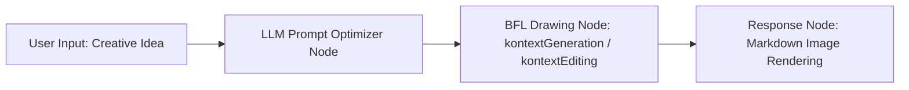

# Black Forest Labs Drawing Toolset (Flux Drawing)

The Black Forest Labs Drawing Toolset (`blackForestLab`) is an official professional AI image generation and editing plugin integrated into FastGPT. Powered by **FLUX.1 Kontext [pro]**, the flagship model created by Black Forest Labs, this plugin delivers industry-leading visual aesthetics, intricate spatial understanding, accurate on-canvas text rendering, and context-aware image-to-image editing that faithfully preserves reference image features.

With this plugin, FastGPT users can seamlessly leverage BFL's official compute within AI agents and automated workflows—spanning the entire multimodal creation lifecycle from high-fidelity creative text-to-image generation to commercial-grade targeted image editing.

---

## Typical Application Scenarios

- **Cutting-Edge Art & Concept Design**: Leverage FLUX.1's exceptional lighting hierarchy, realistic physical textures, and artistic compositional intelligence to rapidly translate game concept art, cinematic storyboards, and sci-fi environments into production-ready visuals.
- **High-Fidelity Typography & Complex Composition**: Overcome the classic limitations of garbled text and spatial incoherence in traditional diffusion models. Accurately render embedded typography on posters, storefront signs, product packaging, UI mockups, and logos.
- **E-Commerce Product Background Replacement & Editing**: Using `kontextEditing`, seamlessly alter studio lighting, replace backgrounds, or introduce decorative contextual elements while strictly preserving the geometry and texture of foreground merchandise (apparel, footwear, electronics), drastically reducing photography and post-production costs.
- **Custom Social Media Visuals & Variations**: Produce customized 16:9 widescreen banners, 9:16 mobile wallpapers, or 3:4 social media cards tailored to article topics, and generate multi-style variations while maintaining character and stylistic consistency.

---

## Secret & Endpoint Configuration

Before using this plugin, you must configure the Black Forest Labs API key (`apiKey`) in FastGPT.

### How to Obtain an API Key

1. Visit the [Black Forest Labs Official API Platform](https://api.bfl.ai/).
2. Register and log in to your BFL account (supports GitHub, Google, or email sign-in).
3. Navigate to the [API Keys](https://api.bfl.ai/keys) page on the dashboard and click **Create API Key**.
4. Copy and securely store your new API key string (e.g., `bfl_...`).
5. Go to the [Billing & Credits](https://api.bfl.ai/billing) page to configure a payment method and purchase credits. The BFL API operates on a usage-based billing model, and invoking the `flux-kontext-pro` endpoint consumes account credits.

### Plugin Secret Schema

| Setting | Field | Type | Required | Secret (`isSecret`) | Description |
| :--- | :--- | :--- | :---: | :---: | :--- |
| **API Key** | `apiKey` | String (`string`) | **Yes** | Yes (`true`) | Black Forest Labs API key. Sent in requests to BFL endpoints via the `x-key: <apiKey>` HTTP header for authentication. |

> **Endpoint Note**: The underlying API endpoint invoked by this plugin is `https://api.bfl.ai/v1/flux-kontext-pro`. All requests automatically handle payload signing and asynchronous polling.

---

## Sub-Tools List

This tool suite includes 2 core sub-tools:

| Tool ID | Chinese Name | English Name | Description |
| :--- | :--- | :--- | :--- |
| `kontextGeneration` | **FLUX.1 图像生成** | FLUX.1 Image Generation | Text-to-image generation powered by the FLUX.1 Kontext [pro] model, supporting flexible aspect ratios and high-fidelity output. |
| `kontextEditing` | **FLUX.1 图像编辑** | FLUX.1 Image Editing | Text-guided image editing and contextual image-to-image tool powered by FLUX.1 Kontext [pro], accepting image URLs or Base64 data. |

---

## Sub-Tool 1: kontextGeneration (FLUX.1 Image Generation)

### Input Parameters

| Parameter | Field | Type | Required | Default / Allowed Values | Description |
| :--- | :--- | :--- | :---: | :--- | :--- |
| **Image Prompt** | `prompt` | String (`string`) | **Yes** | None | Detailed textual description of the scene to generate (subject, composition, lighting, palette, artistic style, and embedded text). English prompts yield the best results. |
| **Aspect Ratio** | `aspect_ratio` | Enum (`string`) | **Yes** | `"1:1"` / `"16:9"` / `"9:16"` / `"4:3"` / `"3:4"` / `"21:9"` / `"9:21"` | Output image aspect ratio. For example: `1:1` for square avatars, `16:9` for desktop banners, or `9:16` for mobile vertical displays. |
| **Random Seed** | `seed` | Integer (`number`) | No | Omit for random | Seed for reproducible image generation. Using the same seed with identical parameters produces consistent compositions. |
| **Prompt Enhancement** | `prompt_upsampling` | Boolean (`boolean`) | **Yes** | `false` / `true` | Whether BFL servers should automatically expand and embellish the prompt. |
| **Safety Tolerance** | `safety_tolerance` | Integer (`number`) | **Yes** | Integer range `0` to `6` | Content moderation strictness: `0` is strictest and `6` is most permissive (recommended `2` to `4` for a balanced creative freedom). |
| **Output Format** | `output_format` | Enum (`string`) | **Yes** | `"jpeg"` / `"png"` | Target file format. Use `jpeg` for standard web usage and `png` for lossless quality. |

### Output Results

| Field | Type | Description |
| :--- | :--- | :--- |
| `image_url` | String (`string`) | Publicly accessible direct URL of the generated image. Can be rendered directly in Markdown or passed to downstream workflow nodes. |
| `error` | String (`string`) | Error message (optional). Returned when an API call fails, authentication is rejected, or content moderation is triggered. |

### Example Response

```json
{
  "image_url": "https://bfl-samples.s3.amazonaws.com/samples/flux-kontext-pro/018f9e6a-72ab-7bc8-8092-2b5d4e123456.jpg"
}
```

---

## Sub-Tool 2: kontextEditing (FLUX.1 Image Editing)

### Input Parameters

| Parameter | Field | Type | Required | Default / Allowed Values | Description |
| :--- | :--- | :--- | :---: | :--- | :--- |
| **Edit Prompt** | `prompt` | String (`string`) | **Yes** | None | Text prompt describing the desired edits to apply to the input image (e.g., "Change the background to a sunny Tokyo street with cherry blossoms"). |
| **Input Image** | `input_image` | String (`string`) | **Yes** | None | Reference image to edit. Accepts a **public image URL** (starting with `http://` or `https://`) or **Base64-encoded image data**. The plugin automatically downloads URLs and converts them to Base64. Supports files up to **20 MB** or **20 megapixels (20 MP)**. |
| **Aspect Ratio** | `aspect_ratio` | Enum (`string`) | No | Defaults to `"1:1"` | Target image aspect ratio. Supports 13 ratios from `3:7` to `7:3`: `"3:7"`, `"4:7"`, `"1:2"`, `"9:16"`, `"2:3"`, `"3:4"`, `"1:1"`, `"4:3"`, `"3:2"`, `"16:9"`, `"2:1"`, `"7:4"`, `"7:3"`. Total resolution is normalized to approximately 1 megapixel (~1 MP). |
| **Random Seed** | `seed` | Integer (`number`) | No | Omit for random | Seed for reproducible editing results. |
| **Prompt Enhancement** | `prompt_upsampling` | Boolean (`boolean`) | No | Defaults to `false` | Whether to automatically enhance the editing prompt on the server side. |
| **Safety Tolerance** | `safety_tolerance` | Integer (`number`) | No | Defaults to `2` | Content moderation strictness: integer between `0` and `2`, where `0` is most strict and `2` is balanced. |
| **Output Format** | `output_format` | Enum (`string`) | No | Defaults to `"jpeg"` | File format of the edited image (`"jpeg"` or `"png"`). |

### Output Results

| Field | Type | Description |
| :--- | :--- | :--- |
| `image_url` | String (`string`) | Public direct URL of the edited image. |
| `error` | String (`string`) | Error message (optional). Returned if image editing fails, download of the reference image fails, or moderation policy is violated. |

### Example Response

```json
{
  "image_url": "https://bfl-samples.s3.amazonaws.com/samples/flux-kontext-pro/018f9e6b-83cd-7de9-9183-3c6e5f654321.jpg"
}
```

---

## Typical Workflow Examples

Connecting an upstream Large Language Model (LLM) with BFL drawing tools in FastGPT delivers an end-to-end automated experience: "User Idea -> English Prompt Optimization -> Asynchronous Generation -> Inline Image Rendering".

### 1. Workflow Architecture



### 2. Orchestration Steps

1. **User Input Node**: Accepts user prompts in natural language (e.g., "Draw a cyberpunk rainy night street poster with neon signs glowing 'FASTGPT', vertical 9:16 aspect ratio").
2. **LLM Prompt Optimizer Node**:
   - Uses a system prompt to transform brief, casual ideas into rich, sensory-detailed FLUX English prompts with appropriate parameter mapping.
3. **BFL Drawing Tool Node**:
   - Select `Flux Drawing -> FLUX.1 Image Generation (kontextGeneration)`.
   - Node parameter configuration:
     - `prompt`: Bind to the upstream LLM optimized prompt variable.
     - `aspect_ratio`: Set to `"9:16"`.
     - `prompt_upsampling`: Set to `false` (prompt has already been optimized by the upstream LLM).
     - `safety_tolerance`: Set to `2`.
     - `output_format`: Set to `"png"`.
4. **Final Response Node**:
   - Reference the `image_url` variable from the BFL node using standard Markdown image syntax:
   ```markdown
   Your generated image is ready:

   
   ```

### 3. Recommended System Prompt for Upstream Prompt Optimizer

Add the following prompt to the upstream LLM node:

```markdown
You are an expert AI art prompt engineer specializing in Black Forest Labs FLUX.1 models.
Your task is to expand the user's brief creative concept into an evocative, highly detailed English prompt tailored for FLUX.

Guidelines:
1. Subject & Details: Clearly specify appearance, pose, clothing textures, and distinctive traits.
2. Perspective & Framing: Specify camera angle and composition (e.g., Close-up shot, Wide-angle view, Cinematic composition, Rule of thirds).
3. Lighting & Palette: Detail lighting schemes (e.g., Volumetric rim lighting, Golden hour, Neon luminescence) and chromatic harmony.
4. Medium & Style: Define rendering fidelity (e.g., 35mm film photograph, Kodak grain, Unreal Engine 5 render, Digital concept art).
5. Text Rendering: If the scene requires readable text, wrap the target words in double quotes, such as: text "FASTGPT" glowing on a neon signboard.
6. Output ONLY the raw English prompt without preamble, conversational remarks, or enclosing quotes.
```

---

## Important Considerations

1. **Generation Latency & Asynchronous Task Polling**:
   - The BFL API uses an asynchronous job queue (submitting a task returns an `id` and `polling_url`).
   - The plugin automatically polls the polling URL at 500ms intervals (up to 120 attempts, ~60 seconds max timeout).
   - Because FLUX.1 Kontext [pro] is a high-parameter flagship model, image generation usually takes 5 to 20 seconds. Ensure appropriate timeout settings in your FastGPT workflow nodes.
2. **BFL API Credits & Billing**:
   - Calling BFL endpoints consumes account credits. `flux-kontext-pro` is a premium model billed per generation. Keep your [https://api.bfl.ai/](https://api.bfl.ai/) credit balance topped up to avoid payment-related execution errors.
3. **Safety Tolerance Range Discrepancy**:
   - In `kontextGeneration` (text-to-image), `safety_tolerance` accepts an integer range from `0` to `6` (0 = strictest, 6 = most permissive).
   - In `kontextEditing` (image editing), `safety_tolerance` accepts an integer range from `0` to `2` (0 = strictest, 2 = standard balanced mode; defaults to 2). Content flagged by moderation policies will result in an error.
4. **Input Image Specifications (`input_image`)**:
   - `kontextEditing` accepts publicly accessible URLs (`http://` or `https://`) or Base64-encoded image strings.
   - Images must not exceed **20 MB** in file size and **20 megapixels (20 MP)** in resolution.
   - URLs must be directly downloadable without session cookies, authentication headers, or anti-hotlinking protections.
5. **Image URL Expiration**:
   - Returned `image_url` links point to temporary BFL AWS S3 buckets and will expire after a certain period. If permanent retention is needed, save or download the image through downstream storage nodes in FastGPT.

---

## Local Development & Testing

```bash
# Install dependencies
pnpm install

# Run unit tests
pnpm run test

# Build package artifacts
pnpm run build

# Validate plugin specifications
npx @fastgpt-plugin/cli check --entry .
```
