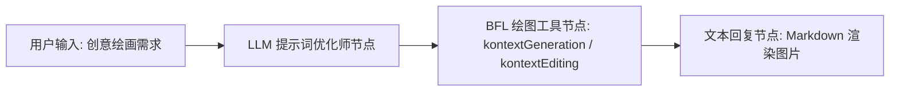

# Black Forest Labs 绘图工具集 (Flux Drawing)

Black Forest Labs 绘图工具集（`blackForestLab`）是 FastGPT 官方集成的专业级 AI 图像生成与图像编辑插件。该插件基于生成式 AI 领域顶尖团队 Black Forest Labs 官方出品的旗舰模型 **FLUX.1 Kontext [pro]** 构建，提供业内一流的画面质感、复杂的空间排版理解、精准的画面文字渲染，以及兼顾原图特征的上下文感知图生图编辑能力。

通过本插件，FastGPT 用户可在智能体（Agent）与自动化工作流（Workflow）中无缝调用 BFL 官方算力，实现从高质量创意文生图到商业级产品图像定向修改的全流程多模态创作。

---

## 典型应用场景

- **前沿高精艺术概念图设计**：借助 FLUX.1 卓越的光影层次、逼真的物理材质与艺术构图理解，快速将游戏原画、电影分镜概念、科幻场景设定等创意转化为高质量艺术视觉方案。
- **高保真文字与复杂构图生成**：突破传统图像模型文字乱码与多主体空间错位的局限，精准渲染包含英文字符的海报标题、招牌门头、包装印花、UI 界面与 Logo 标识。
- **电商产品背景替换与图生图编辑**：基于 `kontextEditing` 子工具，在保留原产品主体（如商品、人像、鞋服）细节与物理结构的前提下，通过自然语言指令快速替换棚拍光影、场景背景或添加修饰元素，显著降低商业静物渲染与后期成本。
- **自媒体多比例配图与视觉变体定制**：根据文章大纲与推文主题定制 16:9 宽屏封面图、9:16 移动端竖版插图或 3:4 社交媒体卡片图，支持基于同一视觉主体快速衍生不同风格与细节的变体配图。

---

## 密钥与服务端点配置说明

使用本插件前，需在 FastGPT 插件配置中配置 Black Forest Labs 开放平台的访问密钥（`apiKey`）。

### 获取渠道指引

1. 访问 [Black Forest Labs API 官方平台](https://api.bfl.ai/)。
2. 注册并登录 BFL 账户（支持 GitHub、Google 授权或邮箱登录）。
3. 进入控制台的 [API Keys](https://api.bfl.ai/keys) 页面，点击 **Create API Key** 创建新的访问密钥。
4. 复制生成的密钥字符串（如 `bfl_...`）并妥善保存。
5. 前往账户的 [Billing & Credits](https://api.bfl.ai/billing) 页面绑定支付方式或购买算力点数。BFL API 采用按量扣费模式，调用 `flux-kontext-pro` 接口需要账户内保持充足的点数额度。

### 插件配置参数

| 配置项 | 字段名 | 类型 | 是否必填 | 敏感加密 (`isSecret`) | 说明 |
| :--- | :--- | :--- | :---: | :---: | :--- |
| **API 密钥** | `apiKey` | 字符串 (`string`) | **是** | 是 (`true`) | Black Forest Labs API 密钥。请求官方服务端点时将通过 HTTP 请求头 `x-key: <apiKey>` 进行鉴权。 |

> **服务端点说明**：插件底层请求的官方 API 端点为 `https://api.bfl.ai/v1/flux-kontext-pro`，所有请求均自动完成签名与异步任务追踪。

---

## 子工具列表

本工具集包含以下 2 个核心子工具：

| 子工具 ID | 中文名称 | 英文名称 | 功能说明 |
| :--- | :--- | :--- | :--- |
| `kontextGeneration` | **FLUX.1 图像生成** | FLUX.1 Image Generation | 基于 FLUX.1 Kontext [pro] 模型的文本到图像（Text-to-Image / 文生图）工具，支持多画幅比例与高画质输出。 |
| `kontextEditing` | **FLUX.1 图像编辑** | FLUX.1 Image Editing | 基于 FLUX.1 Kontext [pro] 模型的图像编辑与上下文图生图（Image-to-Image）工具，支持 URL 与 Base64 图像输入。 |

---

## 子工具 1：kontextGeneration (FLUX.1 图像生成)

### 输入参数说明

| 参数名 | 对应字段 | 类型 | 是否必填 | 默认值 / 可选值 | 说明 |
| :--- | :--- | :--- | :---: | :--- | :--- |
| **图像描述** | `prompt` | 字符串 (`string`) | **是** | 无 | 描述想要生成的画面细节。建议使用详尽具象的英文描述（主体、构图、光照、色彩、材质风格及内嵌文字）。 |
| **宽高比** | `aspect_ratio` | 枚举 (`string`) | **是** | `"1:1"` / `"16:9"` / `"9:16"` / `"4:3"` / `"3:4"` / `"21:9"` / `"9:21"` | 画面输出长宽比。例如社交媒体常用 `1:1`，电脑壁纸常用 `16:9`，移动端全屏推荐 `9:16`。 |
| **随机种子** | `seed` | 整数 (`number`) | 否 | 留空为随机 | 用于可重现生成的一致性种子值。固定相同的种子与提示词可获得相似构图的画面。 |
| **提示词增强** | `prompt_upsampling` | 布尔值 (`boolean`) | **是** | `false` / `true` | 是否由 BFL 服务端对输入提示词进行自动扩写与润色增强。 |
| **安全等级** | `safety_tolerance` | 整数 (`number`) | **是** | 取值范围 `0` ~ `6` | 内容审核严格程度。`0` 表示最严格审核，`6` 表示最宽松审核（推荐设为 `2` ~ `4` 平衡过滤与创意自由度）。 |
| **输出格式** | `output_format` | 枚举 (`string`) | **是** | `"jpeg"` / `"png"` | 生成图像的文件格式。日常展示建议选 `jpeg`，高保真无损需求建议选 `png`。 |

### 输出结果说明

| 字段名 | 类型 | 说明 |
| :--- | :--- | :--- |
| `image_url` | 字符串 (`string`) | 生成图片的公网直接访问 URL 直链。可直接在 Markdown 或后续工作流节点中引用。 |
| `error` | 字符串 (`string`) | 错误信息（可选）。当接口调用失败、鉴权异常或审核拦截时返回详细说明。 |

### 输出示例

```json
{
  "image_url": "https://bfl-samples.s3.amazonaws.com/samples/flux-kontext-pro/018f9e6a-72ab-7bc8-8092-2b5d4e123456.jpg"
}
```

---

## 子工具 2：kontextEditing (FLUX.1 图像编辑)

### 输入参数说明

| 参数名 | 对应字段 | 类型 | 是否必填 | 默认值 / 可选值 | 说明 |
| :--- | :--- | :--- | :---: | :--- | :--- |
| **编辑描述** | `prompt` | 字符串 (`string`) | **是** | 无 | 描述对参考图像的具体编辑与修改指令（例如："Change the background to a sunny Tokyo street with cherry blossoms"）。 |
| **输入图像** | `input_image` | 字符串 (`string`) | **是** | 无 | 待编辑的原始图像。支持传入**公网图片 URL**（以 `http://` 或 `https://` 开头）或 **Base64 编码数据**。插件会自动下载 URL 并转为 Base64。最大支持 **20 MB** 或 **2000 万像素 (20 MP)**。 |
| **宽高比** | `aspect_ratio` | 枚举 (`string`) | 否 | 默认 `"1:1"` | 目标画面的宽高比。支持从 `3:7` 到 `7:3` 共 13 种比例：`"3:7"`, `"4:7"`, `"1:2"`, `"9:16"`, `"2:3"`, `"3:4"`, `"1:1"`, `"4:3"`, `"3:2"`, `"16:9"`, `"2:1"`, `"7:4"`, `"7:3"`。输出总像素约为 100 万像素（~1 MP）。 |
| **随机种子** | `seed` | 整数 (`number`) | 否 | 留空为随机 | 用于可重现生成的随机种子值。 |
| **提示词增强** | `prompt_upsampling` | 布尔值 (`boolean`) | 否 | 默认 `false` | 是否开启服务端提示词自动优化扩展。 |
| **安全等级** | `safety_tolerance` | 整数 (`number`) | 否 | 默认 `2` | 内容审核严格程度。取值范围为 `0` ~ `2`，其中 `0` 最严格，`2` 为标准平衡模式。 |
| **输出格式** | `output_format` | 枚举 (`string`) | 否 | 默认 `"jpeg"` | 生成图像的文件格式，可选 `"jpeg"` 或 `"png"`。 |

### 输出结果说明

| 字段名 | 类型 | 说明 |
| :--- | :--- | :--- |
| `image_url` | 字符串 (`string`) | 编辑完成后的图片公网直接访问 URL 直链。 |
| `error` | 字符串 (`string`) | 错误信息（可选）。当图生图失败、下载输入图像失败或审核拦截时返回详细说明。 |

### 输出示例

```json
{
  "image_url": "https://bfl-samples.s3.amazonaws.com/samples/flux-kontext-pro/018f9e6b-83cd-7de9-9183-3c6e5f654321.jpg"
}
```

---

## 典型工作流编排示例

在 FastGPT 中，将大语言模型与 BFL 绘图工具联动，可以实现“自然语言提问 -> 专业英文提示词优化 -> 异步绘图 -> 图片直观渲染”的全自动化交互体验。

### 1. 节点拓扑编排



### 2. 编排步骤

1. **用户输入节点**：用户输入简短的中文绘画要求，例如：“帮我画一张赛博朋克雨夜街道的海报，街角的霓虹灯牌写着 'FASTGPT'，纵向构图”。
2. **LLM 提示词优化师节点（大模型处理）**：
   - 使用系统提示词引导大模型将用户的粗略描述扩写为细节丰富、风格具象的 FLUX 英文提示词，并输出规范的参数。
3. **BFL 绘图节点**：
   - 选择 `Flux 绘图 -> FLUX.1 图像生成 (kontextGeneration)`。
   - 参数配置：
     - `prompt`：绑定上游大模型输出的优化提示词变量。
     - `aspect_ratio`：设为 `"9:16"`。
     - `prompt_upsampling`：设为 `false`（上游已由 LLM 充分优化）。
     - `safety_tolerance`：设为 `2`。
     - `output_format`：设为 `"png"`。
4. **最终回复节点**：
   - 引用 BFL 节点输出的 `image_url` 变量，使用 Markdown 语法进行直观展示：
   ```markdown
   为您生成的画面已完成：

   
   ```

### 3. 上游提示词优化师 System Prompt 建议

可在上游 LLM 节点中配置如下系统提示词：

```markdown
你是一位资深的 AI 艺术提示词工程师，精通 Black Forest Labs FLUX.1 模型的视觉特性。
你的任务是将用户的绘图想法转化为一段画面感极强、英文表述精准且细节丰富的 FLUX 提示词。

提示词编写规范：
1. 主题与主体：清晰交代主体外观、姿态特征、材质质感与服饰细节。
2. 视角与构图：明确景别（如 Close-up shot, Wide-angle view, Cinematic composition）与空间透视。
3. 光影与色彩：指定光照类型（如 Volumetric rim lighting, Golden hour, Neon luminescence）与主色调氛围。
4. 渲染风格：指定写实摄影（如 35mm photograph, Kodak film grain）、概念原画或 3D 渲染质感。
5. 文本渲染：若画面包含文字，用双引号精准标注，例如 text "FASTGPT" glowing on a neon signboard。
6. 直接输出纯英文提示词正文，不要输出任何多余的解释、前缀或包裹引号。
```

---

## 注意事项

1. **生成耗时与异步任务轮询**：
   - BFL 官方接口采用异步任务模式（客户端提交生成请求后获取任务 `id` 与 `polling_url`）。
   - 插件内置了自动化轮询机制，以 500ms 间隔持续轮询任务状态（最多重试 120 次，最长等待时间约为 60 秒）。
   - FLUX.1 Kontext [pro] 为高保真大参数模型，单张图片生成时间通常在 5 ~ 20 秒之间，请确保 FastGPT 工作流节点的运行超时时间设置合理。
2. **BFL API 额度与计费说明**：
   - 调用 BFL API 会按次扣减 Black Forest Labs 账户内的 Credits 额度。`flux-kontext-pro` 属于官方旗舰模型，请确保账户已充值且额度充足，若欠费将返回错误中断任务。
3. **安全审核等级 (`safety_tolerance`) 范围差异**：
   - 在 `kontextGeneration`（文生图）中，`safety_tolerance` 的可选取值范围为 `0` ~ `6`（0 最严格，6 最宽松）。
   - 在 `kontextEditing`（图像编辑）中，`safety_tolerance` 的可选取值范围为 `0` ~ `2`（0 最严格，2 为标准平衡模式，默认 2）。若生成内容触及安全策略，接口会返回审核拦截错误。
4. **输入图像规范 (`input_image`)**：
   - `kontextEditing` 支持输入公开可访问的图片 URL（`http://` 或 `https://`）或 Base64 编码字符串。
   - 输入图片单张大小不得超过 **20 MB**，图像分辨率上限为 **2000 万像素 (20 MP)**。
   - 传入 URL 时需确保该链接无需鉴权或 Cookie 即可直接下载，且不存在防盗链拦截。
5. **图片链接有效期**：
   - 生成完成返回的 `image_url` 指向 BFL 官方 S3 存储桶，该链接为临时访问地址。如有长期持久化存储需求，建议在下游工作流中保存或下载图片。

---

## 本地开发与测试

```bash
# 安装依赖
pnpm install

# 运行单元测试
pnpm run test

# 构建插件产物
pnpm run build

# 校验插件规范
npx @fastgpt-plugin/cli check --entry .
```

