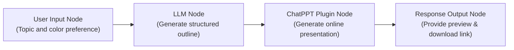

# ChatPPT - One-Click Presentation Generator (ChatPPT)

ChatPPT is an intelligent presentation generation service provided by Biyou AI (必优科技). This plugin offers out-of-the-box AI presentation generation capabilities for FastGPT agent workflows.

Powered by Biyou's natural language understanding and automated slide layout rendering engine, this plugin quickly converts topic descriptions, speech outlines, or structured outlines generated by Large Language Models (LLMs) into beautifully designed, professional, and well-structured presentations. It returns a direct link integrating online previewing, full-screen presenting, cloud editing, and PPTX file downloading.

---

## Typical Application Scenarios

- **Workplace Debriefs and Summary Presentations**: Instantly convert weekly reports, monthly summaries, quarterly reviews, or annual debrief notes into polished slides, dramatically cutting down time spent on layout and visual design.
- **Business Proposals and Pitch Decks**: Quickly generate high-standard pitch decks and business proposals based on business models, product roadmaps, market insights, or fundraising plans.
- **Educational Courseware and Public Lectures**: Rapidly transform key knowledge points, course syllabi, and training materials into visual, easy-to-follow educational slide decks.
- **Conference and Keynote Speeches**: Automatically extract and turn conference speeches, academic presentations, or meeting minutes into on-screen-ready presentation slides.

---

## Secret Configuration

To use this plugin, you must configure the API key (`apiKey`) obtained from the Biyou Open Platform.

### How to Obtain an API Key

1. Visit the [Biyou Open Platform / ChatPPT Developer Center](https://chatppt.yoo-ai.com) (or the official portal at [https://www.yoo-ai.com](https://www.yoo-ai.com)) and sign in.
2. Go to the Console / Developer Center, create an application, and apply for an API Key.
3. Copy and securely store your generated API Key.
4. Ensure your account has sufficient generation points or balance (new users usually receive initial trial credits; commercial deployment requires purchasing quota as needed).

### Configuration in FastGPT

Configure the following secret field in FastGPT tool settings or workflow node configuration:

| Field | Type | Required | Description |
| --- | --- | --- | --- |
| `apiKey` | String (`string`) | Yes | Biyou Open Platform API Key. Passed as a `Bearer Token` for authentication and account balance deduction. |

---

## Input Parameters

| Parameter | Type | Required | Default | Description |
| --- | --- | --- | --- | --- |
| `text` | String (`string`) | Yes | None | **Presentation description or structured outline**.<br>The core content used to generate the presentation. Supports natural language topic prompts (e.g., "2025 AI Technology Trends and Commercial Outlook") or Markdown-formatted structured outlines (with multi-level headings, key arguments, and page-by-page bullet points). Clearer and richer outlines produce higher quality slides. |
| `color` | String (`string`) | No | None | **Presentation theme color**.<br>Specifies the primary color tone and design style of the slides. Accepts **standard hex color codes** (e.g., Tech Blue `#1E88E5`, Business Green `#2E7D32`, Dynamic Red `#C62828`, Warm Orange `#EF6C00`, Elegant Purple `#6A1B9A`, Neutral Slate `#37474F`) or **common color names** (e.g., `blue`, `green`, `red`, `orange`, `purple`). If omitted, Biyou's intelligent layout engine will automatically choose a harmonious color scheme based on the content topic. |

---

## Output Results

| Field | Type | Description |
| --- | --- | --- |
| `preview_url` | String (`string`) | **Presentation online preview and interaction URL**.<br>Direct link to the generated presentation hosted on the Biyou cloud platform. Users can click this link in a browser without any local installation to:<br>1. **Preview slides online**: Inspect page layouts, typography, and graphics page by page;<br>2. **Present full-screen**: Deliver live slide presentations directly in the browser;<br>3. **Edit in cloud**: Modify text content, alter color schemes, and adjust layouts online;<br>4. **Export local file**: Download the native `.pptx` PowerPoint file directly to the local machine. |

### Output Example

```json
{
  "preview_url": "https://saas.api.yoo-ai.com/preview/ppt?id=c7a31b8e-9d24-4f81-8e56-123456789abc"
}
```

---

## Typical Workflow Example

With FastGPT workflow orchestration, you can easily build an end-to-end **"User Request -> LLM Outline Generation -> ChatPPT Rendering -> Online Preview & Download"** intelligent presentation assistant:



### Workflow Steps

1. **User Input Node**: Collects user requirements regarding presentation topic, target audience, and style preferences (e.g., "Please generate a 2025 Global Expansion Strategy report for new energy vehicles, with a tech blue theme").
2. **LLM Node**:
   - **System Prompt**:
     ```text
     You are a professional business presentation strategist. Based on the user's requirements, generate a structured Markdown outline for a presentation, including a title slide, subtitle, agenda, 4-6 body slides, and a summary/conclusion slide.
     Requirements:
     1. Use # for the main deck title, ## for each slide title, and - bullet points for key slide takeaways.
     2. Ensure clear logical hierarchy, persuasive arguments, and concise language.
     ```
   - **Output**: Generates a well-structured Markdown outline and extracts the corresponding color code (e.g., `#1E88E5`).
3. **ChatPPT Tool Node**:
   - Bind the outline output from the LLM node to the `text` parameter.
   - Bind the color variable (e.g., `#1E88E5`) to the `color` parameter.
4. **Response / Output Node**:
   - Reference the `preview_url` output variable from the ChatPPT node to present a friendly Markdown link to the user:
     ```markdown
     Your presentation has been successfully generated!

     🔗 **[Click here to preview and present your PPT]({{chatPPT.preview_url}})**

     > Tip: In the opened page, you can present in full screen directly, or click the download button in the upper right corner to save the `.pptx` file locally for further editing.
     ```

---

## Important Notes

1. **Generation Latency**: Generating a complete presentation involves semantic analysis, template matching, graphic asset rendering, and layout composition. The process typically takes 10 to 30 seconds. Please configure reasonable timeout settings in upstream FastGPT workflows or client callers.
2. **Account Quota and Authentication**: Calling this plugin requires a valid Biyou Open Platform API Key. Each successful presentation generation consumes account credits/points. If generation fails, please verify whether your API Key is valid and has sufficient remaining quota.
3. **Network Requirements**: The FastGPT execution environment must be able to reach `https://saas.api.yoo-ai.com`. Additionally, the generated `preview_url` must be accessible from the end user's browser.
4. **Prompt and Outline Optimization**: Clearer structure yields higher quality slides. It is strongly recommended to provide structured Markdown headings and bullet points in the `text` parameter rather than a brief one-line text.
5. **File Retention**: The `preview_url` provides online previewing and cloud editing hosted by Biyou. Users are advised to review the slides promptly and download the `.pptx` file locally for long-term archiving.
