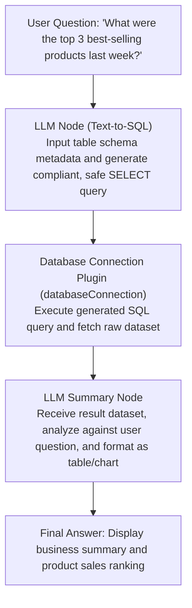

# Database Connection

FastGPT official general-purpose database connection and SQL execution tool, supporting major relational databases including MySQL, PostgreSQL, and Microsoft SQL Server. By integrating database query capabilities into FastGPT workflows, AI agents can automatically generate and execute SQL queries based on user intent, enabling automated business data retrieval, multi-dimensional analysis, and intelligent summarization.

## Typical Application Scenarios

- **AI Text-to-SQL Intelligent Query**: Working alongside upstream Large Language Models (LLMs), natural language questions (e.g., "Find the top 10 stores with the highest sales volume last month") are automatically converted into standard SQL queries, executed securely, and returned directly.
- **Smart Reporting & Metrics Aggregation**: Periodically or on-demand aggregate core business metrics such as orders, revenue, and active users, allowing downstream LLMs to calculate period-over-period trends and generate structured reports or visual summaries.
- **Business System Read-Only Data Retrieval**: In intelligent customer service, IT support, or operations assistant scenarios, securely connect to business databases (CRM, ERP, ticketing systems) to look up real-time statuses by customer ID, phone number, or order ID.
- **Data Consistency Verification & Reconciliation**: Automatically compare data across heterogeneous tables, inspect abnormal or inconsistent records, and assist DevOps and data analysts in efficient data reconciliation.

---

## Supported Database Types

| Database System | Default Port | Driver & Connection Details |
| --- | --- | --- |
| **MySQL** | `3306` | Powered by `mysql2/promise` client, supporting MySQL 5.7, 8.0+, and compatible cloud databases (e.g., AWS RDS, Aliyun RDS). Connection timeout: 30 seconds. |
| **PostgreSQL** | `5432` | Powered by `pg` client, supporting PostgreSQL 10+, TimescaleDB, and compatible databases. Connection timeout: 30 seconds. |
| **Microsoft SQL Server** | `1433` | Powered by `mssql` driver, supporting SQL Server 2012+. Built-in `trustServerCertificate: true` enabled to support self-signed certificates and cloud instances. |

---

## Connection Configuration & Secrets Guide

Configure your database connection credentials in the Secrets section of the FastGPT plugin settings. For security reasons, the **database password (`password`) is stored encrypted** and is never displayed in plaintext across workflow exports, frontend UIs, or invocation logs.

| Configuration Key | Display Title | Data Type | Required | Example / Default | Encrypted (`isSecret`) | Description |
| --- | --- | --- | --- | --- | --- | --- |
| `databaseType` | Database type | Enum (`string`) | Yes | `MySQL` | No | Target database system type. Options: `MySQL`, `PostgreSQL`, `Microsoft SQL Server`. |
| `host` | Host | String (`string`) | Yes | `192.168.1.100` or `db.example.com` | No | IP address or domain name of the database server. |
| `port` | Database port | String / Number (`string`) | Yes | `3306` / `5432` / `1433` | No | Database listening port. Automatically parsed as an integer internally. |
| `databaseName` | Database name | String (`string`) | Yes | `production_db` | No | Name of the target database to connect to. |
| `user` | Database username | String (`string`) | Yes | `readonly_user` | No | Database login username. Strongly recommended to use a **read-only account**. |
| `password` | Database password | String (`string`) | Yes | `******` | Yes | Database login password. Encrypted and managed securely by FastGPT Secrets. |

> **Security Best Practice**: Always create a dedicated read-only account for FastGPT. For example:
> - **MySQL**: `CREATE USER 'fastgpt_ro'@'%' IDENTIFIED BY 'YourStrongPassword'; GRANT SELECT ON production_db.* TO 'fastgpt_ro'@'%'; FLUSH PRIVILEGES;`
> - **PostgreSQL**: `CREATE USER fastgpt_ro WITH PASSWORD 'YourStrongPassword'; GRANT CONNECT ON DATABASE production_db TO fastgpt_ro; GRANT USAGE ON SCHEMA public TO fastgpt_ro; GRANT SELECT ON ALL TABLES IN SCHEMA public TO fastgpt_ro;`

---

## Input Parameters (Inputs)

| Parameter | Display Title | Data Type | Required | Description & Security Guidelines |
| --- | --- | --- | --- | --- |
| `sql` | SQL statement | String (`string`) | Yes | **The standard SQL statement to execute directly**.<br>• Only read-only queries (such as `SELECT ...`) are permitted;<br>• Always include `LIMIT` (MySQL / PostgreSQL) or `TOP` (SQL Server) to restrict the maximum number of returned rows, preventing excessive memory usage;<br>• Do not concatenate multiple statements with semicolons (`;`) in a single execution;<br>• Destructive commands such as `DROP`, `TRUNCATE`, `DELETE`, `UPDATE`, or `INSERT` are strictly prohibited. |

---

## Output Results (Outputs)

| Field | Display Title | Data Type | Description |
| --- | --- | --- | --- |
| `result` | Result | Array or Object (`Array<any> \| Record<string, any>`) | The raw dataset returned after successful SQL execution. The specific structure depends on the underlying database driver. |

### Output Structure Differences

- **MySQL / PostgreSQL**: Returns an **array of objects** (`Array<Record<string, any>>`), where each element represents a row from the result set, with column names as keys.
- **Microsoft SQL Server**: Returns a **composite object** containing `recordset` (array of row objects), `recordsets` (array of multiple result sets), and `rowsAffected` (array of affected row counts).

### Example Response 1: MySQL / PostgreSQL Query Result

```json
{
  "result": [
    {
      "order_id": "ORD-20250201-001",
      "customer_name": "Alice",
      "amount": 128.50,
      "status": "PAID",
      "created_at": "2025-02-01T10:30:00.000Z"
    },
    {
      "order_id": "ORD-20250201-002",
      "customer_name": "Bob",
      "amount": 256.00,
      "status": "COMPLETED",
      "created_at": "2025-02-01T11:15:00.000Z"
    }
  ]
}
```

### Example Response 2: Microsoft SQL Server Query Result

```json
{
  "result": {
    "recordsets": [
      [
        {
          "department_id": 101,
          "department_name": "Research & Development",
          "headcount": 42
        },
        {
          "department_id": 102,
          "department_name": "Marketing",
          "headcount": 18
        }
      ]
    ],
    "recordset": [
      {
        "department_id": 101,
        "department_name": "Research & Development",
        "headcount": 42
      },
      {
        "department_id": 102,
        "department_name": "Marketing",
        "headcount": 18
      }
    ],
    "rowsAffected": [2]
  }
}
```

---

## Typical Workflow Orchestration Example

In FastGPT, the most common pattern is using this plugin as the **core execution engine of an AI Text-to-SQL pipeline**:



### Orchestration Steps

1. **Upstream Node: Text-to-SQL Generator (LLM Node)**
   - **Recommended System Prompt**:
     ```text
     You are an expert SQL generation assistant. Based on the user question and the database schema below, generate a clean, executable SQL query:
     
     Table: products (id INT, product_name VARCHAR, category VARCHAR, price DECIMAL)
     Table: order_items (id INT, order_id INT, product_id INT, quantity INT, sale_price DECIMAL, created_at DATETIME)
     
     Rules:
     1. Only generate a single SELECT statement. Write, update, or delete operations are strictly prohibited.
     2. The query must include a LIMIT clause (max 50 rows).
     3. Output raw SQL only, without Markdown code fences, quotes, or extra explanations.
     ```
2. **Intermediate Node: Database Connection Tool (`databaseConnection`)**
   - **Parameter Binding**: Map the SQL output from the upstream LLM node to the `sql` input parameter.
   - **Secrets Configuration**: Pre-configure read-only credentials and host parameters in the plugin settings.
3. **Downstream Node: Data Analysis & Summary (LLM Node)**
   - **Input Context**: Reference `databaseConnection.result`.
   - **Recommended Prompt**:
     ```text
     User Question: {{User Question}}
     Database Query Result: {{databaseConnection.result}}
     
     Analyze the query results above and answer the user's question clearly. Present key metrics in a Markdown table. If no records are found, inform the user politely.
     ```

---

## Security Considerations & Best Practices

Because executing SQL commands carries inherent risks, adhere strictly to the following security guidelines in production environments:

1. **Principle of Least Privilege (Read-Only Accounts)**
   - **Never** configure the plugin with administrative credentials (e.g., `root`, `postgres`, `sa`) or general read-write application accounts.
   - Create a dedicated **read-only database user** with `SELECT` permissions restricted only to necessary tables. Revoke `DROP`, `DELETE`, `UPDATE`, `INSERT`, `ALTER`, and `GRANT` permissions completely.
2. **SQL Injection Mitigation & Statement Auditing**
   - Implement strict constraints in upstream LLM prompts to prevent malicious query generation.
   - Avoid directly concatenating unvalidated raw user inputs into SQL strings.
   - Semicolon-separated multi-statement execution (`;`) must not be permitted.
3. **Network Access Control & IP Whitelisting**
   - When connecting to cloud databases (AWS RDS, Aliyun RDS, etc.), restrict security groups and network whitelists to the outbound IP addresses of your FastGPT host/cluster. Never open database ports to `0.0.0.0/0`.
   - For on-premise or private enterprise databases, route traffic through internal VPC peering, VPN, or reverse proxy bastions rather than exposing database ports publicly.
4. **Query Performance & Resource Safeguards**
   - Prevent unindexed full-table scans or heavy Cartesian product joins that could degrade database performance.
   - Always enforce row limits via `LIMIT` (MySQL / PostgreSQL) or `TOP` (SQL Server) (recommended max 100 rows per query) to avoid exceeding LLM context windows or triggering out-of-memory errors.
5. **Connection Timeout Handling**
   - The plugin incorporates a built-in 30-second connection and query timeout. If queries time out due to network latency or slow execution, inspect database index efficiency and network connectivity.

---

## Troubleshooting Guide

| Error Message / Symptom | Potential Cause | Troubleshooting & Recommended Solution |
| --- | --- | --- |
| `ETIMEDOUT` / `Connection timeout` | Network unreachable or firewall blocking port | 1. Verify the database server is running and listening on the configured port;<br>2. Check host firewalls, cloud security groups, and IP whitelists to ensure FastGPT's IP is allowed;<br>3. Verify that the configured `host` and `port` are correct. |
| `ER_ACCESS_DENIED_ERROR` / `password authentication failed` | Invalid username/password or remote login disallowed | 1. Verify that `user` and `password` in Secrets are accurate;<br>2. Ensure the database user is permitted to connect from the FastGPT host IP (e.g., MySQL `user`@`%`). |
| `ER_BAD_DB_ERROR` / `database "xxx" does not exist` | Database name does not exist | Check that `databaseName` in Secrets is spelled correctly and the user has permission to access that database. |
| `syntax error at or near ...` | SQL dialect incompatibility | Check whether the generated SQL syntax conflicts with the target database dialect (e.g., MySQL backticks vs. PostgreSQL double quotes, `LIMIT` vs. `TOP`). |

---

## Local Development & Testing

Run the following commands within the `packages/tools/databaseConnection` directory:

```bash
# Run unit tests
pnpm run test

# Build plugin artifacts
pnpm run build

# Validate plugin specifications and dist artifacts
npx @fastgpt-plugin/cli check --entry .

# Package into a .pkg bundle
pnpm run pack
```
