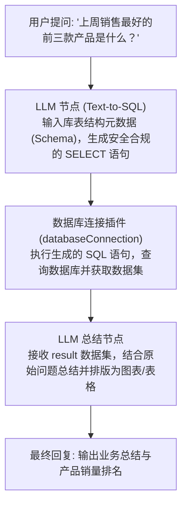

# 数据库连接 (Database Connection)

FastGPT 官方通用数据库连接与 SQL 执行工具，支持主流关系型数据库（MySQL、PostgreSQL、Microsoft SQL Server）。通过将数据库查询能力无缝接入 FastGPT 工作流，智能体能够根据用户意图自动生成并执行 SQL 语句，实现业务数据的自动化检索、多维分析与智能总结。

## 典型应用场景

- **AI Text-to-SQL 智能查询**：配合上游大语言模型（LLM），将用户的自然语言问题（如“查询上个月销售额前十的门店”）自动转化为标准 SQL 语句并安全执行，直接输出查询结果。
- **智能报表与指标统计**：定时或按需聚合订单、收入、活跃用户等核心业务指标，由下游 LLM 自动计算同比、环比数据，并排版生成结构化周报或可视化报表。
- **业务系统只读数据查询**：在智能客服、IT 支持或运营助理场景中，安全直连 CRM、ERP、工单等业务系统数据库，快速根据客户 ID、手机号或订单号反查状态信息。
- **数据一致性核对与校验**：自动比对异构数据表、排查异常记录与不一致数据，协助运维与数据分析人员高效完成数据对账。

---

## 支持的数据库类型

| 数据库系统 | 默认端口 | 驱动与连接特性 |
| --- | --- | --- |
| **MySQL** | `3306` | 基于 `mysql2/promise` 客户端，支持 MySQL 5.7、8.0+ 及兼容协议的云数据库（如 AWS RDS、阿里云 RDS 等）。超时时间 30 秒。 |
| **PostgreSQL** | `5432` | 基于 `pg` 客户端，支持 PostgreSQL 10+、TimescaleDB 等兼容数据库。超时时间 30 秒。 |
| **Microsoft SQL Server** | `1433` | 基于 `mssql` 驱动，支持 SQL Server 2012+，内置启用 `trustServerCertificate: true`，支持自签名证书与云数据库实例。 |

---

## 连接配置与密钥说明 (Secrets)

在 FastGPT 插件配置的密钥（Secrets）区域中设置目标数据库的连接信息。出于安全考量，**数据库密码（`password`）采用加密存储**，不会在工作流导出、前端界面或请求日志中明文展示。

| 配置项 (Key) | 界面显示名称 | 数据类型 | 必填 | 示例 / 默认值 | 加密存储 (`isSecret`) | 配置说明 |
| --- | --- | --- | --- | --- | --- | --- |
| `databaseType` | 数据库类型 | 枚举 (`string`) | 是 | `MySQL` | 否 | 目标数据库类型。可选值：`MySQL`、`PostgreSQL`、`Microsoft SQL Server`。 |
| `host` | 主机地址 | 字符串 (`string`) | 是 | `192.168.1.100` 或 `db.example.com` | 否 | 数据库服务器的 IP 地址或访问域名。 |
| `port` | 数据库连接端口号 | 字符串 / 数值 (`string`) | 是 | `3306` / `5432` / `1433` | 否 | 数据库服务监听端口。插件内部会自动转为整数处理。 |
| `databaseName` | 数据库名称 | 字符串 (`string`) | 是 | `production_db` | 否 | 需要连接的目标数据库名称（Database）。 |
| `user` | 数据库账号 | 字符串 (`string`) | 是 | `readonly_user` | 否 | 数据库登录用户名，强烈建议配置为**只读账号**。 |
| `password` | 数据库密码 | 字符串 (`string`) | 是 | `******` | 是 | 数据库登录密码，系统将全程以密文形式加密存储与传输。 |

> **安全最佳实践**：推荐为 FastGPT 建立专用只读账号。例如：
> - **MySQL**: `CREATE USER 'fastgpt_ro'@'%' IDENTIFIED BY 'YourStrongPassword'; GRANT SELECT ON production_db.* TO 'fastgpt_ro'@'%'; FLUSH PRIVILEGES;`
> - **PostgreSQL**: `CREATE USER fastgpt_ro WITH PASSWORD 'YourStrongPassword'; GRANT CONNECT ON DATABASE production_db TO fastgpt_ro; GRANT USAGE ON SCHEMA public TO fastgpt_ro; GRANT SELECT ON ALL TABLES IN SCHEMA public TO fastgpt_ro;`

---

## 输入参数列表 (Inputs)

| 参数名 | 界面显示名称 | 数据类型 | 必填 | 说明与安全编写建议 |
| --- | --- | --- | --- | --- |
| `sql` | SQL 语句 | 字符串 (`string`) | 是 | **待执行的标准 SQL 语句**。<br>• 仅允许只读查询操作（如 `SELECT ...`）；<br>• 查询务必携带 `LIMIT`（MySQL / PostgreSQL）或 `TOP`（SQL Server）限制最大返回行数，防止拉取过量数据耗尽内存；<br>• 请勿在单次调用中使用分号（`;`）拼接多条语句；<br>• 严禁传入 `DROP`、`TRUNCATE`、`DELETE`、`UPDATE`、`INSERT` 等修改或删除数据的破坏性操作。 |

---

## 输出结果说明 (Outputs)

| 字段名 | 界面显示名称 | 数据类型 | 说明 |
| --- | --- | --- | --- |
| `result` | 结果 | 数组或对象 (`Array<any> \| Record<string, any>`) | SQL 语句执行成功后返回的原始数据集。其具体结构因底层数据库驱动类型而异。 |

### 数据返回结构差异说明

- **MySQL / PostgreSQL**：返回**对象数组**（`Array<Record<string, any>>`），数组中每个元素对应查询结果集中的一行记录，键名为字段列名。
- **Microsoft SQL Server**：返回包含 `recordset`（行数据数组）、`recordsets`（多结果集数组）、`rowsAffected`（受影响行数）的**复合对象**。

### 返回示例 1：MySQL / PostgreSQL 查询结果

```json
{
  "result": [
    {
      "order_id": "ORD-20250201-001",
      "customer_name": "张三",
      "amount": 128.50,
      "status": "PAID",
      "created_at": "2025-02-01T10:30:00.000Z"
    },
    {
      "order_id": "ORD-20250201-002",
      "customer_name": "李四",
      "amount": 256.00,
      "status": "COMPLETED",
      "created_at": "2025-02-01T11:15:00.000Z"
    }
  ]
}
```

### 返回示例 2：Microsoft SQL Server 查询结果

```json
{
  "result": {
    "recordsets": [
      [
        {
          "department_id": 101,
          "department_name": "研发中心",
          "headcount": 42
        },
        {
          "department_id": 102,
          "department_name": "市场营销部",
          "headcount": 18
        }
      ]
    ],
    "recordset": [
      {
        "department_id": 101,
        "department_name": "研发中心",
        "headcount": 42
      },
      {
        "department_id": 102,
        "department_name": "市场营销部",
        "headcount": 18
      }
    ],
    "rowsAffected": [2]
  }
}
```

---

## 典型工作流编排示例

在 FastGPT 中，最经典的应用模式是将本插件作为 **AI Text-to-SQL 管道的核心执行单元**：



### 编排步骤详解

1. **上游节点：Text-to-SQL 生成器（LLM 节点）**
   - **System Prompt 配置建议**：
     ```text
     你是一个专业的 SQL 生成专家。请根据用户的问题以及以下数据库 Schema 生成纯 SQL 查询语句：
     
     表名：products (id INT, product_name VARCHAR, category VARCHAR, price DECIMAL)
     表名：order_items (id INT, order_id INT, product_id INT, quantity INT, sale_price DECIMAL, created_at DATETIME)
     
     约束规则：
     1. 只允许生成单个 SELECT 查询语句，严禁执行任何写入、更新或删除操作。
     2. 查询必须包含 LIMIT 限制（最多返回 50 条）。
     3. 仅输出可直接执行的 SQL 代码，不要包含任何 Markdown 标记或多余的解释。
     ```
2. **中间节点：数据库连接工具（databaseConnection）**
   - **参数映射**：将上游 LLM 生成的代码绑定至 `sql` 输入参数。
   - **Secrets 配置**：预先录入只读账号与主机连接参数。
3. **下游节点：数据总结与分析（LLM 节点）**
   - **输入数据**：引用 `databaseConnection.result`。
   - **提示词建议**：
     ```text
     用户提问：{{用户问题}}
     数据库查询结果：{{databaseConnection.result}}
     
     请根据以上数据进行分析，使用自然清晰的语言回答用户问题，并用 Markdown 表格整理核心指标。如果数据为空，请友好提示未找到对应记录。
     ```

---

## 安全注意事项与运维指南

由于直接执行 SQL 语句具备一定的安全风险，在生产环境中接入本插件时请严格遵守以下安全规范：

1. **必须遵循最小权限原则（只读账号）**
   - **强烈禁止**在生产或测试环境中使用数据库超级管理员（如 `root`、`postgres`、`sa`）或业务读写账号配置该插件。
   - 必须配置专属的**只读权限账号**，仅授予目标业务表的 `SELECT` 权限，明确收回 `DROP`、`DELETE`、`UPDATE`、`INSERT`、`ALTER`、`GRANT` 等危险权限。
2. **防范 SQL 注入与恶意操作**
   - 在上游 LLM Prompt 中增加严密的系统约束，严禁输出破坏性指令。
   - 避免直接将前端用户输入的未经校验的原始字符串拼接到 SQL 语句中。
   - 禁止在单条输入中使用 `;` 堆叠多条 SQL 语句执行。
3. **配置网络访问控制与白名单**
   - 若数据库部署在阿里云、腾讯云、AWS 等云平台，请在安全组及云数据库访问白名单中仅放行 FastGPT 宿主机或集群出口 IP，禁止对 `0.0.0.0/0` 全网开放数据库端口。
   - 若为企业内网数据库，建议通过企业内部专网（VPC Peering / VPN）或反向代理网关打通，不要将敏感数据库端口暴露至公网。
4. **控制查询数据量与保护性能**
   - 避免无索引的全表扫描和大表联查，以免拖慢线上业务数据库。
   - 严格在 SQL 中使用 `LIMIT`（MySQL / PostgreSQL）或 `TOP`（SQL Server）限制最大返回行数（建议单次不超过 100 行），防止返回结果过大撑爆大模型的上下文窗口（Context Window）或触发内存溢出。
5. **处理连接超时**
   - 本插件内置 30 秒连接与查询超时保护机制。若遇到网络波动或慢查询导致超时，请优先检查数据库索引健康度与网络延迟。

---

## 常见问题排查 (Troubleshooting)

| 错误信息 / 异常现象 | 可能原因 | 排查与解决建议 |
| --- | --- | --- |
| `ETIMEDOUT` / `Connection timeout` | 网络不通或防火墙拦截端口 | 1. 确认数据库服务器已启动并正常监听对应端口；<br>2. 检查宿主机防火墙、云平台安全组及数据库白名单，确保 FastGPT 节点 IP 已获放行；<br>3. 检查填写的主机地址（`host`）和端口号（`port`）是否准确。 |
| `ER_ACCESS_DENIED_ERROR` / `password authentication failed` | 账号或密码错误、未开放远程访问 | 1. 检查 Secrets 中的 `user` 和 `password` 是否填写正确；<br>2. 确认该用户允许从 FastGPT 所在 IP 地址发起连接（如 MySQL 的 `user`@`%`）。 |
| `ER_BAD_DB_ERROR` / `database "xxx" does not exist` | 数据库名称不存在 | 检查 Secrets 中的 `databaseName` 是否拼写准确，且该用户拥有访问该数据库的权限。 |
| `syntax error at or near ...` | SQL 语法不符合目标数据库方言 | 检查上游生成的 SQL 是否混淆了方言特性（如 MySQL 的反引号与 PostgreSQL 的双引号、分页语法 `LIMIT` 与 `TOP` 等）。 |

---

## 本地开发与测试

在插件目录 `packages/tools/databaseConnection` 下运行以下命令：

```bash
# 运行单元测试
pnpm run test

# 构建插件产物
pnpm run build

# 校验插件规范与产物结构
npx @fastgpt-plugin/cli check --entry .

# 打包发布为 .pkg 文件
pnpm run pack
```

