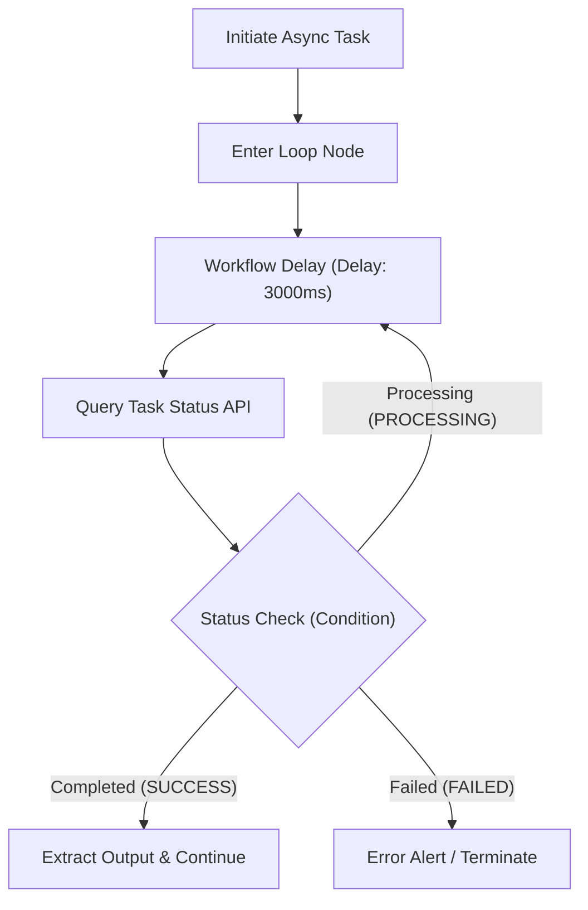

# Workflow Delay (Delay)

The Workflow Delay (`delay`) plugin is an official FastGPT workflow control tool designed to introduce a configurable pause between workflow execution steps. By precisely managing execution intervals, it helps developers satisfy diverse requirements such as API rate limit throttling, asynchronous status polling, and step-by-step interactive pacing.

## Application Scenarios

- **Third-Party API Rate Limit Throttling**: When calling external services subject to strict rate limits (QPS/RPM), such as search engines, LLM generation endpoints, or messaging webhooks, inserting delays between iterations or batch calls smooths traffic spikes and prevents `429 Too Many Requests` errors.
- **Asynchronous Task Polling Interval**: When initiating long-running asynchronous operations (e.g., AI video generation, audio transcription, document parsing, or batch data export), workflows often need to poll task status. The delay node provides a steady interval (e.g., 3–5 seconds) between checks, preventing excessive idle polling and saving system resources.
- **Interactive Step Pacing & Realistic Pauses**: In conversational AI, customer support, or multi-step automated announcements, introducing brief pauses simulates natural human thought and typing cadence, or creates pleasant pacing between sequential messages to improve user experience.
- **Cross-System Data Synchronization Buffer**: After triggering external data synchronizations, message queue deliveries, or database changes, a short delay ensures downstream systems are fully updated before executing subsequent read or verification steps.

## Input Parameters

| Parameter | Type | Required | Default | Range | Description |
| --- | --- | --- | --- | --- | --- |
| `ms` | Number | No | `1` | 1 ~ 300,000 (ms) | Workflow delay duration in milliseconds (1 second = 1,000 ms). Maximum supported duration is 300,000 ms (5 minutes). Compatible with legacy Chinese parameter name `延迟时长`. |

> **Compatibility Note**: To maintain backward compatibility with existing workflows, the plugin supports both the standard English parameter `ms` and the legacy Chinese parameter `延迟时长`. If both are provided, `ms` takes precedence. If neither is provided, it defaults to `1` ms. We recommend using the standard parameter `ms` in all new workflows.

## Output Results

| Field | Type | Description |
| --- | --- | --- |
| - | Object | Returns an empty object `{}` once the delay duration completes. |

> **Execution Mechanism**: The delay node utilizes a non-blocking asynchronous timer to wait for the specified milliseconds. As a pure flow-control utility, it outputs no data payload and automatically triggers downstream connected nodes upon completion.

## Typical Workflow Orchestration Examples

### Scenario: Asynchronous Long-Running Task Polling (Loop + Condition)

When calling an asynchronous API (such as document parsing or image generation), the workflow typically polls the result until the task finishes. Combining a Loop node, a Delay node, and a Condition node forms a robust polling workflow:



#### Workflow Steps and Configuration

1. **Initiate Async Task**: Call the external API to create the background task and retrieve `task_id`.
2. **Loop Polling Body**:
   - **Workflow Delay (Delay)**: Set `ms: 3000` (waits for 3 seconds before the next step).
   - **Query Task Status**: Call the status query API passing `task_id`.
   - **Condition Branch**:
     - If `status === "SUCCESS"`: Break the loop, extract results, and continue to downstream nodes.
     - If `status === "PROCESSING"`: Continue the current loop iteration back to the Delay node.
     - If `status === "FAILED"`: Break the loop and route to error handling.

#### Example Node Configuration

```json
{
  "ms": 3000
}
```

### Scenario: Batch API Rate-Limit Throttling

When iterating through an array to send notifications or call rate-limited external APIs, place a Delay node at the end of each iteration (e.g., `ms: 500`). This keeps request frequencies within safe provider thresholds and avoids temporary IP or account bans.

## Important Considerations

1. **Maximum Delay Limit**:
   - The supported delay range is `1 ~ 300,000` ms (up to 5 minutes / 300 seconds). Any value outside this range (e.g., less than 1 or greater than 300,000) will be rejected by Zod validation, aborting the workflow step.
2. **Workflow Execution Timeout**:
   - FastGPT environments and serverless runtime layers typically enforce a maximum global execution timeout for single workflow executions (e.g., 60 seconds or several minutes). When designing polling loops with delays, ensure the combination of **interval duration** and **maximum loop iterations** stays well within the global platform timeout limit.
3. **Non-blocking Asynchronous Execution**:
   - The plugin relies on Node.js's event loop via `setTimeout`, ensuring the waiting period does not block the thread or consume CPU resources.
4. **Time Unit Note**:
   - The parameter unit is **milliseconds (ms)**, not seconds (s). For example, input `1000` to wait 1 second, `5000` to wait 5 seconds, and `30000` to wait 30 seconds.
