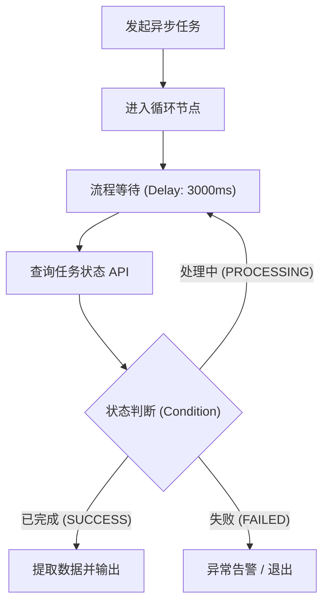

# 流程等待 (Delay)

流程等待（Delay）插件是 FastGPT 官方提供的流程控制工具，用于在工作流节点流转过程中引入可配置的等待延迟。通过精确控制节点间的执行时间间隔，能够有效应对外部服务限流、异步状态轮询、分步交互拟真等多种复杂编排场景。

## 应用场景

- **第三方 API 频控平滑缓冲**：调用具有严格频率限制（QPS/RPM）的外部接口（如搜索引擎、大模型生成、企微/钉钉机器人通知等）时，在多次循环或批量调用之间插入适当延时，平滑请求峰值，避免因请求过密触发 `429 Too Many Requests` 限流阻断。
- **异步任务轮询间隔等待**：在工作流中启动长耗时异步任务（如 AI 视频生成、音频转写、文档深度解析、异步报表导出等）后，通常需要循环查询任务处理状态。通过流程等待节点在每次状态查询之间增加缓冲间隔（如等待 3~5 秒），避免高频空转消耗系统资源。
- **交互式步骤拟真停顿**：在智能客服、拟人助手或步骤式自动化播报流程中，模拟思考与打字停顿，或在多阶段消息推送之间提供节奏间隔，提升用户的交互体验。
- **跨系统数据同步缓冲**：在触发外部数据同步、消息队列投递或数据库变更后，预留缓冲时间，确保下游系统数据完全就绪后再执行后续读取与校验。

## 输入参数

| 参数名 | 类型 | 必填 | 默认值 | 取值范围 | 说明 |
| --- | --- | --- | --- | --- | --- |
| `ms` | 数字 (Number) | 否 | `1` | 1 ~ 300,000 (毫秒) | 工作流延迟暂停时长，单位为毫秒（1 秒 = 1000 毫秒）。最大支持 300,000 毫秒（即 5 分钟）。兼容旧版中文字段名 `延迟时长`。 |

> **兼容性说明**：为了无缝兼容旧版工作流编排，插件同时支持标准英文字段名 `ms` 与旧版中文字段名 `延迟时长`。若两者均提供，优先使用 `ms`；若均未提供，默认延迟 `1` 毫秒。推荐在新建工作流中统一使用标准字段名 `ms`。

## 输出结果

| 字段 | 类型 | 说明 |
| --- | --- | --- |
| - | 对象 (Object) | 延迟等待结束后返回空对象 `{}`。 |

> **执行机制说明**：流程等待节点基于非阻塞异步计时器等待指定毫秒数后完成。该节点为纯控制流工具，不产生额外数据输出，执行完成后将自动推进下游已连接节点的执行。

## 典型工作流编排示例

### 场景：异步长任务轮询 (Polling with Loop & Condition)

在调用异步生成接口（如文档解析或 AI 生图）时，通常需要循环查询结果直到任务完成。结合「循环」节点、「流程等待」节点与「条件分支」节点可实现健壮的轮询逻辑：



#### 节点编排步骤与配置

1. **发起异步任务**：调用第三方 API 创建异步任务，获取返回的 `task_id`。
2. **循环轮询体**：
   - **流程等待 (Delay)**：配置 `ms: 3000`（等待 3 秒后执行下一步）。
   - **查询任务状态**：调用状态查询接口，传入 `task_id`。
   - **条件分支**：
     - 若 `status === "SUCCESS"`：跳出循环，提取生成结果流向后续节点。
     - 若 `status === "PROCESSING"`：继续当前循环，流回流程等待节点。
     - 若 `status === "FAILED"`：跳出循环并进行异常分支处理。

#### 节点参数配置示例

```json
{
  "ms": 3000
}
```

### 场景：批量调用接口防频控限流 (Batch API Throttling)

在遍历数组向外部服务批量推送消息或调用受频控限制的接口时，可在每次迭代的末尾接入「流程等待」节点（例如设置 `ms: 500`），将请求频率控制在安全阈值以内，避免触发服务商的并发与频控封禁。

## 注意事项

1. **最大延迟上限**：
   - 单次延迟支持的数值范围为 `1 ~ 300,000` 毫秒（即最长 5 分钟 / 300 秒）。若输入超出范围（如小于 1 或大于 300,000），插件将触发参数校验错误并中止执行。
2. **工作流全局超时考量**：
   - FastGPT 平台及其运行环境对单次工作流请求通常设有全局执行超时限制（如 60 秒或数分钟）。在轮询循环中编排流程等待时，请务必设置合理的**单次等待时长**与**最大循环次数**，防止工作流因总耗时过长触发全局超时中断。
3. **异步非阻塞机制**：
   - 插件底层基于 Node.js 事件循环的 `setTimeout` 实现，在等待期间不会阻塞进程或占用 CPU 计算资源。
4. **时间单位换算**：
   - 参数单位为**毫秒 (ms)**而非秒 (s)。例如：等待 1 秒请输入 `1000`，等待 5 秒请输入 `5000`，等待 30 秒请输入 `30000`。

