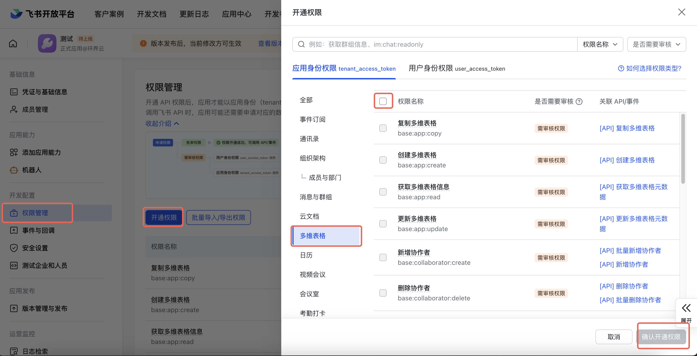
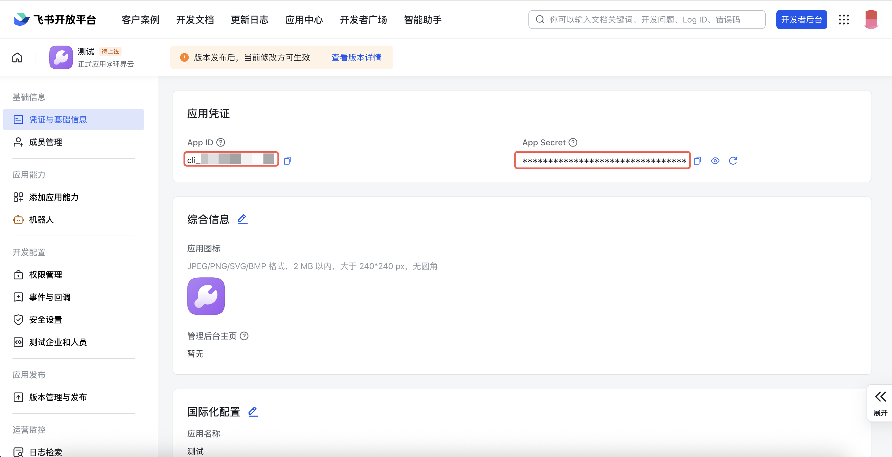

# Feishu Base (Bitable) Tool Set

Manage and manipulate Feishu Base (Bitable) records, tables, fields, and views from FastGPT.

# 1. Create or Select an Application and Get Credentials

Log in to the [Feishu Open Platform](https://open.feishu.cn/) and enter the Developer Console.
Select your existing application or create a new one for Base management.

# 2. Configure Application Permissions

Reference: https://open.feishu.cn/document/server-docs/docs/bitable-v1/bitable-overview

Apply for necessary permissions. To use all tools in this suite, grant all Bitable-related scopes or import the following scopes configuration:

```json
{
  "scopes": {
    "tenant": [
      "base:collaborator:create",
      "base:collaborator:delete",
      "base:collaborator:read",
      "base:dashboard:copy",
      "base:dashboard:read",
      "base:field:create",
      "base:field:delete",
      "base:field:read",
      "base:field:update",
      "base:form:read",
      "base:form:update",
      "base:record:create",
      "base:record:delete",
      "base:record:read",
      "base:record:retrieve",
      "base:record:update",
      "base:role:create",
      "base:role:delete",
      "base:role:read",
      "base:role:update",
      "base:table:create",
      "base:table:delete",
      "base:table:read",
      "base:table:update",
      "base:view:read",
      "base:view:write_only",
      "base:app:copy",
      "base:app:create",
      "base:app:read",
      "base:app:update",
      "bitable:app",
      "bitable:app:readonly"
    ]
  }
}
```



Publish the application version after the enterprise administrator approves the request.

# 3. Retrieve Application Credentials

Obtain your `App ID` and `App Secret` from the application dashboard:


