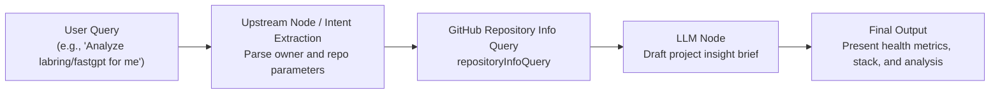

# GitHub Tool Set (GitHub)

English | [简体中文](./README.md)

The GitHub Tool Set is an official FastGPT integration plugin for the open-source software ecosystem. By interfacing directly with the GitHub REST API, it empowers FastGPT AI agents and automated workflows to retrieve repository metrics, read default branch README Markdown documentation, detect open-source licenses, and inspect public developer/organization profiles.

This toolset includes two core sub-tools:
- **`repositoryInfoQuery` (GitHub Repository Info Query)**: Retrieve metadata for any public or authorized private repository (stars, forks, open issues, primary language, topics, etc.), default branch README raw Markdown text, and license information.
- **`userInfoQuery` (GitHub User Info Query)**: Look up public GitHub user or organization profiles (avatar, bio, followers, following, repository count, etc.) and list their public repositories.

---

## Typical Application Scenarios

- **Open-Source Project Popularity & Health Tracking**: Monitor star growth, fork volume, open issue counts, and recent code commit activity (`pushed_at`) in real time to assess maintenance status and community vitality.
- **Developer Profiling & Contributor Archive Lookup**: Fetch public developer credentials, follower counts, organizational affiliations, and published repositories by username for tech recruitment, developer relations, or community contributor verification.
- **Technology Evaluation & Star/Fork Comparison**: Concurrently query multiple candidate open-source repositories in AI tech stack evaluation workflows, generating comparative benchmark reports with an LLM.
- **CI / Automated Workflow Project Metadata Association**: Automatically link GitHub repository status, license compliance, and README guidelines into continuous integration, release notifications, or DevOps bots.

---

## Credentials & Configuration

This toolset supports **direct invocation without a token** as well as optional authentication using a GitHub Personal Access Token (PAT). All sub-tools share this credential configuration.

### Secret Configuration

| Field Name | Type | Required | Secret Masked | Description |
| :--- | :--- | :--- | :--- | :--- |
| `token` | String (`string`) | No | Yes (`isSecret`) | GitHub Personal Access Token (PAT). Optional. Increases API rate limits or allows access to authorized private repositories. |

### API Rate Limit Comparison

The GitHub REST API enforces distinct rate limit quotas depending on authentication status:

| Configuration Status | Rate Limit | Description & Scope |
| :--- | :--- | :--- |
| **Unauthenticated (No Token)** | **60 requests / hour** | Enforced per public outbound IP of the FastGPT host. In shared server or high-concurrency environments, this threshold can quickly result in HTTP 403 Rate Limit errors. Recommended only for lightweight local debugging. |
| **Authenticated (With Token)** | **5,000 requests / hour** | Allocated per authenticated user account (up to 15,000 requests/hour for GitHub Enterprise accounts), supporting high-frequency production tasks and batch queries. |

> **Note**:
> To access **private repository** metadata or README content, you must configure a Personal Access Token with read access to the target repository (`repo` scope).

### How to Generate a GitHub Token

1. Sign in to your GitHub account, click your profile avatar in the upper-right corner, and select **Settings**.
2. Scroll to the bottom of the left sidebar and click **Developer settings**.
3. Navigate to **Personal access tokens** -> **Tokens (classic)** (or Fine-grained tokens).
4. Click **Generate new token** -> **Generate new token (classic)**.
5. Enter a **Note** (e.g., `FastGPT-GitHub-Plugin`) and select an **Expiration** period according to your organization's security policy (or choose No expiration).
6. Select scopes:
   - For querying public repositories and users: No extra scopes are required (public data is accessible by default).
   - For querying private repositories: Select **`repo`** (Full control of private repositories).
   - For querying organization data: Select **`read:org`**.
7. Click **Generate token** at the bottom of the page, and **immediately copy the generated token** (starts with `ghp_`). Note: GitHub will not display this token again once you navigate away.
8. Paste this token into the `token` secret setting of the GitHub plugin in FastGPT.

---

## Sub-Tools List

| Sub-Tool ID | Sub-Tool Name | Description |
| :--- | :--- | :--- |
| `repositoryInfoQuery` | GitHub Repository Info Query | Retrieve repository metadata, raw README Markdown content, and license information. |
| `userInfoQuery` | GitHub User Info Query | Look up public user/organization profiles and recent public repositories. |

---

## Sub-Tool Details & Parameter Specifications

### 1. GitHub Repository Info Query (`repositoryInfoQuery`)

Retrieves detailed repository metadata, star counts, fork counts, primary programming language, topics, timestamps, raw Markdown README content, and license details by specifying the repository owner (`owner`) and repository name (`repo`).

#### Input Parameters

| Parameter | Type | Required | Default | Model Tool Parameter (`isToolParam`) | Description |
| :--- | :--- | :--- | :--- | :--- | :--- |
| `owner` | String (`string`) | Yes | None | Yes | **GitHub repository owner username or organization**. For example, `labring`, `facebook`, or `vercel`. |
| `repo` | String (`string`) | Yes | None | Yes | **GitHub repository name**. For example, `fastgpt`, `react`, or `next.js`. |

#### Output Results

| Field Name | Type | Description |
| :--- | :--- | :--- |
| `info` | Object (`object`) | **Repository metadata object**. |
| `info.full_name` | String (`string`) | Full repository name in `owner/repo` format (e.g., `labring/fastgpt`). |
| `info.description` | Nullable String (`string \| null`) | Repository description; returns `null` if not configured. |
| `info.stargazers_count` | Number (`number`) | Total number of GitHub stars. |
| `info.forks_count` | Number (`number`) | Total number of repository forks. |
| `info.open_issues_count` | Number (`number`) | Total count of open issues and pull requests. |
| `info.language` | Nullable String (`string \| null`) | Primary programming language (e.g., `TypeScript`); returns `null` if unrecognized. |
| `info.html_url` | String (`string`) | Web URL to view the repository on GitHub. |
| `info.topics` | Array of Strings (`string[]`) | Repository topics/tags; returns an empty array `[]` if none exist. |
| `info.created_at` | String (`string`) | Creation timestamp in ISO 8601 UTC format. |
| `info.updated_at` | String (`string`) | Timestamp of the last repository metadata update. |
| `info.pushed_at` | String (`string`) | Timestamp of the most recent code push/commit. |
| `readme` | Nullable String (`string \| null`) | **Raw Markdown content of the default branch README**. Decoded from Base64; returns `null` if unavailable or on fetch error. |
| `license` | Nullable Object (`object \| null`) | **License details**. Returns `null` if no open-source license is detected. |
| `license.key` | String (`string`) | Lowercase license identifier key (e.g., `apache-2.0`, `mit`). |
| `license.name` | String (`string`) | Official license display name (e.g., `Apache License 2.0`, `MIT License`). |
| `license.spdx_id` | String (`string`) | Standard SPDX license identifier (e.g., `Apache-2.0`, `MIT`). |
| `license.url` | Nullable String (`string \| null`) | API URL for the license definition on GitHub. |

#### Example Response

```json
{
  "info": {
    "full_name": "labring/fastgpt",
    "description": "FastGPT is a knowledge-based platform built on the LLM, offers out-of-the-box data processing and model invocation capabilities.",
    "stargazers_count": 21500,
    "forks_count": 5200,
    "open_issues_count": 86,
    "language": "TypeScript",
    "html_url": "https://github.com/labring/fastgpt",
    "topics": [
      "agent",
      "fastgpt",
      "knowledge-base",
      "llm",
      "rag"
    ],
    "created_at": "2023-01-20T03:15:22Z",
    "updated_at": "2025-02-28T09:42:15Z",
    "pushed_at": "2025-02-28T08:16:04Z"
  },
  "readme": "# FastGPT\n\nFastGPT is a knowledge-based platform built on the LLM...",
  "license": {
    "key": "apache-2.0",
    "name": "Apache License 2.0",
    "spdx_id": "Apache-2.0",
    "url": "https://api.github.com/licenses/apache-2.0"
  }
}
```

---

### 2. GitHub User Info Query (`userInfoQuery`)

Retrieves public profile details (avatar, bio, follower count, public repo count, etc.) and a list of public repositories (up to 100 repositories) for a given GitHub username or organization (`username`).

#### Input Parameters

| Parameter | Type | Required | Default | Model Tool Parameter (`isToolParam`) | Description |
| :--- | :--- | :--- | :--- | :--- | :--- |
| `username` | String (`string`) | Yes | None | Yes | **Target GitHub username or organization identifier**. For example, `octocat`, `labring`, or `torvalds`. |

#### Output Results

| Field Name | Type | Description |
| :--- | :--- | :--- |
| `userInfo` | Object (`object`) | **Public profile information object**. |
| `userInfo.login` | String (`string`) | GitHub username or organization login handle (e.g., `octocat`). |
| `userInfo.id` | Number (`number`) | Unique numeric GitHub user/organization ID. |
| `userInfo.avatar_url` | String (`string`) | Direct URL to the user's avatar image. |
| `userInfo.html_url` | String (`string`) | Web URL to the GitHub profile page. |
| `userInfo.name` | Nullable String (`string \| null`) | Display name; returns `null` if not provided. |
| `userInfo.company` | Nullable String (`string \| null`) | Company or affiliated organization; returns `null` if not provided. |
| `userInfo.blog` | Nullable String (`string \| null`) | Personal blog or website URL; returns `null` if not provided. |
| `userInfo.location` | Nullable String (`string \| null`) | Geographical location; returns `null` if not provided. |
| `userInfo.email` | Nullable String (`string \| null`) | Public email address; returns `null` if not publicly visible. |
| `userInfo.bio` | Nullable String (`string \| null`) | Biography / user bio; returns `null` if not provided. |
| `userInfo.public_repos` | Number (`number`) | Total count of owned public repositories. |
| `userInfo.followers` | Number (`number`) | Number of followers. |
| `userInfo.following` | Number (`number`) | Number of users being followed. |
| `userInfo.created_at` | String (`string`) | Account creation timestamp in ISO 8601 format. |
| `userInfo.updated_at` | String (`string`) | Timestamp of the last profile update. |
| `repos` | Array of Objects (`object[]`) | **List of public repositories** (returns up to 100 repositories). |
| `repos[].name` | String (`string`) | Repository name (e.g., `Hello-World`). |
| `repos[].full_name` | String (`string`) | Full repository name (e.g., `octocat/Hello-World`). |
| `repos[].html_url` | String (`string`) | Web URL to the repository. |
| `repos[].description` | Nullable String (`string \| null`) | Repository description. |
| `repos[].stargazers_count` | Number (`number`) | Number of GitHub stars. |
| `repos[].forks_count` | Number (`number`) | Number of repository forks. |
| `repos[].language` | Nullable String (`string \| null`) | Primary programming language. |
| `repos[].created_at` | String (`string`) | Repository creation timestamp. |
| `repos[].updated_at` | String (`string`) | Timestamp of the last repository metadata update. |
| `repos[].pushed_at` | String (`string`) | Timestamp of the most recent code push. |

#### Example Response

```json
{
  "userInfo": {
    "login": "octocat",
    "id": 583231,
    "avatar_url": "https://avatars.githubusercontent.com/u/583231?v=4",
    "html_url": "https://github.com/octocat",
    "name": "The Octocat",
    "company": "@github",
    "blog": "https://github.blog",
    "location": "San Francisco",
    "email": null,
    "bio": "GitHub mascot and developer friend.",
    "public_repos": 8,
    "followers": 15420,
    "following": 9,
    "created_at": "2011-01-25T18:44:36Z",
    "updated_at": "2024-11-22T12:01:30Z"
  },
  "repos": [
    {
      "name": "Hello-World",
      "full_name": "octocat/Hello-World",
      "html_url": "https://github.com/octocat/Hello-World",
      "description": "My first repository on GitHub!",
      "stargazers_count": 2840,
      "forks_count": 2410,
      "language": null,
      "created_at": "2011-01-26T19:01:12Z",
      "updated_at": "2025-02-15T08:11:00Z",
      "pushed_at": "2024-08-01T15:20:10Z"
    },
    {
      "name": "Spoon-Knife",
      "full_name": "octocat/Spoon-Knife",
      "html_url": "https://github.com/octocat/Spoon-Knife",
      "description": "This repo is for spooning nor knifing.",
      "stargazers_count": 12800,
      "forks_count": 142000,
      "language": "HTML",
      "created_at": "2011-03-05T01:42:35Z",
      "updated_at": "2025-02-27T04:12:00Z",
      "pushed_at": "2024-05-10T11:08:23Z"
    }
  ]
}
```

---

## Typical Workflow Orchestration Example

### Scenario: Intelligent Open-Source Project Evaluation & Insight Brief Generation

Combine FastGPT's User Input / Intent Extraction, GitHub Repository Info Query, and AI Chat (LLM) nodes to parse repository names from user queries and draft comprehensive project assessment briefs automatically.



#### Orchestration Steps:
1. **Intent Extraction & Parameter Preparation**:
   - The upstream node receives a question regarding an open-source project (e.g., `"Please evaluate the labring/fastgpt project for me"`).
   - Use an LLM or regular expression node to extract `owner: "labring"` and `repo: "fastgpt"`.
2. **Invoke GitHub Repository Query**:
   - Add the **GitHub Tool Set -> GitHub Repository Info Query (`repositoryInfoQuery`)** node to the FastGPT canvas.
   - Bind the extracted `owner` and `repo` variables to the node's input parameters.
3. **LLM Insight Synthesis & Report Generation**:
   - Connect the output variables (`info` metadata and `readme` content) of `repositoryInfoQuery` to the context input of an **AI Chat** node.
   - Sample system prompt:
     ```text
     You are a seasoned open-source software architect. Based on the provided GitHub repository metrics (stars, forks, open issues, push activity) and README content, draft an insightful project brief addressing:
     1. Project positioning and key architectural features;
     2. Community popularity and maintenance health analysis;
     3. Technology adoption recommendations and potential risks.
     ```
4. **Deliver Response to End User**: Deliver a structured, Markdown-formatted evaluation report with key metrics and repository links directly to the user.

---

## Important Notes

1. **Troubleshooting API Rate Limits (`Rate Limit Exceeded`)**:
   - When calling without a token, GitHub limits unauthenticated requests to 60 requests per hour per outbound IP. If you encounter `GitHub API error: 403 Forbidden` (`API rate limit exceeded`) on shared servers or during frequent testing, configure a valid GitHub Personal Access Token in the plugin credentials.
   - You can query `https://api.github.com/rate_limit` to check remaining IP or token quota.
2. **Private Repository Access Requirements**:
   - Anonymous calls only have access to public repositories.
   - To query private repositories or internal enterprise codebases, you must supply a Personal Access Token with the `repo` scope. Otherwise, GitHub API returns `404 Not Found` (GitHub intentionally returns 404 instead of 403 for unauthorized private repositories to prevent existence enumeration).
3. **README Payload Size and Context Window Limits**:
   - For large repositories, the `readme` field provides the full Markdown content. When forwarding raw README content into an LLM node, be mindful of your model's context window. Consider adding a text truncation or summarization node if necessary.
4. **Upper Bound for User Public Repositories**:
   - `userInfoQuery` requests public repositories with `per_page=100`. For users with more than 100 repositories, only the most recent 100 repositories are returned. Refer to `userInfo.public_repos` for the exact total repository count.
