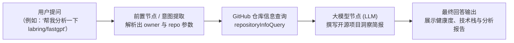

# GitHub 工具集 (GitHub Tool Set)

[English](./README.en.md) | 简体中文

GitHub 工具集是 FastGPT 官方提供的开源生态数据集成插件。通过对接 GitHub REST API，为智能体与自动化工作流提供便捷的开源仓库指标查询、README 原文读取、开源许可证检测以及开发者与组织公开档案画像分析能力。

本工具集包含两个核心子工具：
- **`repositoryInfoQuery`（GitHub 仓库信息查询）**：支持检索任意 GitHub 仓库的基础元数据（Star、Fork、Open Issues、主要编程语言、Topics 标签等）、默认分支 README Markdown 原文与 License 许可证信息。
- **`userInfoQuery`（GitHub 用户信息查询）**：支持查询 GitHub 用户或组织的公开个人档案（头像、Bio、粉丝数、关注数、公开仓库数等）及该账号下的公开仓库列表。

---

## 典型应用场景

- **开源项目热度跟踪与健康度分析**：实时获取开源项目的 Star 增长、Fork 规模、开放 Issue 数量及最近代码提交（`pushed_at`）活跃度，辅助评估项目的维护状态与社区健康度。
- **开发者画像与贡献者档案查询**：根据用户名快速拉取开发者的公开履历、关注人数、组织归属及名下公开仓库清单，用于技术招聘评估、技术布道对象洞察或社区贡献者认证。
- **技术选型 Star/Fork 对比与评估**：在 AI 技术选型顾问或技术调研工作流中，并行调用多个候选开源仓库的元数据，结合 LLM 智能生成技术框架横向对比报告与选型建议。
- **CI/自动化工作流项目元数据关联**：在持续集成、发布通知或运维巡检机器人中，自动联动 GitHub 仓库的最新状态、License 合规性与 README 规范说明，实现元数据自动化校验与播报。

---

## 密钥与凭据配置说明

本工具集支持**免 Token 直接调用**，也支持配置 GitHub Personal Access Token（个人访问令牌）。所有子工具共享此全局凭据配置。

### 凭据配置项

| 字段名 | 字段类型 | 必填 | 密钥脱敏 | 说明 |
| :--- | :--- | :--- | :--- | :--- |
| `token` | 字符串 (`string`) | 否 | 是 (`isSecret`) | GitHub Personal Access Token (PAT)。可选填，用于提升 API 请求速率上限或访问授权范围内的私有仓库。 |

### API 调用速率上限对比（Rate Limits）

GitHub REST API 对不同认证状态有明确的调用速率配额限制：

| 配置状态 | 速率上限 (Rate Limit) | 适用场景与限制说明 |
| :--- | :--- | :--- |
| **未配置 Token（匿名/未认证）** | **60 次 / 小时** | 按 FastGPT 服务节点出口公网 IP 聚合统计。多租户或高频测试场景下极易触发 HTTP 403 Rate Limit 错误，仅建议用于轻量本地调试。 |
| **已配置 Token（认证请求）** | **5,000 次 / 小时** | 按照 Token 归属的用户账号独立配额核算（GitHub Enterprise 账户最高可达 15,000 次/小时），满足高频生产环境与批量数据分析需求。 |

> **提示**：
> 若工作流需要查询**私有仓库**元数据或 README，必须配置具备对应仓库读权限（`repo` scope）的 Personal Access Token。

### GitHub Token 申请指引

1. 登录 GitHub 账号，点击右上角个人头像，选择 **Settings**（设置）。
2. 在左侧菜单栏拉到底部，点击 **Developer settings**（开发者设置）。
3. 选择 **Personal access tokens** -> **Tokens (classic)**（或 Fine-grained tokens）。
4. 点击 **Generate new token** -> **Generate new token (classic)**。
5. 填写 **Note**（例如 `FastGPT-GitHub-Plugin`），设置 **Expiration**（过期时间，推荐根据实际安全策略设置，或选 No expiration）。
6. 选择权限范围（Scopes）：
   - 查询公开仓库与公开用户：无需勾选额外权限（默认公开权限即可访问公开数据）。
   - 查询私有仓库：勾选 **`repo`**（Full control of private repositories）权限。
   - 查询组织私有数据：勾选 **`read:org`** 权限。
7. 点击页面底部 **Generate token**，**立即复制生成的 Token 字符串**（形如 `ghp_xxxxxxxxxxxxxxxxxxxx`）。注意：离开页面后将无法再次查看该 Token 明文。
8. 将该 Token 填入 FastGPT 插件配置的 `token` 密钥项中保存即可。

---

## 子工具列表

| 子工具 ID | 子工具名称 | 功能说明 |
| :--- | :--- | :--- |
| `repositoryInfoQuery` | GitHub 仓库信息查询 | 查询指定 GitHub 仓库的基础元数据、README 原文内容及开源许可证信息。 |
| `userInfoQuery` | GitHub 用户信息查询 | 查询指定 GitHub 用户或组织的公开个人档案与公开仓库列表。 |

---

## 子工具详情与参数说明

### 1. GitHub 仓库信息查询 (`repositoryInfoQuery`)

根据仓库拥有者（`owner`）和仓库名称（`repo`），获取该仓库的 Star 数、Fork 数、主要语言、主题标签、创建与更新时间、默认分支 README 纯文本全文以及许可证详情。

#### 输入参数

| 参数名 | 字段类型 | 必填 | 默认值 | 包含在模型提示词中 (`isToolParam`) | 说明 |
| :--- | :--- | :--- | :--- | :--- | :--- |
| `owner` | 字符串 (`string`) | 是 | 无 | 是 | **GitHub 仓库拥有者用户名或组织名**。例如 `labring`、`facebook`、`vercel`。 |
| `repo` | 字符串 (`string`) | 是 | 无 | 是 | **GitHub 仓库名称**。例如 `fastgpt`、`react`、`next.js`。 |

#### 输出结果

| 字段名 | 字段类型 | 说明 |
| :--- | :--- | :--- |
| `info` | 对象 (`object`) | **仓库基础元数据对象**。 |
| `info.full_name` | 字符串 (`string`) | 仓库全名，格式为 `owner/repo`（如 `labring/fastgpt`）。 |
| `info.description` | 可空字符串 (`string \| null`) | 仓库描述信息；未配置时返回 `null`。 |
| `info.stargazers_count` | 整数 (`number`) | 仓库获得的 Star 总数。 |
| `info.forks_count` | 整数 (`number`) | 仓库的 Fork 总数。 |
| `info.open_issues_count` | 整数 (`number`) | 处于开启状态的 Issue 与 PR 总数。 |
| `info.language` | 可空字符串 (`string \| null`) | 仓库的主要开发编程语言（如 `TypeScript`）；未识别时为 `null`。 |
| `info.html_url` | 字符串 (`string`) | 仓库在 GitHub 上的访问 Web URL。 |
| `info.topics` | 字符串数组 (`string[]`) | 仓库的主题标签（Topics）列表，未配置时为空数组 `[]`。 |
| `info.created_at` | 字符串 (`string`) | 仓库创建时间，采用 ISO 8601 标准 UTC 时间戳格式。 |
| `info.updated_at` | 字符串 (`string`) | 仓库元数据最近更新时间。 |
| `info.pushed_at` | 字符串 (`string`) | 仓库最近一次代码提交/推送时间。 |
| `readme` | 可空字符串 (`string \| null`) | **仓库 README 原始 Markdown 内容**。从默认分支自动 Base64 解码后的纯文本内容；若仓库无 README 或读取失败则返回 `null`。 |
| `license` | 可空对象 (`object \| null`) | **开源许可证信息**。若仓库未检测到开源许可证则返回 `null`。 |
| `license.key` | 字符串 (`string`) | 许可证标识 Key（如 `apache-2.0`、`mit`）。 |
| `license.name` | 字符串 (`string`) | 许可证完整名称（如 `Apache License 2.0`、`MIT License`）。 |
| `license.spdx_id` | 字符串 (`string`) | 许可证 SPDX 规范标识码（如 `Apache-2.0`、`MIT`）。 |
| `license.url` | 可空字符串 (`string \| null`) | GitHub API 对应的许可证规则详情链接。 |

#### 输出示例

```json
{
  "info": {
    "full_name": "labring/fastgpt",
    "description": "FastGPT is a knowledge-based platform built on the LLM, offers out-of-the-box data processing and model invocation capabilities.",
    "stargazers_count": 21500,
    "forks_count": 5200,
    "open_issues_count": 86,
    "language": "TypeScript",
    "html_url": "https://github.com/labring/fastgpt",
    "topics": [
      "agent",
      "fastgpt",
      "knowledge-base",
      "llm",
      "rag"
    ],
    "created_at": "2023-01-20T03:15:22Z",
    "updated_at": "2025-02-28T09:42:15Z",
    "pushed_at": "2025-02-28T08:16:04Z"
  },
  "readme": "# FastGPT\n\nFastGPT is a knowledge-based platform built on the LLM...",
  "license": {
    "key": "apache-2.0",
    "name": "Apache License 2.0",
    "spdx_id": "Apache-2.0",
    "url": "https://api.github.com/licenses/apache-2.0"
  }
}
```

---

### 2. GitHub 用户信息查询 (`userInfoQuery`)

根据输入的 GitHub 用户名或组织名（`username`），获取其公开档案详细信息（头像、Bio、关注者数量、公开仓库数等）以及名下的公开仓库列表（默认返回最多 100 个公开仓库）。

#### 输入参数

| 参数名 | 字段类型 | 必填 | 默认值 | 包含在模型提示词中 (`isToolParam`) | 说明 |
| :--- | :--- | :--- | :--- | :--- | :--- |
| `username` | 字符串 (`string`) | 是 | 无 | 是 | **要查询的 GitHub 用户名或组织名**。例如 `octocat`、`labring`、`torvalds`。 |

#### 输出结果

| 字段名 | 字段类型 | 说明 |
| :--- | :--- | :--- |
| `userInfo` | 对象 (`object`) | **用户或组织公开基本信息对象**。 |
| `userInfo.login` | 字符串 (`string`) | GitHub 用户名或组织登录标识（如 `octocat`）。 |
| `userInfo.id` | 整数 (`number`) | GitHub 唯一数字用户 ID。 |
| `userInfo.avatar_url` | 字符串 (`string`) | 用户头像图片 URL。 |
| `userInfo.html_url` | 字符串 (`string`) | 用户的 GitHub 个人主页链接。 |
| `userInfo.name` | 可空字符串 (`string \| null`) | 用户自定义显示的姓名/昵称；未填写时为 `null`。 |
| `userInfo.company` | 可空字符串 (`string \| null`) | 所属公司或组织名称；未填写时为 `null`。 |
| `userInfo.blog` | 可空字符串 (`string \| null`) | 个人博客或主页网站 URL；未填写时为 `null`。 |
| `userInfo.location` | 可空字符串 (`string \| null`) | 所在地区或城市；未填写时为 `null`。 |
| `userInfo.email` | 可空字符串 (`string \| null`) | 公开电子邮箱；未公开时为 `null`。 |
| `userInfo.bio` | 可空字符串 (`string \| null`) | 个人简介 (Bio)；未填写时为 `null`。 |
| `userInfo.public_repos` | 整数 (`number`) | 拥有的公开仓库总数。 |
| `userInfo.followers` | 整数 (`number`) | 关注该用户的粉丝数 (Followers)。 |
| `userInfo.following` | 整数 (`number`) | 该用户正在关注的人数 (Following)。 |
| `userInfo.created_at` | 字符串 (`string`) | 账号注册时间（ISO 8601 标准时间戳）。 |
| `userInfo.updated_at` | 字符串 (`string`) | 账号资料最近更新时间。 |
| `repos` | 数组 (`object[]`) | **公开仓库列表**（最多返回 100 个公开仓库）。 |
| `repos[].name` | 字符串 (`string`) | 仓库短名称（如 `Hello-World`）。 |
| `repos[].full_name` | 字符串 (`string`) | 仓库完整名称（如 `octocat/Hello-World`）。 |
| `repos[].html_url` | 字符串 (`string`) | 仓库的 GitHub Web 链接。 |
| `repos[].description` | 可空字符串 (`string \| null`) | 仓库描述信息。 |
| `repos[].stargazers_count` | 整数 (`number`) | 仓库获得的 Star 数量。 |
| `repos[].forks_count` | 整数 (`number`) | 仓库被 Fork 的数量。 |
| `repos[].language` | 可空字符串 (`string \| null`) | 仓库主要开发语言。 |
| `repos[].created_at` | 字符串 (`string`) | 仓库创建时间。 |
| `repos[].updated_at` | 字符串 (`string`) | 仓库元数据最近更新时间。 |
| `repos[].pushed_at` | 字符串 (`string`) | 仓库最近推送时间。 |

#### 输出示例

```json
{
  "userInfo": {
    "login": "octocat",
    "id": 583231,
    "avatar_url": "https://avatars.githubusercontent.com/u/583231?v=4",
    "html_url": "https://github.com/octocat",
    "name": "The Octocat",
    "company": "@github",
    "blog": "https://github.blog",
    "location": "San Francisco",
    "email": null,
    "bio": "GitHub mascot and developer friend.",
    "public_repos": 8,
    "followers": 15420,
    "following": 9,
    "created_at": "2011-01-25T18:44:36Z",
    "updated_at": "2024-11-22T12:01:30Z"
  },
  "repos": [
    {
      "name": "Hello-World",
      "full_name": "octocat/Hello-World",
      "html_url": "https://github.com/octocat/Hello-World",
      "description": "My first repository on GitHub!",
      "stargazers_count": 2840,
      "forks_count": 2410,
      "language": null,
      "created_at": "2011-01-26T19:01:12Z",
      "updated_at": "2025-02-15T08:11:00Z",
      "pushed_at": "2024-08-01T15:20:10Z"
    },
    {
      "name": "Spoon-Knife",
      "full_name": "octocat/Spoon-Knife",
      "html_url": "https://github.com/octocat/Spoon-Knife",
      "description": "This repo is for spooning nor knifing.",
      "stargazers_count": 12800,
      "forks_count": 142000,
      "language": "HTML",
      "created_at": "2011-03-05T01:42:35Z",
      "updated_at": "2025-02-27T04:12:00Z",
      "pushed_at": "2024-05-10T11:08:23Z"
    }
  ]
}
```

---

## 典型工作流编排示例

### 场景：开源项目智能评估与洞察简报生成

通过结合 FastGPT 的「对话输入 / 意图识别」、「GitHub 仓库信息查询」与「AI 对话 (LLM)」节点，实现自动提取用户输入的开源仓库并生成专业的项目分析简报。



#### 编排步骤：
1. **意图提取与参数准备**：
   - 上游节点接收用户关于开源项目的提问（例如：`请帮我评估一下 labring/fastgpt 这个项目`）。
   - 通过大模型或正则表达式从用户语句中解析出仓库拥有者 `owner: "labring"` 与仓库名 `repo: "fastgpt"`。
2. **调用 GitHub 仓库查询**：
   - 在 FastGPT 画布中添加「GitHub 工具集 -> GitHub 仓库信息查询 (`repositoryInfoQuery`)」节点。
   - 将提取出的 `owner` 与 `repo` 变量连接至该节点的输入参数。
3. **LLM 洞察提炼与报告生成**：
   - 将 `repositoryInfoQuery` 节点的输出变量（`info` 元数据与 `readme` 内容）连接至「AI 对话」节点的上下文输入。
   - 系统提示词示例：
     ```text
     你是一名资深开源架构师。请根据提供的 GitHub 仓库元数据指标（Star、Fork、Issues、最近更新时间）及 README 内容，从以下维度撰写专业洞察简报：
     1. 项目定位与核心特性；
     2. 社区热度与维护健康度分析；
     3. 技术选型建议与潜在风险提示。
     ```
4. **输出给最终用户**：将生成的分析简报直接输出给用户，展示排版优美、包含关键指标与技术架构的完整报告。

---

## 注意事项

1. **API 速率限制（Rate Limit Exceeded）排查**：
   - 未配置 Token 时，GitHub API 会限制单一出口 IP 每小时最多 60 次请求。若在多人共用服务器、集群或频繁调试时遇到 `GitHub API error: 403 Forbidden`（提示 `API rate limit exceeded`），请务必在插件配置中填入有效的 GitHub Personal Access Token。
   - 可以在 GitHub API `https://api.github.com/rate_limit` 中查询当前 IP 或 Token 的剩余配额。
2. **私有仓库访问权限要求**：
   - 默认匿名调用仅能访问公开仓库（Public Repositories）。
   - 若需查询企业内部或个人私有仓库，必须在配置中填入具备对应仓库访问权限（`repo` scope）的 Personal Access Token，否则 GitHub API 将返回 `404 Not Found`（GitHub 出于隐私保护策略，对无访问权限的私有仓库默认返回 404 而非 403）。
3. **README 内容体积与上下文窗口**：
   - 对于超长 README 的大型开源项目，`readme` 字段会返回完整的 Markdown 纯文本。在工作流中直接将全量 `readme` 传入大语言模型时，请注意当前模型支持的上下文窗口（Context Window）长度，必要时可在工作流中前置添加文本切片或提取摘要节点。
4. **用户公开仓库列表上限**：
   - `userInfoQuery` 目前通过分页参数 `per_page=100` 拉取最近的 100 个公开仓库。若目标用户的公开仓库数超过 100 个，列表将包含前 100 个仓库，如需获取总数请以 `userInfo.public_repos` 为准。

