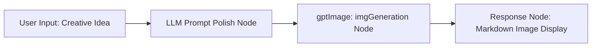
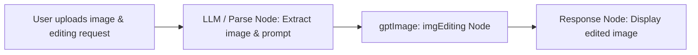

# GPT-Image Generation & Editing Toolset (gptImage)

The GPT-Image plugin is an official FastGPT multimodal image processing toolset (Tool Set). Powered by the `gpt-image-1` model, it supports high-quality text-to-image generation from natural language descriptions as well as instruction-guided image-to-image editing on existing images.

Deeply integrated with FastGPT host file storage capabilities (declaring the `file-upload:allow` permission), this plugin automatically persists the raw image data returned by the model and produces a permanent, long-lasting direct access URL (`imageUrl`), eliminating the risk of temporary third-party link expiration.

---

## Typical Application Scenarios

- **Commercial Design & Marketing Poster Generation**: Automatically batch-generate high-definition promotional posters, marketing collateral, social media banners, and e-commerce hero graphics based on campaign themes or article summaries.
- **Background Replacement & Stylistic Modification**: Replace portrait or product backgrounds (e.g., swapping to a beach, snowy landscape, showroom, or clean solid color) using natural language instructions, or transfer artistic styles onto existing imagery.
- **Multi-size & Multi-quality Asset Customization**: Supports popular aspect ratios such as square (1024x1024), portrait (1024x1536), and landscape (1536x1024), along with quality tiers and transparent background settings to fit mobile covers, desktop wallpapers, and print media.
- **E-commerce Product Image Fine-tuning**: Add holiday elements to product photos, adjust lighting and color tones, or intelligently add/remove secondary props without complex manual retouching.

---

## Secrets and Endpoint Configuration

In the FastGPT plugin management interface, configure the following secrets to set up service access:

| Configuration Key | Display Name | Data Type | Required | Encrypted (`isSecret`) | Default / Example | Description |
| :--- | :--- | :--- | :---: | :---: | :--- | :--- |
| `baseUrl` | Base URL | String (`string`) | No | No | `https://api.openai.com/v1` | The base URL of the API service. Defaults to the official OpenAI endpoint. Compatible with third-party proxy gateways or aggregation services supporting the `gpt-image-1` model (e.g., `https://api.gpt.ge`). The plugin automatically joins the relative request endpoints. |
| `apiKey` | API Key | String (`string`) | **Yes** | Yes | `sk-xxxxxxxxxxxxxxxx` | The authentication credential for API access. Can be obtained at [gpt.ge pricing page](https://api.gpt.ge/pricing) or from your compatible service provider. The plugin automatically prepends `Authorization: Bearer <apiKey>` to HTTP request headers; provide the raw key without the `Bearer ` prefix. |

---

## Sub-tools Overview

This toolset contains two sub-tools for image generation and image editing:

| Sub-tool ID | Tool Name | Description |
| :--- | :--- | :--- |
| `imgGeneration` | gpt-image Image Generation | High-quality Text-to-Image generation. Renders refined images using the `gpt-image-1` model based on detailed text prompts, with configurable resolution, quality, and background transparency. |
| `imgEditing` | gpt-image Image Editing | Instruction-based Image-to-Image editing and manipulation. Takes an existing image and natural language modification instructions to perform inpainting, background replacement, or element adjustments. |

---

## Input Parameters

### 1. Image Generation (`imgGeneration`)

| Parameter Name | Display Name | Data Type | Required | Default | Tool Param (`isToolParam`) | Description & Recommendations |
| :--- | :--- | :--- | :---: | :--- | :---: | :--- |
| `prompt` | Image description | String (`string`) | **Yes** | - | Yes (`true`) | A detailed text description of the desired image. Specifying subject details, camera perspective, composition, lighting, color palette, and artistic medium (e.g., photorealistic photography, digital illustration, oil painting, cyberpunk) yields the best results. |
| `size` | Image size | Enum (`string`) | No | `1024x1024` | Yes (`true`) | Resolution dimensions of the output image. Available options:<br>• `1024x1024` (1:1 square, ideal for avatars and standard displays)<br>• `1024x1536` (2:3 portrait, ideal for mobile wallpapers and posters)<br>• `1536x1024` (3:2 landscape, ideal for banners and desktop backgrounds) |
| `quality` | Image quality | Enum (`string`) | No | `medium` | Yes (`true`) | Visual rendering quality. Available options:<br>• `low` (faster generation speed)<br>• `medium` (balanced speed and image fidelity)<br>• `high` (enhanced texture details and nuanced rendering) |
| `background` | Background | Enum (`string`) | No | `auto` | Yes (`true`) | Background transparency setting. Available options:<br>• `auto` (adaptive, determined by model prompt)<br>• `transparent` (transparent background, ideal for cutouts, logos, icons, and sticker assets)<br>• `opaque` (solid background, ideal for full-scene artworks) |
| `moderation` | Moderation level | Enum (`string`) | No | `auto` | Yes (`true`) | Content safety moderation policy. Available options:<br>• `auto` (standard automated moderation, default)<br>• `low` (relaxed moderation filtering to reduce false positives) |

### 2. Image Editing (`imgEditing`)

| Parameter Name | Display Name | Data Type | Required | Default | Tool Param (`isToolParam`) | Description & Recommendations |
| :--- | :--- | :--- | :---: | :--- | :---: | :--- |
| `image` | Source image | String (`string`) | **Yes** | - | Yes (`true`) | The source image to edit. Accepts publicly accessible HTTP/HTTPS URLs or Base64 data (including Data URLs such as `data:image/png;base64,...`). **File size must be under 4MB**. |
| `prompt` | Editing instructions | String (`string`) | **Yes** | - | Yes (`true`) | Natural language instructions describing the edits to apply. For example: "Replace the background with a starry night sky", "Add gold-rimmed glasses to the character", or "Shift lighting to a warm sunset glow". |
| `size` | Image size | Enum (`string`) | No | `1024x1024` | Yes (`true`) | Target resolution of the edited image. Available options: `1024x1024`, `1024x1536`, `1536x1024`. |
| `quality` | Image quality | Enum (`string`) | No | `medium` | Yes (`true`) | Rendering quality of the edited image. Available options: `low`, `medium`, `high`. |

---

## Output Parameters & Persistence Mechanism

### Output Parameters

Both `imgGeneration` and `imgEditing` return the same structured output:

| Field Name | Display Name | Data Type | Description |
| :--- | :--- | :--- | :--- |
| `imageUrl` | Image URL / Edited image URL | String (`string`) | The persistent direct access URL of the generated or edited image. Can be directly rendered in Markdown or HTML image elements. |

### JSON Response Example

```json
{
  "imageUrl": "https://your-fastgpt-domain.com/api/system/img/gpt-image-generated-20250201.png"
}
```

### Image Persistence Mechanism

1. **Eliminating Temporary URL Expiration**: Many upstream image generation APIs return temporary URLs that expire within hours.
2. **Automated Host Upload**: This plugin requests the `file-upload:allow` permission. Upon receiving raw Base64 image data from the upstream API, the plugin decodes the binary stream and immediately persists it into FastGPT's local file storage or configured object storage (such as AWS S3, Aliyun OSS, MinIO) via `ctx.invoke.uploadFile`, returning a permanent direct URL.
3. **Environment Fallback**: In offline development or sandbox environments where host upload is unavailable, the plugin automatically falls back to returning a Base64 Data URL, ensuring resilient execution across all environments.

---

## Typical Workflow Orchestration Examples

### Scenario 1: Creative Text-to-Image Generation (Prompt Expansion -> Generation -> Display)

Orchestrate an AI Creative Drawing Agent within FastGPT:



1. **User Input**: The user inputs a brief concept (e.g., "Design a futuristic cyberpunk city nightscape poster").
2. **LLM Node (Prompt Enhancer)**: Uses prompt engineering to expand the user's idea into a vivid, descriptive prompt detailing subjects, framing, lighting, and textures.
3. **gptImage: imgGeneration Node**: Binds its `prompt` parameter to the LLM node's output, with custom `size` (e.g., `1536x1024`) and `quality` (`high`).
4. **Final Response Node**: Uses Markdown syntax to display the generated artwork directly to the user:
   ```markdown
   Here is your generated artwork:
   
   ```

#### Recommended LLM System Prompt for Prompt Expansion
```text
You are an expert AI visual and artistic prompt engineer. Your task is to expand the user's brief concept into a vivid, highly descriptive image generation prompt.
Follow these guidelines:
1. Core Subject: Detail the appearance, posture, and textures of the main subjects.
2. Composition & Perspective: Specify camera angles (e.g., macro close-up, bird's-eye view, cinematic wide shot).
3. Lighting & Palette: Describe the light source, shadows, and color grading (e.g., neon glow, golden hour rim light).
4. Artistic Medium: Define the visual style (e.g., digital concept art, photorealistic commercial photography, 3D render).
5. Output only the final expanded prompt without conversational filler or explanations.
```

### Scenario 2: Instruction-based Image Editing



1. **User Input**: The user uploads a product photo and inputs: "Replace the background with a sunlit modern wooden showroom table".
2. **Extraction Node**: Passes the uploaded image URL (or Base64) to `image` and the edit instructions to `prompt`.
3. **gptImage: imgEditing Node**: Processes the source image and generates the edited output URL.
4. **Final Response Node**: Displays the modified image:
   ```markdown
   Image editing completed:
   
   ```

---

## Important Notes

1. **Input Image Size Limit**: When calling `imgEditing`, the decoded source image file size **must be under 4MB**. Images exceeding this limit will be rejected with an error. Please ensure large images are compressed before passing them to the tool.
2. **Timeout Settings**: Image generation and editing are compute-intensive tasks that typically take 10 to 40 seconds. The plugin sets a 180-second (180,000 ms) network timeout. Ensure reverse proxies and gateways (such as Nginx, Cloudflare) are configured with an upstream timeout of at least 120 seconds to prevent premature disconnections.
3. **Endpoint Compatibility & baseUrl**:
   - The default base URL is `https://api.openai.com/v1`.
   - The plugin dispatches HTTP requests to `${baseUrl}/v1/images/generations` and `${baseUrl}/v1/images/edits`.
   - When using compatible proxy gateways (such as `https://api.gpt.ge`), set `baseUrl` to the root host (e.g., `https://api.gpt.ge`) which will naturally resolve the `/v1/images/...` endpoints.
4. **Authentication Header**: Enter the raw API key directly in `apiKey`. The plugin automatically adds the `Authorization: Bearer <apiKey>` header during requests.
