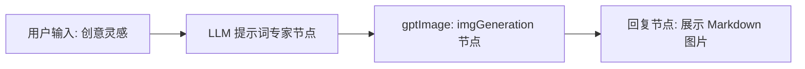
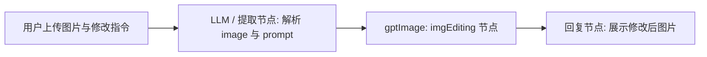

# GPT-Image 图像生成与编辑工具集 (gptImage)

GPT-Image 图像生成与编辑插件是 FastGPT 官方提供的多模态图像处理工具集（Tool Set）。该插件基于 `gpt-image-1` 模型，支持根据自然语言描述生成高质量图像（文生图），以及基于自然语言指令对现有图像进行局部修改与图生图编辑。

本插件深度集成了 FastGPT 宿主文件存储能力（声明 `file-upload:allow` 权限），在模型返回图像数据后自动转存并生成长期有效的持久化访问直链（`imageUrl`），有效规避了第三方临时直链过期失效的问题。

---

## 典型应用场景

- **商业设计与海报文案生图**：结合营销活动主题或文案摘要，自动批量生成契合意境的高清广告海报、宣传物料、社媒营销配图与电商 Banner。
- **照片背景替换与风格化修改**：根据自然语言指令智能更换人像或商品照片的背景（如置换为沙滩、雪山、室内展厅或极简纯色），或对既有画面进行风格化渲染迁移。
- **多尺寸与多画质素材定制**：支持正方形（1024x1024）、竖版（1024x1536）、横版（1536x1024）等常见宽高比例，并提供多档画质与透明背景配置，按需适配移动端封面、电脑壁纸与印刷品。
- **电商商品图智能微调**：为商品主图增添节日氛围装饰、调整光影质感与配色风格、智能替换或增删局部周边道具，极大提升电商运营上架效率。

---

## 密钥与服务端点配置 (Secrets)

在 FastGPT 插件配置的密钥管理区域中，需配置访问接口的基础端点与身份凭证：

| 配置项 (Key) | 界面显示名称 | 数据类型 | 是否必填 | 加密存储 (`isSecret`) | 默认值 / 示例 | 说明 |
| :--- | :--- | :--- | :---: | :---: | :--- | :--- |
| `baseUrl` | 基础 URL (Base URL) | 字符串 (`string`) | 否 | 否 | `https://api.openai.com/v1` | 接口服务的基础地址。默认为 OpenAI 官方端点；支持配置为兼容 `gpt-image-1` 模型的第三方代理平台或聚合网关（例如 `https://api.gpt.ge`）。插件底层会自动拼接请求路径。 |
| `apiKey` | API 密钥 (API Key) | 字符串 (`string`) | **是** | 是 | `sk-xxxxxxxxxxxxxxxx` | 访问服务的身份认证密钥。可以在 [gpt.ge 定价页面](https://api.gpt.ge/pricing) 或相应兼容提供商平台获取。插件会在 HTTP 请求头中自动添加 `Authorization: Bearer <apiKey>` 鉴权，填写时直接输入密钥原文即可。 |

---

## 子工具列表

本工具集包含以下 2 个子工具，分别负责图像生成与图像编辑：

| 子工具 ID | 工具名称 | 功能描述 |
| :--- | :--- | :--- |
| `imgGeneration` | gpt-image 图像生成 (gpt-image Image Generation) | 高品质文本生成图像（Text-to-Image）。根据详细的文本提示词，使用 `gpt-image-1` 模型渲染生成精美图像，支持自定义分辨率、质量与背景透明度。 |
| `imgEditing` | gpt-image 图像编辑 (gpt-image Image Editing) | 基于指令的图像编辑与图生图修改（Image-to-Image / Image Editing）。输入原始图片及修改指令，对画面进行局部重绘、背景变更或元素微调。 |

---

## 输入参数说明

### 1. 图像生成 (`imgGeneration`)

| 参数名 | 界面显示名称 | 数据类型 | 是否必填 | 默认值 | 工具参数 (`isToolParam`) | 说明与建议 |
| :--- | :--- | :--- | :---: | :--- | :---: | :--- |
| `prompt` | 图像描述 | 字符串 (`string`) | **是** | - | 是 (`true`) | 详细描述要生成的图像内容。建议详细指定画面主体、视角、构图、光影、色彩与艺术风格（如写实摄影、数码插画、油画、赛博朋克等）。 |
| `size` | 图片尺寸 | 枚举 (`string`) | 否 | `1024x1024` | 是 (`true`) | 生成图像的分辨率规格。可选值：<br>• `1024x1024`（1:1 正方形，适合头像与常规展示）<br>• `1024x1536`（2:3 竖版，适合手机壁纸与海报）<br>• `1536x1024`（3:2 横版，适合横幅与电脑壁纸） |
| `quality` | 图片质量 | 枚举 (`string`) | 否 | `medium` | 是 (`true`) | 画面渲染质量。可选值：<br>• `low`（低画质，生成速度更快）<br>• `medium`（中等质量，平衡生成速度与画质细节）<br>• `high`（高质量，画面纹理与细节表现更为丰富细腻） |
| `background` | 背景透明度 | 枚举 (`string`) | 否 | `auto` | 是 (`true`) | 画面背景类型。可选值：<br>• `auto`（自动，根据模型提示词自适应）<br>• `transparent`（透明背景，适合免抠主体、Logo 图标与设计贴纸）<br>• `opaque`（不透明背景，适合完整场景插画） |
| `moderation` | 图片审查级别 | 枚举 (`string`) | 否 | `auto` | 是 (`true`) | 内容安全审核策略等级。可选值：<br>• `auto`（标准自动审核，默认策略）<br>• `low`（宽松审核级别，减少敏感误拦截） |

### 2. 图像编辑 (`imgEditing`)

| 参数名 | 界面显示名称 | 数据类型 | 是否必填 | 默认值 | 工具参数 (`isToolParam`) | 说明与建议 |
| :--- | :--- | :--- | :---: | :--- | :---: | :--- |
| `image` | 原始图片 | 字符串 (`string`) | **是** | - | 是 (`true`) | 待编辑的原始图片源。支持公开的 HTTP/HTTPS 图片链接，或完整的 Base64 编码（支持 Data URL 格式如 `data:image/png;base64,...`）。**文件大小必须小于 4MB**。 |
| `prompt` | 编辑描述 | 字符串 (`string`) | **是** | - | 是 (`true`) | 描述希望对原始图片进行的调整与修改指令。例如：“将背景替换为星空夜景”、“为主角佩戴一副金丝边眼镜”、“调整光影为暖色黄昏夕阳”。 |
| `size` | 图片尺寸 | 枚举 (`string`) | 否 | `1024x1024` | 是 (`true`) | 编辑后输出图像的目标分辨率。可选值：`1024x1024`、`1024x1536`、`1536x1024`。 |
| `quality` | 图片质量 | 枚举 (`string`) | 否 | `medium` | 是 (`true`) | 输出图像的渲染质量。可选值：`low`、`medium`、`high`。 |

---

## 输出结果说明与持久化机制

### 输出参数说明

无论是 `imgGeneration` 还是 `imgEditing`，工具执行成功后均返回统一的图像持久化直链：

| 字段名 | 界面显示名称 | 数据类型 | 说明 |
| :--- | :--- | :--- | :--- |
| `imageUrl` | 图片链接 / 编辑后图片链接 | 字符串 (`string`) | 成功生成的持久化图像访问直链（URL）。可直接在 Markdown 或前端页面中作为 `src` 渲染展示。 |

### 响应示例

```json
{
  "imageUrl": "https://your-fastgpt-domain.com/api/system/img/gpt-image-generated-20250201.png"
}
```

### 图片持久化存储机制

1. **解决第三方临时链接过期痛点**：通常图像生成模型接口返回的直链带有严格的时效限制（部分托管于临时对象存储中，数小时内即会失效）。
2. **自动持久化转存**：本插件声明了 `file-upload:allow` 权限。插件在请求上游接口获取图像的 Base64 原始数据流后，立即解码并通过 FastGPT 宿主环境的 `ctx.invoke.uploadFile` 能力自动持久化转存至 FastGPT 本地文件存储或已挂载的对象存储（如 AWS S3、阿里云 OSS、MinIO 等），输出长效稳定的直链。
3. **环境降级兼容**：若在离线开发环境或宿主未配置上传能力的沙箱环境中运行，插件会自动降级返回 Base64 Data URL 格式，确保工作流在各种环境下均能正常运转。

---

## 典型工作流编排示例

### 场景一：自然语言创意生图（Prompt 扩写 -> 生图 -> 渲染展示）

在 FastGPT 中编排“AI 创意绘图助手”工作流：



1. **用户输入**：用户输入简短想法，例如：“设计一张具有未来科技感的城市夜景海报”。
2. **大模型节点（LLM 提示词润色）**：通过 Prompt 工程将简短想法扩写为具象、生动的专业绘图提示词，指定画面元素、构图、冷暖光影与风格。
3. **gptImage: imgGeneration 节点**：将 `prompt` 绑定大模型节点的输出内容，并按需设置 `size`（如 `1536x1024`）与 `quality`（如 `high`）。
4. **最终回复节点**：在文本回复节点中直接利用 Markdown 图片语法输出给终端用户：
   ```markdown
   这是为您生成的画面：
   
   ```

#### 推荐的 LLM 提示词润色 System Prompt
```text
你是一位资深的 AI 视觉与艺术提示词专家。你的任务是将用户简短的画面创意扩展为细节丰富、画面感强烈的绘图描述。
请按以下规范扩写：
1. 主体明确：详细描绘画面主体的外观、姿态与材质细节。
2. 构图与视角：指定构图方式（如特写、俯瞰、广角、对称构图等）。
3. 光影与色彩：指定光源方向、色调搭配与氛围（如霓虹光效、晨曦漫反射、电影级质感）。
4. 艺术媒介：指定呈现风格（如概念设计图、写实商业摄影、赛博朋克 3D 渲染）。
5. 直接输出扩写后的描述正文，无需附加任何开场白或多余解释。
```

### 场景二：基于自然语言的图片编辑与修图



1. **用户输入**：用户上传一张产品图，并输入：“请将背景更换为带有金色阳光的现代木质展厅桌面”。
2. **节点提取**：提取用户上传的图片文件 URL（或 Base64），并将编辑要求传入 `prompt`。
3. **gptImage: imgEditing 节点**：设置输入参数 `image` 与 `prompt`，生成编辑后的图像直链。
4. **最终回复节点**：输出编辑后的新图并展示：
   ```markdown
   图片编辑完成：
   
   ```

---

## 注意事项

1. **输入图片文件大小限制**：在调用 `imgEditing` 图像编辑工具时，传入的 `image`（URL 或 Base64 字符串）底层解码后的文件大小**必须小于 4MB**。若超过 4MB，接口将直接报错拒绝。建议上传前在前端或上游节点进行必要压缩。
2. **请求超时设置**：图像生成与图像编辑属于耗时较长的重计算型任务，接口网络耗时通常在 10 ~ 40 秒不等。插件内部配置了 180 秒（180,000 ms）的超时保护。请确保部署 FastGPT 服务器与代理网关（如 Nginx、Cloudflare 等）的代理超时阈值设置不低于 120 秒，避免因网关提前超时导致连接断开。
3. **接口兼容性与 baseUrl 配置**：
   - 默认服务端点为 `https://api.openai.com/v1`。
   - 插件发起的实际网络请求路径为 `${baseUrl}/v1/images/generations`（生图）和 `${baseUrl}/v1/images/edits`（编辑）。
   - 若使用兼容服务网关（如 `https://api.gpt.ge`），只需将 `baseUrl` 配置为网关主机根地址（如 `https://api.gpt.ge`），网关会自动匹配 `/v1/images/...` 路由。
4. **认证凭证填写规范**：`apiKey` 项直接输入 API 密钥字符串即可，无需手动补全 `Bearer ` 前缀，插件底层会自动封装请求头。

