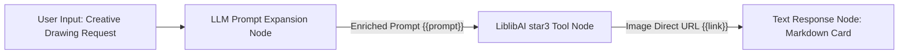

# LiblibAI Drawing Tool Set (Libulibu Tool Set)

FastGPT official LiblibAI image generation tool set. Connects to LiblibAI Open Platform's cutting-edge text-to-image capabilities to deliver industrial-grade AI drawing and multimodal visual creation for intelligent agents and workflows. Built-in "Star-3" (star3 / Xinghuo 3.0 text-to-image architecture) model, supporting multiple standard aspect ratios, intelligent asynchronous task polling, and highly accessible image direct URLs.

---

## Overview and Typical Use Cases

LiblibAI is a leading original AI creator community and model open platform in China, featuring a rich ecosystem of artistic styles and superior Chinese semantic comprehension. This plugin encapsulates LiblibAI's official WebUI generation pipeline and HMAC-SHA1 signature authentication protocol, ready for out-of-the-box integration.

### Typical Use Cases

- **Anime & ACG Illustration Drawing**: Accurately interprets Japanese anime, Donghua, ACG character portraits, mechas, and fantasy settings, producing vibrant, high-fidelity wallpapers and illustrations with fine line work.
- **Commercial E-Commerce Model & Product Visuals**: Rapidly creates studio-grade product backdrops, apparel showcases, and on-model location photography, significantly cutting commercial photography and retouching expenses.
- **Traditional Art & Concept Design**: Faithfully renders ink wash painting, Gongbi heavy-color aesthetics, and Xianxia traditional art atmospheres, supplying high-concept visual sketches for game design and film scene pre-visualization.
- **Custom High-Definition Social Media Covers**: Automatically generates high-CTR cover art tailored to specific content themes in 9:16 (Short video/Xiaohongshu) or 16:9 (Bilibili/WeChat article header banners) formats.

---

## Secret and Credential Configuration

When configuring this tool set in FastGPT, provide the authentication credentials issued by the LiblibAI Open Platform in the plugin configuration panel:

### How to Obtain Credentials

1. Visit the [LiblibAI Open Platform](https://www.liblib.art/apis) to register and sign in to your developer account.
2. Complete real-name or developer verification and access the developer console.
3. In the "API Keys" section, create and retrieve your dedicated `AccessKey` and `SecretKey`.
4. Ensure your account holds sufficient compute points (the platform typically grants trial credits to new developers; commercial usage requires recharging).

### Configuration Parameter Table

| Configuration Item | Field Name | Type | Required | Encrypted (`isSecret`) | Description & Guidance |
| :--- | :--- | :--- | :---: | :---: | :--- |
| **Access Key** | `accessKey` | string (`string`) | **Yes** | Yes (`true`) | LiblibAI developer public key used for request identification and authentication. Obtain from [LiblibAI Open Platform](https://www.liblib.art/apis). |
| **Secret Key** | `secretKey` | string (`string`) | **Yes** | Yes (`true`) | LiblibAI developer secret key used for dynamic HMAC-SHA1 request signing. Obtain from [LiblibAI Open Platform](https://www.liblib.art/apis). |

> **Authentication Mechanism Note**:
>
> The plugin includes a built-in HMAC-SHA1 signature generation algorithm. When initiating API requests, it automatically constructs signatures based on millisecond timestamps, random nonces, the API path, and your `secretKey`. You do not need to manually compute or format query signatures.

---

## Sub-Tool List

This tool set currently provides the following core sub-tool:

| Tool ID | Tool Name | Description |
| :--- | :--- | :--- |
| `star3` | **Star-3 (star3)**<br>Xinghuo 3.0 Model Text-to-Image | Generates high-definition images from descriptive text prompts via LiblibAI's Star-3 model, delivering exceptional composition, detail richness, and multiple resolution options. |

---

## Sub-Tool: star3 (Star-3)

### Input Parameters

When invoked in a FastGPT workflow or by an AI agent tool call, `star3` accepts the following input parameters:

| Parameter Name | Field Name | Type | Required | Default | Tool Param (`isToolParam`) | Description & Recommendations |
| :--- | :--- | :--- | :---: | :---: | :---: | :--- |
| **Image prompt** | `prompt` | string (`string`) | **Yes** | None | Yes (`true`) | Descriptive prompt detailing the image to be generated. Include the main subject, scene details, lighting, camera angle, and artistic medium. Both Chinese and English inputs are supported. |
| **Image size** | `size` | enum string (`string`) | No | `1024*1024` | Yes (`true`) | Target resolution of the output image. See the size breakdown table below for supported values. |

#### Resolution Size (`size`) Breakdown

| Value | Aspect Ratio | Recommended Use Cases |
| :--- | :---: | :--- |
| `1024*1024` | 1:1 (Square) | **Default option**. Universal avatars, square posters, social media cards, CD album covers. |
| `576*1024` | 9:16 (Vertical portrait) | Xiaohongshu posts, TikTok/Shorts vertical background images, mobile lockscreen wallpapers. |
| `768*1024` | 3:4 (Classic portrait) | E-commerce apparel showcases, character portraits (half/full body), artistic fashion photography. |
| `1024*576` | 16:9 (Widescreen landscape) | Article header banners, Bilibili/YouTube video covers, cinematic concept art, landscape paintings. |
| `768*512` | 3:2 (Classic DSLR landscape) | DSLR photography, desktop wallpapers, editorial spreads, natural scenery. |
| `512*1024` | 1:2 (Ultra-tall portrait) | Mobile product detail pages, tall promotional banners, customized vertical phone wallpapers. |

---

### Output Parameters

Upon task completion, the sub-tool returns the following output fields:

| Field Name | Type | Description & Example |
| :--- | :--- | :--- |
| `link` | string (`string`) | Publicly accessible direct URL of the generated image. Returns a CDN URL on success, suitable for Markdown rendering or downstream downloading. |
| `error` | string (`string`, optional) | Error message if generation fails or is rejected by safety filters (e.g., content policy violation, timeout, invalid keys). Empty on success. |

#### Output JSON Examples

**Successful Generation**:
```json
{
  "link": "https://liblibai-tmp-image.liblib.cloud/img/xxx/generate_result.png"
}
```

**Task Failure or Policy Rejection**:
```json
{
  "link": "",
  "error": "任务完成但图片列表为空，可能图片未通过审核"
}
```

---

## Typical Workflow Orchestration Example

In a FastGPT workflow, connecting the LiblibAI drawing tool with an upstream Large Language Model (LLM) creates an end-to-end loop: **User Brief Idea -> LLM Prompt Expansion -> libulibu star3 Generation -> Markdown Response Card**:

### 1. Workflow Architecture



### 2. Upstream LLM Prompt Optimizer System Prompt Example

Configure the following system prompt in the LLM node to enhance prompt fidelity, composition, and visual quality:

```markdown
You are an expert AI drawing prompt engineer. Your task is to expand the user's brief concept into an evocative, highly detailed visual prompt.

Follow these output guidelines:
1. Subject & Attire: Clearly define the subject, physical features, clothing texture, expression, and dynamic posture.
2. Background & Setting: Detail the surroundings, environmental elements, and depth-of-field blur.
3. Lighting & Atmosphere: Specify lighting characteristics (e.g., Tyndall effect, rim light, cinematic contrast, volumetric lighting).
4. Artistic Style & Quality: Include artistic medium keywords (e.g., Makoto Shinkai style, ultra-detailed anime illustration, ink wash painting, masterpiece, 8K resolution, cinematic lighting).
5. Output only the final expanded prompt without any introductory text, preambles, or conversational filler.
```

### 3. Downstream Response Node Configuration Example

In the final response node, present the generated image using Markdown syntax:

```markdown
Your artwork has been generated successfully:


> 💡 Tip: You can specify custom aspect ratios (e.g., vertical portrait, 16:9 widescreen, or 1:1 square avatar) in your next request.
```

---

## Important Notes

1. **Asynchronous Polling & Execution Duration**:
   LiblibAI uses an asynchronous server-side queueing mechanism. The plugin automatically begins polling after submitting the task (querying every 2 seconds, up to 30 retries, maximum waiting time ~60 seconds). Standard generation takes 10 to 25 seconds. During peak platform hours, queue times may extend; ensure upstream nodes have adequate timeout thresholds.
2. **Content Compliance & Safety Filters**:
   LiblibAI enforces strict content safety guidelines. If a prompt contains restricted terms or the generated image violates safety standards, the platform will return an empty image list, and the plugin will report `任务完成但图片列表为空，可能图片未通过审核` (Task completed but image list is empty, image may have failed content review).
3. **Platform Quotas & Concurrency Limits**:
   Calling the Star-3 model consumes compute points from your LiblibAI developer account. Monitor your point balance in the console. Avoid sending burst requests to prevent triggering API rate limits (QPS caps).
4. **Temporary Direct Links & Storage Persistence**:
   The generated direct image links are hosted on LiblibAI's CDN. For long-term archiving or business-critical assets, consider routing the output image through an object storage or file backup node in downstream workflow steps.
