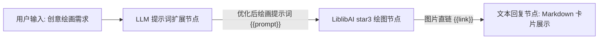

# LiblibAI 哩布哩布 AI 绘图工具集 (Libulibu Tool Set)

FastGPT 官方 LiblibAI（哩布哩布 AI）图像生成工具集。通过对接 LiblibAI 开放平台前沿文生图能力，为智能体与工作流提供高品质、工业级 AI 绘画与多模态创作支持。工具集内置「星流 3」（Star-3 / 星火 3.0 大模型文生图）能力，支持多种主流画幅比例、智能异步任务轮询与高可用图片直链返回。

---

## 插件简介与典型应用场景

LiblibAI 作为国内领先的原创 AI 模型社区与开放平台，具备丰富的画风生态与强大的中文语义理解能力。本插件封装了 LiblibAI 官方开放平台 WebUI 生成管线与 HMAC-SHA1 签名认证协议，开箱即用。

### 典型应用场景

- **动漫二次元插画绘制**：精准解析日漫、国漫、二次元角色立绘、机甲与幻想场景，生成色彩饱满、线条细腻的高质量二次元壁纸与插画。
- **商业电商模特与商品图生成**：快速生成棚拍级商品展示背景、电商服饰穿搭、模特外景展示图，大幅降低商业摄影与修图成本。
- **国风艺术与概念设计**：还原水墨丹青、重彩工笔、仙侠古风等传统东方美学场景，为游戏原画、影视场景提供高度概念化的美术草图。
- **自媒体高清封面图定制**：结合自媒体文章主题，一键产出 9:16（短视频/小红书）或 16:9（B站/微信公众号横幅）等专属高点击率封面大图。

---

## 密钥与凭据配置说明

在 FastGPT 中添加或配置该工具集时，需在插件配置面板中提供 LiblibAI 开放平台的身份认证密钥：

### 凭据获取渠道

1. 访问 [LiblibAI 开放平台](https://www.liblib.art/apis) 注册并登录开发者账号。
2. 完成实名或开发者认证，进入开发者控制台。
3. 在「API 密钥」管理页面中，创建并获取专属的 `AccessKey` 和 `SecretKey`。
4. 确保账户内具备足够的算力点数（平台通常向新开发者提供体验额度，商业调用需按需充值）。

### 配置参数表

| 配置项 | 字段名 | 类型 | 是否必填 | 敏感加密 (`isSecret`) | 说明与获取指引 |
| :--- | :--- | :--- | :---: | :---: | :--- |
| **Access Key** | `accessKey` | 字符串 (`string`) | **是** | 是 (`true`) | LiblibAI 开放平台开发者公钥凭证。用于请求标识与鉴权识别。可在 [LiblibAI 开放平台](https://www.liblib.art/apis) 获取。 |
| **Secret Key** | `secretKey` | 字符串 (`string`) | **是** | 是 (`true`) | LiblibAI 开放平台私钥凭证。可在 [LiblibAI 开放平台](https://www.liblib.art/apis) 获取。插件底层基于该密钥执行 HMAC-SHA1 动态加密签名，确保请求安全。 |

> **鉴权机制说明**：
>
> 插件底层内置了标准的 HMAC-SHA1 签名生成算法。调用接口时会自动基于当前时间戳、随机 Nonce、API 路径与 `secretKey` 签署请求参数，无需用户在外部手动计算或拼接签名。

---

## 子工具列表

本工具集当前提供以下核心子工具：

| 子工具 ID | 子工具名称 | 说明 |
| :--- | :--- | :--- |
| `star3` | **星流 3 (star3)**<br>星火 3.0 大模型文生图 | 调用 LiblibAI 星流 3（Star-3）大模型进行文本到图像（Text-to-Image）生成，具备卓越的构图能力与画质细节，支持多种宽高分辨率。 |

---

## 子工具：star3 (星流 3)

### 输入参数说明

在 FastGPT 智能体工作流或工具调用（Tool Call）中，`star3` 支持以下输入参数：

| 参数名 | 字段名 | 类型 | 是否必填 | 默认值 | 工具参数 (`isToolParam`) | 说明与建议 |
| :--- | :--- | :--- | :---: | :---: | :---: | :--- |
| **绘画提示词** | `prompt` | 字符串 (`string`) | **是** | 无 | 是 (`true`) | 描述要生成的图像画面。建议包含画面主体、场景细节、光影氛围、构图视角及艺术风格。支持中文与英文输入。 |
| **图像尺寸** | `size` | 枚举字符串 (`string`) | 否 | `1024*1024` | 是 (`true`) | 生成图像的目标分辨率。可选值见下文尺寸枚举详解。 |

#### 分辨率尺寸 (`size`) 枚举详解

| 枚举值 | 画面比例 | 适用场景推荐 |
| :--- | :---: | :--- |
| `1024*1024` | 1:1（正方形） | **默认选项**。通用社交头像、方图海报、插画设计、CD 唱片封面。 |
| `576*1024` | 9:16（竖屏画幅） | 小红书竖屏图文、抖音/快手短视频背景图、手机高清锁屏壁纸。 |
| `768*1024` | 3:4（经典竖版） | 电商服装模特展示、人物立绘半身照/全身照、写真艺术摄影。 |
| `1024*576` | 16:9（宽屏横版） | 微信公众号顶图大 Banner、B站视频封面、影视概念图、宽幅风景插画。 |
| `768*512` | 3:2（经典单反画幅） | 单反摄影风格照、PC 桌面壁纸、画册插页、自然风光记录。 |
| `512*1024` | 1:2（超长竖屏） | 移动端详情页长图展示、长屏海报与手机个性化全屏壁纸。 |

---

### 输出结果说明

绘图任务执行完成后，返回以下输出字段：

| 字段名 | 类型 | 说明与示例 |
| :--- | :--- | :--- |
| `link` | 字符串 (`string`) | 生成图片的公网访问直链（URL）。成功时返回 CDN 图片地址，可直接用于 Markdown 渲染或下游下载。 |
| `error` | 字符串 (`string`, 可选) | 任务失败或异常时的错误信息（如提示词触发安全审核、任务超时、凭据无效等）。成功时为空。 |

#### 输出 JSON 示例

**生成成功**：
```json
{
  "link": "https://liblibai-tmp-image.liblib.cloud/img/xxx/generate_result.png"
}
```

**生成失败或被风控拦截**：
```json
{
  "link": "",
  "error": "任务完成但图片列表为空，可能图片未通过审核"
}
```

---

## 典型工作流编排示例

在 FastGPT 工作流中，推荐将 LiblibAI 绘图工具与上游的大语言模型（LLM）节点组合，形成「**用户自然语言输入 -> LLM 丰富并扩展细节提示词 -> libulibu star3 执行绘图 -> 回复节点以图片卡片输出**」的闭环架构：

### 1. 工作流拓扑架构



### 2. 上游 LLM 提示词优化师 System Prompt 示例

在大模型节点（Prompt 扩展器）中填入以下系统提示词，可显著提升图像画面质感与意境：

```markdown
你是一位专业的 AI 绘画提示词工程师。你的任务是将用户的简短构想转换为富有画面感、细节充沛的绘画提示词。

请遵循以下输出规则：
1. 画面主体：明确画面主体物、服装材质、表情与动态姿势。
2. 背景与环境：细化周围场景、环境细节与景深虚化效果。
3. 光影与色彩：添加光影特性（如：丁达尔光、侧逆光、电影级冷暖色温光感、体积光）。
4. 艺术媒介与画质：明确风格词（如：新海诚画风、超精细二次元插画、国风水墨、Masterpiece、8K resolution、Cinematic lighting）。
5. 直接输出扩充后的提示词文本，不要包含任何前导说明或解释。
```

### 3. 下游文本回复节点配置示例

在最终的回复节点中，使用 Markdown 图片语法将生成的图片直链呈现给用户：

```markdown
为您绘制的作品已生成完成：


> 💡 提示：如需调整画面比例，可在对话中指定尺寸（如竖屏、16:9 或头像方图）。
```

---

## 注意事项

1. **异步任务轮询耗时**：
   LiblibAI 服务端采用排队异步渲染机制。插件底层会在提交任务后自动启动轮询（每 2 秒查询一次状态，最多轮询 30 次，最长等待约 60 秒）。一般情况下出图耗时约 10 ~ 25 秒，高峰期若排队过长可能出现超时，请确保上游节点或工作流网络等待时长充足。
2. **内容合规安全审查**：
   LiblibAI 平台执行严格的文本及图像安全审查。若提示词包含违禁敏感词，或生成图像未通过平台安全过滤，平台将不会返回图片 URL，插件将返回 `任务完成但图片列表为空，可能图片未通过审核`。
3. **平台额度与并发限制**：
   调用星流 3 模型需扣除 LiblibAI 开发者账户的算力点数。请及时关注控制台额度余额；同时避免短时间内高并发突发请求，防止触碰平台 API 的 QPS 频控限制。
4. **临时直链与存储持久化**：
   生成的图片直链托管于 LiblibAI 官方 CDN，若需长期持久保存或作为企业级核心资产，建议在工作流后续接入对象存储或文件归档节点。

