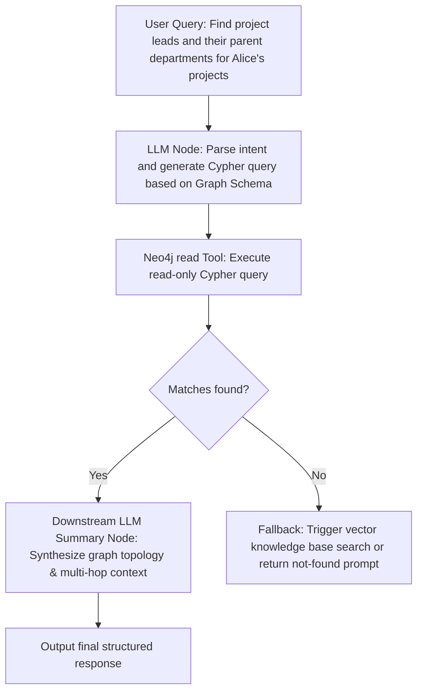

# Neo4j Graph Database Operations Toolset (Neo4j Graph Database)

The Neo4j Graph Database Operations Toolset is an official, enterprise-grade graph database plugin for FastGPT. By connecting seamlessly to remote or local Neo4j instances, it provides AI agents and complex business workflows with read-only transactional querying (`read`) and write/update operations (`write`).

The toolset fully supports the Cypher declarative graph query language, featuring built-in JSON parameter mapping, static read-only syntax validation, and automated serialization of graph data structures (Nodes, Relationships, Paths, and high-precision 64-bit integers) into standard JSON.

---

## Typical Application Scenarios

- **Enterprise Knowledge Graph Construction & Retrieval**: Extract entities, attributes, and semantic relations from unstructured documents, research papers, or service tickets, dynamically creating nodes and querying connections to enhance domain-specific QA accuracy and completeness.
- **Graph RAG Multi-Hop Relational Reasoning**: Traditional vector retrieval evaluates isolated semantic similarities but struggles with multi-hop dependencies and causal chains. With Graph RAG and Cypher multi-hop traversals (e.g., Company A invests in B, B controls C), agents can reason along topological paths and supply reliable multi-hop context to LLMs.
- **Social Network & Risk Association Path Discovery**: In Anti-Money Laundering (AML), fraud detection, corporate shareholding penetration, and supply-chain risk auditing, swiftly detect shortest paths, cyclic fund loops, and suspicious dense clusters among entities.
- **Smart Asset & Infrastructure Topology Tracking**: Model end-to-end IT infrastructure topologies, microservice invocation chains, and IT asset dependencies. Pinpoint impacted services and identify root causes in seconds during incident troubleshooting or change evaluations.

---

## Connection Configuration & Secrets

Before using this toolset, configure the Neo4j connection parameters in FastGPT Secrets Management or toolset settings. All sub-tools (`read`, `write`) share this configuration.

### Configuration Items

| Field | Type | Required | Secret Masked | Description |
| --- | --- | --- | --- | --- |
| `uri` | String (`string`) | Yes | No | **Neo4j Connection URI**. Supports standard and encrypted protocols, e.g., `neo4j://host:7687`, `neo4j+s://host:7687`, or `bolt://host:7687`. |
| `username` | String (`string`) | Yes | No | **Authentication Username**. Used to authenticate with the Neo4j instance (e.g., `neo4j`). |
| `password` | String (`string`) | Yes | Yes (`isSecret`) | **Authentication Password**. Credential password used to authenticate with the Neo4j instance. |
| `database` | String (`string`) | No | No | **Target Database Name**. Leave blank to use the default database (typically `neo4j` in Neo4j 4.x/5.x). |
| `connectionTimeout` | String / Number (`string \| number`) | No | No | **Network Connection Timeout** (milliseconds). Non-negative integer, defaults to `10000` (10 seconds) if left blank. |
| `maxTransactionRetryTime` | String / Number (`string \| number`) | No | No | **Maximum Transaction Retry Time** (milliseconds). Non-negative integer, defaults to `30000` (30 seconds) if left blank. |

### `uri` Scheme Specifications & Breakdown

The official Neo4j driver supports several URI schemes based on network and clustering requirements:

| Scheme Prefix | Architecture | Encryption & Certificate Validation | Typical Use Case |
| --- | --- | --- | --- |
| `neo4j://` | Clustered / Routed | Plaintext (No TLS) | Local single-node development, private internal network clusters, or environments behind a secure reverse proxy. |
| `neo4j+s://` | Clustered / Routed | **TLS Encrypted + Trusted Public CA** | **Recommended for production**. Ideal for public networks, managed cloud databases (e.g., Neo4j AuraDB), and enterprise clusters with valid CA certificates. |
| `neo4j+ssc://` | Clustered / Routed | **TLS Encrypted + Self-Signed Certificate** | Testing or intranet environments using self-signed TLS certificates without public CA verification. |
| `bolt://` | Direct Single Node | Plaintext (No TLS) | Direct point-to-point connection to a single Neo4j instance during development, bypassing cluster routing. |
| `bolt+s://` | Direct Single Node | **TLS Encrypted + Trusted Public CA** | Direct connection to a specific production node requiring verified TLS encryption. |
| `bolt+ssc://` | Direct Single Node | **TLS Encrypted + Self-Signed Certificate** | Direct connection to a specific node using a self-signed TLS certificate. |

> **Security Note**:
> The `password` field is configured with `isSecret: true`. It is encrypted and stored securely within FastGPT, and automatically masked in the user interface, execution logs, and debugging traces to prevent credential exposure.

---

## Sub-Tools List

This toolset includes 2 core sub-tools:

- **`read` (Read Cypher)**: Executes Cypher queries in read-only transactions. Features lexical safety checks to automatically block mutating operations, protecting database integrity.
- **`write` (Write Cypher)**: Executes Cypher data mutation statements in write transactions, supporting node creation, property updates, relationship connections, and deletions.

---

## Sub-Tool Details & Parameter Specifications

### 1. Read Cypher (`read`)

Executes Cypher queries within a read-only transaction session. Ideal for entity lookups, multi-hop path traversals, aggregations, and read-only graph algorithms.

#### Safety Protection Mechanism
To prevent accidental data modifications or prompt injection hazards, the `read` sub-tool strips comments and string literals from the Cypher query and verifies that no mutating clauses exist before execution:
- Mutating keywords blocked: `CREATE`, `MERGE`, `SET`, `DELETE`, `DETACH DELETE`, `REMOVE`, `DROP`, `LOAD CSV`, `FOREACH`.
- Mutating procedures blocked: `apoc.create.*`, `apoc.merge.*`, `apoc.refactor.*`, `apoc.periodic.*`, `apoc.schema.*`, `apoc.trigger.*`, `db.create.*`, `db.drop.*`, `dbms.*`, etc.
- If a mutating statement is detected, execution is rejected immediately with an informative error instructing the caller to use the `write` tool.

#### Input Parameters

| Parameter | Type | Required | Default | Description |
| --- | --- | --- | --- | --- |
| `cypher` | String (`string`) | Yes | None | **Cypher query statement to execute**. For example: `MATCH (p:Person {name: $name})-[r:KNOWS]->(f) RETURN p, r, f LIMIT $limit`. Any trailing semicolon `;` is automatically removed. |
| `parameters` | String (`string`) | No | `"{}"` | **Query parameters dictionary**. Must be a valid JSON object string for parameterized value binding, preventing Cypher injection. |

#### Output Results

| Field | Type | Description |
| --- | --- | --- |
| `rows` | Array (`Array<Record<string, any>>`) | **List of result rows**. Each row contains key-value pairs matching the query return variables. Graph objects (Nodes, Relationships, Paths) and integers are serialized to JSON. |
| `summary` | Object (`Record<string, any>`) | **Execution Summary**. Contains query type (`queryType: "r"` for read-only), target database name (`database`), and latency metrics (`resultAvailableAfter`, `resultConsumedAfter`). |

#### Graph Data Serialization Conventions

- **Node**: Serialized as `{ identity: number | string, labels: string[], properties: Record<string, any> }`.
- **Relationship**: Serialized as `{ identity: number | string, type: string, start: number | string, end: number | string, properties: Record<string, any> }`.
- **Path**: Serialized as `{ start: Node, end: Node, segments: Array<{ start: Node, relationship: Relationship, end: Node }> }`.
- **Integer (64-bit)**: Converted to a JavaScript `number` if within safe integer limits; converted to a precision-preserving `string` if beyond the safe range, preventing numeric truncation.

#### Example Invocation

- **Input Cypher**:
  ```cypher
  MATCH (c:Company {name: $companyName})-[r:INVESTED_IN]->(target:Company)
  RETURN c.name AS investor, r.amount AS amount, target.name AS investee
  LIMIT $limit
  ```
- **Input parameters**:
  ```json
  "{\"companyName\":\"FutureTech Corp\",\"limit\":5}"
  ```
- **Response**:
  ```json
  {
    "rows": [
      {
        "investor": "FutureTech Corp",
        "amount": 50000000,
        "investee": "GraphAI Dynamics"
      },
      {
        "investor": "FutureTech Corp",
        "amount": 20000000,
        "investee": "DeepBlue Analytics"
      }
    ],
    "summary": {
      "queryType": "r",
      "counters": {
        "containsUpdates": false,
        "containsSystemUpdates": false
      },
      "database": "neo4j",
      "resultAvailableAfter": 3,
      "resultConsumedAfter": 1
    }
  }
  ```

---

### 2. Write Cypher (`write`)

Executes data manipulation Cypher statements within a write transaction session. Supports batch entity persistence, relationship creation, property updates, and cleanup.

#### Input Parameters

| Parameter | Type | Required | Default | Description |
| --- | --- | --- | --- | --- |
| `cypher` | String (`string`) | Yes | None | **Cypher mutation statement to execute**. Supports `CREATE`, `MERGE`, `SET`, `DELETE`, etc. Trailing semicolons `;` are automatically removed. |
| `parameters` | String (`string`) | No | `"{}"` | **Query parameters dictionary**. Must be a valid JSON object string containing variables for creation or conditional updates. |

#### Output Results

| Field | Type | Description |
| --- | --- | --- |
| `rows` | Array (`Array<Record<string, any>>`) | **Result rows**. If the write Cypher includes a `RETURN` clause, the created or modified graph entities will be returned. If no `RETURN` clause is provided, returns an empty array `[]`. |
| `summary` | Object (`Record<string, any>`) | **Execution Summary & Mutation Counters**. Contains the `counters` object (nodes created, relationships created, properties set, etc.) and execution timing. |

#### Key Metrics in `summary.counters`

- `nodesCreated`: Number of nodes created
- `nodesDeleted`: Number of nodes deleted
- `relationshipsCreated`: Number of relationships created
- `relationshipsDeleted`: Number of relationships deleted
- `propertiesSet`: Number of properties set or updated
- `labelsAdded`: Number of labels added
- `labelsRemoved`: Number of labels removed
- `indexesAdded` / `indexesRemoved`: Number of indexes added or removed
- `constraintsAdded` / `constraintsRemoved`: Number of constraints added or removed
- `containsUpdates`: Boolean flag indicating if any data updates occurred

#### Example Invocation

- **Input Cypher**:
  ```cypher
  MERGE (p:Person {id: $personId})
  ON CREATE SET p.name = $name, p.createdAt = timestamp()
  ON MATCH SET p.lastActive = timestamp()
  WITH p
  MATCH (d:Department {deptId: $deptId})
  MERGE (p)-[r:BELONGS_TO]->(d)
  RETURN p.id AS personId, p.name AS name, d.name AS department
  ```
- **Input parameters**:
  ```json
  "{\"personId\":\"usr_1001\",\"name\":\"Alice\",\"deptId\":\"dept_tech\"}"
  ```
- **Response**:
  ```json
  {
    "rows": [
      {
        "personId": "usr_1001",
        "name": "Alice",
        "department": "Engineering R&D"
      }
    ],
    "summary": {
      "queryType": "rw",
      "counters": {
        "nodesCreated": 1,
        "nodesDeleted": 0,
        "relationshipsCreated": 1,
        "relationshipsDeleted": 0,
        "propertiesSet": 2,
        "labelsAdded": 1,
        "labelsRemoved": 0,
        "indexesAdded": 0,
        "indexesRemoved": 0,
        "constraintsAdded": 0,
        "constraintsRemoved": 0,
        "containsUpdates": true,
        "containsSystemUpdates": false
      },
      "database": "neo4j",
      "resultAvailableAfter": 6,
      "resultConsumedAfter": 2
    }
  }
  ```

---

## Typical Workflow Orchestration

### Scenario: Graph RAG Multi-Hop Relational Reasoning & Question Answering

Combine Neo4j with Large Language Models to build an intelligent graph-augmented reasoning workflow:



#### Node Configurations:

1. **Schema & Cypher Generation Node (LLM)**:
   - **System Prompt**: Provide the graph schema definition (e.g., `(:Person)-[:BELONGS_TO]->(:Department)`, `(:Person)-[:PARTICIPATES_IN]->(:Project)`).
   - **Output Format**: Instruct the LLM to output parameterized Cypher alongside a JSON parameters object.
2. **Neo4j Read Query Node (`neo4j.read`)**:
   - Map the upstream `cypher` and `parameters` outputs to the tool inputs.
   - The tool automatically validates against write operations and executes the read transaction safely.
3. **Graph Relationship Summarization Node (Downstream LLM)**:
   - Receives the `rows` array from `neo4j.read`.
   - Explains multi-hop relationships, core properties, and causal paths, delivering a clear, grounded answer to the end user.

---

## Security Considerations & Best Practices

1. **Always Use Parameterized Queries to Prevent Cypher Injection**:
   - Never concatenate user-supplied input or unvetted LLM output directly into Cypher strings (e.g., `MATCH (n) WHERE n.name = '` + input + `'`).
   - Always use `$param` placeholders with the `parameters` dictionary. Parameterization prevents injection vulnerabilities and maximizes Neo4j's query execution plan cache reuse.
2. **Adhere to the Principle of Least Privilege**:
   - For public-facing question-answering agents, configure dedicated read-only database credentials in Neo4j (e.g., assign `GRANT MATCH ON GRAPH ...` to a custom `reader` role) rather than using the `neo4j` superuser account.
   - For core production knowledge graphs, restrict DDL permissions (such as `DROP CONSTRAINT` or `DROP INDEX`) to administrative sessions only.
3. **Prevent Unbounded Global Scans and Cartesian Product Explosions**:
   - Avoid unconstrained queries without labels or index lookups (e.g., `MATCH (a), (b) RETURN a, b`).
   - Always specify node labels and index filters. Append a reasonable `LIMIT` clause (e.g., `LIMIT 100`) on open queries to prevent memory exhaustion (OOM) or database CPU starvation.
   - On variable-length relationship traversals (e.g., `-[*1..5]->`), always specify an upper bound. Never use unbounded traversals like `-[*]->`.
4. **Connection Lifecycle & Network Isolation**:
   - The toolset releases driver and session resources in a `finally` block after every execution, preventing connection leaks.
   - In production, cloud deployments, or cross-datacenter architectures, always use the `neo4j+s://` protocol to enforce TLS encryption in transit.
   - Calibrate `connectionTimeout` (default: 10000ms) and `maxTransactionRetryTime` (default: 30000ms) to ensure resilience against transient network hiccups without hanging agent workflows.

---

## Local Development & Testing

You can spin up a local Neo4j 5.x Community instance using the included `docker-compose.yml`:

```bash
# 1. Start the local Neo4j test container
docker compose up -d

# 2. Install workspace dependencies
pnpm install

# 3. Run unit tests
pnpm run test

# 4. Build plugin bundle
pnpm run build

# 5. Check plugin specification
npx @fastgpt-plugin/cli check --entry .
```
