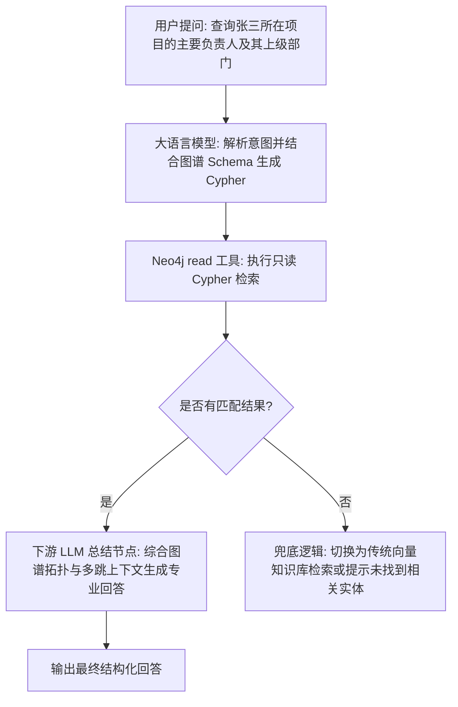

# Neo4j 图数据库操作工具集 (Neo4j Graph Database)

Neo4j 图数据库操作工具集是 FastGPT 官方提供的企业级图数据操作插件。通过与远程或本地 Neo4j 数据库无缝交互，为智能体与复杂业务工作流提供只读事务查询（`read`）与写入/更新操作（`write`）能力。

本工具集全量支持 Cypher 声明式图查询语言，内置 JSON 参数化映射、Cypher 只读安全静态校验以及图数据类型（节点 Node、关系 Relationship、路径 Path、64 位高精度大整数等）的自动序列化转换，帮助企业级智能体高效连接图谱世界。

---

## 典型应用场景

- **企业级知识图谱构建与检索**：从非结构化业务文档、研报或工单中提取实体属性及关联关系，实现图谱节点的动态写入与关联检索，提升专业领域问答的知识完备度与事实准确率。
- **Graph RAG 复杂多跳实体关系推演**：传统向量检索仅能处理孤立语义相似度，难以应对跨节点、长链路的派生与因果逻辑。借助 Graph RAG 与 Cypher 多跳查询，智能体可沿实体拓扑链条推演（例如 A 投资 B、B 控股 C），为大语言模型提供高可信的多跳上下文。
- **社群网络与风险关联路径挖掘**：在金融反洗钱（AML）、反欺诈排查、企业股权穿透与供应链风控等场景中，快速分析目标节点之间的最短关联路径、隐蔽资金闭环回路或可疑团体聚集网络。
- **智能资产与拓扑依赖追踪**：对 IT 基础设施拓扑网络、微服务调用链路以及业务资产依赖树进行端到端建模，在系统故障排查或架构变更评估中，秒级推算受影响节点及根因来源。

---

## 连接配置与密钥说明

使用本工具集前，需在 FastGPT 密钥管理或工具集配置中填入 Neo4j 连接配置。所有子工具（`read`、`write`）共享该连接配置。

### 配置项说明

| 字段名 | 字段类型 | 必填 | 密钥脱敏 | 说明 |
| --- | --- | --- | --- | --- |
| `uri` | 字符串 (`string`) | 是 | 否 | **Neo4j 数据库连接地址**。支持标准协议与加密通道，例如 `neo4j://host:7687`、`neo4j+s://host:7687` 或 `bolt://host:7687`。 |
| `username` | 字符串 (`string`) | 是 | 否 | **认证用户名**。用于登录 Neo4j 实例的身份标识（如 `neo4j`）。 |
| `password` | 字符串 (`string`) | 是 | 是 (`isSecret`) | **认证密码**。连接 Neo4j 实例的身份鉴权密码。 |
| `database` | 字符串 (`string`) | 否 | 否 | **目标数据库名称**。留空时使用实例的默认数据库（Neo4j 4.x/5.x 通常默认为 `neo4j`）。 |
| `connectionTimeout` | 字符串/数值 (`string \| number`) | 否 | 否 | **网络连接超时时间**（毫秒）。非负正整数，留空时默认值为 `10000`（10 秒）。 |
| `maxTransactionRetryTime` | 字符串/数值 (`string \| number`) | 否 | 否 | **事务最大重试时间**（毫秒）。非负整数，留空时默认值为 `30000`（30 秒）。 |

### `uri` 协议规范与解析

Neo4j 官方驱动支持多种协议前缀，连接串需符合以下规范：

| 协议前缀 | 适用架构 | 加密与证书验证 | 典型使用场景 |
| --- | --- | --- | --- |
| `neo4j://` | 集群 / 路由直连 | 明文（无 TLS） | 本地单机开发、内网私有部署集群或已在外层做反向代理保护的环境。 |
| `neo4j+s://` | 集群 / 路由直连 | **TLS 加密 + 信任公网证书** | **生产环境推荐**。适用于公网通信、云托管实例（如 Neo4j AuraDB）或具备权威 CA 证书的企业集群。 |
| `neo4j+ssc://` | 集群 / 路由直连 | **TLS 加密 + 允许自签名证书** | 启用了 TLS 加密但使用组织内部自签名证书（Self-Signed Certificate）的测试或专网环境。 |
| `bolt://` | 单节点点对点直连 | 明文（无 TLS） | 开发测试环境中直接连接单台 Neo4j 实例（跳过集群路由查找）。 |
| `bolt+s://` | 单节点点对点直连 | **TLS 加密 + 信任公网证书** | 需直连特定服务器节点的生产安全连接。 |
| `bolt+ssc://` | 单节点点对点直连 | **TLS 加密 + 允许自签名证书** | 直连特定节点并使用自签名 SSL 证书的环境。 |

> **安全提示**：
> `password` 字段在 FastGPT 插件定义中配置了 `isSecret: true`。在平台内部会被加密持久化，在前端界面展示、运行调试日志及接口交互中均会自动进行脱敏保护，防止数据库凭据意外泄露。

---

## 子工具列表

本工具集包含以下 2 个核心子工具：

- **`read`（读取 Cypher / Read Cypher）**：以只读事务执行 Cypher 检索语句。内置词法安全检查，自动拦截变动性操作，确保图数据库数据安全。
- **`write`（写入 Cypher / Write Cypher）**：以写事务执行数据变更 Cypher 语句，支持节点的创建、属性设置、关系连接、数据更新以及删除操作。

---

## 子工具详情与参数说明

### 1. 读取 Cypher (Read Cypher / `read`)

在 Neo4j 只读事务会话中执行查询语句。常用于实体搜索、多跳拓扑路径遍历、统计聚合与只读算法调用。

#### 安全保护机制
为了防止意外篡改数据库或提示词注入风险，`read` 工具在执行前会对 Cypher 语句执行 AST 级别的注释与字符串剔除，并在预检阶段拦截以下变动操作：
- 关键字：`CREATE`、`MERGE`、`SET`、`DELETE`、`DETACH DELETE`、`REMOVE`、`DROP`、`LOAD CSV`、`FOREACH`。
- 修改型系统存储过程：`apoc.create.*`、`apoc.merge.*`、`apoc.refactor.*`、`apoc.periodic.*`、`apoc.schema.*`、`apoc.trigger.*`、`db.create.*`、`db.drop.*`、`dbms.*` 等。
- 若包含写操作，将直接抛出异常，提示应使用 `write` 子工具。

#### 输入参数

| 参数名 | 字段类型 | 必填 | 默认值 | 说明 |
| --- | --- | --- | --- | --- |
| `cypher` | 字符串 (`string`) | 是 | 无 | **要执行的 Cypher 查询语句**。例如 `MATCH (p:Person {name: $name})-[r:KNOWS]->(f) RETURN p, r, f LIMIT $limit`。末尾的分号 `;` 会被自动剔除。 |
| `parameters` | 字符串 (`string`) | 否 | `"{}"` | **查询参数映射字典**。需传入合法的 JSON 对象字符串，用于参数化绑定，防止 Cypher 注入。 |

#### 输出结果

| 字段名 | 字段类型 | 说明 |
| --- | --- | --- |
| `rows` | 数组 (`Array<Record<string, any>>`) | **结果行列表**。每一行为返回变量与对应值的键值对。复杂图对象（Node、Relationship、Path）与大整数已被序列化为标准 JSON。 |
| `summary` | 对象 (`Record<string, any>`) | **执行摘要**。包含查询类型 `queryType`（只读时为 `"r"`）、数据库名 `database`、查询耗时（`resultAvailableAfter`、`resultConsumedAfter`）等。 |

#### 节点与关系数据序列化约定

- **Node（节点）**：转换为 `{ identity: number | string, labels: string[], properties: Record<string, any> }`。
- **Relationship（关系）**：转换为 `{ identity: number | string, type: string, start: number | string, end: number | string, properties: Record<string, any> }`。
- **Path（路径）**：转换为 `{ start: Node, end: Node, segments: Array<{ start: Node, relationship: Relationship, end: Node }> }`。
- **Integer（64 位整型）**：在 JavaScript 安全整数区间内转为 `number`；超过安全范围时转为高精度 `string`，杜绝长 ID 截断溢出。

#### 调用示例

- **输入 Cypher**：
  ```cypher
  MATCH (c:Company {name: $companyName})-[r:INVESTED_IN]->(target:Company)
  RETURN c.name AS investor, r.amount AS amount, target.name AS investee
  LIMIT $limit
  ```
- **输入 parameters**：
  ```json
  "{\"companyName\":\"创新未来科技\",\"limit\":5}"
  ```
- **输出响应结构**：
  ```json
  {
    "rows": [
      {
        "investor": "创新未来科技",
        "amount": 50000000,
        "investee": "智图智能科技"
      },
      {
        "investor": "创新未来科技",
        "amount": 20000000,
        "investee": "深蓝数据科技"
      }
    ],
    "summary": {
      "queryType": "r",
      "counters": {
        "containsUpdates": false,
        "containsSystemUpdates": false
      },
      "database": "neo4j",
      "resultAvailableAfter": 3,
      "resultConsumedAfter": 1
    }
  }
  ```

---

### 2. 写入 Cypher (Write Cypher / `write`)

在 Neo4j 写事务会话中执行写入、更新或删除语句。支持批量实体入库、关系链接以及拓扑关系清理。

#### 输入参数

| 参数名 | 字段类型 | 必填 | 默认值 | 说明 |
| --- | --- | --- | --- | --- |
| `cypher` | 字符串 (`string`) | 是 | 无 | **要执行的数据变更 Cypher 语句**。支持 `CREATE`、`MERGE`、`SET`、`DELETE` 等。末尾分号 `;` 自动剔除。 |
| `parameters` | 字符串 (`string`) | 否 | `"{}"` | **参数映射字典**。需传入合法的 JSON 对象字符串，包含要写入或条件更新的变量。 |

#### 输出结果

| 字段名 | 字段类型 | 说明 |
| --- | --- | --- |
| `rows` | 数组 (`Array<Record<string, any>>`) | **返回行数据**。如果在写入 Cypher 末尾携带了 `RETURN` 子句，将返回创建或修改后的实体对象数据；若无 `RETURN`，则返回空数组 `[]`。 |
| `summary` | 对象 (`Record<string, any>`) | **执行摘要与变更统计**。包含更新计数器 `counters`（创建节点数、创建关系数、设置属性数等），以及操作耗时。 |

#### `summary.counters` 包含的关键变更指标

- `nodesCreated`: 创建的节点数量
- `nodesDeleted`: 删除的节点数量
- `relationshipsCreated`: 创建的关系数量
- `relationshipsDeleted`: 删除的关系数量
- `propertiesSet`: 写入或更新的属性数量
- `labelsAdded`: 添加的标签数量
- `labelsRemoved`: 移除的标签数量
- `indexesAdded` / `indexesRemoved`: 索引添加与移除数
- `constraintsAdded` / `constraintsRemoved`: 约束添加与移除数
- `containsUpdates`: 是否包含数据变更（布尔值）

#### 调用示例

- **输入 Cypher**：
  ```cypher
  MERGE (p:Person {id: $personId})
  ON CREATE SET p.name = $name, p.createdAt = timestamp()
  ON MATCH SET p.lastActive = timestamp()
  WITH p
  MATCH (d:Department {deptId: $deptId})
  MERGE (p)-[r:BELONGS_TO]->(d)
  RETURN p.id AS personId, p.name AS name, d.name AS department
  ```
- **输入 parameters**：
  ```json
  "{\"personId\":\"usr_1001\",\"name\":\"张三\",\"deptId\":\"dept_tech\"}"
  ```
- **输出响应结构**：
  ```json
  {
    "rows": [
      {
        "personId": "usr_1001",
        "name": "张三",
        "department": "技术研发部"
      }
    ],
    "summary": {
      "queryType": "rw",
      "counters": {
        "nodesCreated": 1,
        "nodesDeleted": 0,
        "relationshipsCreated": 1,
        "relationshipsDeleted": 0,
        "propertiesSet": 2,
        "labelsAdded": 1,
        "labelsRemoved": 0,
        "indexesAdded": 0,
        "indexesRemoved": 0,
        "constraintsAdded": 0,
        "constraintsRemoved": 0,
        "containsUpdates": true,
        "containsSystemUpdates": false
      },
      "database": "neo4j",
      "resultAvailableAfter": 6,
      "resultConsumedAfter": 2
    }
  }
  ```

---

## 典型工作流编排示例

### 场景：Graph RAG 复杂多跳实体关系推演与问答

将图数据库与大语言模型结合，构建智能实体推演链路：



#### 工作流各节点配置说明：

1. **图谱 Schema 与 Cypher 意图生成节点（大模型）**：
   - **系统提示词**：注入当前图数据库的 Schema 定义（如 `(:Person)-[:BELONGS_TO]->(:Department)`、`(:Person)-[:PARTICIPATES_IN]->(:Project)`）。
   - **输出格式**：要求大模型输出两部分内容：参数化 Cypher 语句及参数 JSON 对象。
2. **Neo4j 只读查询节点（`neo4j.read`）**：
   - 将上游大模型提取的 `cypher` 与 `parameters` 映射输入到工具。
   - 工具自动校验是否包含破坏性写指令，并安全连入数据库执行查询。
3. **实体关系总结与归纳节点（下游大模型）**：
   - 接收 `neo4j.read` 输出的 `rows` 数组。
   - 提取实体间多跳关系、核心属性以及依赖路径，最终向终端用户输出语义清晰、逻辑完备的解答。

---

## 安全注意事项与最佳实践

1. **坚持使用参数化查询，严防 Cypher 注入**：
   - 严禁将来自用户或不可信大模型输出的文本以字符串拼接方式拼入 Cypher（例如 `MATCH (n) WHERE n.name = '` + input + `'`）。
   - 务必采用 `$param` 占位符并通过 `parameters` 字典传参。参数化不仅能彻底避免代码注入，还可大幅提升 Neo4j 查询执行计划的缓存命中率。
2. **遵循最小权限原则（Principle of Least Privilege）**：
   - 针对面向日常用户问答的智能体，强烈建议在 Neo4j 中配置专用只读账号角色（例如仅赋予 `GRANT MATCH ON GRAPH ...`），避免使用高权限 `neo4j` 超级管理员账号。
   - 对生产核心知识图谱，严禁向外暴露任何包含 Schema 变更（如 `DROP CONSTRAINT`）的写权限。
3. **避免无约束全局匹配与笛卡尔积爆炸**：
   - 避免编写无标签、无索引条件的笛卡尔积查询（如 `MATCH (a), (b) RETURN a, b`）。
   - 图查询中必须带上节点标签（Label）或索引属性过滤，且在可能返回大量记录的语句末尾必须声明 `LIMIT` 限制（如 `LIMIT 100`），避免拉取数万节点造成智能体上下文溢出或数据库内存耗尽（OOM）。
   - 对于变长多跳路径匹配（如 `-[*1..5]->`），务必设定明确的跳数上限，切忌使用无界泛查 `-[*]->`。
4. **连接管理与网络隔离**：
   - 工具集内部在每次执行完成后，均在 `finally` 块中严格释放 Session 与 Driver 资源，保障连接池健康，杜绝连接泄露。
   - 在生产环境、公有云部署或跨机房通信时，必须优先采用 `neo4j+s://` 协议保障 TLS 加密传输，防止传输过程中的敏感业务图谱数据被窃听或篡改。
   - 合理评估并设置 `connectionTimeout` 与 `maxTransactionRetryTime`，防止因偶发网络波动导致工作流长久挂起。

---

## 本地开发与测试

可利用本插件附带的 `docker-compose.yml` 快速启动本地单机 Neo4j 5.x 实例进行测试：

```bash
# 1. 启动本地测试 Neo4j 容器
docker compose up -d

# 2. 安装项目依赖
pnpm install

# 3. 运行单元测试
pnpm run test

# 4. 构建插件产物
pnpm run build

# 5. 校验插件规范
npx @fastgpt-plugin/cli check --entry .
```

