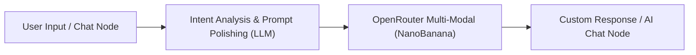

# OpenRouter Multi-Modal Image Generation Toolset (OpenRouter Multi-Modal)

The OpenRouter Multi-Modal Toolset (`openrouterMultiModal`) is an official plugin deeply integrated into FastGPT for multimodal AI image generation and visual synthesis. By integrating with [OpenRouter](https://openrouter.ai), a leading global AI model routing and aggregation platform, it delivers ultra-fast, high-quality multimodal image generation capabilities to FastGPT agents and automated workflows.

Powered by cutting-edge multimodal architectures such as Google Gemini (e.g., `google/gemini-2.5-flash-image-preview`), this plugin provides rapid text-to-image capabilities with adaptive rendering across 10 distinct aspect ratios ranging from 1:1 to 21:9. Furthermore, it deeply integrates with FastGPT's host file upload and persistent storage capability (`file-upload:allow`). The tool automatically uploads generated image data directly to FastGPT object storage and returns a publicly accessible, unauthenticated persistent direct URL, significantly simplifying downstream workflow rendering and external system consumption.

---

## Typical Application Scenarios

- **Text-to-Image Generation with Cutting-Edge Multimodal Models**: Leverages native image generation capabilities from state-of-the-art multimodal foundation models like Google Gemini, deeply understanding complex Chinese and English prompts to deliver vivid visual details, realistic lighting, and artistic compositions.
- **Rapid Illustration & Social Media Graphics**: Takes advantage of Flash-level ultra-low inference latency to generate article illustrations, social media headers, news graphics, and creative concept sketches in seconds, dramatically boosting content creation workflows.
- **Multi-Aspect Poster & Panoramic Visual Design**: Supports 10 mainstream aspect ratios ranging from 1:1 square avatars to 21:9 cinematic ultrawide formats, seamlessly adapting to mobile wallpapers and short video covers (9:16, 9:21), social media cards (3:4, 2:3), desktop banners (16:9, 2:1), and marketing posters.

---

## Secret & Credential Configuration

To use this plugin, you must configure an API key (`apiKey`) obtained from the OpenRouter open platform.

### How to Obtain an API Key

1. Visit the [OpenRouter Open Platform](https://openrouter.ai/) and sign in to your account (supports Google, GitHub, or Web3 wallet authentication).
2. Navigate to the console's [API Keys Management Page](https://openrouter.ai/keys) and click **Create Key** to generate a new API key.
3. Copy and securely store your generated key string (typically starts with `sk-or-v1-...`).
4. Go to the [Credits Page](https://openrouter.ai/settings/credits) to ensure your account has sufficient available credit balance. OpenRouter operates on a pay-as-you-go model, and invoking multimodal image generation models deducts compute credits accordingly.

### Authentication & Configuration Table

Enter the following credential in the FastGPT Toolset Secrets management or node settings:

| Setting | Field | Type | Required | Secret (`isSecret`) | Description |
| :--- | :--- | :--- | :---: | :---: | :--- |
| **API Key** | `apiKey` | String (`string`) | **Yes** | Yes (`true`) | OpenRouter open platform API key. Transmitted as a Bearer Token via the HTTP request header `Authorization: Bearer <apiKey>` to the underlying endpoint (`https://openrouter.ai/api/v1/chat/completions`) for authentication and billing. |

---

## Sub-Tools List

This tool suite includes the following core sub-tool:

| Sub-Tool ID | Chinese Name | English Name | Description |
| :--- | :--- | :--- | :--- |
| `NanoBanana` | **Nano Banana 文生图** | Nano Banana Text-to-Image | High-speed image generation powered by Gemini-based multimodal image models through OpenRouter, supporting 10 aspect ratios and direct persistent URL output. |

---

## Sub-Tool: NanoBanana (Nano Banana Text-to-Image)

### Input Parameters

| Parameter | Field | Type | Required | Default / Allowed Values | Description |
| :--- | :--- | :--- | :---: | :--- | :--- |
| **Prompt** | `text` | String (`string`) | **Yes** | None | Text prompt describing the image to generate. Supports both English and Chinese; providing rich descriptions of subject, composition, lighting, style, and atmosphere yields superior results. |
| **Aspect Ratio** | `aspect_ratio` | Enum (`string`) | **Yes** | `"1:1"` ~ `"21:9"` (10 enum options) | Aspect ratio of the generated image. Supports 10 common aspect ratios from 1:1 to 21:9 to accommodate diverse screens and publication media. |
| **Model** | `model` | Enum (`string`) | **Yes** | `"google/gemini-2.5-flash-image-preview"` | Multimodal image generation model to use. Currently integrates Google Gemini's multimodal preview model, delivering sub-second inference speeds and outstanding visual fidelity. |

### Aspect Ratio Enumerations & Typical Use Cases

| Aspect Ratio (`aspect_ratio`) | Visual Format | Recommended Use Cases |
| :--- | :--- | :--- |
| `1:1` | Square | Avatars, app icons, square product covers, Instagram posts |
| `2:3` | Vertical Standard | Portrait photography, book covers, Pinterest feed pins |
| `3:4` | Portrait Card | Social feed cards, mobile info cards, digital magazine inserts |
| `4:3` | Standard Landscape | Tablet wallpapers, classic photobooks, blog post inserts, presentation graphics |
| `2:1` | Wide Banner | Website banners, email marketing headers, panoramic displays |
| `3:2` | DSLR Photo Format | 35mm film photography standard, landscape photography, art gallery exhibits |
| `16:9` | Widescreen | Desktop wallpapers, slide presentations, YouTube / video thumbnails, widescreen posters |
| `9:16` | Fullscreen Vertical (Stories / Reels) | Mobile wallpapers, TikTok / Reels / Shorts covers, mobile story posters |
| `21:9` | Cinematic Ultrawide | Film giant screen posters, ultrawide gaming monitors, immersive panoramic headers |
| `9:21` | Ultra-Tall Vertical | Long mobile lockscreen wallpapers, mobile landing page infographics, folding screen covers |

### Output Results

| Field | Type | Description |
| :--- | :--- | :--- |
| `imageUrl` | String (`string`) | **Persistent, publicly accessible direct URL of the generated image**. The underlying OpenRouter service returns image data in Base64 format. Utilizing FastGPT host environment's declared `file-upload:allow` permission, the plugin automatically uploads the image to FastGPT object storage and returns a permanent HTTPS direct URL (with graceful fallback to Base64 Data URL if host upload is unavailable). Can be directly embedded into Markdown or passed to downstream download nodes. |

### Example Response

```json
{
  "imageUrl": "https://fastgpt.run/api/common/file/preview?fileId=66b45a1e2f38c4091a123456"
}
```

---

## Typical Workflow Examples

This tool suite integrates seamlessly into FastGPT AI agent workflows, establishing a complete automated pipeline: "User Query -> Intent Analysis & Prompt Enhancement -> Fast Image Synthesis -> Rich Markdown Display".



### Step-by-Step Orchestration Guide

1. **User Input & Intent Recognition**: Capture the user's natural language drawing request at the workflow start (e.g., *"Draw a cyberpunk rainy Tokyo neon street scene in widescreen wallpaper format"*).
2. **Intent Analysis & Prompt Enhancement (LLM Node)**:
   - Direct an upstream LLM to analyze the request and expand it into a detailed English prompt describing subject, environment, composition, lighting, and palette.
   - Select the most appropriate aspect ratio based on the user's requirement (e.g., `16:9` for widescreen wallpaper).
3. **Invoke the NanoBanana Node**:
   - Bind the polished prompt to the `text` parameter.
   - Set `aspect_ratio` to `16:9`.
   - Specify `model` as `google/gemini-2.5-flash-image-preview`.
4. **Display via Response Node**:
   - In a downstream "Custom Response" or "AI Chat" node, directly reference the `imageUrl` output variable using standard Markdown syntax:
     ```markdown
     Your cyberpunk neon street wallpaper has been generated:

     
     ```

---

## Important Considerations

1. **OpenRouter Account Balance & Credits**: Calling image generation models via OpenRouter requires available account credits. Ensure your account maintains an adequate balance on the [OpenRouter Credits Page](https://openrouter.ai/settings/credits). If your balance is exhausted, calls will fail with HTTP 402/429 errors.
2. **Network Connectivity Requirements**: The plugin runtime must have stable network access to OpenRouter's official API endpoint (`https://openrouter.ai/api/v1/chat/completions`). For private deployments, ensure outbound network access and firewall rules allow this domain.
3. **File Upload & Persistent Storage**: The plugin requests the `file-upload:allow` permission. In standard FastGPT environments, the plugin persists Base64 image data returned by OpenRouter into FastGPT object storage and returns a direct HTTPS URL, preventing large Base64 strings from exhausting context windows and memory. In test or offline environments lacking host storage, it gracefully falls back to Base64 Data URLs.
4. **Prompt Engineering & Optimization**: Although Gemini multimodal models comprehend multiple languages, incorporating concrete visual descriptors (subject, perspective, lighting conditions, textural details, artistic style) significantly enhances image aesthetics. We recommend using an upstream LLM node for automated prompt refinement.
5. **Generation Latency & Timeout Configuration**: Multimodal image synthesis is computationally intensive, typically taking between 5 and 15 seconds. Ensure that workflow timeouts are configured generously (recommended: at least 60 seconds).

---

## Local Development and Verification

```bash
# Install dependencies
pnpm install

# Run unit tests
pnpm test

# Build package artifacts
pnpm build

# Validate plugin specifications
npx @fastgpt-plugin/cli check --entry .
```
