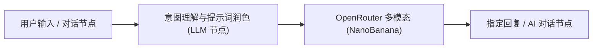

# OpenRouter 多模态图像生成工具集 (OpenRouter Multi-Modal)

OpenRouter 多模态工具集（`openrouterMultiModal`）是专为 FastGPT 深度集成的官方多模态 AI 图像生成与处理插件。通过统一对接全球前沿模型聚合路由平台 [OpenRouter](https://openrouter.ai)，为 FastGPT 智能体（Agent）和自动化工作流（Workflow）提供极速、高质量的多模态图像生成能力。

本插件内置基于 Google Gemini 等前沿多模态架构的极速文生图工具（如 `google/gemini-2.5-flash-image-preview`），不仅支持从 1:1 到 21:9 共 10 种丰富宽高比画幅自适应渲染，更深度集成了 FastGPT 宿主文件上传与持久化存储能力（`file-upload:allow`）。工具能够自动将模型返回的图像数据转存至 FastGPT 对象存储，并输出公网可直接访问的免鉴权持久化直链，极大简化了下游工作流展示与外部系统的对接。

---

## 典型应用场景

- **基于全球前沿多模态大模型的文生图**：调用 Google Gemini 等全球顶尖多模态大模型的原生图像生成能力，深入理解复杂中文与英文语义，精准呈现细腻画质、真实光影层次与艺术构图。
- **极速插画与社交配图生成**：凭借 Flash 级别的极速推理性能，秒级响应并生成文章配图、社交媒体推文封面、新闻快讯配图与创意概念草图，大幅提升内容创作流转效率。
- **多比例海报设计与全场景视觉适配**：支持从 1:1 方形头像到 21:9 电影级超宽屏等 10 种主流宽高比，无缝适配手机壁纸、短视频封面（9:16、9:21）、社交卡片（3:4、2:3）、桌面宽屏（16:9、2:1）以及印刷海报设计。

---

## 密钥与凭据配置说明

使用本插件需要配置 OpenRouter 开放平台的访问密钥（`apiKey`）。

### 获取渠道指引

1. 访问 [OpenRouter 开放平台](https://openrouter.ai/) 并登录账户（支持 Google、GitHub 或 Web3 钱包登录）。
2. 进入控制台的 [API Keys 管理页面](https://openrouter.ai/keys)，点击 **Create Key** 创建新的访问密钥。
3. 复制生成的密钥字符串（通常以 `sk-or-v1-...` 开头）并妥善保存。
4. 前往账户的 [Credits 充值页面](https://openrouter.ai/settings/credits) 确保账户内有足够的可用余额。OpenRouter 采用按量计费模式，调用图像生成多模态模型会扣除相应算力费用。

### 鉴权说明与配置表

在 FastGPT 的工具集密钥管理或节点配置中填写以下凭据：

| 配置项 | 字段名 | 类型 | 是否必填 | 敏感加密 (`isSecret`) | 说明 |
| :--- | :--- | :--- | :---: | :---: | :--- |
| **API 密钥** | `apiKey` | 字符串 (`string`) | **是** | 是 (`true`) | OpenRouter 开放平台 API 密钥。请求底层接口（`https://openrouter.ai/api/v1/chat/completions`）时作为 Bearer Token 在 HTTP 请求头 `Authorization: Bearer <apiKey>` 中进行鉴权与计费。 |

---

## 子工具列表

本工具集目前包含以下核心子工具：

| 子工具 ID | 中文名称 | 英文名称 | 功能说明 |
| :--- | :--- | :--- | :--- |
| `NanoBanana` | **Nano Banana 文生图** | Nano Banana Text-to-Image | 通过 OpenRouter 调用基于 Gemini 等多模态图像生成模型的极速绘图工具，支持 10 种宽高比画幅与高质量图像直链输出。 |

---

## 子工具：NanoBanana (Nano Banana 文生图)

### 输入参数说明

| 参数名 | 对应字段 | 类型 | 是否必填 | 默认值 / 可选值 | 说明 |
| :--- | :--- | :--- | :---: | :--- | :--- |
| **提示词** | `text` | 字符串 (`string`) | **是** | 无 | 用于生成图像的文本描述。支持中英文，详细描述画面的主体、构图、光影、色彩风格及艺术氛围可获得更惊艳的生成效果。 |
| **宽高比** | `aspect_ratio` | 枚举 (`string`) | **是** | `"1:1"` ~ `"21:9"`（共 10 种枚举值） | 画面输出的宽高比。支持从 1:1 至 21:9 共 10 种常见画幅比例，可灵活适配各类终端与展示媒介。 |
| **模型** | `model` | 枚举 (`string`) | **是** | `"google/gemini-2.5-flash-image-preview"` | 要使用的图像生成模型。目前支持接入 Google Gemini 多模态图像预览模型，具备毫秒级快速推理和卓越视觉还原度。 |

### 宽高比枚举与应用场景详解

| 宽高比 (`aspect_ratio`) | 画幅形态 | 典型应用场景推荐 |
| :--- | :--- | :--- |
| `1:1` | 正方形 (Square) | 社交头像、应用图标、电商方形主图、Instagram 帖子 |
| `2:3` | 经典竖版 (Vertical) | 经典肖像摄影、图书封面、Pinterest 瀑布流配图 |
| `3:4` | 常见竖屏卡片 (Portrait) | 小红书笔记配图、移动端信息流卡片、电子杂志插页 |
| `4:3` | 经典横屏 (Standard) | 平板电脑壁纸、传统画册、博客文章插入图、简报配图 |
| `2:1` | 双倍超宽横图 (Wide Banner) | 网站横幅 (Banner)、邮件营销顶部图、全景展示图 |
| `3:2` | 单反相机画幅 (Photo) | 35mm 胶片摄影比例、风景摄影、画廊艺术展品 |
| `16:9` | 宽屏横图 (Widescreen) | 电脑桌面壁纸、PPT 演示文稿、YouTube/B站视频封面与横向海报 |
| `9:16` | 竖屏全屏 (Stories / Reels) | 手机全屏壁纸、抖音/TikTok 短视频封面、微信视频号海报 |
| `21:9` | 电影级超宽屏 (Cinematic) | 院线电影巨幕海报、电竞带鱼屏壁纸、沉浸式横幅设计 |
| `9:21` | 超长竖屏 (Ultra-Tall) | 手机长图锁屏壁纸、移动端落地页引导图、折叠屏副屏封面 |

### 输出结果说明

| 字段名 | 类型 | 说明 |
| :--- | :--- | :--- |
| `imageUrl` | 字符串 (`string`) | **生成图像的持久化公网可访问直链**。底层调用 OpenRouter 生成图片后返回 Base64 格式数据，插件借助 FastGPT 宿主环境声明的 `file-upload:allow` 权限自动将图像上传至 FastGPT 对象存储中，并返回永久可直接访问的 HTTPS 直链（若在无宿主存储环境调用则优雅降级为 Base64 Data URL）。可直接在 Markdown 中嵌入展示，或传递给下游节点下载。 |

### 输出示例

```json
{
  "imageUrl": "https://fastgpt.run/api/common/file/preview?fileId=66b45a1e2f38c4091a123456"
}
```

---

## 典型工作流编排示例

本工具集可无缝嵌入 FastGPT 智能体工作流，实现“用户自然对话 -> 意图识别与提示词增强 -> 极速绘图 -> 图文混排回复”的自动化闭环。



### 编排步骤详解

1. **用户输入与意图识别**：在工作流起始端接收用户的绘画自然语言指令（例如：“帮我画一张赛博朋克风格的雨夜东京霓虹街景，要横屏壁纸”）。
2. **意图理解与提示词润色（LLM 节点）**：
   - 引导上游大语言模型提取用户的核心需求，将其扩写为包含主体、环境、构图、光影、色彩基调的高质量英文提示词（Prompt）。
   - 根据用户诉求（“横屏壁纸”）选择最适配的宽高比参数（例如 `16:9`）。
3. **调用 NanoBanana 节点**：
   - 将润色后的提示词输入绑定至 `text` 参数。
   - 将 `aspect_ratio` 设置为 `16:9`。
   - `model` 选择 `google/gemini-2.5-flash-image-preview`。
4. **指定回复节点直观展示**：
   - 在后续的「指定回复」或「AI 对话」节点中，通过标准 Markdown 语法直接引用输出变量 `imageUrl`：
     ```markdown
     已为您生成赛博朋克霓虹街景壁纸：

     
     ```

---

## 注意事项

1. **OpenRouter 账户余额与额度**：调用 OpenRouter 平台的图像生成接口需要消耗账户点数或额度。请确保在 [OpenRouter 充值页面](https://openrouter.ai/settings/credits) 保持充足可用余额。若账户额度耗尽，接口将返回 402/429 错误并导致图片生成失败。
2. **网络连通性要求**：插件服务需要能够稳定访问 OpenRouter 官方 API 地址（`https://openrouter.ai/api/v1/chat/completions`）。如在私有化部署环境中使用，请确保服务器具备访问公网及该域名的网络权限。
3. **文件上传与持久化存储**：插件声明了 `file-upload:allow` 权限。在标准 FastGPT 环境中，插件会将 OpenRouter 返回的 Base64 图像数据转存入 FastGPT 的文件存储服务中，返回持久化直链，避免了 Base64 在工作流上下文中占用过长 token 与内存；在单测或离线环境下无存储服务时，将优雅回退为 Base64 Data URL。
4. **提示词编写与优化建议**：虽然 Gemini 多模态模型具备多语言理解能力，但使用具体、画面感强烈的描述词（如主体、透视角度、光照条件、质感细节、色彩基调）能显著提升图像生成的艺术质量；建议通过上游大语言模型节点进行提示词扩写（Prompt Engineering）。
5. **接口耗时与超时设置**：由于多模态图像生成计算量较大，通常耗时在 5 至 15 秒不等，编排工作流时建议将超时时间设置为合理范围（推荐不低于 60 秒）。

---

## 本地开发与校验

```bash
# 安装依赖
pnpm install

# 运行单元测试
pnpm test

# 构建产物
pnpm build

# 校验插件规范
npx @fastgpt-plugin/cli check --entry .
```

