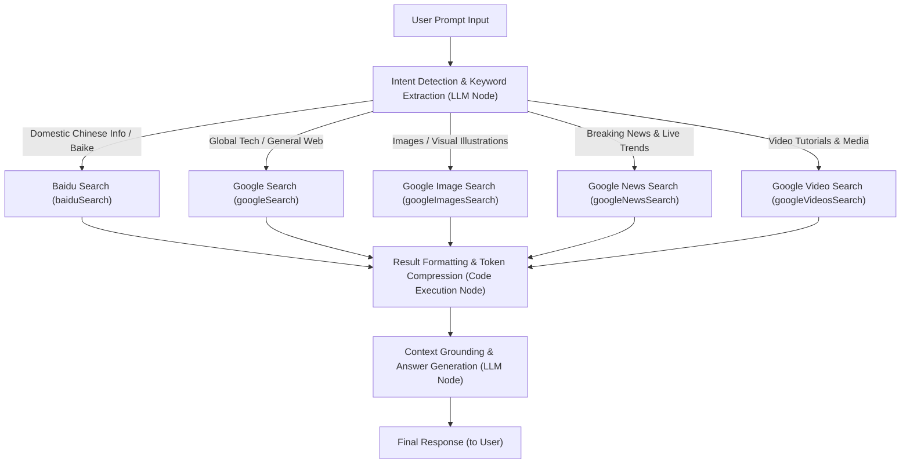

# SearchApi Search Tool Suite

The SearchApi Search Tool Suite is a multi-engine, real-time internet search toolkit designed for Large Language Models (LLMs), AI agents, and Retrieval-Augmented Generation (RAG) workflows. Built on the enterprise-grade search scraping and structured data capabilities provided by [SearchApi.io](https://www.searchapi.io/), this tool suite seamlessly integrates five specialized sub-tools across **Baidu (Baidu Search)** and **Google (Web, Image, News, and Video Search)**. It empowers FastGPT agents with cross-engine, multimodal, and global knowledge retrieval capabilities, effectively overcoming LLM knowledge cutoff limitations and mitigating hallucinations.

---

## Typical Application Scenarios

- **Comprehensive Multilingual Web Search**: Combines Baidu's deep index of the Chinese domestic ecosystem with Google's world-leading global multilingual web coverage. Whether retrieving local Chinese enterprise/governmental information or international cutting-edge scientific research, open-source projects, and technical documentation, it delivers high-precision, cross-lingual results.
- **Breaking News & Multimodal Image/Video Sourcing**:
  - Track breaking international events, policy trends, and industry developments in real time using the dedicated news search tool;
  - Retrieve direct high-resolution image URLs, thumbnails, rich media covers, and video playback links via image and video search tools, enabling agents to provide media-rich answers and audiovisual source verification.
- **Business Intelligence & Market Sentiment Analysis**: Leverage fine-grained time-window filtering (past hour, 24 hours, week, month, or year) to monitor competitor movements, brand reputation, regulatory updates, and emerging market trends for informed decision-making.
- **Knowledge Base RAG Grounding & Hallucination Mitigation**: Dynamically retrieve authoritative web sources as context during agent conversations. Attach verifiable citation links to factual claims, substantially reducing model hallucinations and boosting user trust.

---

## Secrets & Credentials Configuration Guide

Using this plugin requires configuring the API key (`apiKey`) generated by the SearchApi platform within the FastGPT plugin settings.

### Configuration Parameters

| Parameter | Type | Sensitive | Required | Description |
| :--- | :--- | :--- | :--- | :--- |
| `apiKey` | String (`string`) | Yes (`isSecret: true`) | Yes | API access key from SearchApi, used for authenticating requests to SearchApi services. |

### How to Obtain Required Credentials

1. **Sign Up**: Visit the [SearchApi Official Website (https://www.searchapi.io/)](https://www.searchapi.io/) and click **Sign Up** in the upper-right corner (supports one-click login via Google, GitHub, or standard email registration).
2. **New User Free Quota**: Upon successful registration, SearchApi automatically grants **100 free search requests** (no credit card required), which can be immediately used for development, testing, and prototyping.
3. **Retrieve Your API Key**: Sign in and navigate to the [SearchApi Dashboard](https://www.searchapi.io/dashboard). Your unique **API Key** (a 24-character alphanumeric string) is displayed on the dashboard overview page. Click the copy icon to copy it.
4. **Configure in FastGPT**: In FastGPT's Plugin Marketplace or Workflow Tool node settings, paste the copied key into the `apiKey` field and save.

---

## Tool Suite Overview

This tool suite consists of 5 dedicated child tools, each tailored to specific search platforms and media types:

| Tool ID | Tool Name | Underlying Engine (`engine`) | Positioning & Core Capabilities |
| :--- | :--- | :--- | :--- |
| `baiduSearch` | Baidu Search | `baidu` | Tailored for the Chinese internet ecosystem, indexing domestic news, Baidu Baike, and enterprise/institutional sources. |
| `googleSearch` | Google Search | `google` | World-leading general web search covering multilingual literature, technical docs, and global updates with time-range filtering. |
| `googleImagesSearch` | Google Image Search | `google_images` | Multimodal visual retrieval returning high-res original URLs, thumbnails, and source domains for image-rich answers. |
| `googleNewsSearch` | Google News Search | `google_news` | Aggregates major global news publications and wires with high freshness and authority, ideal for real-time tracking. |
| `googleVideosSearch` | Google Video Search | `google_videos` | Searches across video platforms (such as YouTube), providing video titles, watch links, snippets, and highlighted details. |

---

## Parameter & Output Specification

### Query & Parameter Breakdown

Understanding the design and capabilities of the following parameters will significantly enhance your search retrieval precision:

1. **`q` (Search Query)**:
   - Supports natural language questions (e.g., "FastGPT deployment guide"). We recommend using an upstream LLM node to distill conversational prompts into 2–4 targeted keywords.
   - Fully supports native advanced search operators:
     - `site:domain.com`: Restrict search results to a specific domain (e.g., `site:github.com fastgpt`).
     - `filetype:pdf`: Filter for specific file extensions (e.g., `filetype:pdf LLM architecture`).
     - `"exact match"`: Enclose phrases in quotes for literal, verbatim matching.
     - `-term`: Exclude results containing specific keywords (e.g., `Python tutorial -csdn`).
     - `OR` / `|`: Logical OR operator (e.g., `FastGPT Docker OR Kubernetes`).
2. **`num` (Maximum Results)**:
   - Number type with an allowed range of `1 ~ 100`, defaulting to `20`.
   - In standard RAG Q&A pipelines, setting this to `5 ~ 10` is recommended to prevent excessive downstream LLM context token usage. For comprehensive industry research or deep audits, adjust to `20 ~ 50`.
3. **`time_period` (Time Range / Freshness Window)**:
   - Enumerated parameter supported by Google-based tools to constrain result publication/indexing dates:
     - `last_hour`: Within the past hour.
     - `last_day`: Within the past 24 hours.
     - `last_week`: Within the past week.
     - `last_month`: Within the past month.
     - `last_year`: Within the past year (default).
4. **Geolocation (`gl`) & Host Language (`hl`) Strategies**:
   - In search engine protocols and SearchApi's REST specifications, `gl` (Geolocation, e.g., `cn`, `us`, `hk`) and `hl` (Host Language, e.g., `zh-cn`, `en`) control regional ranking preferences and interface display languages.
   - In this FastGPT tool suite, you can achieve equivalent or more flexible geographic and language targeting through two best practices:
     - **Multi-Engine Routing**: Route domestic Chinese queries to `baiduSearch` and global or multilingual queries to `googleSearch`.
     - **Keyword-Level Targeting**: Embed top-level domains or language qualifiers in `q` (e.g., `site:.cn`, `site:.edu`, `inurl:zh`, or explicit country/region names).

---

### 1. Baidu Search (`baiduSearch`)

Searches the Chinese web using Baidu, returning relevant page titles, links, snippets, and highlighted keywords.

#### Input Parameters

| Parameter | Type | Required | Default | Range | Description |
| :--- | :--- | :--- | :--- | :--- | :--- |
| `q` | String (`string`) | Yes | None | - | **Search Query**. Keywords or phrases to search on Baidu. |
| `num` | Number (`number`) | No | `20` | `1 ~ 100` | **Maximum Results**. Maximum number of search results to return. |

#### Output Results

| Parameter | Type | Description |
| :--- | :--- | :--- |
| `result` | Array of Objects (`Array<Object>`) | List of web page search results returned by Baidu. |

#### Object Properties in `result` Array

| Property | Type | Description |
| :--- | :--- | :--- |
| `title` | String (`string`) | Title of the Baidu search result page. |
| `link` | String (`string`) | Full URL of the result page. |
| `snippet` | String (`string`) | Contextual text snippet matching the query. |
| `snippet_highlighted_words` | Array of Strings (`Array<string>`) | Highlighted matching words from the snippet (if available). |

#### Example JSON Response

```json
{
  "result": [
    {
      "title": "FastGPT Official Documentation - LLM Knowledge Platform",
      "link": "https://fastgpt.in/docs/",
      "snippet": "FastGPT is an enterprise-grade LLM knowledge base platform providing ready-to-use data preprocessing, workflow orchestration, and agent plugins...",
      "snippet_highlighted_words": [
        "FastGPT",
        "knowledge base",
        "LLM"
      ]
    },
    {
      "title": "Deploying FastGPT and Vector Databases Locally with Docker",
      "link": "https://example.com/fastgpt-docker-compose-deploy",
      "snippet": "Step-by-step tutorial on deploying FastGPT, OneAPI, PostgreSQL (PGVector), and Milvus in Linux environments using Docker Compose...",
      "snippet_highlighted_words": [
        "FastGPT",
        "deploy",
        "Docker Compose"
      ]
    }
  ]
}
```

---

### 2. Google Search (`googleSearch`)

Searches the global web using Google, supporting temporal filtering across diverse languages and domains.

#### Input Parameters

| Parameter | Type | Required | Default | Allowed Values / Range | Description |
| :--- | :--- | :--- | :--- | :--- | :--- |
| `q` | String (`string`) | Yes | None | - | **Search Query**. Keywords to use for Google web search, supporting advanced syntax. |
| `num` | Number (`number`) | No | `20` | `1 ~ 100` | **Maximum Results**. Maximum number of web search results to return. |
| `time_period` | Enum (`string`) | No | `last_year` | `last_hour`, `last_day`, `last_week`, `last_month`, `last_year` | **Time Period**. Restricts results to a specific time window. |

#### Output Results

| Parameter | Type | Description |
| :--- | :--- | :--- |
| `result` | Array of Objects (`Array<Object>`) | List of web search results returned by Google. |

#### Object Properties in `result` Array

| Property | Type | Description |
| :--- | :--- | :--- |
| `title` | String (`string`) | Title of the web page. |
| `link` | String (`string`) | Full URL of the web page. |
| `snippet` | String (`string`) | Plain-text snippet showing context around query matches. |
| `snippet_highlighted_words` | Array of Strings (`Array<string>`) | Highlighted terms from the result snippet (if available). |

#### Example JSON Response

```json
{
  "result": [
    {
      "title": "FastGPT - Open-Source LLM Knowledge Base Platform",
      "link": "https://github.com/labring/FastGPT",
      "snippet": "FastGPT is an enterprise-grade knowledge platform based on LLMs, offering out-of-the-box data preprocessing, workflow orchestration, and multi-agent capabilities.",
      "snippet_highlighted_words": [
        "FastGPT",
        "LLM",
        "knowledge platform"
      ]
    },
    {
      "title": "Building Production-Ready RAG Applications with FastGPT",
      "link": "https://example.com/building-rag-with-fastgpt",
      "snippet": "A comprehensive deep-dive into orchestrating vector search, hybrid re-ranking, and external search tool integration for production AI applications.",
      "snippet_highlighted_words": [
        "FastGPT",
        "RAG"
      ]
    }
  ]
}
```

---

### 3. Google Image Search (`googleImagesSearch`)

Searches Google Images to retrieve direct high-resolution image links, thumbnails, and origin information.

#### Input Parameters

| Parameter | Type | Required | Default | Allowed Values / Range | Description |
| :--- | :--- | :--- | :--- | :--- | :--- |
| `q` | String (`string`) | Yes | None | - | **Search Query**. Keywords to search on Google Images. |
| `num` | Number (`number`) | No | `20` | `1 ~ 100` | **Maximum Results**. Maximum number of image search results to return. |
| `time_period` | Enum (`string`) | No | `last_year` | `last_hour`, `last_day`, `last_week`, `last_month`, `last_year` | **Time Period**. Restricts image results to a specific time window. |

#### Output Results

| Parameter | Type | Description |
| :--- | :--- | :--- |
| `result` | Array of Objects (`Array<Object>`) | List of image search results returned by Google. |

#### Object Properties in `result` Array

| Property | Type | Description |
| :--- | :--- | :--- |
| `title` | String (`string`) | Title or contextual description of the image. |
| `source` | String (`string`) | Host domain or entity sourcing the image (e.g., `fastgpt.in`, `github.com`). |
| `original` | String (`string`) | Direct URL to the original high-resolution image. |
| `thumbnail` | String (`string`) | Direct URL to the compressed thumbnail image. |

#### Example JSON Response

```json
{
  "result": [
    {
      "title": "FastGPT Architecture Diagram and Workflow Engine",
      "source": "fastgpt.in",
      "original": "https://fastgpt.in/images/architecture-full.png",
      "thumbnail": "https://encrypted-tbn0.gstatic.com/images?q=tbn:ANd9GcRExampleThumb1"
    },
    {
      "title": "FastGPT Plugin System and Multi-Agent Collaboration",
      "source": "github.com",
      "original": "https://raw.githubusercontent.com/labring/FastGPT/main/assets/plugin-demo.jpg",
      "thumbnail": "https://encrypted-tbn0.gstatic.com/images?q=tbn:ANd9GcRExampleThumb2"
    }
  ]
}
```

---

### 4. Google News Search (`googleNewsSearch`)

Searches authoritative news media and wire services with high freshness, tailored for breaking event analysis.

#### Input Parameters

| Parameter | Type | Required | Default | Allowed Values / Range | Description |
| :--- | :--- | :--- | :--- | :--- | :--- |
| `q` | String (`string`) | Yes | None | - | **Search Query**. Keywords to use for Google News search. |
| `num` | Number (`number`) | No | `20` | `1 ~ 100` | **Maximum Results**. Maximum number of news articles to return. |
| `time_period` | Enum (`string`) | No | `last_year` | `last_hour`, `last_day`, `last_week`, `last_month`, `last_year` | **Time Period**. Restricts news articles by publication time (e.g., use `last_day` for breaking news). |

#### Output Results

| Parameter | Type | Description |
| :--- | :--- | :--- |
| `result` | Array of Objects (`Array<Object>`) | List of news search results returned by Google. |

#### Object Properties in `result` Array

| Property | Type | Description |
| :--- | :--- | :--- |
| `title` | String (`string`) | Headline of the news article. |
| `link` | String (`string`) | Direct URL to the full news story. |
| `snippet` | String (`string`) | Summary excerpt or lead paragraph from the news article. |
| `snippet_highlighted_words` | Array of Strings (`Array<string>`) | Highlighted query terms in the snippet (if available). |

#### Example JSON Response

```json
{
  "result": [
    {
      "title": "Next-Gen Enterprise RAG Architecture: FastGPT Plugin Ecosystem Upgraded",
      "link": "https://news.example.com/tech/2025/fastgpt-plugin-ecosystem-update",
      "snippet": "Major open-source communities today reported that FastGPT has introduced an all-new plugin development framework, significantly simplifying tool integration...",
      "snippet_highlighted_words": [
        "FastGPT",
        "RAG",
        "plugin ecosystem"
      ]
    },
    {
      "title": "Global AI Agents Market Forecast: Knowledge Integration Trends",
      "link": "https://technews.example.com/articles/ai-agent-market-trends",
      "snippet": "Industry analysts highlight the accelerating convergence of web-scale real-time search APIs and enterprise knowledge graphs in next-generation autonomous workflows.",
      "snippet_highlighted_words": [
        "real-time search APIs",
        "AI Agents"
      ]
    }
  ]
}
```

---

### 5. Google Video Search (`googleVideosSearch`)

Searches across major video hosting platforms (such as YouTube and Vimeo) to discover relevant video content.

#### Input Parameters

| Parameter | Type | Required | Default | Allowed Values / Range | Description |
| :--- | :--- | :--- | :--- | :--- | :--- |
| `q` | String (`string`) | Yes | None | - | **Search Query**. Keywords to use for Google Video search. |
| `num` | Number (`number`) | No | `20` | `1 ~ 100` | **Maximum Results**. Maximum number of video items to return. |
| `time_period` | Enum (`string`) | No | `last_year` | `last_hour`, `last_day`, `last_week`, `last_month`, `last_year` | **Time Period**. Restricts videos by upload time. |

#### Output Results

| Parameter | Type | Description |
| :--- | :--- | :--- |
| `result` | Array of Objects (`Array<Object>`) | List of video search results returned by Google. |

#### Object Properties in `result` Array

| Property | Type | Description |
| :--- | :--- | :--- |
| `title` | String (`string`) | Title of the video. |
| `link` | String (`string`) | Full URL to the video playback page (e.g., YouTube watch link). |
| `snippet` | String (`string`) | Video description excerpt or summary. |
| `highlighted` | Any (`any`) | Highlighted metadata for the video (e.g., duration, channel name, if available). |

#### Example JSON Response

```json
{
  "result": [
    {
      "title": "FastGPT Quickstart: Building a Private Enterprise Knowledge Base from Scratch",
      "link": "https://www.youtube.com/watch?v=exampleFastGPTTutorial",
      "snippet": "A complete tutorial explaining how to deploy FastGPT, connect vector models, and configure web search plugins for a live-connected customer support agent...",
      "highlighted": "Duration: 18:32 · Channel: AI Tech Guide"
    },
    {
      "title": "Advanced Multi-Agent Workflow Orchestration in FastGPT",
      "link": "https://www.youtube.com/watch?v=exampleMultiAgentDemo",
      "snippet": "Watch this step-by-step walkthrough demonstrating how to connect SearchApi tool suites into FastGPT workflows for dynamic multi-modal information gathering.",
      "highlighted": "Duration: 24:10 · Channel: Enterprise AI Lab"
    }
  ]
}
```

---

## Typical Workflow Orchestration

In FastGPT's Advanced Orchestration, an upstream LLM node typically performs **intent detection and keyword extraction** to choose the best SearchApi child tool. After search execution, a **Code Execution node** extracts core attributes to compress token consumption, and the formatted context is supplied to the **Answer Generation LLM node**.

### Workflow Architecture Diagram



### 1. Response Formatting Example (Code Execution Node)

To avoid sending unneeded metadata to the downstream model and consuming excessive tokens, place a Code Execution node right after the search tool node:

```javascript
function main({ result }) {
  const items = Array.isArray(result) ? result : [];
  
  if (items.length === 0) {
    return {
      text: "No matching online reference materials found.",
      images: []
    };
  }

  // 1. If processing Image Search results, format as Markdown images and sources
  if (items[0] && items[0].original) {
    const topImages = items.slice(0, 4);
    const markdownImages = topImages
      .map((item, idx) => `\n*Source: ${item.source || 'Web'}*`)
      .join('\n\n');
    return {
      text: markdownImages,
      images: topImages.map(item => item.original)
    };
  }

  // 2. If processing Web, News, or Video results, extract top 5 items and format as numbered Markdown
  const formattedText = items.slice(0, 5).map((item, index) => {
    const title = item.title || "Untitled";
    const link = item.link || "#";
    const snippet = item.snippet || "No snippet available";
    const extra = item.highlighted ? ` (${item.highlighted})` : "";
    return `[${index + 1}] [${title}](${link})${extra}\nSummary: ${snippet}`;
  }).join("\n\n");

  return {
    text: formattedText
  };
}
```

### 2. Downstream LLM Node System Prompt Template

Reference the formatted search results in your downstream LLM node's system prompt:

```text
You are an objective and reliable AI assistant. Please answer the user's question using the reference materials retrieved from the search engine below.

[Guidelines]
1. Base your answer primarily on the provided reference materials. If the materials do not contain sufficient information, state so clearly and provide a cautious answer based on your existing knowledge.
2. When citing specific facts, data, or opinions from the text, append the reference index tag (e.g., [1], [2]) at the end of the sentence.
3. At the end of your response, provide a "References" section listing the title and URL of each cited source.

[Reference Materials]
{{formattedResults.text}}
```

---

## Important Considerations

1. **Commercial API Quotas & Billing**:
   - SearchApi is a commercial paid API service. New accounts receive **100 free search requests**; once exhausted, purchase a subscription plan or top-up usage on the [SearchApi Dashboard](https://www.searchapi.io/dashboard).
   - We strongly recommend configuring an upstream **intent detection node** in FastGPT to trigger search only when real-time, external facts are genuinely necessary.
2. **Rate Limits & Concurrency**:
   - SearchApi enforces query-per-second (QPS) and concurrency ceilings based on your subscription tier. In high-concurrency production setups, configure adequate request pacing or upgrade your plan to prevent HTTP 429 (Too Many Requests) errors.
3. **Network Connectivity**:
   - The plugin sends direct HTTPS requests to `https://www.searchapi.io/api/v1/search`. Ensure the host server or container running FastGPT has reliable outbound internet access.
4. **Multimodal Link Longevity**:
   - Image search (`googleImagesSearch`) returns direct image links (`original`) and thumbnails (`thumbnail`) hosted by third-party websites. Some sites may enforce hotlinking protection; in such cases, consider displaying thumbnails or directing users to the source site.
5. **API Key Security**:
   - Keep your `apiKey` secure and never expose it in public code repositories or client-side bundles. Within FastGPT, this field is flagged as sensitive (`isSecret: true`) and securely encrypted.
