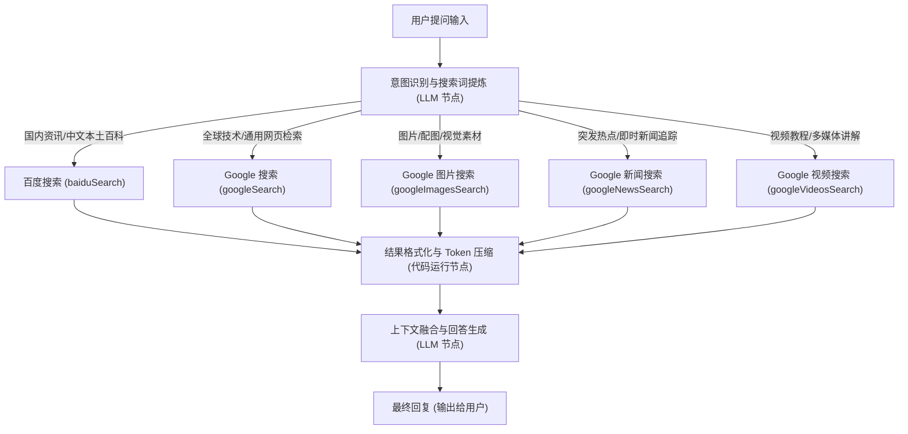

# SearchApi 多引擎智能搜索工具集 (SearchApi Search Tools)

SearchApi 是一款专为大语言模型（LLM）、智能体与知识库 RAG 工作流打造的多引擎实时互联网检索工具集。基于 [SearchApi.io](https://www.searchapi.io/) 提供的企业级搜索抓取与数据结构化能力，该工具集深度整合了 **Baidu（百度搜索）** 与 **Google（网页、图片、新闻、视频搜索）** 五大专业搜索子工具。它为 FastGPT 智能体提供跨引擎、多模态、全球化的外部知识获取与溯源通道，有效突破大模型知识时效性限制并显著消除幻觉。

---

## 典型应用场景

- **中英文全网综合检索**：结合百度在中文本土信息生态的深厚沉淀，与 Google 在全球范围内的多语言全网索引能力，无论是国内本土政务企事业单位信息，还是海外前沿科技、开源项目与学术论文，均可实现跨语言、高精度的实时检索。
- **时事新闻与多模态图片/视频溯源**：
  - 借助新闻搜索子工具快速追踪全球突发热点、政策走向与行业动态；
  - 利用图片搜索与视频搜索子工具直接检索高清原图直链、缩略图、多媒体封面及视频播放链接，为智能体赋予图文并茂的富媒体输出与视听素材溯源能力。
- **商业情报挖掘与舆情分析**：配合细粒度的时间窗口筛选（最近 1 小时、24 小时、1 周、1 个月、1 年），精准监控竞品动向、品牌声誉、市场趋势与舆情演变，支持商业分析与决策辅助。
- **知识库 RAG 外部信源增强与事实校验**：在智能体问答编排中动态检索权威网页内容作为参考事实（Context），在生成答案的同时标注真实可溯源的参考链接（Citations），大幅降低模型幻觉，提高回答置信度。

---

## 密钥与凭据配置说明

使用本插件需要在 FastGPT 插件配置中提供 SearchApi 平台生成的 API 密钥（`apiKey`）。

### 配置参数列表

| 配置项 | 类型 | 敏感保密 | 必填 | 说明 |
| :--- | :--- | :--- | :--- | :--- |
| `apiKey` | 字符串 (`string`) | 是 (`isSecret: true`) | 是 | SearchApi 平台的 API 访问密钥，用于调用 SearchApi 服务时的身份鉴权。 |

### 密钥获取步骤指引

1. **注册账号**：访问 [SearchApi 官网 (https://www.searchapi.io/)](https://www.searchapi.io/)，点击右上角 **Sign Up** 注册账号（支持通过 Google、GitHub 快捷登录或邮箱注册）。
2. **新用户免费额度**：新账户注册成功后，SearchApi 会默认赠送 **100 次免费搜索请求额度**（无需绑定信用卡），可直接用于开发、调试与初期体验。
3. **获取 API Key**：登录后进入 [SearchApi 控制台 Dashboard](https://www.searchapi.io/dashboard)，在控制台概览页面即可查看到您的专属 **API Key**（通常为一串 24 位的字母数字组合）。点击旁边的复制按钮即可复制该密钥。
4. **配置至 FastGPT**：在 FastGPT 的插件市场或工作流工具节点中，将复制的密钥填入 `apiKey` 字段并保存。

---

## 子工具列表

本工具集包含 5 个独立的子工具，分别对应不同的检索平台与垂直领域：

| 子工具 ID | 子工具名称 | 底层引擎 (`engine`) | 定位与核心功能 |
| :--- | :--- | :--- | :--- |
| `baiduSearch` | 百度搜索 | `baidu` | 专为中文本土互联网生态打造，深耕国内新闻、百科、政企资讯等中文特色信源。 |
| `googleSearch` | Google 搜索 | `google` | 全球领先的通用网页检索，覆盖多语言权威文献、海外技术文档、前沿动态，支持按时间窗口筛选。 |
| `googleImagesSearch` | Google 图片搜索 | `google_images` | 多模态视觉检索，返回高清原图直链、缩略图及来源站点，赋能图文并茂的内容生成。 |
| `googleNewsSearch` | Google 新闻搜索 | `google_news` | 聚合全球主流权威新闻通讯社与媒体报道，具备高新鲜度与时效性，适合时事追踪与舆情分析。 |
| `googleVideosSearch` | Google 视频搜索 | `google_videos` | 检索跨平台视频资源（如 YouTube 等），返回视频标题、播放链接、简介及高亮信息。 |

---

## 各子工具输入参数与输出结构说明

### 检索参数拆解与高级用法说明

在配置各子工具的输入参数时，了解以下核心参数的设计与用法有助于大幅提升检索质量：

1. **`q`（搜索关键词）**：
   - 支持自然语言问题（如“FastGPT 部署教程”），建议配合上游大模型节点将口语化提问提炼为 2~4 个高权重关键词。
   - 完整支持搜索引擎的高级操作符（Advanced Search Operators）：
     - `site:domain.com`：限定在指定网站内搜索（例如 `site:github.com fastgpt`）。
     - `filetype:pdf`：限定返回特定文件格式（例如 `filetype:pdf 大语言模型架构`）。
     - `"精确匹配"`：使用半角双引号强制词组完全一致。
     - `-排除词`：使用减号排除包含指定字词的干扰页面（例如 `Python 教程 -csdn`）。
     - `OR` / `|`：逻辑或检索（例如 `FastGPT Docker OR Kubernetes`）。
2. **`num`（返回结果条数）**：
   - 数值类型，可选配置范围为 `1 ~ 100`，默认值为 `20`。
   - 建议在常规 RAG 问答中设置为 `5 ~ 10`，以控制注入下游大模型的上下文 Token 消耗；在进行全网舆情扫描或资料调研时可调大至 `20 ~ 50`。
3. **`time_period`（搜索日期范围 / 时效性窗口）**：
   - Google 系列子工具支持的枚举参数，用于严格锁定搜索结果的发布/更新时间：
     - `last_hour`：最近 1 小时内。
     - `last_day`：最近 24 小时内。
     - `last_week`：最近 1 周内。
     - `last_month`：最近 1 个月内。
     - `last_year`：最近 1 年内（默认值）。
4. **地区（`gl`）与语言（`hl`）定向策略**：
   - 在底层搜索引擎协议与 SearchApi 标准中，`gl`（Geolocation，国家/地区代码，如 `cn`、`us`、`hk`）与 `hl`（Host Language，界面语言代码，如 `zh-cn`、`en`）用于控制搜索结果的地域偏好和展示语言。
   - 在当前 FastGPT 工具集中，推荐通过以下两种方式实现同等或更灵活的地域与语言定向：
     - **多引擎分流机制**：针对国内中文环境与本土业务，优先路由至 `baiduSearch`；针对全球多语言与海外资源，优先路由至 `googleSearch` 系列。
     - **关键词显式限定**：在 `q` 中使用顶级域名或语言关键词限定（例如 `site:.cn`、`site:.edu.cn`、`inurl:zh` 或添加城市/国家名称）。

---

### 1. 百度搜索 (`baiduSearch`)

使用百度搜索引擎检索中文互联网网页，返回高相关度的网页标题、链接、摘要和高亮词。

#### 输入参数

| 参数名 | 类型 | 必填 | 默认值 | 范围 | 描述 |
| :--- | :--- | :--- | :--- | :--- | :--- |
| `q` | 字符串 (`string`) | 是 | 无 | - | **搜索关键词**。要在百度搜索的关键词或检索短语。 |
| `num` | 数字 (`number`) | 否 | `20` | `1 ~ 100` | **最大搜索数量**。最多返回的百度搜索结果条数。 |

#### 输出结果

| 参数名 | 类型 | 描述 |
| :--- | :--- | :--- |
| `result` | 对象数组 (`Array<Object>`) | 百度搜索返回的网页结果列表。 |

#### `result` 数组内部对象字段

| 字段名 | 类型 | 说明 |
| :--- | :--- | :--- |
| `title` | 字符串 (`string`) | 百度搜索结果网页标题。 |
| `link` | 字符串 (`string`) | 目标网页的完整 URL 访问链接。 |
| `snippet` | 字符串 (`string`) | 匹配关键词的网页上下文文本摘要。 |
| `snippet_highlighted_words` | 字符串数组 (`Array<string>`) | 摘要中与查询词匹配的高亮词语列表（如有）。 |

#### 返回 JSON 示例

```json
{
  "result": [
    {
      "title": "FastGPT 官方文档 - 基于 LLM 的知识库问答系统",
      "link": "https://fastgpt.in/docs/",
      "snippet": "FastGPT 是一个基于 LLM 大语言模型的知识库问答系统，提供开箱即用的数据处理、模型调用、智能体编排与工作流插件能力...",
      "snippet_highlighted_words": [
        "FastGPT",
        "知识库",
        "大语言模型"
      ]
    },
    {
      "title": "如何本地私有化部署 FastGPT 与向量数据库",
      "link": "https://example.com/fastgpt-docker-compose-deploy",
      "snippet": "本文详细介绍在 Linux 环境中使用 Docker Compose 快速部署 FastGPT、OneAPI、PostgreSQL (PGVector) 及 Milvus 的完整实战步骤...",
      "snippet_highlighted_words": [
        "FastGPT",
        "部署",
        "Docker Compose"
      ]
    }
  ]
}
```

---

### 2. Google 网页搜索 (`googleSearch`)

使用 Google 检索全球多语言网页，支持按时间跨度精准过滤结果。

#### 输入参数

| 参数名 | 类型 | 必填 | 默认值 | 可选值 / 范围 | 描述 |
| :--- | :--- | :--- | :--- | :--- | :--- |
| `q` | 字符串 (`string`) | 是 | 无 | - | **搜索关键词**。用于 Google 网页搜索的关键词，支持高级检索语法。 |
| `num` | 数字 (`number`) | 否 | `20` | `1 ~ 100` | **最大搜索数量**。最多返回的网页搜索结果条数。 |
| `time_period` | 枚举 (`string`) | 否 | `last_year` | `last_hour`, `last_day`, `last_week`, `last_month`, `last_year` | **搜索日期范围**。限定检索结果的时间范围。 |

#### 输出结果

| 参数名 | 类型 | 描述 |
| :--- | :--- | :--- |
| `result` | 对象数组 (`Array<Object>`) | Google 搜索返回的网页结果列表。 |

#### `result` 数组内部对象字段

| 字段名 | 类型 | 说明 |
| :--- | :--- | :--- |
| `title` | 字符串 (`string`) | 网页标题。 |
| `link` | 字符串 (`string`) | 目标网页的完整 URL 访问链接。 |
| `snippet` | 字符串 (`string`) | 网页正文相关上下文文本摘要。 |
| `snippet_highlighted_words` | 字符串数组 (`Array<string>`) | 摘要中与查询词匹配的高亮词语列表（如有）。 |

#### 返回 JSON 示例

```json
{
  "result": [
    {
      "title": "FastGPT - Open-Source LLM Knowledge Base Platform",
      "link": "https://github.com/labring/FastGPT",
      "snippet": "FastGPT is an enterprise-grade knowledge platform based on LLMs, offering out-of-the-box data preprocessing, workflow orchestration, and multi-agent capabilities.",
      "snippet_highlighted_words": [
        "FastGPT",
        "LLM",
        "knowledge platform"
      ]
    },
    {
      "title": "Building Production-Ready RAG Applications with FastGPT",
      "link": "https://example.com/building-rag-with-fastgpt",
      "snippet": "A comprehensive deep-dive into orchestrating vector search, hybrid re-ranking, and external search tool integration for production AI applications.",
      "snippet_highlighted_words": [
        "FastGPT",
        "RAG"
      ]
    }
  ]
}
```

---

### 3. Google 图片搜索 (`googleImagesSearch`)

使用 Google 检索全球高质量图片，直接获取原始大图、缩略图直链及来源信息。

#### 输入参数

| 参数名 | 类型 | 必填 | 默认值 | 可选值 / 范围 | 描述 |
| :--- | :--- | :--- | :--- | :--- | :--- |
| `q` | 字符串 (`string`) | 是 | 无 | - | **搜索关键词**。用于 Google 图片搜索的关键词。 |
| `num` | 数字 (`number`) | 否 | `20` | `1 ~ 100` | **最大搜索数量**。最多返回的图片搜索结果数量。 |
| `time_period` | 枚举 (`string`) | 否 | `last_year` | `last_hour`, `last_day`, `last_week`, `last_month`, `last_year` | **搜索日期范围**。限定检索图片的时间范围。 |

#### 输出结果

| 参数名 | 类型 | 描述 |
| :--- | :--- | :--- |
| `result` | 对象数组 (`Array<Object>`) | Google 返回的图片搜索结果列表。 |

#### `result` 数组内部对象字段

| 字段名 | 类型 | 说明 |
| :--- | :--- | :--- |
| `title` | 字符串 (`string`) | 图片标题或关联网页上下文描述。 |
| `source` | 字符串 (`string`) | 图片来源站点域名或机构名称（如 `github.com`、`fastgpt.in`）。 |
| `original` | 字符串 (`string`) | 原始高清大图的完整直链 URL。 |
| `thumbnail` | 字符串 (`string`) | 经过压缩优化的图片缩略图直链 URL。 |

#### 返回 JSON 示例

```json
{
  "result": [
    {
      "title": "FastGPT Architecture Diagram and Workflow Engine",
      "source": "fastgpt.in",
      "original": "https://fastgpt.in/images/architecture-full.png",
      "thumbnail": "https://encrypted-tbn0.gstatic.com/images?q=tbn:ANd9GcRExampleThumb1"
    },
    {
      "title": "FastGPT Plugin System and Multi-Agent Collaboration",
      "source": "github.com",
      "original": "https://raw.githubusercontent.com/labring/FastGPT/main/assets/plugin-demo.jpg",
      "thumbnail": "https://encrypted-tbn0.gstatic.com/images?q=tbn:ANd9GcRExampleThumb2"
    }
  ]
}
```

---

### 4. Google 新闻搜索 (`googleNewsSearch`)

检索全球权威媒体与新闻出版物，具备极高的时效性与真实度，适合突发热点捕捉。

#### 输入参数

| 参数名 | 类型 | 必填 | 默认值 | 可选值 / 范围 | 描述 |
| :--- | :--- | :--- | :--- | :--- | :--- |
| `q` | 字符串 (`string`) | 是 | 无 | - | **搜索关键词**。用于 Google 新闻搜索的关键词。 |
| `num` | 数字 (`number`) | 否 | `20` | `1 ~ 100` | **最大搜索数量**。最多返回的新闻条数。 |
| `time_period` | 枚举 (`string`) | 否 | `last_year` | `last_hour`, `last_day`, `last_week`, `last_month`, `last_year` | **搜索日期范围**。限定新闻报道的时间范围（如关注突发新闻建议使用 `last_day` 或 `last_week`）。 |

#### 输出结果

| 参数名 | 类型 | 描述 |
| :--- | :--- | :--- |
| `result` | 对象数组 (`Array<Object>`) | Google 返回的新闻搜索结果列表。 |

#### `result` 数组内部对象字段

| 字段名 | 类型 | 说明 |
| :--- | :--- | :--- |
| `title` | 字符串 (`string`) | 新闻报道标题。 |
| `link` | 字符串 (`string`) | 原始新闻报道网页的完整 URL 访问链接。 |
| `snippet` | 字符串 (`string`) | 新闻正文精炼摘要或导语片段。 |
| `snippet_highlighted_words` | 字符串数组 (`Array<string>`) | 摘要中与查询词匹配的高亮词语列表（如有）。 |

#### 返回 JSON 示例

```json
{
  "result": [
    {
      "title": "新一代企业级 RAG 架构发布：FastGPT 官方插件生态全面升级",
      "link": "https://news.example.com/tech/2025/fastgpt-plugin-ecosystem-update",
      "snippet": "今日多家开源社区联合报道，基于大语言模型的知识库系统 FastGPT 宣布推出全新插件框架，进一步降低了外部工具接入与工作流编排门槛...",
      "snippet_highlighted_words": [
        "FastGPT",
        "RAG",
        "插件生态"
      ]
    },
    {
      "title": "Global AI Agents Market Forecast: Knowledge Integration Trends",
      "link": "https://technews.example.com/articles/ai-agent-market-trends",
      "snippet": "Industry analysts highlight the accelerating convergence of web-scale real-time search APIs and enterprise knowledge graphs in next-generation autonomous workflows.",
      "snippet_highlighted_words": [
        "real-time search APIs",
        "AI Agents"
      ]
    }
  ]
}
```

---

### 5. Google 视频搜索 (`googleVideosSearch`)

检索主流视频托管与分享平台（如 YouTube、Vimeo 等）的内容，获取多媒体视频资源。

#### 输入参数

| 参数名 | 类型 | 必填 | 默认值 | 可选值 / 范围 | 描述 |
| :--- | :--- | :--- | :--- | :--- | :--- |
| `q` | 字符串 (`string`) | 是 | 无 | - | **搜索关键词**。用于 Google 视频搜索的关键词。 |
| `num` | 数字 (`number`) | 否 | `20` | `1 ~ 100` | **最大搜索数量**。最多返回的视频数量。 |
| `time_period` | 枚举 (`string`) | 否 | `last_year` | `last_hour`, `last_day`, `last_week`, `last_month`, `last_year` | **搜索日期范围**。限定视频发布的时间范围。 |

#### 输出结果

| 参数名 | 类型 | 描述 |
| :--- | :--- | :--- |
| `result` | 对象数组 (`Array<Object>`) | Google 返回的视频搜索结果列表。 |

#### `result` 数组内部对象字段

| 字段名 | 类型 | 说明 |
| :--- | :--- | :--- |
| `title` | 字符串 (`string`) | 视频标题。 |
| `link` | 字符串 (`string`) | 视频播放页面的完整访问链接（如 YouTube 视频页面链接）。 |
| `snippet` | 字符串 (`string`) | 视频描述文本或发布摘要。 |
| `highlighted` | 任何类型 (`any`) | 视频结果高亮展示的详情信息（如发布者、播放时长等，如有）。 |

#### 返回 JSON 示例

```json
{
  "result": [
    {
      "title": "FastGPT 零基础搭建企业级专属知识库实战教程",
      "link": "https://www.youtube.com/watch?v=exampleFastGPTTutorial",
      "snippet": "本视频系统讲解如何从零部署 FastGPT，结合私有向量模型和互联网检索插件，构建具备实时联网能力的高性能 AI 智能客服...",
      "highlighted": "时长: 18:32 · 发布者: AI Tech Guide"
    },
    {
      "title": "Advanced Multi-Agent Workflow Orchestration in FastGPT",
      "link": "https://www.youtube.com/watch?v=exampleMultiAgentDemo",
      "snippet": "Watch this step-by-step walkthrough demonstrating how to connect SearchApi tool suites into FastGPT workflows for dynamic multi-modal information gathering.",
      "highlighted": "Duration: 24:10 · Channel: Enterprise AI Lab"
    }
  ]
}
```

---

## 典型工作流编排示例

在 FastGPT 高级工作流编排中，可利用上游大模型进行**意图识别与关键词提炼**，动态选择最合适的 SearchApi 子工具；搜索完成后通过**代码运行节点**提取关键字段并压缩 Token，最后将整理好的上下文输入给**回答生成 LLM 节点**。

### 编排架构图



### 1. 结果格式化代码示例（代码运行节点）

为避免将搜索结果中的冗余元数据全部传给大模型从而浪费上下文 Token，推荐在搜索节点后添加一个“代码运行”节点进行结构化提炼：

```javascript
function main({ result }) {
  const items = Array.isArray(result) ? result : [];
  
  if (items.length === 0) {
    return {
      text: "未检索到匹配的互联网参考资料。",
      images: []
    };
  }

  // 1. 若为图片搜索结果，格式化为 Markdown 图片与来源列表
  if (items[0] && items[0].original) {
    const topImages = items.slice(0, 4);
    const markdownImages = topImages
      .map((item, idx) => `\n*来源: ${item.source || '网络'}*`)
      .join('\n\n');
    return {
      text: markdownImages,
      images: topImages.map(item => item.original)
    };
  }

  // 2. 若为网页/新闻/视频搜索结果，截取前 5 条并排版为带序号引用的 Markdown
  const formattedText = items.slice(0, 5).map((item, index) => {
    const title = item.title || "未知标题";
    const link = item.link || "#";
    const snippet = item.snippet || "暂无摘要";
    const extra = item.highlighted ? ` (${item.highlighted})` : "";
    return `[${index + 1}] [${title}](${link})${extra}\n摘要: ${snippet}`;
  }).join("\n\n");

  return {
    text: formattedText
  };
}
```

### 2. 下游 LLM 节点系统提示词（System Prompt）模板

在下游大模型的系统提示词中引用格式化后的外部信源：

```text
你是一个专业严谨的 AI 智能助手。请严格结合下方从搜索引擎检索到的参考资料回答用户问题。

【回答规范】
1. 优先基于参考资料陈述客观事实；如果参考资料未包含问题答案，请明确告知用户并基于已知知识给出谨慎分析。
2. 在陈述关键事实、数据或引用原文观点时，请务必在对应语句末尾标注引用角标编号，例如 [1]、[2]。
3. 在回答末尾附上“参考来源”列表，列出对应的标题和访问链接。

【参考资料】
{{formattedResults.text}}
```

---

## 注意事项

1. **商业 API 计费与额度监控**：
   - SearchApi 为商业付费 API 服务。新注册用户享有 **100 次免费搜索额度**；额度耗尽后需在 [SearchApi 仪表盘](https://www.searchapi.io/dashboard) 购买套餐或按量充值。
   - 强烈建议在 FastGPT 工作流中配合前置**意图识别节点**，仅在用户提出时效性高、需要外部联网事实支持的问题时才触发搜索，避免无意义的额度消耗。
2. **请求频率与并发限制 (Rate Limits)**：
   - SearchApi 根据不同账户订阅套餐施加每秒请求数（QPS / Concurrency）限制。在高并发生产环境中，请合理配置智能体的请求间隔或选用更高并发的订阅方案，避免触发 HTTP 429 速率限制错误。
3. **网络与接口连通性**：
   - 插件执行时将直接向 SearchApi 官方接口 `https://www.searchapi.io/api/v1/search` 发起 HTTPS 请求。请确保部署 FastGPT 容器或插件运行环境具备稳定可达的外网访问能力。
4. **多模态直链有效性**：
   - 图片搜索（`googleImagesSearch`）返回的原始大图链接（`original`）与缩略图（`thumbnail`）来源于互联网各第三方站点。部分站点可能设有防盗链限制（Hotlinking Protection），如遇图片无法外链展示，建议使用缩略图或引导用户点击来源站点。
5. **API 密钥安全保密**：
   - 请妥善保管您的 `apiKey`，切勿泄露到公共代码仓库或前端页面中。在 FastGPT 中该字段已标记为敏感保密项（`isSecret: true`），平台将进行安全加密存储。

