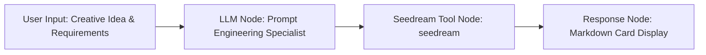

# Seedream 4.0 Image Generation (seedream)

English | [简体中文](./README.md)

The Seedream 4.0 Image Generation plugin is an official FastGPT high-resolution AI visual creation tool, integrating directly with ByteDance Volcengine's (Volcano Ark / Doubao Foundation Model Platform) flagship **Doubao-Seedream 4.0** image generation model (`doubao-seedream-4-0-250828`).

The model features robust bilingual text-to-image multimodal generation capabilities, natively understanding nuanced semantic prompts in both Chinese and English, and delivering ultra-high-resolution images of up to 3K+ with rich textures and cinematic compositions.

---

## Typical Application Scenarios

- **Ultra-HD Commercial Design & Marketing Visuals**: Faithfully renders material textures, lighting, and dimensional details to create high-standard commercial artwork for e-commerce campaigns, brand billboards, and promotional banners.
- **Cinematic Widescreen Wallpapers & Concept Art**: Supports ultra-widescreen 21:9 (3024x1296) and 16:9 (2560x1440) aspect ratios to produce desktop wallpapers and film concept art with depth and cinematic ambiance.
- **High-Fidelity Bilingual Prompt Rendering**: Eliminates the need for intermediary translation by directly interpreting Chinese idioms, classical poetry, and Western artistic concepts with fidelity to the creative vision.
- **4K Social Media Content Creation**: Provides native 1:1 (2048x2048) and 9:16 (1440x2560) formats for social media channels, including Xiaohongshu, WeChat Official Accounts, Instagram, and short-form video cover art.

---

## Credentials & Configuration

Before configuring or executing this tool in FastGPT plugins or workflows, configure the ByteDance Volcengine API credentials.

### Credential Configuration

| Field Name | Key | Type | Required | Secret Masked (`isSecret`) | Description |
| :--- | :--- | :--- | :---: | :---: | :--- |
| **API Key** | `apiKey` | String (`string`) | **Yes** | **Yes** (`true`) | API key issued by ByteDance Volcano Ark (Volcengine) or the Doubao Foundation Model Platform. |

### How to Obtain and Configure Your API Key

1. **Sign in to Volcengine Console**: Visit [Volcengine Official Website](https://www.volcengine.com/) or the [Volcano Ark Console](https://console.volcengine.com/ark/) and log in to your account.
2. **Activate the Model Service**: Navigate to the **Volcano Ark** console. Under **Model Inference** or **Model Square**, locate **Doubao-Seedream 4.0** (`doubao-seedream-4-0-250828`) and activate or subscribe to the endpoint.
3. **Generate an API Key**: In the left sidebar, click **API Key Management** (or Credentials), click **Create API Key**, specify a name, and copy the generated key string.
4. **Configure in FastGPT**: In the FastGPT plugin credential settings, paste your key into the `apiKey` field. The plugin automatically prepends the required `Bearer ` header upon dispatch; **do not add it manually**.

---

## Input Parameters

When invoking this tool from an AI agent or a FastGPT workflow node, the following parameters are supported:

| Parameter | Field | Type | Required | Tool Param (`isToolParam`) | Default | Description & Guidelines |
| :--- | :--- | :--- | :---: | :---: | :--- | :--- |
| **Model** | `model` | Enum (`enum`) | **Yes** | Yes (`true`) | - | Image generation model identifier. Supported official model enum:<br>• `doubao-seedream-4-0-250828` (Doubao Seedream 4.0 base model) |
| **Prompt** | `prompt` | String (`string`) | **Yes** | Yes (`true`) | - | Descriptive text for generating the image. Supports both Chinese and English.<br>• Recommended elements: subject traits, environment/background, composition/angle, artistic style, lighting, material texture, and color palette.<br>• Doubao natively interprets Chinese semantics and excels at traditional Chinese aesthetics and poetic imagery. |
| **Image Size** | `size` | Enum (`enum`) | No | Yes (`true`) | - | Resolution and aspect ratio enum (see details below). Defaults to the model's standard size if omitted. |
| **Random Seed** | `seed` | Number (`number`) | No | Yes (`true`) | `0` | Random seed to control generation variance.<br>• Fixing the seed value helps preserve composition, layout, and character style across prompt iterations.<br>• Leaving it default or blank produces creative variations. |

### Ultra-HD Resolution Options (`size`)

Seedream 4.0 offers a comprehensive set of 2K to 3K high-resolution outputs suitable for diverse media requirements:

| Size Value (`size`) | Aspect Ratio | Total Pixels | Recommended Use Cases |
| :--- | :---: | :---: | :--- |
| `2048x2048` | **1:1** | ~4.2 MP | Square profile avatars, e-commerce product listings, Instagram posts, square stickers & icons |
| `2304x1728` | **4:3** | ~3.98 MP | Vintage photography, slide presentation (PPT) illustrations, traditional canvas art |
| `1728x2304` | **3:4** | ~3.98 MP | Commercial posters, digital notes cover art, mobile feed illustrations |
| `2560x1440` | **16:9** | ~3.68 MP | **2K/QHD widescreen desktop wallpapers**, YouTube/Bilibili video horizontal covers, widescreen PPT backgrounds |
| `1440x2560` | **9:16** | ~3.68 MP | Fullscreen mobile lockscreen wallpapers, TikTok/Reels/Shorts video backgrounds, vertical posters |
| `2496x1664` | **3:2** | ~4.15 MP | DSLR standard landscape framing, commercial photography, print magazines, and lookbooks |
| `1664x2496` | **2:3** | ~4.15 MP | Portrait photography, book and magazine covers, full-body character artwork |
| `3024x1296` | **21:9** | ~3.91 MP | **Cinematic ultrawide format**, panoramic landscapes, ultrawide monitor wallpapers, website banners |

---

## Output Parameters

Upon generation, the plugin returns the image URL in its response:

### Output Fields

| Parameter | Field | Type | Description |
| :--- | :--- | :--- | :--- |
| **Image URL** | `image` | String (`string`) | Direct access URL for the image generated by Volcano Ark. Can be rendered directly in Markdown or HTML nodes. |

### JSON Response Example

```json
{
  "image": "https://ark-content-tos.volces.com/image/20250828/xxxxxx_seedream4_0.jpg"
}
```

---

## Workflow Orchestration Example

To construct an end-to-end "Seedream 4.0 Creative Art Studio" in FastGPT, the following workflow structure is recommended:



### 1. Node Setup & Data Flow

1. **User Input**: The user inputs a brief concept, e.g., *"Generate a cyber-tea-house on a rainy neon night, holographic signs and a mechanical teapot, 2K landscape wallpaper"*.
2. **LLM Node (Prompt Engineer)**:
   - Expands the concise request into a detailed, visually descriptive prompt with lighting, atmosphere, and styling cues.
   - Determines or passes the optimal `size` (e.g., `2560x1440`) and sets `model` to `doubao-seedream-4-0-250828`.
3. **Seedream Tool Node**:
   - `model`: `doubao-seedream-4-0-250828`
   - `prompt`: Bound to the prompt generated by the upstream LLM node.
   - `size`: Bound to the selected resolution (or fixed to e.g., `2560x1440`).
4. **Final Response Node**:
   - Captures the tool's `image` variable and formats it as a Markdown image card.

### 2. Prompt Specialist System Prompt Example

Configure the upstream LLM node with this system prompt to maximize image aesthetics:

```markdown
You are a senior AI visual art director and prompt engineer. Your job is to transform user concepts into rich, vivid, and detailed prompts for ByteDance's Doubao-Seedream 4.0 image model.

Follow these optimization principles:
1. Core Subject: Detail physical traits, materials, textures, poses, and expressions.
2. Environment: Describe depth, background elements, weather atmosphere, and props.
3. Composition & Angle: Specify the camera angle (e.g., wide-angle, aerial view, cinematic close-up, panoramic).
4. Lighting & Color: Detail light sources (e.g., volumetric god rays, cyber neon glow, golden hour) and color palettes.
5. Level of Detail: Emphasize rendering clarity (e.g., 8K texture detail, photorealistic macro finish, film grain).
6. Prompts can be written naturally in either English or descriptive Chinese.

Output only the finalized image generation prompt without unnecessary conversational filler.
```

### 3. Response Node Markdown Card Example

```markdown
### 🎨 Seedream 4.0 Artwork Ready


- **Resolution**: 2560x1440 (16:9 QHD Ultra-HD)
- **Engine**: ByteDance Doubao-Seedream 4.0
> 💡 *Tip: Click the image to view or save the original high-resolution file.*
```

---

## Important Notes

1. **Generation Latency for Ultra-HD Resolutions**: Seedream 4.0 outputs images at 2K to 3K resolutions by default. Model inference and rendering typically require **5 to 15 seconds**. Ensure that any reverse proxy or gateway (such as Nginx) has its request timeout configured to 60 seconds or higher.
2. **File Size and Network Loading**: Generated ultra-HD images usually range from 2MB to 8MB in size. In low-bandwidth network environments, image loading in chat interfaces may take a moment. Progressive rendering or thumbnail placeholders are recommended on custom frontend clients.
3. **URL Expiration and Archiving**: Image URLs returned by Volcano Ark are hosted on temporary CDN storage and may expire after a predetermined duration. For production archival, store the generated assets in permanent object storage (such as AWS S3, Aliyun OSS, or MinIO) in downstream nodes.
4. **API Quotas and Rate Limits**: Volcano Ark applies RPM (Requests Per Minute) and TPM (Tokens Per Minute) thresholds to API keys, in addition to account credit balances. For high-concurrency production deployments, request quota increases in the Volcengine console or implement queuing and retry logic in your workflow.
5. **Content Safety Compliance**: Volcano Ark includes automated content moderation. Prompts containing NSFW themes, graphic violence, politically sensitive material, or protected celebrity likenesses may be blocked with an API error. Ensure prompts comply with content policy guidelines.
