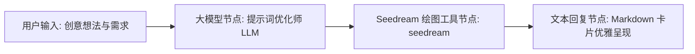

# Seedream 4.0 绘图 (Seedream Image Generation)

[English](./README.en.md) | 简体中文

Seedream 4.0 绘图插件是 FastGPT 官方提供的超高清 AI 绘画工具，深度对接字节跳动火山引擎（火山方舟 / 豆包大模型开放平台）旗下的 **Doubao-Seedream 4.0** 图片生成模型（`doubao-seedream-4-0-250828`）。

该模型具备强大的双语图文多模态生成能力，原生支持中英文复杂语义理解，能够输出最高达 3K+ 级别超高清分辨率、丰富质感与电影级构图的视觉作品。

---

## 典型应用场景

- **超高清商业设计与广告配图**：精准呈现产品细节、光影材质与立体质感，生成适用于电商大促、品牌展牌、营销海报的高水准商业视觉物料。
- **影视级横版宽屏壁纸与概念设计**：利用 21:9 超宽屏（3024x1296）与 16:9（2560x1440）画幅，一键生成富有纵深感、电影感场景的桌面壁纸与影视概念概念草图。
- **中英双语提示词高质量渲染**：无需依赖额外的翻译中转，直接理解中式古风成语、诗词意境，或西方经典艺术构想，高保真还原创意设想。
- **自媒体与社交平台 4K 视觉素材**：支持 1:1（2048x2048）、9:16（1440x2560）等常见社媒画幅，为小红书、微信公众号、短视频封面等提供高质量自媒体配图。

---

## 密钥与凭据配置说明

在 FastGPT 插件配置或工作流中添加该工具前，需配置字节跳动火山引擎的 API 访问凭据。

### 凭据配置项

| 配置项 | 字段名 | 类型 | 是否必填 | 敏感加密 (`isSecret`) | 说明 |
| :--- | :--- | :--- | :---: | :---: | :--- |
| **API 密钥** | `apiKey` | 字符串 (`string`) | **是** | **是** (`true`) | 字节跳动火山方舟（火山引擎）/ 豆包大模型开放平台的 API Key。 |

### API Key 获取渠道与配置指引

1. **登录火山引擎控制台**：访问 [火山引擎官网](https://www.volcengine.com/) 或 [火山方舟大模型服务平台](https://console.volcengine.com/ark/) 并登录账号。
2. **开通模型服务**：进入「火山方舟」控制台，在「模型推理」或「大模型广场」中找到 **Doubao-Seedream 4.0**（`doubao-seedream-4-0-250828`），完成模型接入点或服务开通。
3. **创建 API Key**：在左侧导航栏点击「API Key 管理」或「访问凭证」，点击「创建 API Key」，为密钥命名并保存生成的 Key 字符串。
4. **填入 FastGPT**：在 FastGPT 插件凭据配置中，将获取到的密钥填入 `apiKey` 字段（插件请求时会自动添加 `Bearer ` 鉴权头，**无需手动拼接**）。

---

## 输入参数列表

在 FastGPT 智能体工具调用（Tool Call）或工作流节点中，支持以下输入参数：

| 参数名 | 对应字段 | 类型 | 是否必填 | 工具参数 (`isToolParam`) | 默认值 | 描述与编写建议 |
| :--- | :--- | :--- | :---: | :---: | :--- | :--- |
| **模型** | `model` | 枚举 (`enum`) | **是** | 是 (`true`) | - | 图像生成模型标识。当前支持官方模型枚举：<br>• `doubao-seedream-4-0-250828`（豆包 Seedream 4.0 官方基座模型） |
| **提示词** | `prompt` | 字符串 (`string`) | **是** | 是 (`true`) | - | 用于生成画面的文本描述。支持中文与英文输入。<br>• 建议包含：主体特征、环境背景、构图视角、艺术风格、光照材质及色彩基调。<br>• 豆包模型原生理解中文语义，对古风诗词、成语、东方美学有深厚表现力。 |
| **生成图像尺寸** | `size` | 枚举 (`enum`) | 否 | 是 (`true`) | - | 生成图片的尺寸与宽高比枚举（详见下表）。如未指定，将采用模型默认尺寸。 |
| **随机种子** | `seed` | 数值 (`number`) | 否 | 是 (`true`) | `0` | 控制模型生成随机性的种子数。<br>• 固定 seed 值可在提示词微调时保持画面构图与人物风格的一致性；<br>• 保持默认或留空则产生多样的随机创意。 |

### 超高清分辨率尺寸枚举 (`size`) 说明

Seedream 4.0 提供多款达到 2K ~ 3K 级别的超高清输出尺寸，覆盖全平台创作场景：

| 尺寸取值 (`size`) | 画幅比例 | 像素总数 | 适用设计场景 |
| :--- | :---: | :---: | :--- |
| `2048x2048` | **1:1** | 约 420 万像素 | 正方形头像、商品展示主图、Instagram 帖子、方形图标与贴纸 |
| `2304x1728` | **4:3** | 约 398 万像素 | 经典复古摄影画幅、演示文稿 (PPT) 插图、传统画板构图 |
| `1728x2304` | **3:4** | 约 398 万像素 | 商业海报立幅、图文笔记封面、移动端信息流配图 |
| `2560x1440` | **16:9** | 约 368 万像素 | **2K/QHD 宽屏桌面壁纸**、B 站/YouTube 视频横版封面、PPT 宽屏背景 |
| `1440x2560` | **9:16** | 约 368 万像素 | 手机竖版全屏锁屏壁纸、抖音/快手短视频背景、微信视频号海报 |
| `2496x1664` | **3:2** | 约 415 万像素 | 单反相机经典横幅构图、专业摄影写真、画册与杂志横版印刷 |
| `1664x2496` | **2:3** | 约 415 万像素 | 人物肖像写真、书籍杂志封面、站立全身人像立绘 |
| `3024x1296` | **21:9** | 约 391 万像素 | **影视级超宽画幅**、全景风光大片、带鱼屏壁纸、网站 Banner 横幅 |

---

## 输出结果说明

绘图完成后，插件将返回包含高画质图片直链的响应结果：

### 输出参数

| 参数名 | 对应字段 | 类型 | 说明与应用 |
| :--- | :--- | :--- | :--- |
| **图片链接** | `image` | 字符串 (`string`) | 字节跳动火山方舟生成的图片访问直链（URL）。可直接在 Markdown 或 HTML 节点中嵌入渲染。 |

### JSON 响应示例

```json
{
  "image": "https://ark-content-tos.volces.com/image/20250828/xxxxxx_seedream4_0.jpg"
}
```

---

## 典型工作流编排示例

在 FastGPT 中构建一个端到端的「Seedream 4.0 智能创意绘图助手」，推荐的工作流节点编排如下：



### 1. 节点设计与数据流转

1. **用户输入**：用户输入简短描述，例如：“画一张赛博朋克风格的雨夜老茶馆，有全息霓虹招牌和机械茶壶，2K横屏壁纸”。
2. **大模型节点（LLM 提示词优化师）**：
   - 将用户简短语言扩展为画面感极强、色彩光影丰富的专业绘画 Prompt。
   - 提取或指定最佳 `size`（如 `2560x1440`）与 `model`（`doubao-seedream-4-0-250828`）。
3. **Seedream 工具节点**：
   - `model`：`doubao-seedream-4-0-250828`
   - `prompt`：绑定上游大模型节点输出的专业提示词。
   - `size`：绑定上游大模型选定的尺寸，或直接固定设置为需要的画幅（如 `2560x1440`）。
4. **最终回复节点**：
   - 提取工具输出的 `image` 变量，使用 Markdown 语法进行卡片式图文排版输出。

### 2. 提示词优化师 System Prompt 示例

在大模型节点中配置以下系统提示词，可显著提升画面质感与创意表现力：

```markdown
你是一位资深的 AI 视觉艺术总监与提示词工程师。你的任务是根据用户的需求，为字节跳动豆包 Seedream 4.0 绘画模型撰写画面细节丰富、艺术风格鲜明的提示词。

请遵循以下优化原则：
1. 画面主体：明确主体物的外貌特征、材质质感、姿态与动态细节。
2. 场景环境：描绘背景深度、空间纵深、天气氛围与环境道具。
3. 构图与视角：指定视角（如广角镜头、俯视、电影特写、特宽全景）。
4. 光影色彩：明确光源类型（如丁达尔光线、赛博霓虹漫反射、落日余晖）与主色调搭配。
5. 细节渲染：强调细节真实度（如 8K 细腻纹理、微距发丝级细节、胶片电影颗粒感）。
6. 支持直接使用生动的中文或英文进行描述。

请直接输出优化后的绘图提示词，不要附带多余的寒暄与解释。
```

### 3. 回复节点 Markdown 卡片示例

```markdown
### 🎨 Seedream 4.0 创意画作已生成


- **画面规格**：2560x1440 (16:9 QHD 超高清)
- **绘图引擎**：ByteDance Doubao-Seedream 4.0
> 💡 *提示：点击图片可查看或另存超高清原图。*
```

---

## 注意事项

1. **超高清分辨率生成耗时**：Seedream 4.0 默认输出均为 2K ~ 3K 级别的超高分辨率大图，GPU 推理与渲染时间通常在 **5 ~ 15 秒** 左右，属于正常现象。若网关存在反向代理（如 Nginx），请确保请求超时时间设置在 60 秒以上。
2. **原图文件大小与网络加载**：生成的超清图片文件体积通常在 2MB ~ 8MB 之间。在弱网环境下，聊天界面加载图片可能稍有延迟，建议终端采用流式渲染或加载占位图。
3. **图片直链的时效性与归档**：火山方舟接口返回的图片直链通常具备有效访问期（临时存储直链）。若业务上需对生成的图片做长期存档，建议在工作流后续接入对象存储转存节点（如 S3/OSS），将图像持久化保存。
4. **API 配额与并发限流 (Rate Limits)**：火山方舟对 API Key 设有 RPM（每分钟请求数）与 TPM（每分钟 Token 数）限额。在企业高并发场景下，请前往火山引擎控制台申请调高配额，或在工作流中增加并发缓冲与失败重试机制。
5. **内容安全审查**：火山方舟内置智能内容审核系统，提示词若命中涉黄、涉暴、敏感政治或受版权保护的名人肖像，接口将拒绝生成并返回错误，编写提示词时应遵守相关安全规范。

