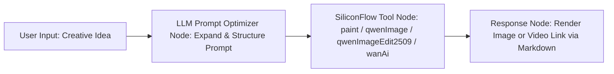

# SiliconFlow Multimodal Model Toolset

The SiliconFlow Multimodal Model Toolset (`silliconFlow`) is an official professional multimodal AI generation and image/video editing plugin integrated into FastGPT. Powered by the high-performance computing infrastructure of the [SiliconFlow Cloud Platform](https://cloud.siliconflow.cn), this toolset aggregates premier open-source vision and video models: **Kwai-Kolors/Kolors** (Kuaishou's flagship text-to-image model), Alibaba Tongyi's flagship image generator **Qwen/Qwen-Image**, precision instruction-based image editor **Qwen/Qwen-Image-Edit-2509**, and the next-generation SOTA video generation foundation model **Wan-AI/Wan2.1**.

With this toolset, FastGPT users can seamlessly orchestrate top-tier multimodal AI capabilities inside Agents and Workflows, spanning the complete creative pipeline—from high-fidelity text-to-image generation and e-commerce conceptual rendering to single/multi-reference image editing and 720P cinematic video synthesis.

---

## Typical Application Scenarios

- **Rapid High-Fidelity Image Generation**: Leverage the profound Chinese/English semantic understanding and realistic rendering quality of Kolors and Qwen-Image to transform literary prose, storyboards, anime artwork, and photorealistic concepts into high-resolution visuals.
- **E-Commerce Merchandise & Concept Modeling**: Generate intricate, studio-lit product renders, virtual fashion try-on visuals, and multi-aspect-ratio promotional banners tailored for global e-commerce campaigns.
- **Instruction-Guided Precision Image Editing**: Utilize `qwenImageEdit2509`'s multi-reference contextual editing capabilities to modify clothing, replace backgrounds, transfer artistic styles, and add or remove elements using natural language commands without manual inpainting masks.
- **Multimodal Video Generation with Wan2.1**: Combine Wan2.1 video foundation models to animate creative prompts or static reference images into 720P cinematic videos with vivid camera motion, realistic physical dynamics, and temporal coherence.

---

## Secret & Credential Configuration

Before invoking this plugin, you must configure the SiliconFlow Cloud access token (`authorization`) in your FastGPT plugin settings.

### How to Obtain an API Token

1. Visit the [SiliconFlow Cloud Platform](https://cloud.siliconflow.cn).
2. Register and sign in to your SiliconFlow account.
3. In the left navigation sidebar of the console, click **API Keys**.
4. Click **Create API Key**, then copy the generated access token (formatted as `sk-xxxxxxxxxxxxxxxxxxxxxxxx`).
5. Verify your account balance or voucher credits under [Finance / Billing Center](https://cloud.siliconflow.cn/account/finance).
6. Paste the copied API token into the FastGPT plugin credential configuration.

### Plugin Secret Schema

| Setting | Field | Type | Required | Secret (`isSecret`) | Description & Notes |
| :--- | :--- | :--- | :---: | :---: | :--- |
| **API Token** | `authorization` | String (`string`) | **Yes** | Yes (`true`) | SiliconFlow API access token, e.g., `sk-xxxx`.<br>⚠️ **Important Authentication Note**: Provide the raw API key directly. **Do NOT include the `Bearer ` prefix**. The plugin automatically prepends `Authorization: Bearer <authorization>` to the outgoing HTTP headers. |

---

## Sub-Tools List

This tool suite consists of 4 core sub-tools:

| Tool ID | Chinese Name | English Name | Positioning & Description |
| :--- | :--- | :--- | :--- |
| `paint` | **Kolors 绘图** | Kolors painting | Text-to-image and image-to-image generation powered by **Kwai-Kolors/Kolors**, featuring strong multilingual comprehension, multi-resolution support, and batch generation. |
| `qwenImage` | **Qwen 图像生成** | Qwen-image | Professional image generation tool powered by **Qwen/Qwen-Image**, excelling in fine-grained visual details, complex spatial layout, and accurate typography rendering. |
| `qwenImageEdit2509` | **Qwen 图像编辑** | Qwen-image-edit | Instruction-guided image editing tool powered by **Qwen/Qwen-Image-Edit-2509**, supporting multi-image (1–3 references) inpainting, style transfer, and character element modification. |
| `wanAi` | **Wan-AI 视频生成** | Wan-AI Video Generation | High-definition video generation tool powered by Alibaba's **Wan2.1** family, supporting 720P Text-to-Video (T2V) and Image-to-Video (I2V) workflows. |

---

## Sub-Tool 1: paint (Kolors Painting)

### Overview & Capabilities
Employs the official cloud-hosted `Kwai-Kolors/Kolors` text-to-image model. Renowned for its rich texture rendering, nuanced aesthetic comprehension, and photorealistic lighting, this tool supports generating 1 to 4 images per invocation and accepts an optional reference image for image-to-image transformations.

### Input Parameters

| Parameter | Field | Type | Required | Default / Allowed Range | Description & Guidance |
| :--- | :--- | :--- | :---: | :--- | :--- |
| **Image Prompt** | `prompt` | String (`string`) | **Yes** | None | Text prompt describing the desired image contents. Supports detailed descriptions covering subject attributes, lighting, composition, and artistic style. |
| **Image Size** | `image_size` | Enum (`string`) | **Yes** | Defaults to `"1024x1024"` | Target image resolution. Allowed values: `"1024x1024"` (1:1 square), `"960x1280"`, `"768x1024"` (3:4 portrait), `"720x1440"` (1:2 vertical), `"720x1280"` (9:16 mobile), `"512x512"`, `"2048x2048"`. |
| **Number of Images** | `batch_size` | Integer (`number`) | **Yes** | Default `1`, range `1` to `4` | Number of image variations to generate per request. Setting this to 4 produces four compositional alternatives simultaneously. |
| **Inference Steps** | `num_inference_steps` | Integer (`number`) | **Yes** | Default `20`, range `1` to `100` | Number of denoising diffusion steps. Values between 20 and 30 provide an optimal trade-off between speed and detail. |
| **Guidance Scale** | `guidance_scale` | Float (`number`) | **Yes** | Default `7.5`, range `0` to `20` | Classifier-Free Guidance (CFG) scale. Higher values adhere more strictly to the prompt text, whereas lower values encourage creative model exploration. |
| **Negative Prompt** | `negative_prompt` | String (`string`) | No | Omit | Undesired visual artifacts or subjects to exclude (e.g., blurry, distorted anatomy, low quality, watermarks). |
| **Seed** | `seed` | Integer (`number`) | No | Omit for random, `0` to `9999999999` | Random seed for deterministic reproducibility. Reusing identical seeds and parameters produces matching results. |
| **Reference Image** | `image` | String (`string`) | No | Omit | Reference image for image-to-image tasks. Accepts a direct public image URL or Base64 data (e.g., `"data:image/png;base64,XXX"`). URLs are automatically converted to Base64 by the plugin. |

### Output Results

| Field | Type | Description & Example |
| :--- | :--- | :--- |
| `images` | String Array (`string[]`) | List of direct public URLs for the generated images. Can be embedded directly in Markdown or forwarded to downstream workflow nodes. |
| `timings` | Float (`number`) | Total inference duration in seconds, e.g., `3.42`. |
| `seed` | Integer (`number`) | The actual random seed value used during image synthesis. |

### Example Response

```json
{
  "images": [
    "https://sf-images.siliconflow.cn/generations/kolors-20250101-abc12345.png"
  ],
  "timings": 3.42,
  "seed": 2025031588
}
```

---

## Sub-Tool 2: qwenImage (Qwen Image Generation)

### Overview & Capabilities
Powered by the `Qwen/Qwen-Image` foundation model developed by Alibaba's Tongyi Qianwen team. It delivers exceptional multilingual instruction adherence, fine-grained texture synthesis, and superior typography rendering for embedded signage, labels, and posters.

### Input Parameters

| Parameter | Field | Type | Required | Default / Allowed Range | Description & Guidance |
| :--- | :--- | :--- | :---: | :--- | :--- |
| **Image Prompt** | `prompt` | String (`string`) | **Yes** | None | Text prompt describing the target scene. Wrap text intended for on-canvas typography in quotation marks. |
| **Image Size** | `image_size` | Enum (`string`) | **Yes** | Defaults to `"1328x1328"` | Output resolution preset. Allowed values: `"1328x1328"` (1:1 square), `"1664x928"` (16:9 banner), `"928x1664"` (9:16 mobile display), `"1472x1140"` (4:3 landscape), `"1140x1472"` (3:4 portrait), `"1584x1056"` (3:2 landscape), `"1056x1584"` (2:3 portrait). |
| **Inference Steps** | `num_inference_steps` | Integer (`number`) | **Yes** | Default `20`, range `1` to `100` | Number of denoising inference iterations. |
| **Negative Prompt** | `negative_prompt` | String (`string`) | No | Omit | Unwanted elements to exclude from the visual output. |
| **Seed** | `seed` | Integer (`number`) | No | Omit for random, `0` to `9999999999` | Random seed used for generation consistency and repeatability. |

### Output Results

| Field | Type | Description & Example |
| :--- | :--- | :--- |
| `imageUrl` | String (`string`) | Public direct access URL of the synthesized image. |

### Example Response

```json
{
  "imageUrl": "https://sf-images.siliconflow.cn/generations/qwen-image-20250101-def67890.png"
}
```

---

## Sub-Tool 3: qwenImageEdit2509 (Qwen Image Editing)

### Overview & Capabilities
Driven by `Qwen/Qwen-Image-Edit-2509`, a specialized model engineered specifically for instruction-based image manipulation. It supports editing across 1 to 3 reference images, executing precise subject alterations, background replacements, outfit modifications, and artistic style transfers based on natural language instructions while faithfully retaining the subject's identity.

### Input Parameters

| Parameter | Field | Type | Required | Default / Allowed Range | Description & Guidance |
| :--- | :--- | :--- | :---: | :--- | :--- |
| **Edit Prompt** | `prompt` | String (`string`) | **Yes** | None | Natural language modification instructions (e.g., "Change the background to a sunset along the Seine river, put sunglasses on the person, and place a coffee cup in their hand"). |
| **Reference Image 1** | `image` | String (`string`) | **Yes** | None | Primary reference image. Accepts a public image URL or Base64 data. Serves as the foundational base for modifications. |
| **Reference Image 2** | `image2` | String (`string`) | No | Omit | Optional second reference image (URL or Base64). Useful for multi-image synthesis, style matching, or garment transfer. |
| **Reference Image 3** | `image3` | String (`string`) | No | Omit | Optional third reference image (URL or Base64). |
| **Inference Steps** | `num_inference_steps` | Integer (`number`) | **Yes** | Default `20`, range `1` to `100` | Number of denoising steps for image editing. |
| **Negative Prompt** | `negative_prompt` | String (`string`) | No | Omit | Visual characteristics to eliminate during editing. |
| **Seed** | `seed` | Integer (`number`) | No | Omit for random, `0` to `9999999999` | Random seed for generation reproducibility. |

### Output Results

| Field | Type | Description & Example |
| :--- | :--- | :--- |
| `imageUrl` | String (`string`) | Public direct access URL of the edited image. |

### Example Response

```json
{
  "imageUrl": "https://sf-images.siliconflow.cn/generations/qwen-image-edit-20250101-edit9988.png"
}
```

---

## Sub-Tool 4: wanAi (Wan-AI Video Generation)

### Overview & Capabilities
Harnesses Alibaba's state-of-the-art open-source **Wan2.1** video foundation model family. Featuring 14B parameter architectures for both Text-to-Video (T2V) and Image-to-Video (I2V), it delivers fluid temporal consistency, natural physical dynamics, and cinematic camera trajectories up to 720P HD resolution. The plugin incorporates an automated asynchronous polling mechanism to track task execution and deliver the finished video URL.

### Input Parameters

| Parameter | Field | Type | Required | Default / Allowed Range | Description & Guidance |
| :--- | :--- | :--- | :---: | :--- | :--- |
| **Model** | `model` | Enum (`string`) | **Yes** | Defaults to `"Wan-AI/Wan2.1-T2V-14B"` | Video model variant.<br>• `Wan-AI/Wan2.1-T2V-14B`: 14B flagship Text-to-Video model.<br>• `Wan-AI/Wan2.1-T2V-14B-Turbo`: 14B accelerated Text-to-Video model.<br>• `Wan-AI/Wan2.1-I2V-14B-720P`: 14B 720P Image-to-Video model.<br>• `Wan-AI/Wan2.1-I2V-14B-720P-Turbo`: 14B 720P accelerated Image-to-Video model. |
| **Prompt** | `prompt` | String (`string`) | **Yes** | None | Text prompt describing the video scene dynamics. Specify subject motion, environmental elements, camera movement (zoom in, pan, orbit, slow-motion), and lighting shifts. |
| **Video Size** | `image_size` | Enum (`string`) | **Yes** | Defaults to `"1280x720"` | Video resolution and aspect ratio preset: `"1280x720"` (16:9 cinematic landscape), `"720x1280"` (9:16 mobile vertical), `"960x960"` (1:1 square). |
| **Input Image** | `image` | String (`string`) | Conditional (Required for I2V) | Omit | Initial reference frame. **Required** when selecting `Wan2.1-I2V` models. Accepts a public image URL or Base64 data. |
| **Negative Prompt** | `negative_prompt` | String (`string`) | No | Omit | Video artifacts to avoid (e.g., flickering, jittering, severe anatomical distortion, motion blur). |
| **Seed** | `seed` | Integer (`number`) | No | Omit for random | Integer seed controlling video generation randomness. |

### Output Results

| Field | Type | Description & Example |
| :--- | :--- | :--- |
| `status` | Enum (`string`) | Task completion status: `"Succeed"`, `"InQueue"`, `"InProgress"`, or `"Failed"`. |
| `url` | String (`string`) | Direct public playback and download URL for the generated MP4 video. Points to the primary generated video. |
| `results` | Object (`object`) | Comprehensive video generation metadata:<br>• `videos` (`string[]`): Array of direct video URLs (SiliconFlow links are typically valid for 1 hour).<br>• `timings` (`object`): Includes performance telemetry such as `inference` duration in seconds.<br>• `seed` (`number`): The actual seed utilized during synthesis. |

### Example Response

```json
{
  "status": "Succeed",
  "url": "https://sf-videos.siliconflow.cn/generations/wan-video-20250101-720p-demo.mp4",
  "results": {
    "videos": [
      "https://sf-videos.siliconflow.cn/generations/wan-video-20250101-720p-demo.mp4"
    ],
    "timings": {
      "inference": 48.65
    },
    "seed": 9876543210
  }
}
```

---

## Typical Workflow Examples

Connecting an upstream Large Language Model (LLM) with SiliconFlow multimodal tools inside FastGPT creates an automated creation loop: "User Idea -> Prompt Expansion & Parameter Mapping -> Cloud Multimodal Synthesis -> Rich Inline Rendering".

### 1. Workflow Architecture



### 2. Orchestration Steps

1. **User Input Node**: Accepts conversational creative prompts, such as: "Draw an elegant poster for a modern Chinese tea room, soft morning light filtering through bamboo blinds onto a tea table with gentle steam rising, vertical framing".
2. **LLM Prompt Optimizer Node**:
   - Employs a system prompt to elaborate the user's brief input into an evocative visual prompt, while determining the optimal aspect ratio and parameters.
3. **SiliconFlow Multimodal Node**:
   - Select `Silicon Flow -> Kolors painting (paint)` or `Qwen-image (qwenImage)`.
   - Node parameter configuration:
     - `prompt`: Bind to the upstream LLM output prompt variable.
     - `image_size`: Set to `"768x1024"` or `"928x1664"` (poster aspect ratio).
     - `batch_size`: Set to `1`.
     - `guidance_scale`: Set to `7.5`.
4. **Final Response Node**:
   - Reference the `images` array or `imageUrl` variable from the SiliconFlow node using Markdown syntax:
   ```markdown
   Your design has been generated successfully:

   
   ```
   *(For the Wan-AI video generation tool, you can provide `[Click to watch generated video]({{url}})` or embed HTML `<video src="{{url}}" controls="controls" width="100%"></video>`)*

### 3. Recommended System Prompt for Upstream Prompt Optimizer

Add the following system prompt to the upstream LLM node:

```markdown
You are an expert multimodal AI art director and prompt engineer. Your task is to transform the user's brief concept into an evocative, highly detailed prompt tailored for image or video generation models.

Guidelines:
1. Subject & Detailing: Specify subject identity, physical anatomy, garment textures, and posture.
2. Perspective & Composition: Detail spatial camera angles and framing (e.g., Close-up shot, Wide-angle view, Cinematic framing, Rule of thirds).
3. Lighting & Palette: Describe illumination schemes (e.g., Morning rim lighting, Volumetric mist, Neon glow, Warm golden tones) and color harmony.
4. Medium & Style: Define artistic rendering fidelity (e.g., Photorealistic 8K, Modern minimalist graphic design, Ink wash illustration, Cinematic Unreal Engine 5 render).
5. Text Typography: If the scene includes signs, banners, or typography, wrap exact text in double quotes.
6. Output ONLY the raw prompt without introductory remarks, explanations, or enclosing wrappers.
```

---

## Important Considerations

1. **Authentication Token Formatting**:
   - When configuring the `authorization` credential in FastGPT, paste the raw API key directly (e.g., `sk-xxxx`). **Do NOT prepend `Bearer `**. The plugin automatically attaches the standard `Bearer ` header; adding it manually will cause HTTP 401 Unauthorized errors.
2. **Execution Latency & Timeout Settings**:
   - **Image Generation (Kolors / Qwen-Image / Qwen-Image-Edit)**: Generally completes synchronously in **3 to 15 seconds**.
   - **Video Generation (Wan2.1)**: As an intensive compute workload, video rendering usually requires **30 to 120 seconds**. The plugin incorporates an internal polling loop running up to 180 attempts (3-second intervals, max ~9 minutes). Ensure that upstream FastGPT node execution timeouts are configured generously (recommended at least 180 seconds) to prevent gateway timeouts.
3. **SiliconFlow API Billing & Model Credits**:
   - Different models operate on distinct billing tiers. Kolors and smaller models often include free tier usage, whereas Wan2.1-14B video models and high-resolution image synthesis consume cash balance or vouchers. Verify that your [SiliconFlow Console](https://cloud.siliconflow.cn) balance remains positive.
4. **Temporary Asset Lifespan & Persistent Storage**:
   - Image and video URLs returned by SiliconFlow are hosted on temporary cloud storage buckets and **carry expiration windows (video URLs are typically valid for 1 hour)**.
   - For long-term archiving, permanent sharing, or public hosting, we strongly recommend storing the output files using the official FastGPT object storage plugin (`objectStorage`) or downloading them into an enterprise S3/OSS bucket in downstream workflow nodes.
5. **Reference Image Requirements & Accessibility**:
   - When supplying reference images to `paint`, `qwenImageEdit2509`, or `wanAi`, you may pass either a **publicly reachable image URL** or a **Base64-encoded string** (`data:image/png;base64,XXX`).
   - For URLs, ensure the resource is publicly downloadable via standard HTTP/HTTPS GET requests without requiring session cookies, authorization headers, or triggering anti-hotlinking protections.

---

## Local Development & Testing

```bash
# Install workspace dependencies
pnpm install

# Run unit tests
pnpm run test

# Build plugin artifacts
pnpm run build

# Validate plugin standards and artifacts
npx @fastgpt-plugin/cli check --entry .
```
