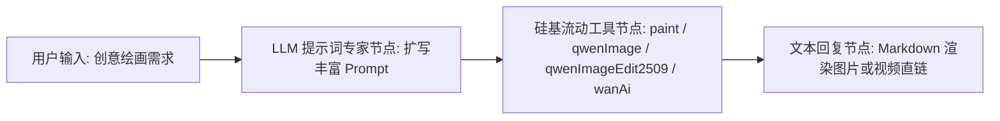

# 硅基流动多模态模型工具集 (SiliconFlow)

硅基流动多模态模型工具集（`silliconFlow`）是 FastGPT 官方集成的专业级多模态 AI 创作与图像/视频处理插件。本工具集深度对接[硅基流动开放平台](https://cloud.siliconflow.cn)的高性能算力，汇聚了前沿开源绘图大模型 **Kwai-Kolors/Kolors**（快手可图）、阿里通义团队旗舰图像大模型 **Qwen/Qwen-Image**、精细化指令图像编辑大模型 **Qwen/Qwen-Image-Edit-2509**，以及新一代开源 SOTA 视频生成大模型 **Wan-AI/Wan2.1**（万象视频大模型）。

通过本工具集，FastGPT 用户可在智能体（Agent）与自动化工作流（Workflow）中无缝调用多模态顶级算力，覆盖从高精度文生图、电商概念设计、单图/多图参考精细化编辑，到 720P 高清影视级视频生成的完整多模态创作链路。

---

## 典型应用场景

- **前沿开源大模型快速生图**：结合 Kolors 与 Qwen-Image 顶尖模型的中文语义理解与高保真渲染能力，快速将文学描写、故事分镜、二次元插画和写实摄影等创意转化为高分辨率精美画作。
- **电商模特与概念图设计**：为电商出海、商品展示与营销海报定制生成高细节、专业棚拍打光的产品渲染图、虚拟模特试衣图以及多比例社交媒体主图。
- **基于指令的图像局部编辑**：利用 `qwenImageEdit2509` 强大的多图融合与上下文编辑能力，无需复杂遮罩即可通过自然语言指令完成主体换装、背景替换、风格迁移及元素增删。
- **通义千问与万象模型多模态能力调用**：结合 Wan2.1 顶级视频模型，将静态创意概念或参考图片直接扩展为镜头感丰富、物理规律真实、时空一致性稳定的 720P 电影级短视频。

---

## 密钥与凭据配置说明

使用本插件前，需在 FastGPT 插件配置中配置硅基流动开放平台的访问令牌（`authorization`）。

### 获取渠道指引

1. 访问 [硅基流动开放平台 (SiliconFlow Cloud)](https://cloud.siliconflow.cn)。
2. 注册并登录硅基流动账号。
3. 进入控制台，在左侧导航栏中点击 **API 密钥 (API Keys)**。
4. 点击 **新建 API 密钥**，创建并复制生成的访问令牌（格式如 `sk-xxxxxxxxxxxxxxxxxxxxxxxx`）。
5. 检查账户余额或代金券状态（可在 [财务管理 / 费用中心](https://cloud.siliconflow.cn/account/finance) 查看充值情况）。
6. 将复制的 API 密钥粘贴至 FastGPT 插件凭证配置项中。

### 插件凭证参数

| 配置项 | 字段名 | 类型 | 是否必填 | 敏感加密 (`isSecret`) | 说明与示例 |
| :--- | :--- | :--- | :---: | :---: | :--- |
| **接口凭证** | `authorization` | 字符串 (`string`) | **是** | 是 (`true`) | 硅基流动 API 访问令牌，例如 `sk-xxxx`。<br>⚠️ **鉴权格式特别注意**：直接填入令牌字符串即可，**切勿手动添加 `Bearer ` 前缀**。插件底层在发起 HTTP 请求时会自动组装 `Authorization: Bearer <authorization>`。 |

---

## 子工具列表

本工具集包含以下 4 个核心子工具：

| 子工具 ID | 中文名称 | 英文名称 | 定位与功能说明 |
| :--- | :--- | :--- | :--- |
| `paint` | **Kolors 绘图** | Kolors painting | 基于快手 **Kwai-Kolors/Kolors** 模型的文生图/图生图工具，中文理解力极强，支持批量输出与多尺寸分辨率。 |
| `qwenImage` | **Qwen 图像生成** | Qwen-image | 基于通义千问 **Qwen/Qwen-Image** 大模型的专业图像生成工具，在文字排版与复杂空间构图上表现优异。 |
| `qwenImageEdit2509` | **Qwen 图像编辑** | Qwen-image-edit | 基于 **Qwen/Qwen-Image-Edit-2509** 模型的指令级图像编辑工具，支持 1~3 张参考图的多图局部修图与风格转换。 |
| `wanAi` | **Wan-AI 视频生成** | Wan-AI Video Generation | 基于阿里万象 **Wan2.1** 系列开源模型的视频生成工具，支持文生视频（T2V）与图生视频（I2V）720P 高清输出。 |

---

## 子工具 1：paint (Kolors 绘图)

### 定位与特点
采用硅基流动官方托管的 `Kwai-Kolors/Kolors` 旗舰开源文生图模型。该模型在中文语言理解、东方美学风格渲染以及精细纹理呈现上具备行业领先实力，支持 1~4 张图片并行生成，同时支持传入参考图进行图生图。

### 输入参数说明

| 参数名 | 对应字段 | 类型 | 是否必填 | 默认值 / 可选范围 | 说明与编写建议 |
| :--- | :--- | :--- | :---: | :--- | :--- |
| **绘图提示词** | `prompt` | 字符串 (`string`) | **是** | 无 | 描述要生成图像内容的文本提示词。支持详尽的中文或英文描述，包含主体细节、光照、构图与艺术风格。 |
| **绘图尺寸** | `image_size` | 枚举 (`string`) | **是** | 默认 `"1024x1024"` | 图像分辨率。可选值：`"1024x1024"`（1:1 方图）、`"960x1280"`、`"768x1024"`（3:4 竖图）、`"720x1440"`（1:2 竖图）、`"720x1280"`（9:16 移动全屏）、`"512x512"`、`"2048x2048"`。 |
| **输出图片数量** | `batch_size` | 整数 (`number`) | **是** | 默认 `1`，范围 `1` ~ `4` | 单次请求生成的图片数量。例如设为 4 可一次性输出 4 张不同构图的备选方案。 |
| **推理步数** | `num_inference_steps` | 整数 (`number`) | **是** | 默认 `20`，范围 `1` ~ `100` | 去噪推理迭代步数。通常步数在 20~30 之间能达到速度与画质的最佳平衡。 |
| **引导尺度** | `guidance_scale` | 浮点数 (`number`) | **是** | 默认 `7.5`，范围 `0` ~ `20` | 分类器自由引导（CFG）系数。数值越高画面越严格贴合提示词；数值越低模型的自主创意发挥度越高。 |
| **负面提示词** | `negative_prompt` | 字符串 (`string`) | 否 | 留空 | 描述画面中希望排除的瑕疵与元素（如模糊、畸形肢体、低画质、文字水印等）。 |
| **随机种子** | `seed` | 整数 (`number`) | 否 | 留空为随机，`0` ~ `9999999999` | 固定相同的种子与参数可以复现相同或高度相似的画面构图。 |
| **参考图** | `image` | 字符串 (`string`) | 否 | 留空 | 图生图参考图片。支持传入公网图片直链 URL 或 Base64 格式（如 `"data:image/png;base64,XXX"`）。传入 URL 时插件会自动转为 Base64。 |

### 输出结果说明

| 字段名 | 类型 | 说明与示例 |
| :--- | :--- | :--- |
| `images` | 字符串数组 (`string[]`) | 生成的图片可访问 URL 直链列表。可直接在 Markdown 或后续工作流节点中提取并展示。 |
| `timings` | 浮点数 (`number`) | 模型推理耗时（单位：秒），例如 `3.42`。 |
| `seed` | 整数 (`number`) | 本次图像生成实际使用的随机种子值。 |

### 输出示例

```json
{
  "images": [
    "https://sf-images.siliconflow.cn/generations/kolors-20250101-abc12345.png"
  ],
  "timings": 3.42,
  "seed": 2025031588
}
```

---

## 子工具 2：qwenImage (Qwen 图像生成)

### 定位与特点
基于阿里通义千问官方研发的 `Qwen/Qwen-Image` 图像生成大模型。具备强大的多语言对齐能力、细粒度视觉渲染与出色的中英文文本排版理解，能够清晰渲染画面中的标牌与文字，适合海报、招贴及复杂故事分镜生成。

### 输入参数说明

| 参数名 | 对应字段 | 类型 | 是否必填 | 默认值 / 可选范围 | 说明与编写建议 |
| :--- | :--- | :--- | :---: | :--- | :--- |
| **绘图提示词** | `prompt` | 字符串 (`string`) | **是** | 无 | 描述要生成图像内容的文本提示词。支持中文与英文，画面中若包含特定文字，可用引号标注。 |
| **绘图尺寸** | `image_size` | 枚举 (`string`) | **是** | 默认 `"1328x1328"` | 生成图像的分辨率规格。可选值：`"1328x1328"`（1:1 正方）、`"1664x928"`（16:9 宽屏）、`"928x1664"`（9:16 移动竖版）、`"1472x1140"`（4:3 横版）、`"1140x1472"`（3:4 竖版）、`"1584x1056"`（3:2 横版）、`"1056x1584"`（2:3 竖版）。 |
| **推理步数** | `num_inference_steps` | 整数 (`number`) | **是** | 默认 `20`，范围 `1` ~ `100` | 推理去噪步数。 |
| **负面提示词** | `negative_prompt` | 字符串 (`string`) | 否 | 留空 | 描述生成图像中需要排除的不良元素。 |
| **随机种子** | `seed` | 整数 (`number`) | 否 | 留空为随机，`0` ~ `9999999999` | 随机种子值，用于控制图像生成的确定性与复现性。 |

### 输出结果说明

| 字段名 | 类型 | 说明与示例 |
| :--- | :--- | :--- |
| `imageUrl` | 字符串 (`string`) | 生成图片的公网直接访问 URL。可在下游节点直接作为 Markdown 图片展示。 |

### 输出示例

```json
{
  "imageUrl": "https://sf-images.siliconflow.cn/generations/qwen-image-20250101-def67890.png"
}
```

---

## 子工具 3：qwenImageEdit2509 (Qwen 图像编辑)

### 定位与特点
基于通义千问 `Qwen/Qwen-Image-Edit-2509` 专项图像编辑模型。专为指令化图生图设计，支持通过一段自然语言描述，对输入的 1~3 张参考图片进行精准的元素增删、人物换装、主体姿态调整、背景环境替换以及风格重塑，保留原图核心身份特征的同时实现高质量重绘。

### 输入参数说明

| 参数名 | 对应字段 | 类型 | 是否必填 | 默认值 / 可选范围 | 说明与编写建议 |
| :--- | :--- | :--- | :---: | :--- | :--- |
| **绘图提示词** | `prompt` | 字符串 (`string`) | **是** | 无 | 描述对参考图的具体修改指令。例如：“将背景替换为落日余晖下的塞纳河畔，人物戴上墨镜并手持一杯咖啡”。 |
| **参考图片1** | `image` | 字符串 (`string`) | **是** | 无 | 主参考图片。支持公网图片直链 URL 或 Base64 编码数据。作为编辑和修改的基础底图。 |
| **参考图片2** | `image2` | 字符串 (`string`) | 否 | 留空 | 可选的第二张参考图片（URL 或 Base64）。可用于多图融合、提供风格参考或服饰道具对照。 |
| **参考图片3** | `image3` | 字符串 (`string`) | 否 | 留空 | 可选的第三张参考图片（URL 或 Base64）。 |
| **推理步数** | `num_inference_steps` | 整数 (`number`) | **是** | 默认 `20`，范围 `1` ~ `100` | 图像编辑推理迭代步数。 |
| **负面提示词** | `negative_prompt` | 字符串 (`string`) | 否 | 留空 | 描述编辑结果中需要排除的内容。 |
| **随机种子** | `seed` | 整数 (`number`) | 否 | 留空为随机，`0` ~ `9999999999` | 随机种子值。 |

### 输出结果说明

| 字段名 | 类型 | 说明与示例 |
| :--- | :--- | :--- |
| `imageUrl` | 字符串 (`string`) | 编辑完成后的图片公网直接访问 URL。 |

### 输出示例

```json
{
  "imageUrl": "https://sf-images.siliconflow.cn/generations/qwen-image-edit-20250101-edit9988.png"
}
```

---

## 子工具 4：wanAi (Wan-AI 视频生成)

### 定位与特点
基于阿里开源旗舰 **Wan2.1（万象）** 视频生成大模型系列。包含 14B 参数级别的高精度文生视频（Text-to-Video）与图生视频（Image-to-Video）模型，提供卓越的时空连贯性、复杂镜头运动轨迹以及物理仿真质感，支持 720P 高清影视级视频输出。插件内部已内置智能异步轮询机制，自动跟踪任务完成并返回视频结果直链。

### 输入参数说明

| 参数名 | 对应字段 | 类型 | 是否必填 | 默认值 / 可选范围 | 说明与编写建议 |
| :--- | :--- | :--- | :---: | :--- | :--- |
| **模型** | `model` | 枚举 (`string`) | **是** | 默认 `"Wan-AI/Wan2.1-T2V-14B"` | 视频生成模型版本。<br>• `Wan-AI/Wan2.1-T2V-14B`：14B 文生视频旗舰模型<br>• `Wan-AI/Wan2.1-T2V-14B-Turbo`：14B 文生视频极速加速模型<br>• `Wan-AI/Wan2.1-I2V-14B-720P`：14B 图生视频 720P 高清模型<br>• `Wan-AI/Wan2.1-I2V-14B-720P-Turbo`：14B 图生视频 720P 极速加速模型 |
| **提示词** | `prompt` | 字符串 (`string`) | **是** | 无 | 描述视频运动画面的文本提示词。建议明确主体动作、环境动态、镜头运镜（如推镜、环绕、慢动作）及光影变化。 |
| **尺寸** | `image_size` | 枚举 (`string`) | **是** | 默认 `"1280x720"` | 视频分辨率与画幅比例。可选值：`"1280x720"`（16:9 横屏影视画幅）、`"720x1280"`（9:16 移动端竖屏短视频）、`"960x960"`（1:1 正方形画幅）。 |
| **输入图片** | `image` | 字符串 (`string`) | 否 (I2V 模型必填) | 留空 | 输入首帧参考图片。使用 `Wan2.1-I2V` 图生视频模型时**必填**。支持公开访问的图片 URL 或 Base64 编码。 |
| **负面提示词** | `negative_prompt` | 字符串 (`string`) | 否 | 留空 | 描述视频中需排除的画面缺陷（如抽搐、严重形变、画面噪点、闪烁等）。 |
| **随机种子** | `seed` | 整数 (`number`) | 否 | 留空为随机 | 用于控制视频生成随机性的整数种子。 |

### 输出结果说明

| 字段名 | 类型 | 说明与示例 |
| :--- | :--- | :--- |
| `status` | 枚举 (`string`) | 任务最终执行状态。可选值：`"Succeed"`（成功）、`"InQueue"`（排队中）、`"InProgress"`（生成中）、`"Failed"`（失败）。 |
| `url` | 字符串 (`string`) | 生成视频的公网直接播放/下载链接（MP4 格式）。通常指向首个生成的视频。 |
| `results` | 对象 (`object`) | 完整的视频生成结果对象：<br>• `videos` (`string[]`)：生成的视频直链数组（硅基流动官方通常有效期为 1 小时）。<br>• `timings` (`object`)：包含 `inference`（推理耗时秒数）等性能指标。<br>• `seed` (`number`)：实际执行使用的随机种子。 |

### 输出示例

```json
{
  "status": "Succeed",
  "url": "https://sf-videos.siliconflow.cn/generations/wan-video-20250101-720p-demo.mp4",
  "results": {
    "videos": [
      "https://sf-videos.siliconflow.cn/generations/wan-video-20250101-720p-demo.mp4"
    ],
    "timings": {
      "inference": 48.65
    },
    "seed": 9876543210
  }
}
```

---

## 典型工作流编排示例

在 FastGPT 中，将大语言模型（LLM）与硅基流动多模态工具无缝联动，可以实现“用户意图理解 -> 提示词扩写与参数匹配 -> 硅基流动云端绘制 -> 最终结果直观图文展示”的全自动化闭环流程。

### 1. 节点拓扑编排



### 2. 编排步骤

1. **用户输入节点**：用户提出简短或口语化的创作意图，例如：“画一张新中式风格的茶室海报，柔和晨光透过竹帘洒在茶台上，水蒸气袅袅升起，纵向构图”。
2. **LLM 提示词专家节点（大模型处理）**：
   - 编写系统提示词（System Prompt），引导大模型将口语描述扩写为高完成度的视觉提示词，并规划适宜的宽高比与参数。
3. **硅基流动多模态绘图节点**：
   - 添加工具选择：`硅基流动 -> Kolors 绘图 (paint)` 或 `Qwen 图像生成 (qwenImage)`。
   - 参数绑定：
     - `prompt`：绑定上游大模型输出的优化提示词变量。
     - `image_size`：设为 `"768x1024"` 或 `"928x1664"`（竖版海报规格）。
     - `batch_size`：设为 `1`。
     - `guidance_scale`：设为 `7.5`。
4. **文本回复节点**：
   - 引用绘图节点输出的 `images` 数组或 `imageUrl` 变量，使用 Markdown 格式渲染图片呈现给用户：
   ```markdown
   为您生成的视觉设计已完成：

   
   ```
   *（若使用 wanAi 视频生成工具，可直接使用 `[点击观看生成的视频]({{url}})` 或 HTML `<video src="{{url}}" controls="controls" width="100%"></video>` 展示）*

### 3. 上游提示词优化师 System Prompt 建议

可在上游 LLM 节点中配置如下系统提示词：

```markdown
你是一位专业的多模态 AI 艺术视觉总监与提示词工程师。你的任务是将用户提供的简短想法转换为高水准、画面细节具象的图像/视频生成提示词。

提示词构建规范：
1. 视觉主体：明确主体的外观形态、姿态细节、材质质感与服饰色彩。
2. 环境构图：明确空间透视、镜头景别（如 Close-up shot, Wide-angle view, Cinematic framing）。
3. 光影与色彩氛围：详细描述光照类型（如晨光薄雾、金光散射、霓虹环境光、明暗对比）与主色彩搭配。
4. 艺术媒介：指定呈现风格（如写实摄影 8K、现代极简设计、东方水墨工笔、国风插画）。
5. 文字渲染：若画面涉及标牌门匾文字，使用双引号精确标明。
6. 直接输出纯提示词正文，不要输出多余的前缀、说明或聊天套话。
```

---

## 注意事项

1. **鉴权令牌填写格式**：
   - 在 FastGPT 中配置凭据 `authorization` 时，直接填写从硅基流动后台获取的 API Key（如 `sk-xxxx`），**不要添加 `Bearer ` 前缀**。插件内部会自动添加标准 Bearer 标头，手动重复添加会导致 401 鉴权失败。
2. **生成耗时与工作流超时配置**：
   - **图像生成（Kolors / Qwen-Image / Qwen-Image-Edit）**：通常耗时在 **3 ~ 15 秒**，属于同步接口调用。
   - **视频生成（Wan2.1）**：属于重度计算任务，单次视频生成通常需要 **30 ~ 120 秒**。插件内部内置了最大 180 次轮询（每次间隔 3 秒，总轮询时长上限约 9 分钟）。请确保 FastGPT 工作流节点的运行超时时间设置足够充裕（建议 180 秒以上），避免因上游网关超时导致中断。
3. **硅基流动 API 额度与模型计费**：
   - 硅基流动平台对不同模型采用不同的计费标准。Kolors 与部分模型通常提供普惠或免费体验额度，而 Wan2.1-14B 视频模型及大尺寸高清生图会按量消耗账户代金券或现金余额。调用前请确保 [硅基流动控制台](https://cloud.siliconflow.cn) 账户余额充足。
4. **图片与视频临时链接有效期及持久化存储**：
   - 硅基流动官方接口返回的生成结果 URL（图片和视频）托管在硅基流动云端对象存储中，**具备有效期限制（例如视频 URL 通常有效期为 1 小时）**。
   - 若业务场景需要长期归档、永久访问或在多端展示，强烈建议在下游工作流中配合 FastGPT 官方提供的对象存储工具（`objectStorage`）或文件转存机制将文件下载并转存至私有持久化存储桶（如 AWS S3、MinIO、阿里云 OSS）。
5. **参考图格式与网络访问规范**：
   - 当在 `paint`、`qwenImageEdit2509` 或 `wanAi` 中传入参考图片时，支持直接传入 **公网图片 URL** 或 **Base64 字符串**（格式如 `data:image/png;base64,XXX`）。
   - 传入图片 URL 时，请务必确保该链接处于公开网络环境、免鉴权即可直接通过 HTTP/HTTPS GET 下载，且目标服务器无严格的防盗链或 IP 黑名单限制。

---

## 本地开发与测试

```bash
# 安装项目依赖
pnpm install

# 运行单元测试
pnpm run test

# 构建插件产物
pnpm run build

# 校验插件规范与产物完整性
npx @fastgpt-plugin/cli check --entry .
```

