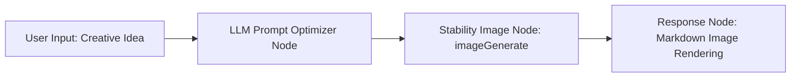

# Stability AI Image Generation Toolset

The Stability AI Image Generation Toolset (`stability`) is an official professional-grade image synthesis plugin integrated into FastGPT. Powered by Stability AI's flagship models, this plugin supports **Stable Image Ultra**, **Stable Image Core**, and the latest **Stable Diffusion 3.5** series (**Large**, **Large Turbo**, and **Medium**). It provides flexible multi-ratio composition, negative prompt controls, 17 curated artistic style presets, and reproducible random seed management.

Furthermore, leveraging the FastGPT host environment's `file-upload:allow` permission, the plugin automatically downloads the generated image binary stream and uploads it to FastGPT's local storage or configured S3-compatible object storage (MinIO, AWS S3, Aliyun OSS, etc.), returning a durable direct link (`link`) that eliminates the risk of temporary image URL expiration.

---

## Typical Application Scenarios

- **Commercial & Film Concept Design**: Leverage the flagship Stable Image Ultra model's superior lighting rendering, depth perception, and fine surface textures to rapidly turn film storyboards, sci-fi concepts, and game character designs into production-ready visual concepts.
- **Stable Diffusion 3.5 High-Definition Text-to-Image**: Utilize the SD 3.5 family (Large / Large Turbo / Medium) for complex prompt adherence, multi-subject spatial layout, and on-canvas typography rendering to produce crisp illustrations and commercial posters.
- **E-Commerce & Marketing Multi-Style Visual Customization**: Take advantage of the 17 native style presets supported by Stable Image Core (such as 3D model, analog film, anime, neon-punk, cinematic, low-poly, pixel art, etc.) to cost-effectively generate e-commerce product imagery, social media banners, and promotional cards.
- **Precise Aspect Ratio Layout Design**: Natively supports 9 mainstream aspect ratios: 1:1, 16:9, 9:16, 21:9, 9:21, 2:3, 3:2, 4:5, and 5:4. Seamlessly adapts to mobile full-screen wallpapers, social feed cards, and desktop banners without secondary cropping that ruins the original composition.

---

## Secret & Credential Configuration

Before using this plugin, configure your Stability AI API key (`STABILITY_KEY`) in the FastGPT plugin settings.

### How to Obtain an API Key

1. Visit the [Stability AI Developer Platform (platform.stability.ai)](https://platform.stability.ai/).
2. Sign up and log in to your developer account (supports Google, GitHub, or email sign-in).
3. Navigate to the [API Keys page](https://platform.stability.ai/account/keys) in the dashboard and click **Create API Key**.
4. Copy and securely store your new API key string (typically starting with `sk-...`).
5. Go to the [Billing & Credits page](https://platform.stability.ai/account/credits) to view your credit balance or add payment methods. The Stability AI API operates on a per-generation credit consumption model.
6. Paste the obtained key into the `STABILITY_KEY` field in the FastGPT plugin configuration.

### Plugin Secret Schema

| Setting | Field | Type | Required | Secret (`isSecret`) | Description & Auth Mechanism |
| :--- | :--- | :--- | :---: | :---: | :--- |
| **Stability API Key** | `STABILITY_KEY` | String (`string`) | **Yes** | Yes (`true`) | Stability AI API key. Sent in requests to Stability AI endpoints via the `Authorization: Bearer <STABILITY_KEY>` HTTP header. The plugin automatically prepends `Bearer `. |

---

## Sub-Tools List

This toolset contains 1 core image generation sub-tool:

| Sub-Tool ID | Chinese Name | English Name | Description |
| :--- | :--- | :--- | :--- |
| `imageGenerate` | **图像生成** | Image Generate | High-quality image generation using Stability AI, supporting Ultra, Core, and SD 3.5 series models with aspect ratio, negative prompt, style preset, and format controls. |

---

## Sub-Tool: imageGenerate (Image Generate)

### Input Parameters

| Parameter | Field | Type | Required | Default / Allowed Values | Tool Param (`isToolParam`) | Description & Suggestions |
| :--- | :--- | :--- | :---: | :--- | :---: | :--- |
| **Prompt** | `prompt` | String (`string`) | **Yes** | None | Yes (`true`) | Textual description of the image to generate. Detailed, concrete English descriptions specifying subject, composition, lighting, color palette, texture, and background atmosphere yield the best results. |
| **Model** | `model` | Enum (`string`) | **Yes** | `ultra`<br>`core`<br>`sd3.5-large`<br>`sd3.5-large-turbo`<br>`sd3.5-medium` | Yes (`true`) | Underlying Stability AI generation model:<br>• `ultra`: Flagship ultra-high quality model with industry-leading realism and detail.<br>• `core`: Balanced speed and quality with support for 17 style presets.<br>• `sd3.5-large`: 8B parameter flagship architecture with superior prompt adherence and typography.<br>• `sd3.5-large-turbo`: 4-step distilled high-speed model balancing quality and latency.<br>• `sd3.5-medium`: 2.5B parameter medium model with great efficiency. |
| **Aspect Ratio** | `aspect_ratio` | Enum (`string`) | No | Defaults to `"1:1"`<br>See table below | Yes (`true`) | Output image aspect ratio. Supports 9 ratios: `"1:1"`, `"16:9"`, `"21:9"`, `"2:3"`, `"3:2"`, `"4:5"`, `"5:4"`, `"9:16"`, and `"9:21"`. |
| **Negative Prompt** | `negative_prompt` | String (`string`) | No | Empty | Yes (`true`) | Things you do not want to see in the generated image (e.g., `blurry, bad anatomy, text, watermark, low quality, oversaturated`). |
| **Style Preset** | `style_preset` | Enum (`string`) | No | Empty<br>17 presets listed below | Yes (`true`) | **Supported by `core` model only**. Guides the aesthetic style, color palette, and rendering medium. |
| **Random Seed** | `seed` | Integer (`number`) | No | Omit for random<br>Range `0` to `4294967294` | Yes (`true`) | Seed for reproducible image generation. Using the exact same prompt, model, and seed produces consistent compositions. |
| **Output Format** | `output_format` | Enum (`string`) | No | Defaults to `"webp"`<br>`"webp"` / `"png"` / `"jpeg"` | Yes (`true`) | Output file format. Use `webp` or `jpeg` for fast web delivery and smaller file sizes, or `png` for lossless preservation and print design. |

#### Aspect Ratio (`aspect_ratio`) Allowed Values

| Ratio | Layout Type | Typical Use Cases |
| :--- | :--- | :--- |
| `1:1` | Square | Avatars, icons, square product displays (Default) |
| `16:9` | Widescreen landscape | Desktop wallpapers, presentation slides, video horizontal covers |
| `21:9` | Ultra-wide panoramic | Cinematic widescreen panoramas, scenic concept banners |
| `2:3` | Classic portrait | Traditional portrait photography, display posters |
| `3:2` | Classic landscape | Standard 35mm DSLR photography framing |
| `4:5` | Vertical feed card | Recommended ratio for Instagram and social media portrait posts |
| `5:4` | Landscape frame | Classic art framing, fine art gallery showcases |
| `9:16` | Full-screen vertical | Mobile vertical wallpapers, TikTok/Reels covers, mobile stories |
| `9:21` | Ultra-tall vertical | Extra-tall smartphone display graphics, vertical landing pages |

#### Style Presets (`style_preset`) - 17 Curated Styles (Core Model Only)

| Preset Value | Style Name | Visual Characteristics & Use Cases |
| :--- | :--- | :--- |
| `3d-model` | 3D Model | Clean 3D CGI rendering reminiscent of Blender or Cinema4D with volumetric depth and defined textures |
| `analog-film` | Analog Film | Classic film camera aesthetic with soft grain, subtle vignetting, and vintage color grading |
| `anime` | Anime | Japanese anime cel-shaded art style featuring vibrant colors, clean outlines, and expressive features |
| `cinematic` | Cinematic | Hollywood blockbuster aesthetic with shallow depth of field, dramatic lighting, and cinematic color palettes |
| `comic-book` | Comic Book | Western comic illustration with bold inking, halftone dot patterns, and high-contrast styling |
| `digital-art` | Digital Art | Contemporary commercial digital illustration with rich textures, smooth gradients, and balanced color harmony |
| `enhance` | Enhance | Sharpened micro-details, increased clarity, and boosted dynamic range while retaining realism |
| `fantasy-art` | Fantasy Art | Mythological and high-fantasy aesthetic featuring mystical glows, painterly strokes, and epic scale |
| `isometric` | Isometric | 2.5D axonometric projection ideal for micro-scenes, architectural cross-sections, and diorama designs |
| `line-art` | Line Art | Minimalist black-and-white ink contours and linework sketches without complex shading |
| `low-poly` | Low Poly | Retro faceted polygon meshes delivering an abstract, modern geometric 3D appearance |
| `modeling-compound` | Modeling Compound | Hand-sculpted clay and plasticine look with soft rounded edges and tangible tactile surfaces |
| `neon-punk` | Neon Punk | Cyberpunk cityscape style saturated with luminous neon highlights and dark nocturnal contrast |
| `origami` | Origami | Folded paper craft aesthetic with crisp crease lines and tactile paper grain |
| `photographic` | Photographic | Photorealistic DSLR capture with accurate optical characteristics, natural skin tones, and ambient lighting |
| `pixel-art` | Pixel Art | Retro 8-bit / 16-bit pixelated arcade game aesthetic with crisp grid-aligned pixels |
| `tile-texture` | Tile Texture | Seamless repeating pattern suitable for game textures, background wallpapers, and surface mapping |

---

### Output Results

| Field | Type | Description & Example |
| :--- | :--- | :--- |
| `link` | String (`string`) | Durable direct URL to the generated image. Example: `https://your-fastgpt-domain/api/system/img/67890abcdef.webp`.<br>Can be embedded directly in downstream workflow steps or Markdown reply nodes via ``. |

#### Output Mechanism & Persistence Details

- **Official API Response & Metadata**: Stability AI endpoints return the generated image as a binary image stream accompanied by generation metadata such as `finish_reason` (e.g., `SUCCESS` or `CONTENT_FILTERED`) and the actual `seed` utilized.
- **FastGPT Automatic Persistence**: The plugin declares the `file-upload:allow` permission. Upon receiving the image stream, it automatically calls FastGPT's host `uploadFile` storage interface to persist the image into FastGPT's local file system or configured S3/OSS object storage, returning a long-lived direct URL (`link`).
- **Development Fallback**: In offline or local development environments lacking host file upload capabilities, the plugin gracefully falls back to returning a Base64 Data URL to preserve pipeline reliability.

#### Output JSON Example

```json
{
  "link": "https://fastgpt.example.com/api/system/img/stability-core-a1b2c3d4e5f6.webp"
}
```

---

## Typical Workflow Examples

Connecting a Large Language Model (LLM) with the Stability AI Image Generation tool in FastGPT enables a fully automated creative pipeline: "User Idea -> LLM Prompt Expansion & Parameter Mapping -> Stability Image Synthesis -> Host Storage Persistence -> Markdown Inline Image Rendering".

### 1. Workflow Architecture



### 2. Orchestration Steps

1. **User Input Node**: Accepts casual natural language requirements (e.g., "Generate a cinematic cyberpunk rainy street poster in 9:16 vertical ratio with neon signs").
2. **LLM Prompt Optimizer Node**:
   - Uses a system prompt to transform brief user ideas into detailed, evocative English prompts tailored for Stability AI.
   - Outputs a clean positive `prompt` and negative `negative_prompt`.
3. **Stability Drawing Tool Node (`imageGenerate`)**:
   - **Prompt (`prompt`)**: Bind to the upstream LLM optimized prompt variable.
   - **Model (`model`)**: Choose `ultra` for photorealism, `core` for stylized artwork, or `sd3.5-large` for typography.
   - **Aspect Ratio (`aspect_ratio`)**: Set to `"9:16"`.
   - **Style Preset (`style_preset`)**: When using `core`, set to `"cinematic"` or `"neon-punk"`.
   - **Output Format (`output_format`)**: Set to `"webp"` or `"png"`.
4. **Final Response Node**:
   - Reference the `link` variable from the Stability node using standard Markdown syntax:
   ```markdown
   Your generated image is ready:

   
   ```

### 3. Recommended System Prompt for Upstream Prompt Optimizer

Configure the following system prompt in the upstream LLM node for optimal generation quality:

```markdown
You are an expert AI art director specializing in Stability AI visual models.
Your task is to transform the user's creative concept into a vivid, descriptive English prompt tailored for Stability AI image synthesis.

Guidelines:
1. Subject & Detail: Clearly describe the subject's features, posture, attire, and fine textures.
2. Perspective & Composition: Specify camera angle and framing (e.g., Cinematic wide shot, Rule of thirds, Intricate depth of field).
3. Lighting & Color: Detail the illumination scheme and color mood (e.g., Volumetric rim lighting, Moody chiaroscuro, Neon luminescence).
4. Artistic Medium: Specify rendering style or photographic lens (e.g., 35mm film photograph, 8k resolution, Masterpiece).
5. Negative Prompt: List elements to avoid (e.g., blurry, distorted proportions, low quality, duplicate limbs, watermark, text).
6. Output Format: Output ONLY the enhanced positive English prompt without conversational preamble or markdown backticks.
```

---

## Important Considerations

1. **Credit Billing & Model Cost Discrepancy**:
   - The Stability AI platform charges usage on a per-generation credit basis, with different models consuming different credit amounts:
     - `ultra` (Stable Image Ultra): ~**8 Credits** / generation; best for production-grade commercial artwork.
     - `sd3.5-large`: ~**6.5 Credits** / generation.
     - `sd3.5-large-turbo`: ~**4 Credits** / generation; fast 4-step generation.
     - `sd3.5-medium`: ~**3.5 Credits** / generation.
     - `core` (Stable Image Core): ~**3 Credits** / generation; cost-effective with native style preset support.
   - Ensure your [Stability Account](https://platform.stability.ai/account/credits) maintains sufficient credits to avoid 402/429 errors.
2. **Style Preset Compatibility**:
   - The `style_preset` parameter is exclusively supported by the `core` model. Passing `style_preset` when calling `ultra` or `sd3.5` models will be ignored or cause an API parameter error. When using Ultra or SD3.5, specify your desired aesthetic directly in the `prompt` text.
3. **Content Moderation (`CONTENT_FILTERED`)**:
   - Stability AI enforces strict safety filters. Prompts or generated images that trigger NSFW, violence, or sensitive content policies will be blocked with an error response. Always use positive, neutral, and artistic descriptors.
4. **Generation Latency & Node Timeouts**:
   - Synthesizing high-resolution images with Ultra or SD3.5 Large typically requires 5 to 25 seconds. While the plugin has a generous internal timeout (up to 360 seconds), ensure the execution timeout on your FastGPT workflow nodes is configured accordingly.

---

## Local Development & Testing

```bash
# Install dependencies
pnpm install

# Run unit tests
pnpm run test

# Build package artifacts
pnpm run build

# Validate plugin specifications
npx @fastgpt-plugin/cli check --entry .
```
