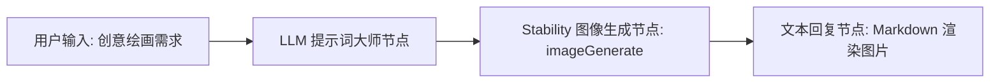

# Stability AI 图像生成工具集 (Stability AI Image Generation)

Stability AI 图像生成工具集（`stability`）是 FastGPT 官方集成的专业级 AI 图像生成插件。该插件深度整合了 Stability AI 官方平台旗舰级生图模型能力，涵盖 **Stable Image Ultra**、**Stable Image Core** 以及最新的 **Stable Diffusion 3.5** 系列（Large、Large Turbo 与 Medium）。插件提供灵活多样的画幅比例定制、负面提示词控制、17 种专业级风格预设与精确的随机种子复现机制。

同时，插件结合 FastGPT 宿主环境的 `file-upload:allow` 文件转存能力，在接口获取图像后自动转存至 FastGPT 本地存储或配置的对象存储（MinIO、AWS S3、阿里云 OSS 等），直接输出持久化访问直链（`link`），告别临时图片链接过期失效的困扰。

---

## 典型应用场景

- **商业影视级概念设计**：利用旗舰级 Stable Image Ultra 模型顶级的物理光影质感、空间透视深度与微观材质还原力，快速将电影分镜、科幻场景设定、游戏角色立绘转化为高质量视觉提案。
- **Stable Diffusion 3.5 高清文生图**：借助 SD 3.5 系列（Large / Large Turbo / Medium）在复杂提示词理解、多主体空间排布与画面文字渲染方面的卓越表现，生成版面结构清晰、文字精准的高清插画与商业海报。
- **电商与营销多风格视觉素材定制**：基于 Core 模型原生支持的 17 种风格预设（如 3D 模型、胶片风、日系动漫、赛博朋克、电影质感、低多边形、像素艺术等），低成本快速批量生产电商详情页配图、社交媒体广告与营销长图。
- **精准比例排版设计**：原生提供 1:1、16:9、9:16、21:9、9:21、2:3、3:2、4:5、5:4 等 9 种主流画幅宽高比，完美适配移动端全屏壁纸、社媒瀑布流卡片及宽屏横幅，无需二次裁剪破坏原始构图。

---

## 密钥与凭据配置说明

使用本插件前，需在 FastGPT 插件配置中配置 Stability AI 平台的访问密钥（`STABILITY_KEY`）。

### 获取渠道指引

1. 访问 [Stability AI 开发者平台 (platform.stability.ai)](https://platform.stability.ai/)。
2. 注册并登录 Stability 开发者账户（支持 Google、GitHub 授权或邮箱登录）。
3. 前往控制台的 [API Keys 页面](https://platform.stability.ai/account/keys)，点击 **Create API Key** 生成新的访问凭证。
4. 复制生成的密钥字符串（格式通常为 `sk-...`）并妥善保存。
5. 前往 [Billing & Credits 页面](https://platform.stability.ai/account/credits) 查看算力点数（Credits）或绑定支付方式充值。Stability AI 接口采用按次扣减 Credits 机制，调用各模型需要账户内保持充足点数。
6. 将获取的 API Key 填入 FastGPT 插件配置的 `STABILITY_KEY` 字段中。

### 插件凭据配置参数

| 配置项 | 字段名 | 类型 | 是否必填 | 敏感加密 (`isSecret`) | 说明与鉴权机制 |
| :--- | :--- | :--- | :---: | :---: | :--- |
| **Stability API 密钥** | `STABILITY_KEY` | 字符串 (`string`) | **是** | 是 (`true`) | Stability AI API 访问密钥。请求官方服务端点时通过 HTTP 请求头 `Authorization: Bearer <STABILITY_KEY>` 鉴权，插件底层已自动拼接 `Bearer ` 前缀。 |

---

## 子工具列表

本工具集目前包含 1 个核心图像生成子工具：

| 子工具 ID | 中文名称 | 英文名称 | 功能说明 |
| :--- | :--- | :--- | :--- |
| `imageGenerate` | **图像生成** | Image Generate | 使用 Stability AI 生成高质量图像，全面支持 Ultra、Core 和 SD 3.5 系列模型，提供多画幅、负面提示词、风格预设与格式控制。 |

---

## 子工具：imageGenerate (图像生成)

### 输入参数说明

| 参数名 | 对应字段 | 类型 | 是否必填 | 默认值 / 可选范围 | 工具参数 (`isToolParam`) | 说明与建议 |
| :--- | :--- | :--- | :---: | :--- | :---: | :--- |
| **提示词** | `prompt` | 字符串 (`string`) | **是** | 无 | 是 (`true`) | 描述想要生成的画面细节。建议使用详尽具象的英文描述（主体、构图、光照、色彩、材质及背景氛围）。 |
| **模型选择** | `model` | 枚举 (`string`) | **是** | `ultra`<br>`core`<br>`sd3.5-large`<br>`sd3.5-large-turbo`<br>`sd3.5-medium` | 是 (`true`) | 选择底层调用的 Stability 图像生成模型：<br>• `ultra`：旗舰超高质量模型，画面细节与真实感最佳。<br>• `core`：平衡速度与画质，支持 17 种风格预设。<br>• `sd3.5-large`：8B 参数旗舰级开源架构，强提示词遵从度与文字排版。<br>• `sd3.5-large-turbo`：4 步蒸馏快速大模型，兼具速度与高品质。<br>• `sd3.5-medium`：2.5B 参数中型模型，性价比极佳。 |
| **宽高比** | `aspect_ratio` | 枚举 (`string`) | 否 | 默认 `"1:1"`<br>可选值见下文 | 是 (`true`) | 目标画面的宽高比。支持 9 种比例：`"1:1"`、`"16:9"`、`"21:9"`、`"2:3"`、`"3:2"`、`"4:5"`、`"5:4"`、`"9:16"`、`"9:21"`。 |
| **负面提示词** | `negative_prompt` | 字符串 (`string`) | 否 | 留空 | 是 (`true`) | 描述生成图像中不希望出现的元素或瑕疵（如：`blurry, bad anatomy, text, watermark, low quality, oversaturated`）。 |
| **风格预设** | `style_preset` | 枚举 (`string`) | 否 | 留空<br>17 种风格预设见下表 | 是 (`true`) | **仅 `core` 模型生效**。预设艺术风格指引，可规范画面的色调与表现手法。 |
| **随机种子** | `seed` | 整数 (`number`) | 否 | 留空为随机<br>范围 `0` ~ `4294967294` | 是 (`true`) | 用于可重现生成的一致性种子。使用相同的提示词、模型与种子值可生成高度相似的画面构图。 |
| **输出格式** | `output_format` | 枚举 (`string`) | 否 | 默认 `"webp"`<br>可选 `"webp"` / `"png"` / `"jpeg"` | 是 (`true`) | 生成图像的文件格式。日常展示建议选 `webp` 或 `jpeg`（体积更小，加载迅速），无损印刷与精细后期建议选 `png`。 |

#### 宽高比 (`aspect_ratio`) 详细可选值

| 比例取值 | 比例类型 | 典型应用场景 |
| :--- | :--- | :--- |
| `1:1` | 正方形 | 社交媒体头像、图标、方形主图（默认值） |
| `16:9` | 横屏宽幅 | 电脑壁纸、演示文稿配图、视频横版封面 |
| `21:9` | 超宽全景 | 电影宽银幕全景大片、游戏场景概念横幅 |
| `2:3` | 经典竖画幅 | 传统竖版肖像摄影、展板立绘 |
| `3:2` | 经典横画幅 | 35mm 传统单反相机标准横向画幅 |
| `4:5` | 竖屏卡片 | Instagram / 小红书图文卡片推荐比例 |
| `5:4` | 横屏相框 | 经典画框比例、艺术画作展示 |
| `9:16` | 移动竖屏全屏 | 手机全屏壁纸、抖音/快手短视频竖版封面、微信朋友圈海报 |
| `9:21` | 超高竖屏 | 超长手机屏幕配图、瀑布流视觉长图 |

#### 风格预设 (`style_preset`) 17 种风格清单（仅 Core 模型支持）

| 预设值 | 预设名称 | 视觉风格特征与适用场景 |
| :--- | :--- | :--- |
| `3d-model` | 3D 模型风格 | 类似 Blender / C4D 渲染的三维模型质感，光照立体，材质清晰 |
| `analog-film` | 胶片复古摄影 | 模拟传统胶卷相机色彩，带有柔和颗粒感、暗角与复古色调 |
| `anime` | 日系动漫 | 经典日系手绘赛璐珞风格，色彩明快，线条清晰，人物造型细腻 |
| `cinematic` | 电影质感 | 好莱坞电影大片视听质感，大景深虚化、冷暖光影对比与情绪氛围 |
| `comic-book` | 美式漫画 | 强烈的黑白网点、轮廓粗线条与高对比度美漫印刷质感 |
| `digital-art` | 数字插画 | 现代商业插画艺术，色彩丰富，层次分明，过渡细腻自然 |
| `enhance` | 增强细节 | 保留写实细节的同时提升画面的色彩饱和度、清晰度与微观层次 |
| `fantasy-art` | 奇幻史诗艺术 | 魔幻小说插图、史诗级神话场景，富有神秘光晕与古典油画笔触 |
| `isometric` | 等距轴测微缩 | 2.5D 等距视角，适合小体量微缩场景、建筑切面与沙盘设计 |
| `line-art` | 纯净线稿素描 | 黑白线条勾勒，极简纯净，无多余光影填充，适合插画线稿 |
| `low-poly` | 低多边形几何 | 几何多面体网格造型，复古 3D 棱角分明，具现代抽象艺术感 |
| `modeling-compound` | 橡皮泥/粘土捏塑 | 独特的软泥、超轻粘土手工捏制质感，圆润童趣，材质触感真实 |
| `neon-punk` | 霓虹赛博朋克 | 赛博朋克都市风格，充斥鲜艳的高饱和霓虹荧光色与暗色夜景 |
| `origami` | 折纸手工艺 | 模拟立体折纸、卡纸拼贴造型，折痕清晰，纸质肌理分明 |
| `photographic` | 纪实摄影写实 | 接近专业单反相机的真实光学成像，逼真的人体与自然光影 |
| `pixel-art` | 经典像素艺术 | 复古 8-bit / 16-bit 像素游戏画风，复古怀旧，颗粒分明 |
| `tile-texture` | 平铺无缝纹理 | 四方连续无缝贴图，适合游戏材质、壁纸图案与平铺背景设计 |

---

### 输出结果说明

| 字段名 | 类型 | 说明与示例 |
| :--- | :--- | :--- |
| `link` | 字符串 (`string`) | 生成图片的持久化可访问直链。例如：`https://your-fastgpt-domain/api/system/img/67890abcdef.webp`。<br>在工作流下游或最终文本回复节点中，可直接通过 Markdown 语法 `` 进行展示。 |

#### 输出机制与持久化说明

- **官方 API 响应与持久化**：Stability AI 官方端点在生成图像时会输出图片二进制流，并附带 `finish_reason`（完成状态，如 `SUCCESS` 或 `CONTENT_FILTERED`）及实际使用的 `seed` 种子值。
- **FastGPT 自动转存**：本插件声明了 `file-upload:allow` 权限。插件在获取图像二进制数据后，会自动调用 FastGPT 宿主环境的 `uploadFile` 存储接口，将图片持久化上传至 FastGPT 本地文件系统或配置的对象存储服务中，返回长期有效的访问直链 `link`。
- **环境兼容降级**：若运行在无宿主上传能力的开发调试环境中，插件会自动降级为 Base64 Data URL 格式返回，保证调用链路的鲁棒性。

#### 输出 JSON 真实示例

```json
{
  "link": "https://fastgpt.example.com/api/system/img/stability-core-a1b2c3d4e5f6.webp"
}
```

---

## 典型工作流编排示例

在 FastGPT 中，将大语言模型（LLM）与 Stability AI 绘图插件结合，可以实现“自然语言需求 -> 智能体提示词扩写与参数匹配 -> Stability 图像渲染 -> 宿主转存直链 -> 最终卡片展示”的全流程自动化创作。

### 1. 工作流拓扑架构



### 2. 编排步骤详解

1. **用户输入节点**：接收用户的自然语言描述（如：“帮我画一张电影级光影的赛博朋克雨夜街道海报，9:16 竖屏，要有霓虹招牌”）。
2. **LLM 提示词大师节点（大模型处理）**：
   - 使用系统提示词引导大模型将用户的粗略描述扩写为高表现力的英文 Prompt，并智能决策模型与宽高比。
   - 提取出清晰的正面提示词 `prompt`（英文）与负面提示词 `negative_prompt`。
3. **Stability 绘图节点 (`imageGenerate`)**：
   - **提示词 (`prompt`)**：引用上游 LLM 节点输出的优化提示词变量。
   - **模型选择 (`model`)**：根据场景选择 `ultra`（影视概念）、`core`（风格化）或 `sd3.5-large`（排版写实）。
   - **宽高比 (`aspect_ratio`)**：设为 `"9:16"`。
   - **风格预设 (`style_preset`)**：如选择 `core` 模型，可设为 `"cinematic"` 或 `"neon-punk"`。
   - **输出格式 (`output_format`)**：选择 `"webp"` 或 `"png"`。
4. **最终回复节点**：
   - 引用 Stability 节点输出的 `link` 变量，使用 Markdown 语法进行直观展示：
   ```markdown
   为您生成的画面已完成：

   
   ```

### 3. 上游提示词大师 System Prompt 推荐配置

在大模型节点中配置以下系统提示词，可显著提升成图品质：

```markdown
你是一位资深 AI 艺术导演与 Stability AI 提示词专家。
你的任务是将用户的绘图想法转化为画面感极强、英文表述精准且符合 Stability 生图特性的提示词组合。

编写规则：
1. 主题与细节：明确主体物的外观特征、姿势、服饰与微观质感。
2. 镜头与构图：指定构图与透视视角（如 Cinematic wide shot, Rule of thirds, Intricate depth of field）。
3. 光影与色彩：指定光照方案与色彩氛围（如 Volumetric rim lighting, Moody chiaroscuro, Neon luminescence）。
4. 艺术媒介：指定写实摄影或画风（如 35mm film photograph, 8k resolution, Masterpiece）。
5. 负面提示词：罗列画面不应出现的内容（如 blurry, distorted proportions, low quality, duplicate limbs, watermark, text）。
6. 输出规范：直接输出优化后的英文正向提示词，避免任何开场白或解释性文字。
```

---

## 注意事项

1. **模型计费与 Credits 消耗差异**：
   - Stability AI 平台采用按次扣除算力点数（Credits）的计费模式，各模型单次生成的消耗存在差异：
     - `ultra`（Stable Image Ultra）：约 **8 Credits** / 次，适合对画质要求极高的商业大片。
     - `sd3.5-large`：约 **6.5 Credits** / 次。
     - `sd3.5-large-turbo`：约 **4 Credits** / 次，极速 4 步出图。
     - `sd3.5-medium`：约 **3.5 Credits** / 次。
     - `core`（Stable Image Core）：约 **3 Credits** / 次，极具性价比且支持风格预设。
   - 请确保您的 [Stability 账户](https://platform.stability.ai/account/credits) 中保有充足的 Credits 余额，余额耗尽将导致接口返回 402/429 错误。
2. **风格预设 (`style_preset`) 仅 Core 模型生效**：
   - `style_preset` 参数为 `core` 模型专属特性。如果在 `ultra` 或 `sd3.5` 系列模型中指定了风格预设，接口底层将忽略该参数或报错。若使用 Ultra 或 SD3.5 模型，建议直接在 `prompt` 提示词文本中描述所需风格。
3. **内容安全策略拦截 (`CONTENT_FILTERED`)**：
   - Stability AI 官方部署了严格的内容审查过滤器。如果输入提示词或生成的图片触及敏感词、暴力血腥或成人限制，API 将触发安全拦截并返回错误响应。建议使用健康积极、中性艺术化的词汇描述画面。
4. **网络请求超时与生成耗时**：
   - Ultra 与 SD3.5 Large 模型计算量较大，生成耗时通常在 5 ~ 25 秒之间。插件内部已为请求设置了充足的超时时间（最长 360 秒），但在 FastGPT 中配置工作流节点时，请确保上层工作流的单节点超时时间设置合理。

---

## 本地开发与测试

```bash
# 安装依赖
pnpm install

# 运行单元测试
pnpm run test

# 构建插件产物
pnpm run build

# 校验插件规范
npx @fastgpt-plugin/cli check --entry .
```

