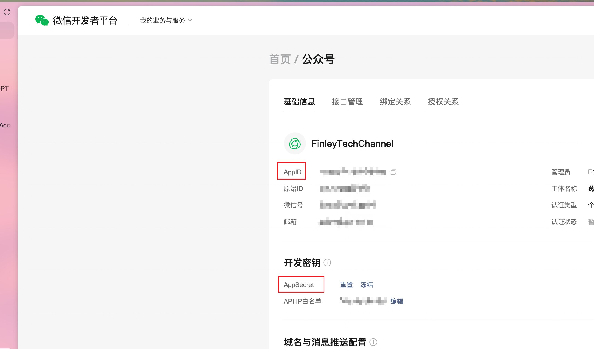

# WeChat Official Account Tool Set

Manage and publish drafts and articles to WeChat Official Accounts.

## Obtaining API Credentials

Log in to the [WeChat Developers Platform](https://developers.weixin.qq.com) and navigate to "Official Accounts".
Retrieve your AppID and AppSecret as illustrated below:



### IP Whitelist Configuration

When using the FastGPT Cloud service, configure the WeChat IP whitelist accordingly:

**Global Cloud (`cloud.fastgpt.io`):**
```text
35.240.227.100
34.124.237.188
34.143.240.160
34.87.51.146
34.87.79.202
35.247.163.68
34.87.102.86
35.198.192.104
34.126.163.205
34.124.189.116
34.143.149.171
34.87.173.252
34.142.157.52
34.87.180.104
34.87.20.189
34.87.110.152
34.87.44.74
34.87.152.33
35.197.149.75
35.247.161.35
```

**China Cloud (`fastgpt.cn`):**
```text
47.97.1.240
121.43.105.217
121.41.178.7
121.40.65.187
47.97.59.172
101.37.205.32
120.55.195.90
120.26.229.115
120.55.193.112
47.98.190.173
112.124.41.79
121.196.235.183
121.41.75.88
121.43.108.48
112.124.12.6
121.43.109.118
120.27.245.92
112.124.36.19
120.27.247.30
121.40.91.139
```
