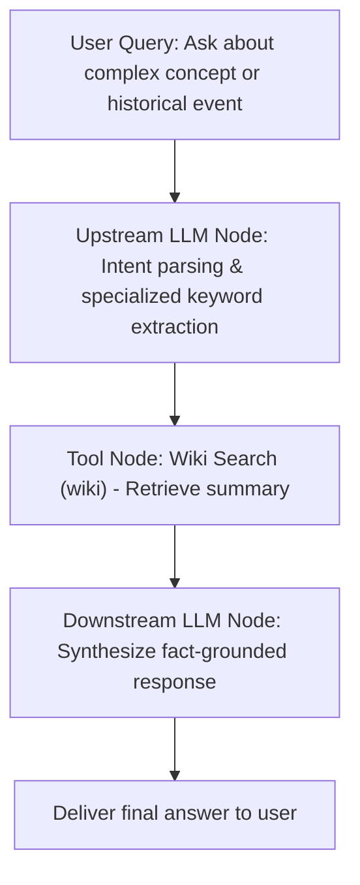

# Wiki Search (wiki)

`wiki` is an official Wikipedia knowledge retrieval plugin provided by FastGPT. Built upon Wikipedia's official open API, this tool rapidly queries and extracts authoritative summary text for given keywords and entry titles. Designed specifically for Large Language Models (LLMs) and AI agents, it delivers real-time, neutral, and reliable encyclopedic knowledge grounding, effectively mitigating hallucinations and fabrication of specialized terminology or historical facts.

---

## Key Features & Advantages

- **Zero-Config & Key-Free**: Directly integrates with the public Wikipedia open API (`https://zh.wikipedia.org/w/api.php`). No third-party account registration, API key application, or credit card binding is required—ready to use out of the box.
- **Authoritative & Neutral Baseline**: Powered by Wikipedia's rigorous collaborative editing and peer-review mechanisms, entries offer exceptional neutrality and factual credibility.
- **Mitigating LLM Hallucinations (Grounding)**: In question-answering and consulting scenarios, inject authentic Wikipedia entry definitions into LLM context as reliable grounding, eliminating fabricated biographies, historical dates, or concept definitions.
- **High Signal-to-Noise Ratio Summaries**: Automatically extracts core summary text while stripping HTML markup, page layouts, and extraneous sidebar content, providing dense, clean context to save prompt tokens.
- **Built-in Resilience & Backoff**: Features up to 3 automatic retries with randomized backoff delay (0–5 seconds) to gracefully handle intermittent network glitches and transient API fluctuations in production environments.

---

## Typical Use Cases

1. **Terminology & Academic Concept Lookup**:
   Quickly retrieve standard, authoritative definitions for advanced terminology across computer science, physics, biomedicine, finance, and law (e.g., "Quantum entanglement", "Zero-knowledge proof", "Transformer model").
2. **Historical Figures & Event Tracing**:
   Accurately trace historical figures' lifespans, major works, pivotal turning points, and international treaties, providing solid chronological timelines and context for humanities and general inquiries.
3. **Open-Source Tech & Scientific Common Sense**:
   Search open-source software ecosystems, OS kernel mechanics (such as Linux kernel architecture), network protocols (e.g., HTTP/3, QUIC), and general astronomy or geography facts.
4. **Factual Grounding & Hallucination Elimination in RAG**:
   Serve as a foundational fact-checking layer in knowledge base Q&A and multi-agent workflows. Cross-reference Wikipedia definitions before generating responses to achieve verifiable grounding.

---

## Key-Free Feature Details

This plugin communicates directly with the Chinese Wikipedia public endpoint: `https://zh.wikipedia.org/w/api.php`.

- **No Secrets Required**: When importing or invoking this plugin in FastGPT, you do not need to configure any API keys or credentials in the "Secrets" configuration.
- **Open Access**: Information is retrieved directly from the public Wikipedia repository, adhering to non-commercial Creative Commons open access guidelines.

---

## Input Parameters

| Parameter | Type | Required | Default | Description | Example |
| :--- | :--- | :--- | :--- | :--- | :--- |
| `query` | `string` | Yes | None | **Search query or entry title**.<br>The keywords, concept title, or specialized term to search on Wikipedia. Recommended to use standardized nouns rather than conversational full sentences. | `"Large language model"` |

---

## Output Results

| Field | Type | Description |
| :--- | :--- | :--- |
| `result` | `string` | **Wikipedia search output**.<br>Upon a successful lookup, returns the clean summary text of the matching entry. If the query fails or no matching article is found, returns an error description message after all retries are exhausted (e.g., `Failed to fetch data from wiki` or specific error details). |

### Output Examples

#### Successful Lookup Example (`result`):

```json
{
  "result": "大型语言模型（英语：large language model，缩写为 LLM）是一种基于大量数据进行训练的深度学习语言模型。通过对海量文本数据进行自监督学习，大型语言模型能够理解、生成和处理人类自然语言，并在机器翻译、问答系统、文本摘要等多种自然语言处理任务中展现出卓越的性能。"
}
```

#### Lookup Failure / Entry Not Found Example (`result`):

```json
{
  "result": "Failed to fetch data from wiki: No article found"
}
```

---

## Typical Workflow Orchestration Example

In FastGPT Advanced Orchestration, the recommended best practice is a 3-stage pipeline: **"Upstream LLM extracts specialized keywords -> Wiki Search fetches authoritative definition -> Downstream LLM synthesizes reliable response"**.

### Workflow Diagram



### Step-by-Step Guide

1. **User Query**: The user asks a question involving complex technical terms or historical concepts, e.g., *"Can you explain what zero-knowledge proofs are and how they are used in blockchain?"*
2. **Upstream Keyword Extraction (LLM Node)**:
   - Wikipedia performs best with exact entry titles. Use an upstream LLM node to distill the user's natural language question into canonical terminology.
   - Extracted value: `query = "零知识证明"`.
3. **Execute Wiki Search (`wiki` Node)**:
   - Pass the extracted `query` into the `wiki` plugin node.
   - The plugin queries the Wikipedia open API and returns the standard summary text for the concept.
4. **Downstream LLM Synthesis (LLM Node)**:
   - Inject the user's original query and the `result` from the `wiki` node into the downstream model prompt, generating an informative, hallucination-free answer.

#### Downstream LLM Prompt Example

```text
You are an expert technical advisor known for rigorous and accessible explanations. Please answer the user's inquiry based on the authoritative Wikipedia definition provided below.

[Authoritative Wikipedia Summary]
{{wiki.result}}

[User Inquiry]
{{user.question}}

[Response Guidelines]
1. Ground your answer in the Wikipedia definition to ensure concepts and core principles are accurate and free of hallucinations.
2. Explain the fundamental idea and common practical applications in clear, accessible language.
3. If the Wikipedia snippet lacks specific details required for a complete answer, state known facts objectively without inventing information.
```

---

## Important Notes & Recommendations

1. **Wikipedia API Network Connectivity**:
   - The plugin defaults to the official Chinese Wikipedia endpoint `https://zh.wikipedia.org/w/api.php`.
   - Direct connection to Wikipedia endpoints may experience timeouts or network restrictions in certain regions (such as mainland China). Ensure your FastGPT deployment host or plugin Runner container possesses reliable international network access, or configure appropriate network proxies in the host environment.
2. **Search Disambiguation & Keyword Precision**:
   - Wikipedia article indexing relies heavily on exact matches with standard terminology.
   - **Avoid Long Sentence Queries**: Do not pass conversational phrases like *"I want to know who Einstein is"* or *"What is quantum entanglement please explain in detail"*. Instead, pass clean, canonical terms like *"阿尔伯特·爱因斯坦"* or *"量子纠缠"*.
   - **Resolve Ambiguity**: For polysemous words (e.g., "Apple" meaning fruit or corporation), use upstream LLM prompt engineering to resolve the term to its unique intended article title (e.g., "Apple Inc.").
3. **Built-in Resilience & Error Handling**:
   - The plugin includes 3 built-in retry attempts with randomized 0–5 second backoff delays. If transient network issues or timeouts occur, it retries automatically. If all attempts fail, an error message is safely returned in `result` rather than crashing the FastGPT workflow. Downstream LLM prompts can include fallback instructions to handle missing entries gracefully.
4. **Fair Use & API Etiquette**:
   - Wikipedia's public API is a non-profit community resource. While free and unmetered by API keys, workflows should adhere to fair use etiquette: avoid high-concurrency burst scraping to respect Wikimedia Foundation operational guidelines.
