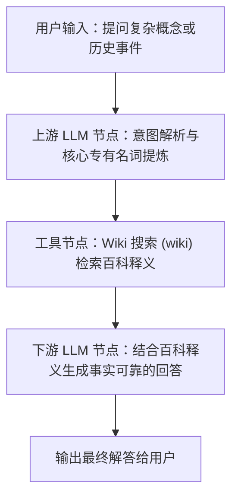

# Wiki 搜索 (Wiki Search)

`wiki` 是 FastGPT 官方提供的维基百科知识检索插件。该工具基于维基百科（Wikipedia）官方开放 API，能够根据输入的词条关键词快速检索并提取权威词条的精炼摘要（Summary）正文。该插件专为大语言模型（LLM）与智能体（AI Agent）设计，为其提供实时、客观且中立的百科事实参考，是消除大模型事实幻觉与专有名词编造的理想事实基座。

---

## 核心特性与优势

- **免 API 密钥，开箱即用**：直接基于维基百科开放 API（`https://zh.wikipedia.org/w/api.php`）构建，无需注册任何第三方账号、无需申请或配置 API Key，零成本开箱即用。
- **权威中立的事实基准**：依托维基百科严格的社区协同编辑和同行评审机制，条目具有高度的中立性与权威性，有效保障知识真实度。
- **消除大模型幻觉 (Grounding)**：在问答、专业咨询等场景下，将维基百科条目释义作为真实事实依据注入大模型上下文，彻底杜绝虚构人物生平、年代或概念定义的幻觉现象。
- **高信噪比摘要提取**：自动提取词条核心摘要内容，过滤页面排版、杂乱标签与冗余侧边栏，为 LLM 提供结构干净、信息密度极高的高质量上下文，大幅节省 Token 消耗。
- **内置自动重试与退避机制**：面对瞬时网络抖动，内部封装最多 3 次自动重试逻辑，并在重试间采用 0~5 秒随机退避延迟，有效提升工作流在生产环境下的容错性与健壮度。

---

## 典型应用场景

1. **专业名词与学术概念百科释义查询**：
   针对计算机科学、物理学、生物医学、金融法律等垂直领域的深奥术语（如“量子纠缠”、“零知识证明”、“Transformer 模型”），快速获取标准权威的学术概念定义。
2. **历史人物与重大事件溯源**：
   精准溯源历史人物生卒年、生平事迹、重要历史转折事件与公约协定，为文史研究与知识普及提供详实的时间线与背景信息。
3. **开源技术与科学常识检索**：
   检索开源软件生态、操作系统内核机制（如 Linux 内核架构）、网络通信协议（如 HTTP/3、QUIC）及天文地理常识，为技术问答助手提供基础技术背景支撑。
4. **大模型 RAG 事实依据支撑与事实核查**：
   在知识库问答或多 Agent 协作工作流中，作为第一道事实核查底座。在回答用户问题前先行比对维基百科释义，实现有据可查的事实 Grounding。

---

## 免 API 密钥特性说明

本插件直连中文维基百科官方开放端点：`https://zh.wikipedia.org/w/api.php`。

- **无需配置密钥**：在 FastGPT 中导入或使用本插件时，不需要在“密钥（Secrets）”中填写任何 API Key 或鉴权凭据。
- **完全开放获取**：数据直接来源于维基百科开放知识库，遵循知识共享（Creative Commons）非商业学术开放获取标准。

---

## 输入参数说明

| 参数名 | 类型 | 必填 | 默认值 | 说明 | 示例 |
| :--- | :--- | :--- | :--- | :--- | :--- |
| `query` | `string` | 是 | 无 | **检索词或词条名称**。<br>用于在 Wiki 中检索的关键词、概念名称或专有名词。建议使用标准命名，避免冗长的口语化问句。 | `"大语言模型"` |

---

## 输出结果说明

| 参数名 | 类型 | 说明 |
| :--- | :--- | :--- |
| `result` | `string` | **维基百科检索结果**。<br>成功检索到词条时，返回对应词条的核心摘要（Summary）纯文本；若检索失败或未找到匹配词条，将在重试耗尽后返回错误提示信息（如 `Failed to fetch data from wiki` 或具体异常描述）。 |

### 输出示例

#### 成功检索返回结果示例 (`result`)：

```json
{
  "result": "大型语言模型（英语：large language model，缩写为 LLM）是一种基于大量数据进行训练的深度学习语言模型。通过对海量文本数据进行自监督学习，大型语言模型能够理解、生成和处理人类自然语言，并在机器翻译、问答系统、文本摘要等多种自然语言处理任务中展现出卓越的性能。"
}
```

#### 异常或未找到条目时的返回示例 (`result`)：

```json
{
  "result": "Failed to fetch data from wiki: No article found"
}
```

---

## 典型工作流编排示例

在 FastGPT 高级编排中，推荐采用**“上游 LLM 提取专有名词关键词 -> Wiki 搜索检索权威释义 -> 下游 LLM 结合百科释义回答用户问题”**的三段式流水线架构。

### 工作流流程示意



### 编排步骤详解

1. **用户输入**：用户提出包含特定专有名词或概念的复杂问题，例如：*“请给我讲讲什么是零知识证明？它在区块链里有什么具体用途？”*
2. **上游关键词提炼（LLM 节点）**：
   - 维基百科对精确词条的匹配度最佳。通过上游 LLM 节点，将用户的自然语言问句提炼为标准专有名词。
   - 提取结果：`query = "零知识证明"`。
3. **调用 Wiki 搜索（`wiki` 节点）**：
   - 将上一步提炼的 `query` 传入 `wiki` 插件节点。
   - 插件自动请求维基百科开放 API 并返回关于“零知识证明”的标准定义摘要文本。
4. **下游 LLM 综合回答（LLM 节点）**：
   - 将用户的原始问题与 `wiki` 节点返回的 `result` 共同注入到下游大模型的提示词中，生成专业通俗且无幻觉的完整解答。

#### 下游 LLM 提示词示例 (Prompt)

```text
你是一位严谨专业且表达生动的技术专家。请结合以下从维基百科中检索到的权威释义，为用户解答问题。

【维基百科权威释义】
{{wiki.result}}

【用户原始问题】
{{user.question}}

【回答要求】
1. 以维基百科释义为基础事实依据，确保核心概念、定义与原理准确无误，杜绝任何事实幻觉。
2. 用通俗易懂的语言向用户解释该概念的核心思想及其常见应用场景。
3. 若维基百科返回中未包含答案所需的所有信息，请客观说明已知事实，勿虚构事实。
```

---

## 注意事项与使用建议

1. **维基百科开放接口网络连通性**：
   - 本插件直连中文维基百科官方端点 `https://zh.wikipedia.org/w/api.php`。
   - 在某些地区（如中国大陆）直连维基百科可能因网络原因受到限制或超时。请确保部署 FastGPT 平台或插件 Runner 容器的主机具备通畅的国际互联网访问通道，或在宿主环境中配置好相应的网络代理策略。
2. **搜索消歧义与关键词精确度建议**：
   - 维基百科的条目索引机制高度依赖“标准专有名词”的精确匹配。
   - **避免长句输入**：请勿直接传入如 *“我想知道谁是爱因斯坦”*、*“什么是量子纠缠请详细讲讲”* 这类自然语言长句，应传入标准化专有名词（如 *“阿尔伯特·爱因斯坦”*、*“量子纠缠”*）。
   - **处理多义项**：对于同名人物或多义词（例如“苹果”可能对应水果或科技公司），建议通过上游 LLM 提炼为更具唯一指向性的词条名（如“苹果公司”）。
3. **内置重试与容错机制**：
   - 插件已内置 3 次自动重试及 0~5 秒随机退避保护机制。当遇到瞬时网络波动或超时时，插件会自动重试；若全部重试均告失败，错误描述文本将在 `result` 中返回，不会导致整个 FastGPT 工作流崩溃中断。下游 LLM 节点可在提示词中适当加入“若百科未检索到内容则基于已有知识回答”的容错指令。
4. **API 请求频率与服务礼仪**：
   - 维基百科 API 属于公益性质的公共服务资源。虽然无需 API Key，但在设计高并发自动化批量任务时，应合理控制调用频率，避免发起瞬时高并发扫描，以符合维基媒体基金会（Wikimedia Foundation）的友好使用政策。

