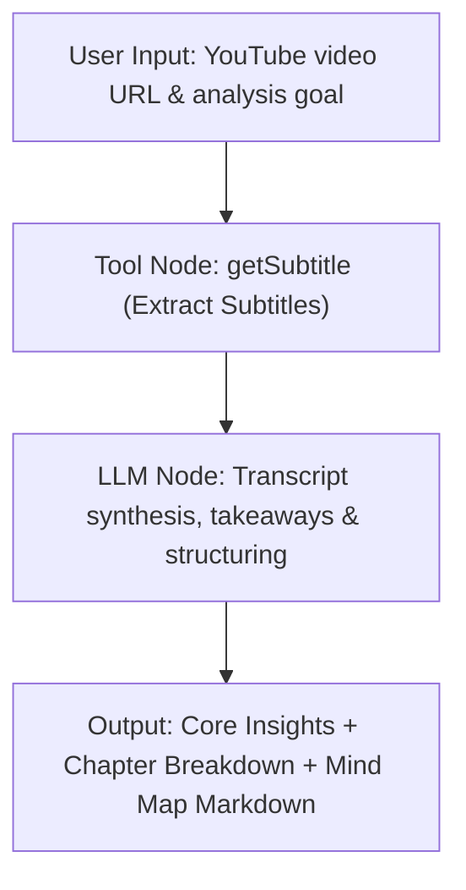

# YouTube Video & Subtitle Tools Suite (YouTube Tools)

The YouTube Video & Subtitle Tools Suite is a dedicated video content parsing and subtitle extraction suite (Tool Suite) designed for FastGPT. This tool suite directly resolves native YouTube caption tracks (including creator-uploaded manual subtitles and YouTube official Automatic Speech Recognition (ASR) tracks), completely eliminating the need to apply for or configure Google Cloud credentials or YouTube Data API keys. Equipped with robust video URL parsing, multi-language selection, and subtitle sanitization, this tool converts long-form videos, academic lectures, and podcasts into clean natural language text, empowering AI agents with multimodal comprehension, cross-language fast reading, and RAG-driven question answering.

---

## Core Advantages & Typical Use Cases

### Core Advantages

- **Key-Free & Zero Configuration**: Ready to use out of the box without requiring a Google Cloud Platform (GCP) developer account, project creation, or YouTube Data API v3 key and quota management.
- **Tolerant Video URL & ID Compatibility**: Natively supports diverse YouTube URL formats (standard video links, shortened sharing URLs, embed links, etc.) as well as raw 11-character video IDs.
- **Multilingual Support & Graceful Fallback**: Supports standard language codes including English, Simplified Chinese, Traditional Chinese, Japanese, Korean, Spanish, French, German, Russian, and Arabic, with graceful fallback handling if a designated language track is unavailable.
- **Optimized for Large Language Models (LLMs)**: Automatically strips HTML/XML tags, control characters, and messy timestamps from raw subtitle tracks, outputting clean, sentence-by-sentence formatted text that saves valuable context tokens.

### Typical Use Cases

- **Long-Form Video/Interview Quick Reading & Key Takeaways**: Extract full-length transcripts from 1–3 hour technical podcasts, executive interviews, earnings calls, or product keynotes, allowing LLMs to distill core arguments, memorable quotes, and consensus points.
- **Academic Lectures & Online Course Transcription**: Parse open courseware (e.g., Stanford, MIT, CS50) or top academic conference talks (e.g., NeurIPS, ICLR), automatically generating chapter outlines, structured study notes, and revision guides.
- **Cross-Language Translation & Summarization of Overseas Videos**: Fetch non-native language subtitles (such as English, Japanese, German, etc.) and leverage downstream translation LLMs for bilingual contrast and structured Chinese summaries, overcoming language barriers.
- **Video Knowledge Base RAG & Factual Source Grounding**: Ingest chunked video transcripts into FastGPT knowledge bases to anchor answers with precise explanations, enhancing the factual accuracy and timeliness of retrieval-augmented generation.

---

## Key-Free & Service Feature Details

This plugin interacts with public YouTube video caption tracks via a lightweight service:

- **Zero Secret Configuration**: When importing or invoking this plugin in FastGPT, you do not need to fill in any API keys or credentials in the "Secrets" settings.
- **Free from API Quota Bottlenecks**: The official YouTube Data API v3 enforces a default daily quota limit of 10,000 units (which can be consumed rapidly by batch operations). This plugin resolves public caption tracks directly, avoiding GCP quota throttling.

---

## Child Tools Overview

This tool suite currently provides the following dedicated child tool:

| Tool ID | Tool Name | Description |
| :--- | :--- | :--- |
| `getSubtitle` | YouTube Subtitle Extraction | Extracts subtitle content from YouTube videos by URL or 11-character video ID, supporting multi-language selection and formatted clean text output |

---

## Input Parameters & Output Specifications

### YouTube Subtitle Extraction (`getSubtitle`)

Extracts the subtitle text from a specified YouTube video. Accepts either a full video link or a raw 11-character video ID, and allows selecting a preferred target subtitle language.

#### Input Parameters

| Parameter | Type | Required | Default | Description |
| :--- | :--- | :--- | :--- | :--- |
| `videoUrl` | `string` | Yes | None | **YouTube video URL or video ID**.<br>Supported formats:<br>• Full URL: `https://www.youtube.com/watch?v=VIDEO_ID`<br>• URL with extra query parameters: `https://www.youtube.com/watch?v=VIDEO_ID&t=120s`<br>• Short link: `https://youtu.be/VIDEO_ID`<br>• Embedded link: `https://www.youtube.com/embed/VIDEO_ID`<br>• Legacy embed link: `https://www.youtube.com/v/VIDEO_ID`<br>• 11-character video ID: e.g. `s3iM7VslPsQ` |
| `lang` | `string` | No | `zh-CN` | **Subtitle language code**.<br>Supported language enum codes:<br>• `en`: English<br>• `zh-CN`: Simplified Chinese<br>• `zh-TW`: Traditional Chinese<br>• `ja`: Japanese<br>• `ko`: Korean<br>• `es`: Spanish<br>• `fr`: French<br>• `de`: German<br>• `ru`: Russian<br>• `ar`: Arabic<br><br>*Note: The requested video might not have subtitles in the specified language. If unavailable, the tool may fall back to default available subtitles such as English, or return an error if no tracks exist.* |

#### Output Results

| Field | Type | Description |
| :--- | :--- | :--- |
| `subtitle` | `string` | **Formatted subtitle text body**. Clean and compact text stripped of HTML/XML tags (e.g. `<font>`), organized with one line per sentence for seamless LLM processing. |
| `videoId` | `string` | **YouTube video identifier** (the parsed 11-character video ID). |

#### Request & Response Examples

**Example Input 1 (Extract English subtitles via full URL):**

```json
{
  "videoUrl": "https://www.youtube.com/watch?v=s3iM7VslPsQ",
  "lang": "en"
}
```

**Example Input 2 (Extract Simplified Chinese subtitles via raw video ID):**

```json
{
  "videoUrl": "s3iM7VslPsQ",
  "lang": "zh-CN"
}
```

**Example Successful Output:**

```json
{
  "videoId": "s3iM7VslPsQ",
  "subtitle": "Welcome to this tutorial.\nIn this video, we will explore the core concepts of artificial intelligence and large language models.\nFirst, let us examine how transformers process attention mechanisms across input tokens.\nAs you can see on the screen, each layer refines the contextual embeddings.\nNext, we will demonstrate practical workflow orchestration with structured outputs.\nThank you for watching, and remember to subscribe for more insights."
}
```

---

## Typical Workflow Orchestration Example

In FastGPT Advanced Orchestration, combining the `getSubtitle` tool node with an LLM node enables you to quickly build an automated **"YouTube Video Summarization, Mind Map & Chapter Breakdown"** workflow.

### Workflow Architecture



### Orchestration Steps

1. **User Input**: The user inputs a YouTube video link (e.g. technical lecture, interview, or tutorial) in the chat interface, optionally specifying analysis preferences.
2. **Subtitle Extraction (`getSubtitle` Tool Node)**:
   - Connect the user's video link input to the `videoUrl` parameter.
   - Set the desired language `lang` (e.g. `zh-CN` or `en`).
   - The tool resolves the video ID and extracts clean subtitle text.
3. **LLM Synthesis (LLM Node)**:
   - Pass `{{getSubtitle.subtitle}}` and `{{getSubtitle.videoId}}` from the tool node into the prompt template.
   - Direct the LLM to perform semantic distillation, timeline organization, and critical takeaways extraction.
4. **Formatted Delivery**: Render a structured Markdown report and mind map outline to the user.

### Recommended Prompt Template

```text
You are an expert content analyst and knowledge researcher. Based on the following subtitle text extracted from a YouTube video (Video ID: {{getSubtitle.videoId}}), produce a rigorous, structured, and insightful synthesis report.

[Video Subtitle Transcript]
{{getSubtitle.subtitle}}

[Output Requirements]
1. 💡 One-Sentence Core Theme: Summarize the central topic and definitive conclusion of this video in 1-2 clear sentences.
2. 🎯 Key Takeaways & Core Arguments (Highlight 3-5 pivotal points):
   - For each point: provide a clear claim statement + supporting arguments/case studies from the video + practical takeaway.
3. ⏱️ Chapter & Structural Breakdown:
   - Segment the video into 3-5 logical progression stages based on narrative flow.
   - Summarize the core points discussed in each stage.
4. 🧠 Mind Map Outline:
   - Output a clean hierarchical Markdown bullet-list tree representing the mind map of the video.

Maintain an objective, analytical tone. Avoid vague platitudes. Preserve standard technical terms in English where appropriate.
```

---

## Important Considerations

1. **Subtitle Track Availability**:
   - This tool relies on the existence of accessible subtitle tracks on YouTube (either creator-uploaded subtitles or YouTube automated ASR tracks).
   - If the uploader did not upload subtitles and YouTube has not generated auto-captions (e.g., brand-new uploads still processing, audio lacking clear speech, overwhelming background noise, or unsupported languages), the tool will return a subtitle-not-found error.
2. **Network Connectivity Requirements**:
   - The tool communicates directly with YouTube servers. The deployment environment hosting FastGPT (Self-hosted Server or Plugin Runner) must have stable network connectivity to YouTube. If hosted in a restricted network zone without an egress proxy, network timeouts or connection failures (e.g., `fetch failed`) may occur.
3. **Video Visibility & Access Restrictions**:
   - Only videos with Public or Unlisted visibility are supported.
   - Private videos, geo-blocked/copyright-restricted videos, paid member-only videos, or videos requiring explicit age-verification sign-in cannot be extracted.
4. **Context Length & Token Management**:
   - Extremely long videos (e.g., conference sessions or podcasts spanning 2+ hours) can yield transcripts exceeding tens of thousands of words. Ensure the downstream LLM has an adequate context window (e.g., 64k/128k+ tokens with Claude 3.5, GPT-4o, or DeepSeek-V3), or introduce text chunking/rolling summarization nodes when necessary.

---

## Local Development & Testing

To test or further develop this tool suite locally, use the following commands:

```bash
# Install dependencies
pnpm install

# Run unit tests
pnpm test

# Build package artifacts
pnpm build

# Validate plugin specifications and package integrity
npx @fastgpt-plugin/cli check --entry .
```
