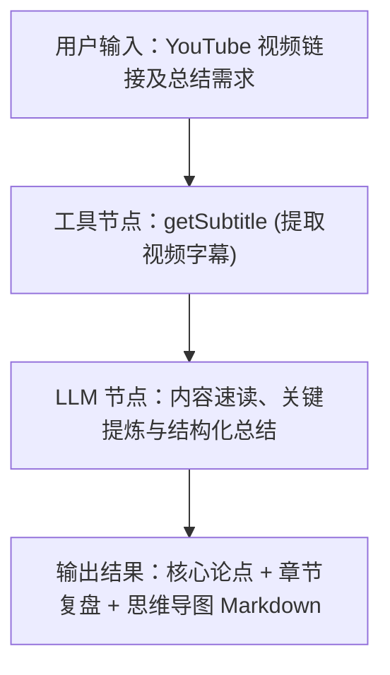

# YouTube 视频与字幕工具集 (YouTube Tools)

YouTube 视频与字幕工具集是专为 FastGPT 设计的视频内容解析与字幕提取套件（Tool Suite）。该工具集直接解析 YouTube 原生字幕轨道（包括创作者上传的人工字幕与 YouTube 官方自动语音识别 ASR 轨道），无需申请或配置任何 Google Cloud 或 YouTube Data API 密钥。工具内置视频链接解析、多语言选择、字幕清洗与格式化能力，将长视频、演讲与播客等音视频内容快速转化为整洁的自然语言文本，赋予 AI Agent 强大的音视频知识理解、跨语言速读与 RAG 问答能力。

---

## 核心优势与应用场景

### 核心优势

- **免 API Key 与零门槛配置**：无需申请 Google Cloud 开发者账号，无需创建 GCP 工程或配置 YouTube Data API v3 密钥与配额，开箱即用。
- **宽容的视频链接与 ID 兼容**：原生支持全类型 YouTube URL 格式（包括标准网页链接、短链接、嵌入链接等）以及 11 位纯视频 ID，自适应提取核心标识符。
- **多语言字幕覆盖与容错回退**：内置包括中、英、日、韩、西、法、德等在内的国际常用语言枚举代码；支持指定偏好语言，并在目标语言不可用时进行容错处理。
- **专为大模型（LLM）清洗规整**：自动剥离原生字幕报文中的 HTML/XML 格式化标签、无用控制字符与杂乱时间码，输出按段落组织的高密度纯净文本，大幅节省提示词 Token。

### 典型应用场景

- **长视频/访谈速读与核心观点提炼**：面对动辄 1~3 小时的技术播客、行业深度访谈、企业财报电话会或新品发布会，快速提取全量文本并由大语言模型提炼核心论点、金句与关键共识。
- **公开课与学术演讲网课字幕转文字**：解析高校公开课（如 Stanford、MIT、CS50）、学术会议录像（如 NeurIPS、ICLR）或技术 Tutorial，自动生成章节大纲、学习笔记与复习要点。
- **海外多语言视频内容跨语言翻译总结**：一键提取外语（如英语、日语、德语等）视频字幕，配合下游翻译大模型进行跨语种深度摘要与对照阅读，消除跨文化跨语言的信息获取鸿沟。
- **视频知识库 RAG 问答与事实依据溯源**：将海量专业教学或产品演示视频解析为文本切片，导入 FastGPT 知识库，配合问答溯源定位视频核心讲解片段，提升知识库的时效性与事实准确率。

---

## 免 Key 与服务特性说明

本插件通过轻量化网络服务直接解析公开 YouTube 视频的字幕轨道：

- **零配置开箱即用**：在 FastGPT 中导入或使用本插件时，不需要在“密钥（Secrets）”中填写任何 API Key 或鉴权凭证。
- **避免配额瓶颈**：传统的 YouTube Data API v3 存在每日 10,000 点配额限制（每次调用消耗大量 quota），而本插件基于公开字幕轨道解析，不受 GCP API 配额限流困扰。

---

## 子工具列表

本工具集目前包含以下专业子工具：

| 子工具 ID | 子工具名称 | 功能说明 |
| :--- | :--- | :--- |
| `getSubtitle` | YouTube 字幕获取 | 根据视频 URL 或 11 位视频 ID 提取字幕内容，支持指定多语言并格式化输出纯净文本 |

---

## 子工具输入参数与输出结果说明

### YouTube 字幕获取 (`getSubtitle`)

提取指定 YouTube 视频的字幕文本内容，支持传入完整视频链接或直接传入 11 位视频 ID，并支持选择期望的目标字幕语言。

#### 输入参数

| 参数名 | 类型 | 必填 | 默认值 | 说明 |
| :--- | :--- | :--- | :--- | :--- |
| `videoUrl` | `string` | 是 | 无 | **YouTube 视频链接或视频 ID**。<br>支持以下格式：<br>• 完整链接：`https://www.youtube.com/watch?v=VIDEO_ID`<br>• 带有其他参数的链接：`https://www.youtube.com/watch?v=VIDEO_ID&t=120s`<br>• 分享短链：`https://youtu.be/VIDEO_ID`<br>• 嵌入播放链接：`https://www.youtube.com/embed/VIDEO_ID`<br>• 旧版播放链接：`https://www.youtube.com/v/VIDEO_ID`<br>• 11 位纯视频 ID：例如 `s3iM7VslPsQ` |
| `lang` | `string` | 否 | `zh-CN` | **字幕语言代码**。<br>支持的语言枚举值：<br>• `en`：英语 (English)<br>• `zh-CN`：简体中文 (Simplified Chinese)<br>• `zh-TW`：繁体中文 (Traditional Chinese)<br>• `ja`：日语 (Japanese)<br>• `ko`：韩语 (Korean)<br>• `es`：西班牙语 (Spanish)<br>• `fr`：法语 (French)<br>• `de`：德语 (German)<br>• `ru`：俄语 (Russian)<br>• `ar`：阿拉伯语 (Arabic)<br><br>*注：视频可能未包含所选语言的字幕轨道。若指定语言不可用，底层可能默认回退至英语等可用字幕，或在完全不可用时返回错误。* |

#### 输出结果

| 字段名 | 类型 | 说明 |
| :--- | :--- | :--- |
| `subtitle` | `string` | **格式化后的字幕文本正文**。已去除 HTML/XML 标签（如 `<font>` 等），每行一句，干净紧凑，便于下游大模型处理。 |
| `videoId` | `string` | **YouTube 视频唯一标识符**（解析后的 11 位字符视频 ID）。 |

#### 调用与返回示例

**输入示例 1（通过完整 URL 提取英文字幕）：**

```json
{
  "videoUrl": "https://www.youtube.com/watch?v=s3iM7VslPsQ",
  "lang": "en"
}
```

**输入示例 2（通过纯视频 ID 提取简体中文字幕）：**

```json
{
  "videoUrl": "s3iM7VslPsQ",
  "lang": "zh-CN"
}
```

**成功输出示例：**

```json
{
  "videoId": "s3iM7VslPsQ",
  "subtitle": "Welcome to this tutorial.\nIn this video, we will explore the core concepts of artificial intelligence and large language models.\nFirst, let us examine how transformers process attention mechanisms across input tokens.\nAs you can see on the screen, each layer refines the contextual embeddings.\nNext, we will demonstrate practical workflow orchestration with structured outputs.\nThank you for watching, and remember to subscribe for more insights."
}
```

---

## 典型工作流编排示例

在 FastGPT 高级编排中，结合 `getSubtitle` 工具节点与大语言模型节点，可快速搭建**“YouTube 长视频速读、思维导图与章节总结”**自动化工作流。

### 工作流流程示意



### 编排步骤详解

1. **用户输入**：用户在聊天界面发送 YouTube 视频链接（如访谈、技术演讲或公开课视频），并可附带个性化分析要求。
2. **字幕提取（`getSubtitle` 工具节点）**：
   - 将用户的输入视频链接连线至 `videoUrl` 参数。
   - 配置目标语言 `lang`（如 `zh-CN` 或 `en`）。
   - 工具自动解析视频 ID 并抓取字幕纯文本。
3. **大模型提炼（LLM 节点）**：
   - 接收 `getSubtitle` 节点输出的 `{{subtitle}}` 与 `{{videoId}}`。
   - 结合提示词模板，指导大模型执行语义归纳、时间线梳理与核心见解提炼。
4. **格式化输出**：向用户展示结构清晰的 Markdown 研报与思维导图文本。

### LLM 提示词模板参考

```text
你是一名顶级内容分析师与知识整理专家。请根据以下提取自 YouTube 视频（视频 ID: {{getSubtitle.videoId}}）的字幕文本，为读者撰写一份结构严谨、层次分明的高质量深度解读总结。

【视频字幕文本】
{{getSubtitle.subtitle}}

【输出要求】
1. 💡 **一句话核心主旨**：用 1-2 句话概括本视频探讨的核心议题与关键结论。
2. 🎯 **核心亮点与关键论据**（提炼 3-5 个最重要的观点）：
   - 每个观点包含：核心观点陈述 + 视频中的论据或案例支撑 + 实际启发。
3. ⏱️ **内容章节结构梳理**：
   - 根据字幕叙事逻辑划分 3-5 个阶段性篇章。
   - 梳理每个篇章的核心讨论要点。
4. 🧠 **思维导图概要**：
   - 以 Markdown 无序列表层级树形式输出思维导图大纲，便于读者一览全局。

请保持客观专业、逻辑缜密，避免泛泛而谈的废话；专业技术术语请保留规范英文或附带中文注释。
```

---

## 注意事项

1. **字幕轨道可用性**：
   - 本工具依赖 YouTube 视频本身存在公开的字幕轨道（包含创作者人工上传的字幕，或 YouTube 官方自动生成的 ASR 语音字幕）。
   - 若视频上传者未上传字幕，且 YouTube 未对该视频生成自动字幕（例如新上传视频尚未完成识别、无有效音频人声、背景杂音过大或语言不支持），则会返回无法获取字幕的错误提示。
2. **网络连通性要求**：
   - 工具直接请求 YouTube 平台数据，部署 FastGPT 的运行环境（Self-hosted Server 或 Plugin Runner）必须具备访问 YouTube 的稳定国际网络环境。若宿主机网络处于受限网络区域且未配置代理，可能出现网络请求超时或连接失败（如 `fetch failed`）。
3. **视频可见性与版权保护限制**：
   - 仅支持公开（Public）或未列出（Unlisted）的正常状态视频。
   - 私密视频（Private）、被版权方锁区限制播放的视频、需要付费会员或强制登录年龄验证的限制视频，无法直接提取字幕。
4. **文本长度与上下文 Token 管理**：
   - 极长视频（如 2 小时以上的完整大会直播或长音频访谈）提取出的字幕可能超过数万字。当下游衔接 LLM 节点时，请确保所选大模型具备足够的上下文窗口（建议使用 64k/128k+ 上下文模型，如 Claude 3.5、GPT-4o、DeepSeek-V3 等），必要时可在下游配合文本分块或滚动摘要节点使用。

---

## 本地开发与测试

如需对本工具集进行二次开发或本地验证，可使用以下命令：

```bash
# 安装依赖
pnpm install

# 运行单元测试
pnpm test

# 构建产物
pnpm build

# 校验插件规范与产物完整性
npx @fastgpt-plugin/cli check --entry .
```

